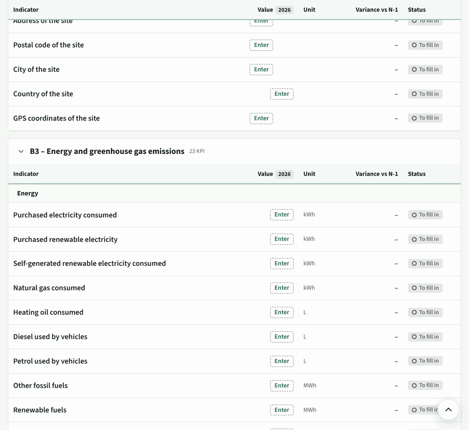

# Probant

Probant is a web tool to collect key performance indicators (KPIs) from many organisations, check them, and get them
ready for an audit. You set it up yourself, in the tool, for any department: sustainability, human resources,
quality, finance, or any other reporting.



## What Probant does

- **Frameworks and KPIs that you configure.** Numbers, percentages, amounts, yes / no answers, lists, tables and
  written answers in Markdown. Formulas, units and tree levels (group, country, entity, site, or your own levels).
- **Campaigns by period.** Year, half-year, quarter or month, with opening and closing dates and email reminders.
- **Data entry with evidence.** Each value has an owner, its evidence (PDF, JPG or PNG), a status and a full history.
- **Validation and consistency checks.** Contributors validate their entry, validators review their scope, and the
  tool shows the values that need a check.
- **Totals that you can trust.** The tool adds up the values in the tree, calculates the formulas, and compares
  each value with the previous period.
- **Audit support.** The auditor role reads everything (values, evidence, history, comments, sign-in history) and
  changes nothing.
- **Excel in and out.** Import values and frameworks from Excel or CSV files, and export readable workbooks.
- **Ready-made templates.** The library includes the Voluntary Standard VS (formerly VSME), the EU pay
  transparency directive, and the revised ESRS (one template for each standard: ESRS 2, E1 to E5, S1 to S4, G1).
- **Several departments in one installation.** Each department works in its own space.


There are five roles: administrator, validator, contributor, reader and auditor. Readers and auditors never change
anything. A guide for each role is in [`docs/guides/`](docs/guides/README.md), and in the tool with the **Help** icon.
The rules that the tool follows to calculate totals and formulas, and to accept an entry, are in
[`docs/calculation_rules.md`](docs/calculation_rules.md).

## What is new in version 1.1

For IT teams: installation in one command, signed image and installation files, installation without Internet
access, company certificates, and sign-in with the company account (OpenID Connect). For small teams: emails set in
the tool, email alerts, automatic updates, and an external copy of the backups. See [`CHANGELOG.md`](CHANGELOG.md).

## Try Probant in 5 minutes

You need a computer with [Docker](https://docs.docker.com/get-docker/) and Docker Compose v2.24 or later.

1. Get the code and start the tool:

   ```bash
   git clone https://github.com/Probant-Reporting/probant.git
   cd probant
   ./install.sh
   ```

2. Load the demo. The demo is Exemplia, a fictitious packaging manufacturer with 11 sites in three countries (20 organisations in all: the group, 3 countries,
   5 subsidiaries and the 11 sites):

   ```bash
   docker compose exec web python manage.py load_demo
   ```

3. Open `http://localhost:8000` and sign in with the account `admin` and the password `demo-probant-2026`.

To try an empty tool instead, with your own structure, skip step 2: when you open `http://localhost:8000`, the
**Setup** wizard opens and its first step creates your administrator account.

The demo has two closed years (2024 and 2025) and one open year (2026). Besides the Voluntary Standard VS, it installs the
eleven ESRS templates of the library, with no value and in no campaign: they show as installed in the library and in the
settings, ready to be put in a campaign. The other demo accounts are `validateur`,
`contributeur`, `lecteur` and `auditeur`, with the same password. Use the demo only for a trial: do not keep it on a
server that other people can reach.

The demo follows the language of the installation (`DEFAULT_LANGUAGE`, English by default): the tool, the demo accounts and the
demo texts open in that language. The demo exists in the seven languages of the interface. To load it in another one, add
`--language`, for example `python manage.py load_demo --language de`. Each person changes the language of the menus,
buttons and contents in **My account**. The names of the fictitious company, its sites and its people are not translated.
The model of the standard (the names of its indicators) is translated, its long descriptions and official lists stay in English.

## Install Probant

On a Linux server, one command installs the tool with the published image, in about 2 minutes, without Git. If Docker
is missing on Debian or Ubuntu, the command offers to install it:

```bash
curl -fsSL https://github.com/Probant-Reporting/probant/raw/main/get.sh | sudo sh
```

To check the server first, without any change, add `--check` (after `sh -s --`). To read the script before you run
it, download it first, then run `sudo sh get.sh`. For HTTPS with a domain name, add `--domain reporting.example.com`
(after `sh -s --` in the command above). The command checks each file against the signed list of the release, and
sets up the automatic updates (`--auto-update off` to install without them).

The installation guide tells you, step by step, how to install the tool on a server with Docker, set up HTTPS and
emails, back up and restore: [`docs/installation.md`](docs/installation.md). French version:
[`docs/fr/installation.md`](docs/fr/installation.md).

To install without a server of your own, on Clever Cloud, see [`docs/managed_hosting.md`](docs/managed_hosting.md).
For a server without Internet access, the guide describes the offline package of each release. To move the data of
the all-in-one version (Windows, Mac) to a server, see [`docs/from_pc_to_server.md`](docs/from_pc_to_server.md).

People can sign in with their company account, through OpenID Connect: see
[`docs/single_sign_on.md`](docs/single_sign_on.md). It is off by default, and the accounts stay managed in the tool.

Before the installation, give your IT team [`docs/it_request.md`](docs/it_request.md) (what to prepare), and your
security team [`docs/security_overview.md`](docs/security_overview.md) (architecture, data, network flows, and a
security questionnaire).

A new installation is empty. When you first open the tool, the **Setup** wizard asks you to create the administrator
account. Do it right after the installation, before you share the address of the tool. To evaluate the tool with the
demo first, load it before that step: the guide says how, and how to start empty afterwards.

## Update Probant

To update an installation, run `./update.sh` in the folder of the tool. After an installation with one command, it
installs the latest published version, and a timer of the server can install each new version at night, with a
backup first and a way back if the new version does not start. The script backs up each space first, then the
tool applies the changes to the database when it starts. You can update from any published version directly. The changes of each version are in
[`CHANGELOG.md`](CHANGELOG.md).

## Languages

The interface is available in seven languages: English, French, Spanish, German, Italian, Dutch and Portuguese. Each
person chooses their language. To add or correct a language, see [`docs/translation.md`](docs/translation.md).

## AI assistants (optional)

- An AI assistant (for example Claude) can read and change data with the rights of the person who connects it. An
  administrator turns this on for a space. See [`docs/mcp.md`](docs/mcp.md).
- An optional AI assistant can explain a value or suggest a text. It is off by default and uses the key of your
  organisation. See [`docs/ai_socket.md`](docs/ai_socket.md).

## Security

To report a vulnerability, do not open a public issue. Use GitHub's private vulnerability reporting, as described in
[`SECURITY.md`](SECURITY.md).

## Contributing

You can report a bug by opening an issue. We do not accept pull requests for now. See
[`CONTRIBUTING.md`](CONTRIBUTING.md).

## Licence

Probant is free software under the GNU Affero General Public License, version 3 or any later version
(AGPL-3.0-or-later). See [`LICENSE`](LICENSE).

```
Copyright (C) 2026 Florent Liaigre

This program is free software: you can redistribute it and/or modify it under the terms of the GNU Affero General
Public License as published by the Free Software Foundation, either version 3 of the License,
or (at your option) any later version.

This program is distributed in the hope that it will be useful, but WITHOUT ANY WARRANTY; without even the implied
warranty of MERCHANTABILITY or FITNESS FOR A PARTICULAR PURPOSE. See the GNU Affero General Public License for more
details.
```

Source code: https://github.com/Probant-Reporting/probant. Website: https://probant-reporting.github.io.
The third-party libraries and their licences are listed in
[`docs/third_party_libraries.md`](docs/third_party_libraries.md).
