# Anleitung für Administratoren

Sie richten das Werkzeug ein, steuern die Kampagnen und verfolgen den Ausfüllgrad. Alles, was Sie einstellen können, finden Sie unter **Administration**. Das IT-Team stellt das Hosting, den Domainnamen und das E-Mail-Konto bereit. Englische Version: [`docs/guides/administrator.md`](../../guides/administrator.md).

## Sehen, was zuerst zu tun ist {#overview}

1. Klicken Sie in der oberen Leiste auf **Administration**. Die Seite **Überblick** wird geöffnet.
2. Lesen Sie die Liste **Zu bearbeiten**, das Dringendste zuerst. Jede Zeile hat einen eigenen Link.
3. Klicken Sie auf **Wofür jeder Abschnitt da ist**, wenn Sie eine Erinnerung an die Register brauchen.

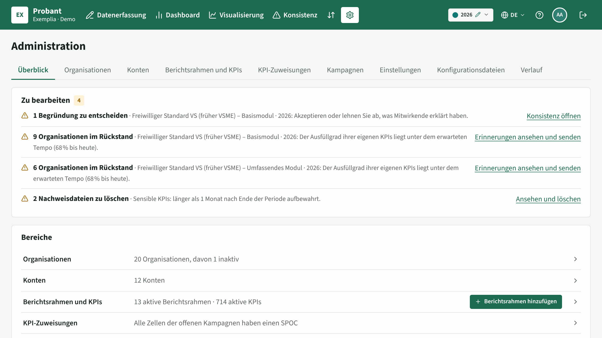

## Eine neue Installation einrichten {#setup}

Beim ersten Start öffnet sich ein Assistent mit 8 Schritten. Er beginnt mit Ihrem eigenen Administratorkonto.

1. Geben Sie das Konto, die Organisation und die Sprachen ein.
2. Wählen Sie einen Berichtsrahmen aus der Bibliothek oder stellen Sie einen eigenen zusammen.
3. Fügen Sie das Team hinzu und legen Sie die erste Kampagne an.

Wenn Sie den Assistenten verlassen, klicken Sie auf **Administration › Einstellungen › Einrichtung fortsetzen**, um weiterzumachen.

## Einen Berichtsrahmen hinzufügen {#framework}

1. Klicken Sie in der oberen Leiste auf **Administration**. Klicken Sie im **Überblick** in der Zeile **Berichtsrahmen und KPIs** auf **Berichtsrahmen hinzufügen**.
2. Wählen Sie **Aus der Bibliothek installieren**, **Aus vorhandenen KPIs zusammenstellen** oder **Datei importieren**.
3. Öffnen Sie das Register **Inhalt** des Berichtsrahmens, um die Themen und die KPIs zu ordnen.

Das KPI-Blatt legt den Antworttyp, die Einheit, die Formel und die Nachweispflicht fest. Wählen Sie für einen sensiblen KPI unter **Vertraulichkeit** „Eingeschränkt“ oder „Vertraulich“.

Sobald ein KPI einen gespeicherten oder importierten Wert hat, lässt sich seine Einheit nicht mehr ändern, ebenso wenig wie sein Format. Das Werkzeug sagt es beim Speichern. Behalten Sie die Einheit, oder legen Sie einen neuen KPI in der gewünschten Einheit an. Um die alten Werte zu übernehmen, exportieren Sie sie, wandeln Sie sie in der Datei um und importieren Sie sie dann in den neuen KPI.

Ein abgeschlossenes Berichtsjahr behält seine KPI-Liste. Um eine KPI auch zu früheren Berichtsjahren hinzuzufügen, setzen Sie ihre Periode **Angefordert seit** (siehe nächsten Abschnitt).

## Festlegen, seit wann eine KPI angefordert wird {#requested-since}

Jede KPI eines Berichtsrahmens hat eine Periode **Angefordert seit**: das erste Berichtsjahr oder die erste Periode, in der der Berichtsrahmen sie anfordert. Wenn Sie eine KPI anlegen, fragt das Tool „Auch zu früheren Berichtsjahren hinzufügen?“. Standardmäßig wird die KPI ab der laufenden Periode angefordert, und kein vergangenes Berichtsjahr ändert sich.

1. Gehen Sie zu **Administration › Berichtsrahmen und KPIs**, öffnen Sie den Berichtsrahmen und dann das Register **Inhalt**.
2. Lesen Sie die Periode am Ende jeder Zeile. „Von Anfang an“ bedeutet, dass die KPI schon vor dieser Einstellung da war.
3. Wählen Sie eine oder mehrere KPIs aus, oder klicken Sie auf die Periode einer Zeile. Wählen Sie in der Aktionsleiste die Periode unter **Angefordert seit**.
4. Klicken Sie auf **Anwenden**. Das Tool zeigt, welche Berichtsjahre sich ändern und wie viele Felder hinzukommen. Bestätigen Sie zum Speichern.

Ein abgeschlossenes Berichtsjahr ändert sich nicht, solange es abgeschlossen ist: kein neues Feld, keine neue Summe, derselbe Ausfüllgrad. Die KPI erscheint, wenn Sie das Berichtsjahr erneut öffnen, in beiden Modi, und bleibt beim nächsten Abschluss. Ein bereits erneut geöffnetes Berichtsjahr erhält die Felder sofort.

Sie können die Periode nicht nach hinten verschieben, wenn ein Berichtsjahr, das die KPI verliert, abgeschlossen ist oder dafür einen Wert, ein N/A, einen Kommentar oder einen Nachweis hat. Sind seine Felder leer, bittet das Tool um Bestätigung. Der Verlauf hält jede Änderung fest. Wird eine berechnete KPI vor einer ihrer Quellen angefordert, warnt das Tool: Die Quelle hat ab derselben Periode Felder.

## Die Währung der Beträge wählen {#currency}

Die Bibliotheksvorlagen schreiben ihre Beträge in Euro. Wenn Ihr Abschluss eine andere Währung verwendet, stellen Sie sie ein, bevor Sie eine Vorlage installieren:

1. Gehen Sie zu **Administration › Berichtsrahmen und KPIs › Einheiten und Formate**.
2. Wählen Sie unter **Referenzwährung** die Währung und klicken Sie auf **Speichern**.

Wenn Sie eine Bibliotheksvorlage installieren oder aktualisieren, übernehmen ihre Beträge diese Währung: Aus „€“ wird „$“, aus „M€“ wird „M$“ und aus „€/h“ wird „$/h“. Die Installationsseiten zeigen die Währung. Eine KPI, die im Bereich bereits existiert, behält ihre Einheit, mit oder ohne Werte; nur die neuen KPIs übernehmen die Währung.

Das Tool rechnet keine Werte um und verwendet keine Wechselkurse. Wenn Sie die Währung später ändern, behalten die vorhandenen KPIs ihre Einheit, und die Seite zählt die KPIs, deren Einheit in einer anderen Währung ist. Die offizielle EFRAG-Arbeitsmappe verwendet die Referenzwährung als Berichtswährung. Sie lässt einen Betrag leer, dessen Einheit in einer anderen Währung ist, und der Exportbericht nennt ihn.

Jeder Bereich hat seine eigene Referenzwährung. Ein neuer Bereich beginnt mit dem Euro.

## Die Organisationen hinzufügen {#organisations}

1. Gehen Sie zu **Administration › Organisationen**.
2. Klicken Sie auf **Neue Organisation**, wählen Sie die übergeordnete Organisation und klicken Sie auf **Organisation anlegen**.
3. Für einen Standort, der im Laufe eines Jahres öffnet, tragen Sie sein Datum unter **Geöffnet seit** ein. Der Standort zählt in den Summen mit, und für ihn werden Werte verlangt, nur für die Perioden, die an diesem Datum oder danach enden. Bleibt das Feld leer, gilt der Standort als schon immer geöffnet. Wenn Sie mehrere Organisationen einfügen, schreiben Sie das Datum in eckigen Klammern: „Lyon [2026-03-01]“.

Die Ebenen der Struktur (zum Beispiel Konzern, Land, Tochtergesellschaft, Standort) stellen Sie unter **Administration › Einstellungen › Ebenen der Struktur** ein.

Auf dieser Seite und unter **Einheiten und Formate** erscheinen die Namen der Ebenen und der Einheiten in Ihrer Sprache. Die Felder, in die Sie schreiben, behalten die Referenzsprache der Installation, und die Beschriftung nennt sie (zum Beispiel „Name (Referenzsprache: Français)“). Die Übersetzung in Ihre Sprache steht neben dem Feld. Um sie zu ändern, nutzen Sie **Einstellungen › Sprachen**.

Eine Organisation öffnet nie vor der übergeordneten Organisation: Es zählt das späteste Datum aus ihrem eigenen und denen der Organisationen darüber. Würde eine Änderung des Datums oder der übergeordneten Organisation Werte aus den Summen nehmen, zählt das Blatt sie, die der Organisationen darunter eingeschlossen, und verlangt eine Bestätigung. Ein Wert für eine Organisation, die in der Periode noch nicht geöffnet ist, wird auf dem Bildschirm, beim Import und über einen Assistenten abgelehnt. Die Meldung verweist auf das Blatt, das das Datum trägt.

## Die Konten anlegen {#accounts}

1. Gehen Sie zu **Administration › Konten**.
2. Klicken Sie auf **Neues Konto** oder auf **Mehrere Konten**, um viele auf einmal anzulegen.
3. Geben Sie die E-Mail-Adresse und den Namen ein und wählen Sie die **Rolle**: Administrator, Validator, Mitwirkender, Leser oder Auditor.
4. Klicken Sie auf **Konto anlegen**. Senden Sie das vorläufige Passwort an die Person.

Um ein neues vorläufiges Passwort zu vergeben, öffnen Sie das Konto und klicken Sie auf **Passwort zurücksetzen**. Die Person wählt bei der ersten Anmeldung ihr eigenes Passwort.

Ein Leser oder ein Auditor erfasst und validiert nichts. Wenn Sie die Rolle eines Kontos auf eine dieser beiden ändern, zeigt das Werkzeug, wie viele Zuweisungen es entfernt, und verlangt vor dem Speichern eine Bestätigung. Es entfernt sie, mit einer Zeile im Verlauf. Die frühere Rolle zurückzugeben stellt sie nicht wieder her. Um sie stattdessen einer anderen Person zu geben, nutzen Sie zuerst **Person ersetzen …**. Um sie später wieder zu vergeben, nutzen Sie **KPI-Zuweisungen** (Auswahl **Validatoren** für Zuweisungen als Validator).

**Zu bearbeiten** listet die Konten auf, die vor dieser Regel schreibgeschützt wurden und noch Zuweisungen haben. Klicken Sie auf **Prüfen** und dann in einer Zeile auf **Entfernen**. Ein deaktiviertes Konto behält seine Zuweisungen, bis Sie **Person ersetzen …** verwenden.

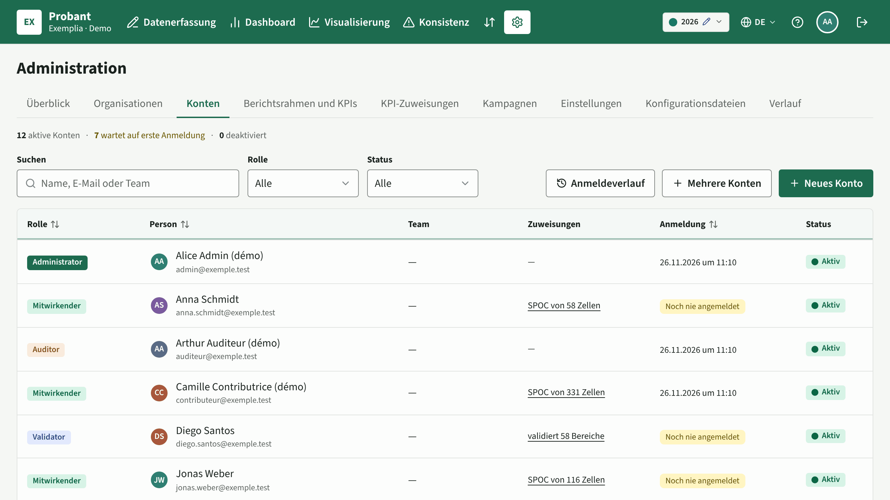

Um zu sehen, wer sich wann angemeldet hat, klicken Sie unter **Administration › Konten** auf **Anmeldeverlauf**. Jede Zeile zeigt das Datum, das Konto und das Ergebnis: **Erfolgreich**, **Fehlgeschlagen** oder **Gesperrt: zu viele Versuche**. Ein Benutzername, der zu keinem Konto des Bereichs passt, erscheint nur mit einer Referenz, nie mit dem eingegebenen Text. Filtern Sie nach Ergebnis oder Zeitraum, oder suchen Sie einen Namen. Wie lange das Tool den Verlauf aufbewahrt, stellen Sie unter **Administration › Einstellungen › Hosting** ein (standardmäßig 180 Tage).

## Die KPIs zuweisen {#assign}

Jede Zelle des Rasters ist ein KPI für eine Organisation. Die Ansprechperson (SPOC) ist die Person, die ihn erfasst.

1. Gehen Sie zu **Administration › KPI-Zuweisungen**.
2. Klicken Sie auf eine Zelle und wählen Sie eine oder mehrere Personen. Sie können auch eine Zeile oder eine Spalte auswählen und dann auf **Zuweisen** klicken.
3. Klicken Sie auf **Person ersetzen …**, wenn jemand ausscheidet.
4. Wählen Sie **Nur die zu vervollständigenden Zeilen** aus, um zu sehen, was fehlt.

Um die Validatoren zu wählen, wählen Sie **Validatoren** in der Liste **Rolle**. Eine Validator-Zuweisung gilt für einen KPI in einer Organisation und in allen Organisationen darunter: Das Raster hat dann einen Reiter pro Organisationsebene, mit den KPIs, die auf dieser Ebene oder darunter erfasst werden. Eine Zelle mit „über …“ ist bereits durch den Validator einer Organisation darüber abgedeckt. Nur aktive Validatoren und Administratoren werden angeboten. Eine Zelle ohne Validator validieren die Administratoren. Jede vergebene oder entfernte Zuweisung schreibt eine Zeile in den Verlauf.

Bei einer großen Gruppe zeigt das Raster jeweils eine Gruppe von Organisationen. Wählen Sie die Gruppe in der Liste **Organisationen** über dem Raster. Die Filter und das gesammelte Speichern gelten für die angezeigte Gruppe. **Alle (langsam bei einer großen Gruppe)** zeigt alles an, aber das Werkzeug merkt sich diese Auswahl nicht.

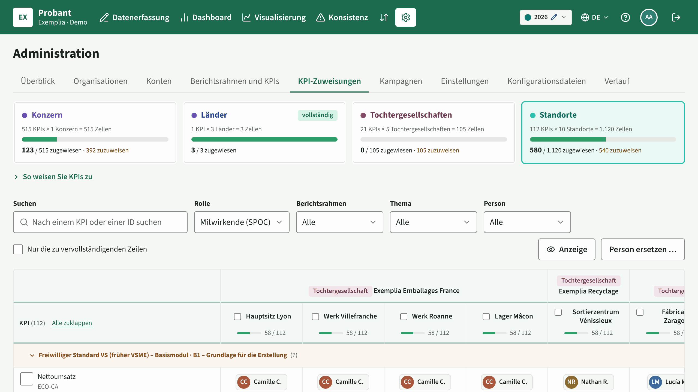

## Eine Kampagne öffnen, prüfen, abschließen und erneut öffnen {#campaign}

1. Gehen Sie zu **Administration › Kampagnen** und klicken Sie in der Zeile des Berichtsrahmens auf **Neue Kampagne**.
2. Wählen Sie die Periode, legen Sie die Daten und den **Schwellenwert für Abweichungen** fest und klicken Sie auf **Kampagne anlegen**.
3. Klicken Sie bei einer Kampagne auf **Verwalten**. Verwenden Sie **Datenerfassung öffnen**, **Prüfung starten** oder **Endgültig abschließen**.
4. Um eine abgeschlossene Kampagne zu ändern, klicken Sie auf **Für Mitwirkende wieder öffnen** oder **Zur Korrektur wieder öffnen (Prüfung)**. Der Verlauf hält die Wiedereröffnung fest.
5. Wenn Sie ein abgeschlossenes Jahr wieder öffnen, wählen Sie zuerst:
   - **Die damaligen Zahlen behalten** (standardmäßig ausgewählt): Nichts wird neu berechnet. Nur eine Organisation, bei der Sie einen Wert korrigieren, und die Summen darüber werden neu berechnet. Beispiel: Eine Organisation, die inzwischen einem anderen Land zugeordnet wurde, bleibt in den Summen ihres früheren Landes.
   - **Mit der heutigen Organisation neu berechnen**: Alle Summen des Jahres werden mit der heutigen Struktur und den heutigen Formeln neu berechnet. Beispiel: Die verschobene Organisation bringt ihre Werte in die Summen ihres neuen Landes.

   Ein Jahr, das mit den damaligen Zahlen wieder geöffnet wird, behält die Organisationsstruktur seines Abschlusses: Eine Korrektur wird mit den damaligen übergeordneten Organisationen neu berechnet, und eine seitdem angelegte Organisation hat in diesem Jahr kein Feld. Ihre Wahl gilt bis zum nächsten Abschluss.

   Hat ein Jahr zwei Kampagnen (zwei Berichtsrahmen) und ist eine davon abgeschlossen, behalten die KPIs, die die abgeschlossene Kampagne abfragt, ihre Zahlen, bis auch die andere Kampagne abgeschlossen ist: Eine Änderung der Organisationen oder **Berechnungen neu ausführen** ändert sie nicht mehr, und sie behalten die Organisationsstruktur vom Tag des Abschlusses. Ein KPI, der zu beiden Kampagnen gehört, behält ebenfalls seine Zahlen. Nur eine in die abgeschlossene Kampagne importierte Korrektur berechnet die korrigierte Organisation und ihre Summen neu. Mit **Mit der heutigen Organisation neu berechnen** behalten die KPIs einer anderen, weiterhin abgeschlossenen Kampagne des Jahres ihre Zahlen.

Eine abgeschlossene Kampagne ist für alle eingefroren, auch für Administratoren. Ihre Werte werden zum Vorjahr (N-1) der nächsten Kampagne. **Berechnungen neu ausführen** ist selten nötig.

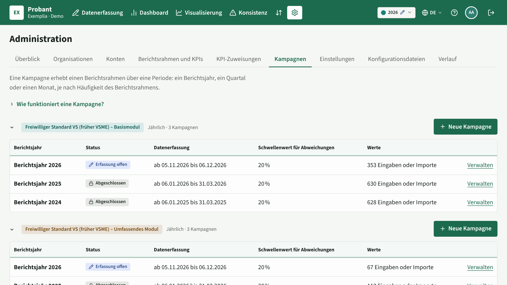

## Werte erfassen und prüfen {#entry}

**Datenerfassung** listet die Felder der offenen Kampagne nach Organisation und KPI auf. Sie sehen alle und können in jedem Feld einen Wert erfassen oder korrigieren. Suchen Sie mit den Filtern ein KPI, eine Organisation oder einen Status und klicken Sie auf ein Feld, um sein Fenster zu öffnen.

## Eine validierte Erfassung wieder öffnen {#reopen}

1. Gehen Sie zu **Datenerfassung** und öffnen Sie die Zeile des Werts.
2. Klicken Sie auf **Zurück zum Entwurf**. Der Wert bleibt gleich.
3. Der Mitwirkende ändert ihn und validiert ihn erneut.

**Wert löschen** leert stattdessen die Zelle. Beide Aktionen stehen im Verlauf.

## Ein KPI, den eine abgeschlossene Kampagne sperrt {#shared-closed}

Ein KPI kann zu zwei Berichtsrahmen mit derselben Periode gehören. Sein Wert ist gemeinsam. Ist eine Kampagne abgeschlossen, kann niemand den Wert in der anderen ändern, auch Sie nicht. Das Bedienfeld nennt die abgeschlossene Kampagne.

1. Öffnen Sie die abgeschlossene Kampagne wieder: Klicken Sie auf **Verwalten** und dann auf **Zur Korrektur wieder öffnen (Prüfung)**.
2. Ändern Sie den Wert im Erfassungsfeld.
3. Schließen Sie die Kampagne wieder ab.

## Erinnerungen senden {#reminders}

1. Klicken Sie im **Dashboard** auf **Erinnern …** (oder auf **Erinnerung vorbereiten …**, wenn die Installation keine E-Mails versendet). Die Seite **Erinnerungen** wird geöffnet.
2. Wählen Sie die Berichtsrahmen. Das Werkzeug wählt die Personen aus, die noch etwas zu tun haben.
3. Lesen Sie die Vorschau und klicken Sie auf **Erinnerung senden**.

Unter **Nachrichtenvorlage** ändern Sie den Text. Unter **Automatische Erinnerungen** legen Sie die Tage vor dem Ende der Datenerfassung fest. Ohne E-Mail-Konto (SMTP) liefert **Schreiben** den Text, den Sie selbst senden. Klicken Sie danach auf **Als erinnert markieren**.

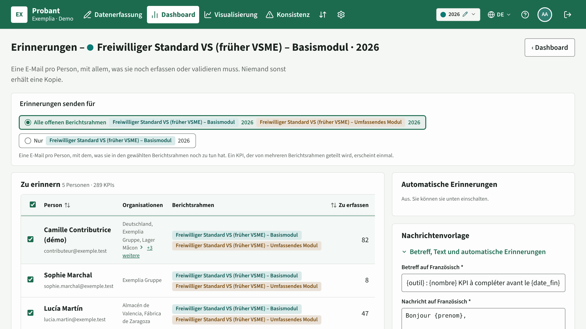

## Das Audit-Dossier abrufen {#audit-file}

Ein Administrator oder ein Auditor kann eine Excel-Datei mit dem herunterladen, was eine Prüfung braucht: für jeden KPI und jede Organisation den Wert, den Status, wer ihn erfasst und validiert hat, die Nachweise, die Plausibilitätshinweise mit ihren Begründungen und den Verlauf der Änderungen. Das Werkzeug liest die Daten nur. Das Erstellen der Datei ändert nichts.

1. Klicken Sie auf **Import / Export** und dann auf **Neuer Export**.
2. Wählen Sie unter **Layout** die Option **Audit-Dossier**. Wählen Sie das Jahr und, wenn Sie nur einige brauchen, die Organisationen.
3. Klicken Sie auf **Herunterladen**.

Die Datei hat vier Blätter: **Lies mich**, **Audit** (eine Zeile je KPI und Organisation), **Verlauf** (jede Änderung dieser Werte, die älteste zuerst) und **Nachweise** (Dateinamen, Größen und wer sie hinzugefügt hat). Das Blatt **Lies mich** nennt das Datum, die Version des Werkzeugs und die Filter. Eine große Datei wird auf dem Server vorbereitet, wie jeder große Export.

Validatoren und Mitwirkende sehen das Audit-Dossier nicht: Es ist für Administratoren und Auditoren. Ein auf einige Organisationen beschränkter Auditor erhält nur diese.

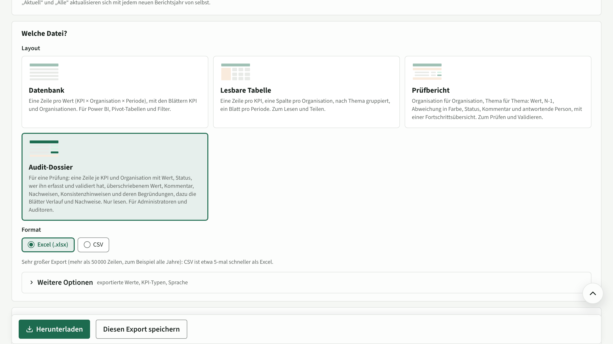

## Das Abschlusszertifikat drucken {#closing-certificate}

Ein Administrator kann eine Seite drucken, die eine abgeschlossene Kampagne zusammenfasst. Das Werkzeug liest die Daten nur. Das Öffnen der Seite ändert nichts.

1. Klicken Sie auf **Administration**, dann auf **Kampagnen** und auf eine abgeschlossene Kampagne.
2. Klicken Sie auf **Abschlusszertifikat**.
3. Klicken Sie auf **Drucken**. Wählen Sie im Druckdialog Als PDF speichern, um eine Datei zu behalten.

Die Seite zeigt den Umfang, den Ausfüllgrad, die Zahl der Werte, die Nachweise und die Konsistenzhinweise. Sie zeigt, wer die Kampagne abgeschlossen hat und wann, wenn der Verlauf es festhält. Der Fingerabdruck ist ein Code, der aus allen Zahlen der Kampagne berechnet wird. Ändert sich eine Zahl, ändert sich der Fingerabdruck. Zum späteren Prüfen öffnen Sie das Zertifikat erneut und vergleichen die beiden Fingerabdrücke.

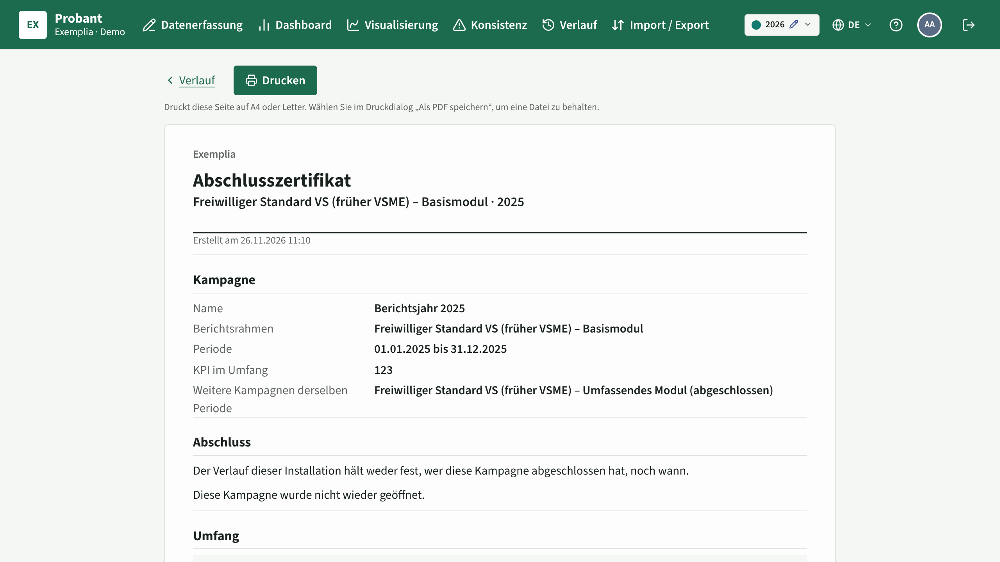

## Einen großen Export abrufen {#large-exports}

Ab einer bestimmten Größe bereitet das Werkzeug einen Export oder eine auszufüllende Datei auf dem Server vor. Öffnen Sie **Import / Export** und wählen Sie **Meine Exporte**. Die Datei steht unter „Große Dateien“. Das Werkzeug bewahrt sie 7 Tage auf.

Ein Administrator legt die Anzahl der Tage unter **Administration › Einstellungen › Hosting** im Block „Große Exporte“ fest.

## Die Nachweise sensibler KPIs löschen {#evidence-delete}

Das Werkzeug bewahrt Nachweisdateien auf. Es löscht sie nie von selbst.

1. Gehen Sie zu **Administration › Einstellungen › Hosting**. Geben Sie unter **Nachweise sensibler KPIs** die Zahl bei **Monate bis zum Löschvorschlag** ein.
2. Klicken Sie auf **Administration › Verlauf** und dann auf **Zu löschende Nachweise**.
3. Die Seite listet die Dateien auf, deren Kampagnen alle abgeschlossen sind und deren Periode vor mehr Monaten endete als diese Zahl.
4. Wählen Sie die Dateien aus und klicken Sie auf **Ausgewählte löschen**. Oder klicken Sie in einer Zeile auf **Löschen**.

Achtung: Das Löschen ist endgültig. Die Datei geht nicht in den Papierkorb. Der Verlauf hält jedes Löschen ohne den Inhalt der Datei fest. Der Wert der Antwort ändert sich nicht.

Früher erstellte Sicherungen enthalten die Datei weiter, bis das Werkzeug sie ersetzt. Eine Wiederherstellung bringt die Datei zurück in **Zu löschende Nachweise**: Löschen Sie sie erneut. Auch die Kopien der Sicherungen, die das IT-Team außerhalb des Werkzeugs aufbewahrt, enthalten die Datei: Bitten Sie das IT-Team, sie zu löschen. Legen Sie unter **Administration › Einstellungen › Hosting** bei **Automatische Sicherung** die Anzahl der aufbewahrten Sicherungen fest, damit alte Sicherungen bald verschwinden.

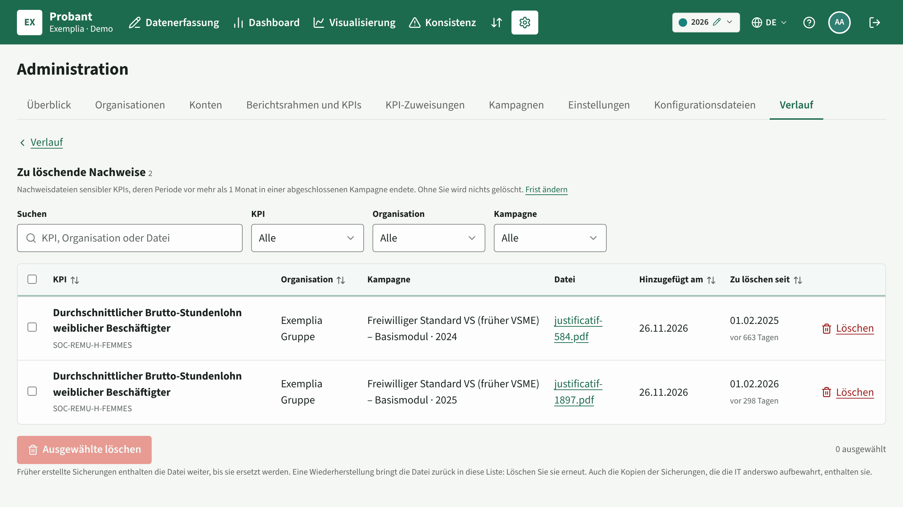

## Eine Sprache hinzufügen oder übersetzen {#languages}

Die Menüs und Schaltflächen gibt es auf Französisch, Englisch, Spanisch, Deutsch, Italienisch, Niederländisch und Portugiesisch. Jede Person wählt ihre Sprache unter **Mein Konto**. Die Namen der KPIs, der Themen und der Einheiten stellen Sie unter **Administration › Einstellungen › Sprachen** ein.

1. Klicken Sie auf **Sprache hinzufügen** oder öffnen Sie eine Sprache und klicken Sie auf **Übersetzen**.
2. Zum gesammelten Übersetzen verwenden Sie **Exportieren** und **Importieren** oder **Alle Sprachen auf einmal übersetzen**.

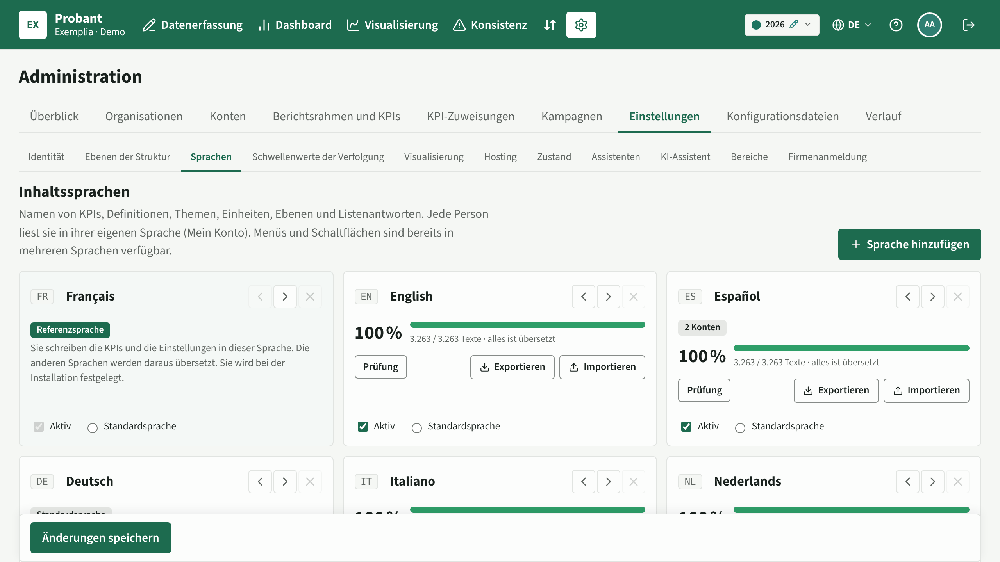

## Einen Assistenten (MCP) verbinden {#assistants}

Ein KI-Assistent, zum Beispiel Claude, kann mit den Rechten der Person, die ihn verbindet, Daten lesen und ändern, nie mehr. Er ist standardmäßig ausgeschaltet.

1. Gehen Sie zu **Administration › Einstellungen › Assistenten**.
2. Wählen Sie **KI-Assistenten (MCP) in diesem Bereich zulassen** aus.
3. Wählen Sie **Assistenten dürfen auch Änderungen vornehmen** nur aus, wenn die Personen es brauchen. Leser und Auditoren ändern nie etwas.
   Stellen Sie unter **Was Assistenten erhalten** ein: **Ein Leser kann Werte über einen Assistenten lesen** (standardmäßig aus) und **Sensible KPIs werden an Assistenten gegeben** (standardmäßig an; ausgeschaltet sind die als Eingeschränkt oder Vertraulich markierten KPIs und die daraus berechneten KPIs für alle Werkzeuge verborgen). Ein Leser erhält nie einen Entwurf, nur validierte Werte.
4. Klicken Sie auf **Speichern**. Geben Sie den Personen die **Serveradresse dieses Bereichs**.

Jede Person erstellt unter **Mein Konto** ein Token. Klicken Sie unter **Aktive Tokens** auf **Widerrufen**, um einen Assistenten sofort zu sperren. Der Verlauf hält jeden Aufruf fest und zeigt nach jeder Änderung „(über MCP)“.

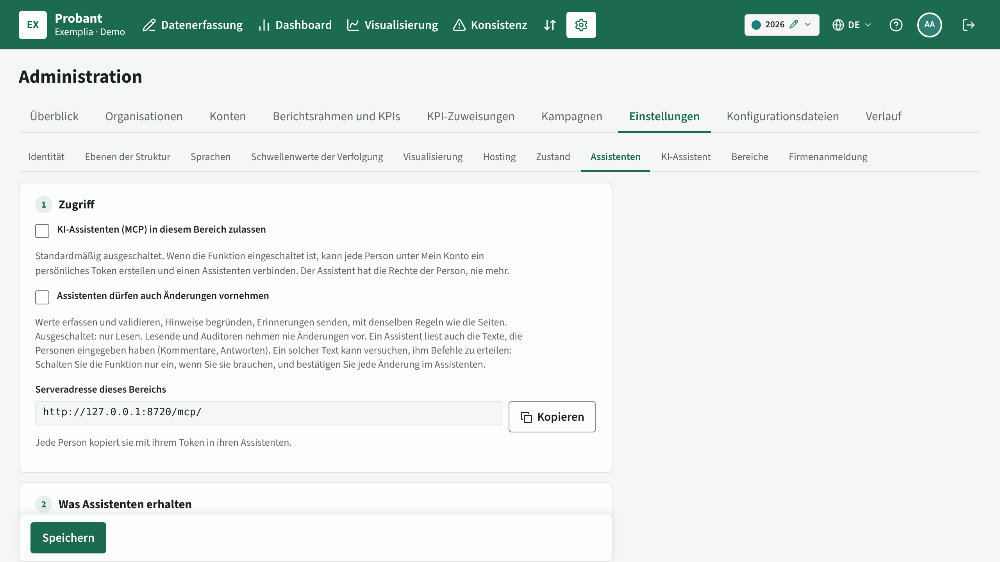

## Den KI-Assistenten einschalten {#ai}

Der KI-Assistent erklärt Konsistenzhinweise, schlägt im Migrationsassistenten KPI-Zuordnungen vor und schlägt Übersetzungen vor. Er ist standardmäßig ausgeschaltet. Nichts verlässt das Werkzeug, bevor Sie ihn einschalten.

1. Gehen Sie zu **Administration › Einstellungen › KI-Assistent**.
2. Wählen Sie **KI-Assistenten einschalten** aus.
3. Wählen Sie den **Anbieter** und das **Modell**.
4. Geben Sie den **API-Schlüssel Ihres Anbieterkontos** ein. Das Werkzeug bewahrt ihn nur für diesen Bereich auf und zeigt ihn nie wieder an. Klicken Sie auf **Schlüssel entfernen**, um ihn zu löschen.
5. Wählen Sie unter **Verwendungen** die gewünschten Verwendungen aus. **Sensible KPIs dürfen an den KI-Assistenten gesendet werden** ist standardmäßig aus: Von einem als eingeschränkt oder vertraulich markierten KPI und von einem daraus berechneten KPI wird nichts gesendet, und seine Warnungen haben kein **Mit KI erklären**. Klicken Sie auf **Speichern**.

Jede Antwort ist ein Vorschlag mit der Kennzeichnung „Von der KI vorgeschlagen“. Nichts wird gespeichert, bis eine Person klickt und wie gewohnt speichert. Der Verlauf hält jeden Aufruf ohne seinen Inhalt fest.

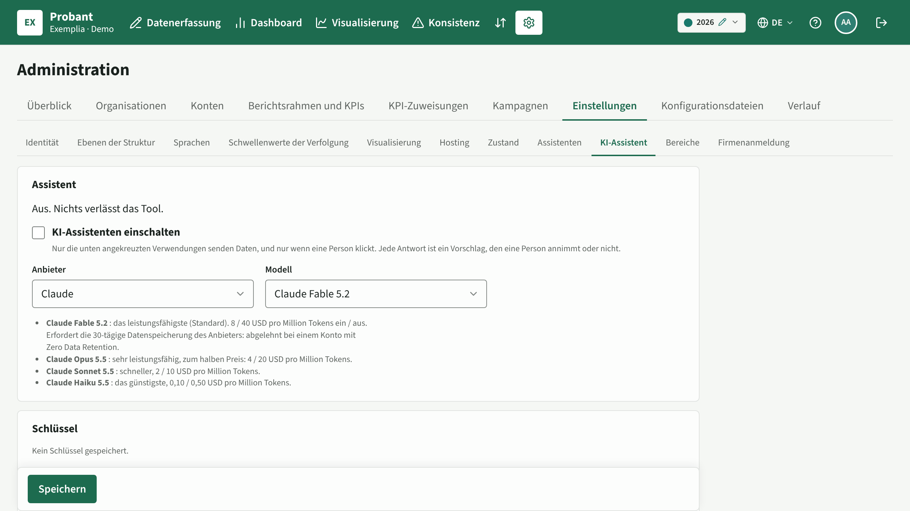

## Hosting und Sicherungen prüfen {#hosting}

Gehen Sie zu **Administration › Einstellungen › Hosting**. Die Seite zeigt die Version, die automatische Sicherung, die Datenprüfung und die E-Mail-Einrichtung. Klicken Sie auf **Sicherung erstellen und herunterladen**, um sofort eine Sicherung zu erstellen. Das IT-Team kopiert die Sicherungen an einen anderen Ort. Oder die Bereichsverwaltung richtet die **Kopie außerhalb des Servers** ein: Das Tool kopiert dann jede Sicherung selbst in einen S3-kompatiblen Speicher oder auf einen SFTP-Server, den das IT-Team bereitstellt, und warnt Sie, wenn eine Kopie fehlschlägt.

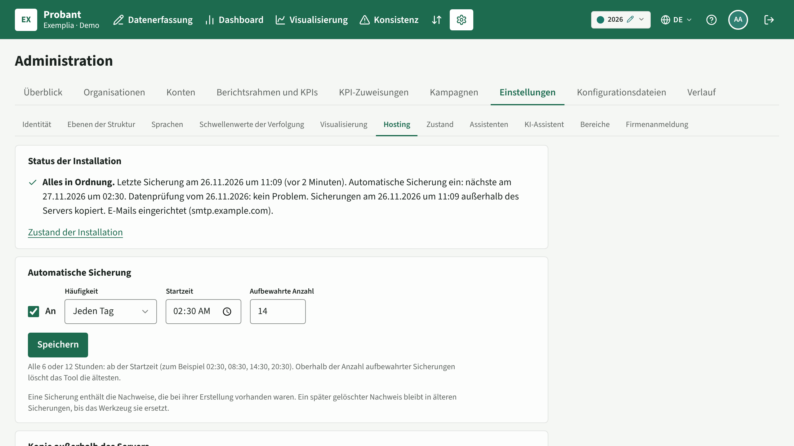

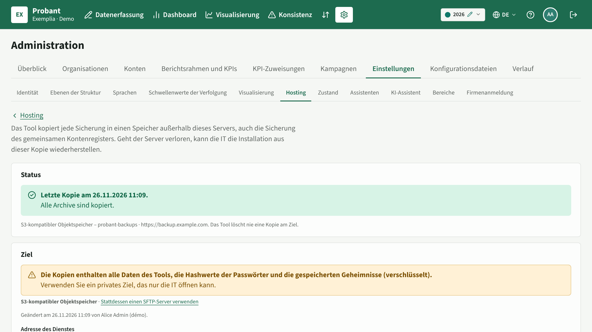

Um den E-Mail-Server einzurichten, verwenden Sie den Block **E-Mails** derselben Seite. Geben Sie den Server, den Port, die Sicherheit, den Benutzernamen, das Passwort und die Absenderadresse ein, die Ihnen das IT-Team nennt. Klicken Sie auf **Speichern** und dann auf **Test-E-Mail senden**. Wird die E-Mail nicht gesendet, nennt eine Meldung den Grund in einfachen Worten. Diese Einstellungen gelten für alle Bereiche: Nur die Bereichsverwaltung kann sie ändern. Das Passwort wird nie wieder angezeigt. Hat das IT-Team die E-Mails in der Einstellungsdatei festgelegt, zeigt der Block diese Einstellungen schreibgeschützt an.

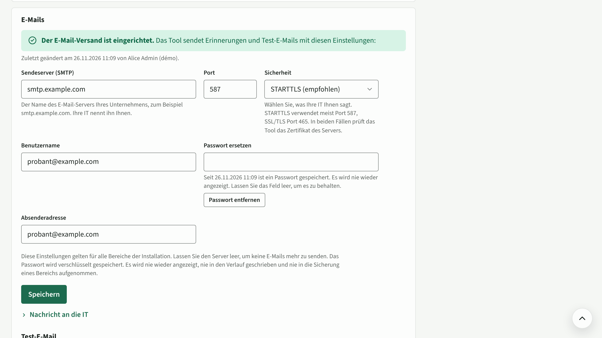

Um auf einen Blick zu sehen, ob alles in Ordnung ist, gehen Sie zu **Administration › Einstellungen › Zustand**. Jede Zeile (Version, Datenbank, Dateien, letzte Sicherung, Speicherplatz, E-Mail, Hintergrundaufgaben, Aktualisierung der Datenbank, HTTPS) zeigt **In Ordnung**, **Zu prüfen** oder **Störung** und was zu tun ist. Die Administration eines anderen Bereichs als des Hauptbereichs sieht dieselben Zeilen, aber die Zeilen Datenbank und Aktualisierung der Datenbank prüfen nur den eigenen Bereich und das gemeinsame Kontenregister, nicht die anderen Bereiche. Das Detail für die IT (Namen der anderen Bereiche, Ordner auf dem Datenträger) sieht sie nicht: Die Bereichsverwaltung sieht es. In **Einstellungen › Hosting** zeigt ihr der Block **Für die IT** weder den Datenordner noch die zulässigen Adressen, den Datenbankserver, den Benutzernamen für E-Mails oder den Ordner der Sicherungen.

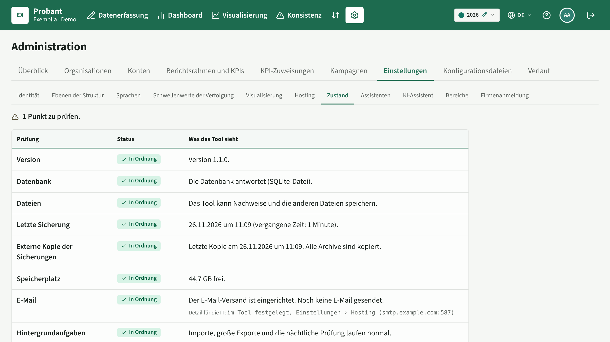

Das Tool kann Sie auch per E-Mail warnen. Unten auf **Einstellungen › Zustand** schaltet die Bereichsverwaltung die **E-Mail-Warnungen** ein und wählt die Empfänger: standardmäßig die Administration des Hauptbereichs und die Bereichsverwaltung, dazu weitere Adressen, zum Beispiel das Postfach der IT. Wenn ein Problem auftritt (fehlgeschlagene oder verspätete Sicherung, fast voller Datenträger, beendete Hintergrundaufgabe, fehlgeschlagene E-Mails…), erhalten die Empfänger eine E-Mail mit dem, was zu tun ist. Danach erhalten sie höchstens einmal am Tag eine Erinnerung, solange das Problem besteht, und eine E-Mail, wenn es behoben ist. Bei einer neuen Installation sind die Warnungen von Anfang an eingeschaltet; eine Installation, die schon vor ihnen bestand, lässt sie ausgeschaltet, bis jemand sie einschaltet. Die Seite sagt, welcher Fall gilt. Klicken Sie auf **Testwarnung senden**, um sie zu prüfen. Wenn der Server ausgeschaltet ist, kann das Tool niemanden warnen.

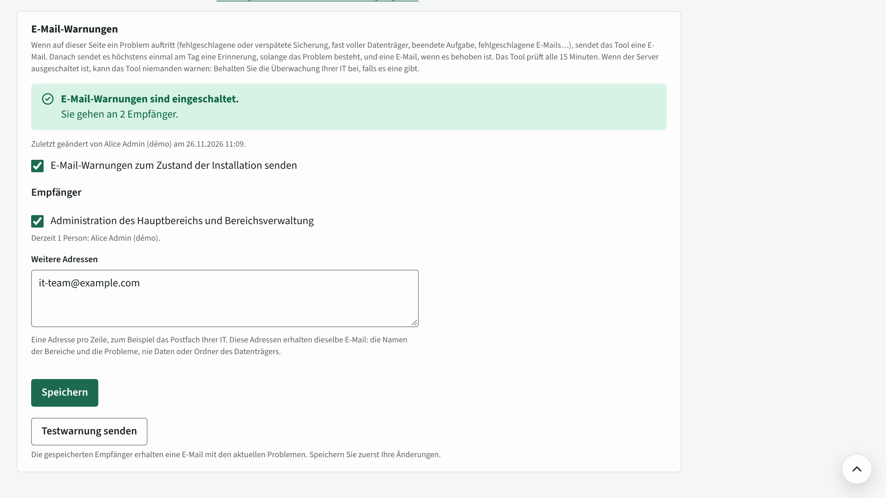

Der Block **Automatische Updates** unter **Einstellungen › Hosting** zeigt die letzte Prüfung des Servers und ihr Ergebnis. Die Bereichsverwaltung wählt, was bei einer neuen Version passiert: **Automatisch installieren** (nachts, nach einer Sicherung; funktioniert die neue Version nicht, kehrt der Server zur vorherigen Version zurück), **Nur benachrichtigen** (die IT installiert sie) oder **Aus**, und wie viele Tage nach der Veröffentlichung gewartet wird (standardmäßig 3). Die Arbeit macht eine Aufgabe des Servers, nie das Tool selbst. Wenn der Bildschirm sagt, dass die Aufgabe nicht installiert ist, bitten Sie Ihre IT, sie einzurichten.

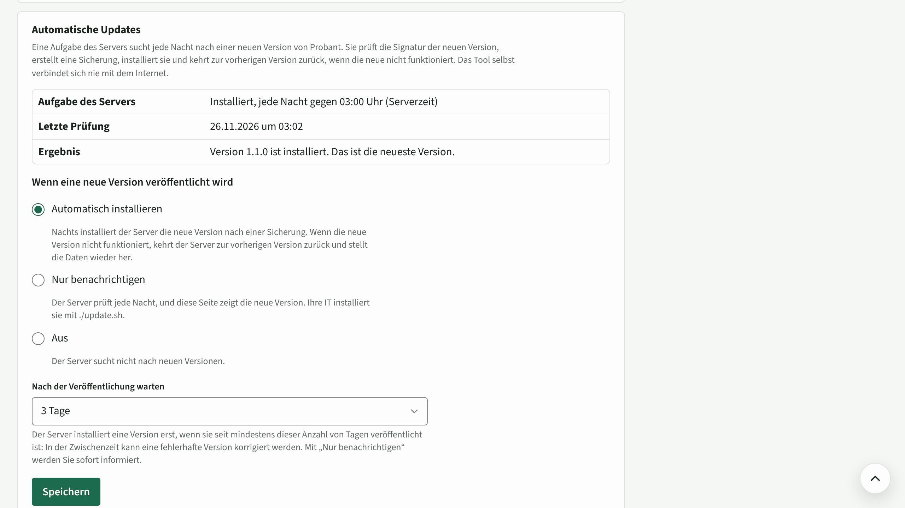

## Die Summen jeder Ebene ansehen {#consolidation}

**Konsolidierung** zeigt den Wert jedes KPI auf jeder Ebene des Baums, von den Standorten bis zur Gruppe. Wählen Sie die anzuzeigenden KPIs, öffnen Sie eine Zeile, um die darunterliegenden Organisationen zu sehen, und exportieren Sie die Tabelle nach Excel. Ein Hinweis zeigt, wenn eine Summe unvollständig ist.

## Hinweise und Konsistenzregeln bearbeiten {#consistency}

**Konsistenz** listet die Hinweise der Kampagne auf: ungewöhnliche Werte, große Abweichungen zum Vorjahr (N-1) und nicht erfüllte Regeln. Klicken Sie auf einen Hinweis, um die Feststellung und die Erklärung des Mitwirkenden zu lesen, und akzeptieren, verwerfen oder ignorieren Sie ihn. Unter **Konsistenzregeln** legen Sie die Regeln fest. Eine Regel mit der Schwere **Blockierend** hindert den Mitwirkenden daran, zu validieren, bis sie erfüllt ist.

## Werte aus einer Datei importieren {#import-values}

Klicken Sie auf **Import / Export** und dann auf **Werte importieren**. Wählen Sie die Datei, lesen Sie die Vorschau und bestätigen Sie. Das Werkzeug speichert vor Ihrer Bestätigung nichts und wendet dieselben Regeln an wie das Erfassungsfenster.

Zahlen in Excel-Zellen werden unverändert gelesen. Eine als Text geschriebene Zahl wird in der Sprache der Datei gelesen. In einer CSV-Datei gibt das Spaltentrennzeichen sie an: „;“ gehört zum Dezimalkomma, „,“ zum Dezimalpunkt. Sonst gibt die Überschrift der Wertespalte sie an: auf Englisch ist „1,234“ 1234, auf Deutsch 1,234. Die Vorschau sagt, wie sie die Zahlen gelesen hat, und markiert einen Wert wie „1,234“. Der Assistent **Ein früheres System migrieren** liest sie in der Sprache Ihres Bildschirms.

Enthält die Datei Zahlen für berechnete KPIs eines nicht abgeschlossenen Zeitraums, zählt die Vorschau sie und fragt, ob Sie diese Werte überschreiben oder diese Zeilen ignorieren möchten. Überschriebene Zahlen ersetzen das berechnete Ergebnis, und Summen und Formeln, die sie verwenden, werden neu berechnet. **Zu bearbeiten** zeigt auch Zahlen, die vor dieser Regel unverändert in berechnete Zellen importiert wurden: Öffnen Sie **Überschriebene Werte** und wählen Sie für jede **Überschreiben** oder **Entfernen**.

## In ein offizielles Format exportieren {#official-formats}

**Offizielle Formate** exportiert die Werte in die offizielle Arbeitsmappe einer Norm, zum Beispiel die Arbeitsmappe der EFRAG für die Norm VS. Das Werkzeug schreibt nur die Erfassungszellen. Öffnen Sie die exportierte Datei in Excel und speichern Sie sie, bevor Sie sie konvertieren.

## Eine KPI-Liste speichern {#kpi-lists}

**KPI-Listen** fasst die KPIs, die Sie oft verfolgen, unter einem Namen zusammen. Wählen Sie eine Liste mit einem Klick in einem Export oder in einer auszufüllenden Datei.

## Diagramme lesen und Ansichten erstellen {#visualisation}

**Visualisierung** zeigt die Diagramme der Ansichten. Öffnen Sie eine Ansicht, ändern Sie oben die Filter und nutzen Sie dann das Menü „…“ eines Diagramms, um seine Daten anzuzeigen oder es zu exportieren. Sie können auch eine Ansicht erstellen, bearbeiten und teilen.

## Die Einstellungen des Werkzeugs ändern {#settings}

**Einstellungen** vereint, was Sie im Werkzeug einstellen können: die Identität, die Ebenen des Organisationsbaums, die Schwellenwerte, die Farben der Diagramme, die Sprachen, den KI-Assistenten, die Assistenten und das Hosting. Niemand muss Code ändern.

## Die Bereiche verwalten {#spaces}

**Bereiche** listet die Bereiche dieser Installation auf. Jeder Bereich hat eigene Daten: Rahmenwerke, Organisationen, Kampagnen, Werte, Nachweise und Identität. Die Konten sind gemeinsam: Eine Person meldet sich nur einmal an.

## Mit dem Firmenkonto anmelden {#company-sign-in}

Die Bereichsverwaltung kann allen erlauben, sich mit ihrem Firmenkonto anzumelden (OpenID Connect, zum Beispiel Microsoft Entra ID, Google, Okta oder Keycloak). Das Firmenkonto beweist nur, wer die Person ist: Konten, Rollen und Zuweisungen legen Sie weiterhin im Tool an. Eine Person braucht ein aktives Konto mit derselben E-Mail-Adresse.

1. Öffnen Sie **Administration › Einstellungen › Firmenanmeldung**.
2. Kopieren Sie die **Weiterleitungs-URI** in die Anwendung bei Ihrem Anbieter. Geben Sie die **Adresse des Anbieters (Issuer)**, die **Client-ID** und das **Client-Geheimnis** ein.
3. Klicken Sie auf **Anbieter prüfen**. Wählen Sie **Anmeldung mit dem Firmenkonto erlauben** und klicken Sie auf **Speichern**.

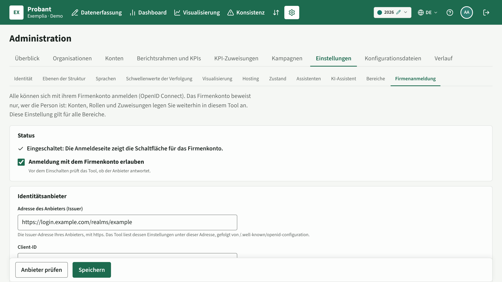

Ist sie eingeschaltet, behält nur die Bereichsverwaltung ihr Passwort, als Notfallkonten. **Abmelden** beendet die Sitzung nur im Tool, nicht beim Anbieter. Der **Anmeldeverlauf** zeigt die Methode jeder Anmeldung.

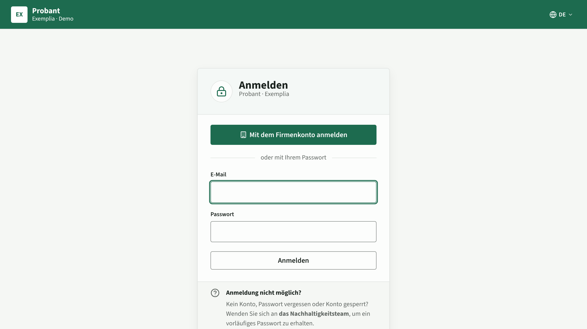

## Jede Änderung nachverfolgen {#history}

Klicken Sie in der oberen Leiste auf **Administration** und dann auf **Verlauf**. Wählen Sie unter **Protokoll** **Datenerfassung**, um die Werte, die Validierungen und die Nachweise zu sehen, oder **Änderungen der Administration**, um die Kampagnen, das Rahmenwerk, die Organisationen und die Konten zu sehen. Das Werkzeug löscht nie etwas aus dem Verlauf.

## Die geführte Tour erneut anzeigen {#tour}

Bei Ihrer ersten Anmeldung zeigt eine kurze Tour, wo Sie handeln. Sie blockiert den Bildschirm nicht. Ihr Browser merkt sich, dass Sie sie gesehen haben.

1. Klicken Sie in der oberen Leiste auf **Hilfe**.
2. Klicken Sie auf **Tour erneut anzeigen**.
3. Klicken Sie auf **Weiter**, um fortzufahren, und am Ende auf **Fertig**. Zum Beenden klicken Sie auf **Tour schließen**, drücken Sie Esc oder klicken Sie auf **Nicht mehr anzeigen**.

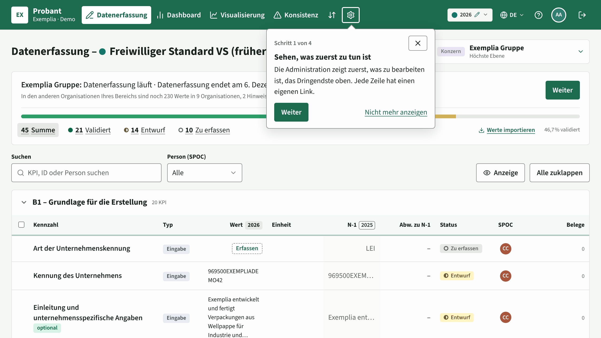

## Meine Sprache oder mein Passwort ändern {#account}

Klicken Sie auf Ihren Namen und dann auf **Mein Konto**. Wählen Sie die **Sprache** und ändern Sie Ihr Passwort unter **Mein Passwort ändern**.

**Meine letzten Anmeldungen** unter **Mein Konto** listet Ihre letzten Anmeldungen in diesem Bereich auf. Wenn Sie eine nicht erkennen, ändern Sie Ihr Passwort und informieren Sie einen Administrator.
