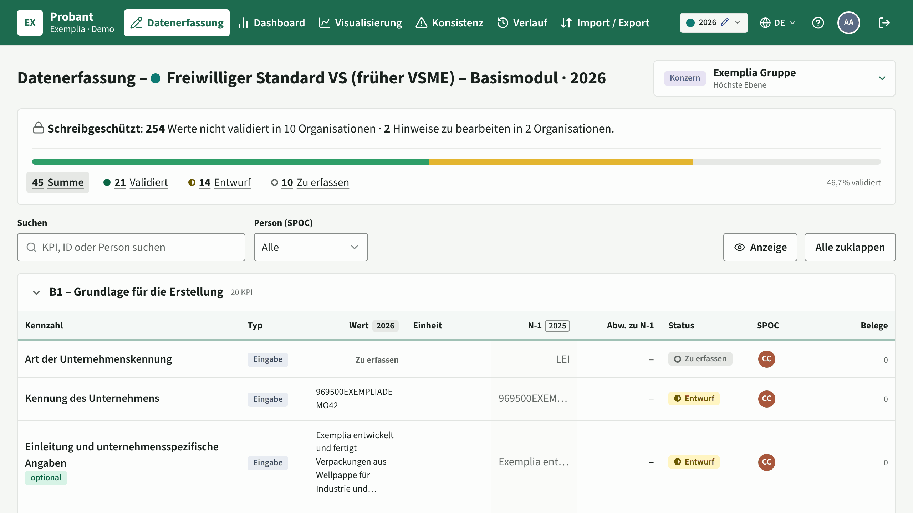
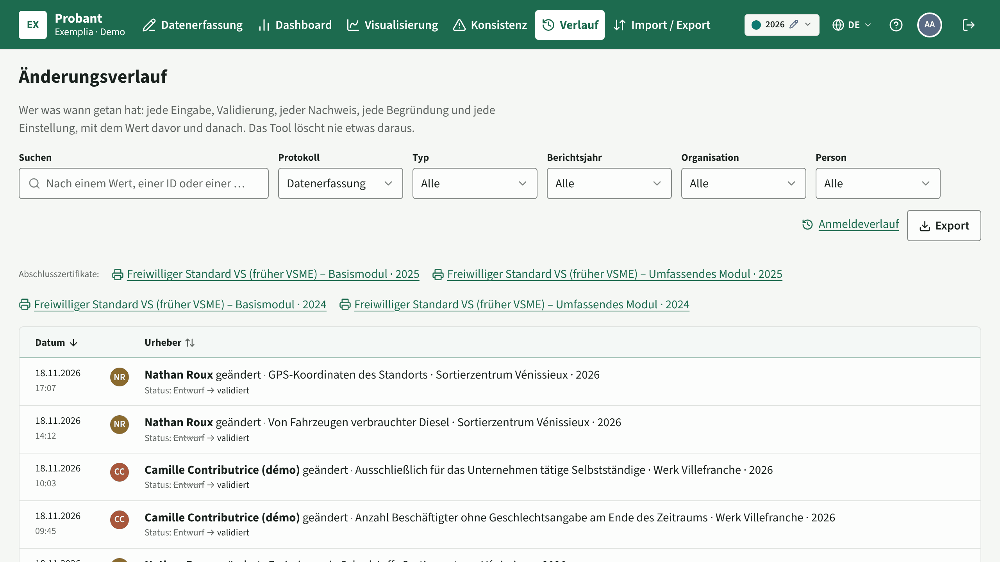
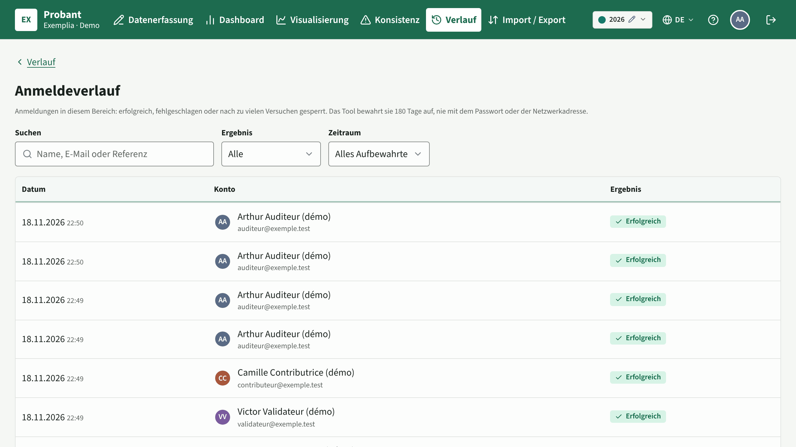
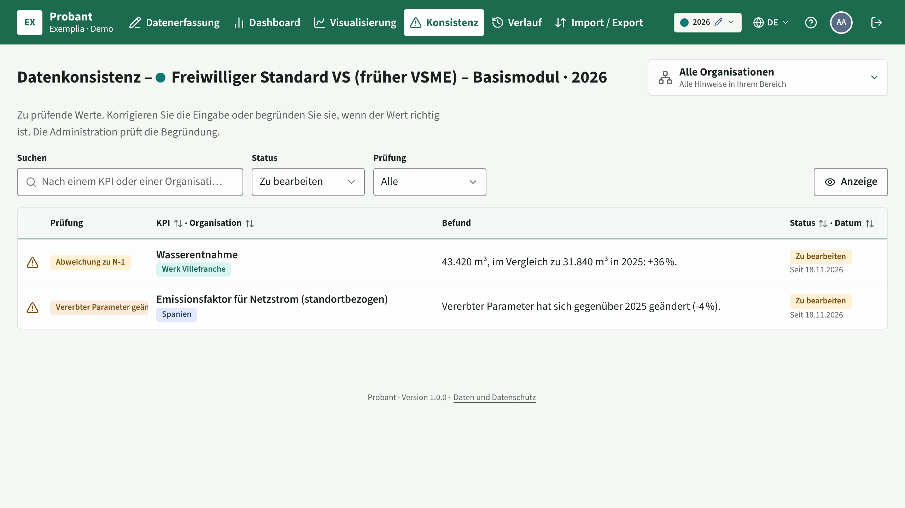
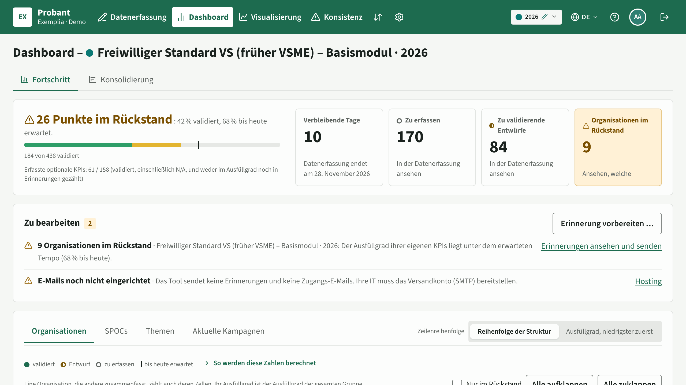
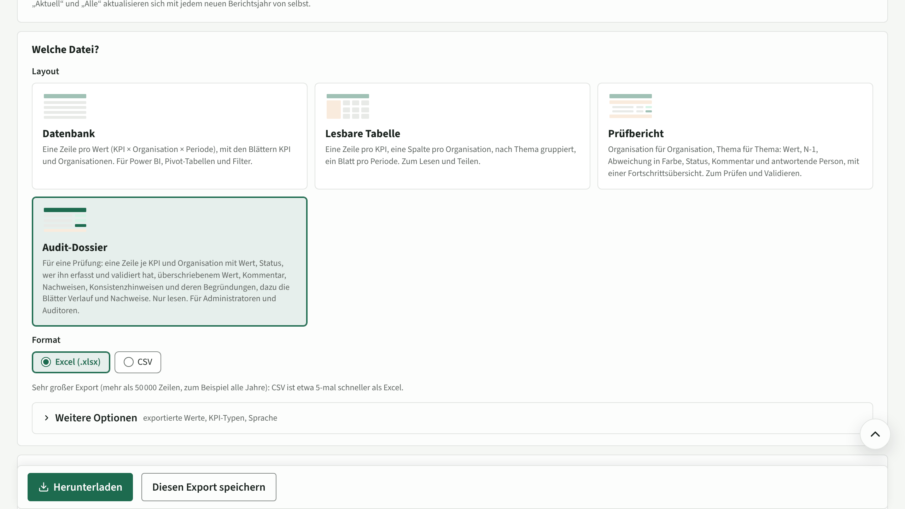
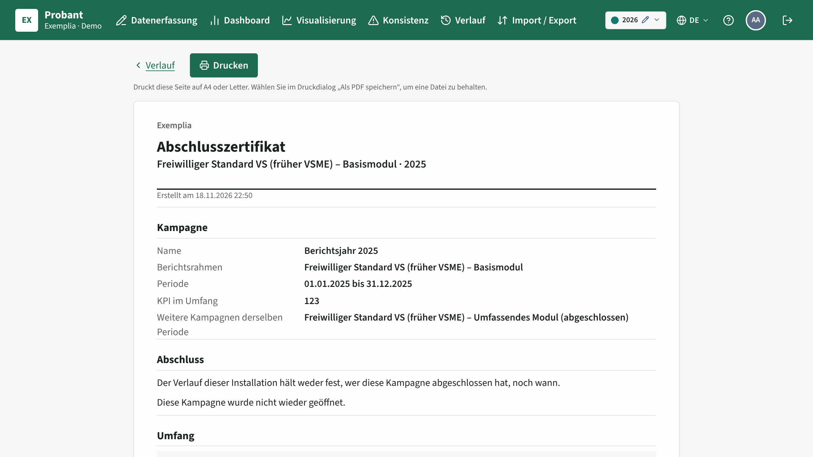

# Anleitung für Auditoren

Sie können alle Werte, ihre Nachweise und ihren Verlauf sehen. Sie ändern nie etwas: Die Rolle Auditor ist schreibgeschützt. Englische Version: [`docs/guides/auditor.md`](../../guides/auditor.md).

## Die Werte einer Organisation ansehen {#read-only}

1. Klicken Sie in der oberen Leiste auf **Datenerfassung**. Die Seite öffnet sich bei der höchsten Organisation Ihres Bereichs.
2. Klicken Sie oben rechts auf der Seite auf den Namen der Organisation und wählen Sie die Organisation in der Liste.
3. Verwenden Sie **Suchen** und die Filter über der Tabelle, um einen KPI zu finden.
4. Klicken Sie auf eine Zeile, um das Feld zu öffnen. Es zeigt den Wert, den Kommentar, die Nachweise und den Verlauf nach Berichtsjahr.

Öffnen Sie **Anzeige** und wählen Sie **Berechnete und konsolidierte KPIs anzeigen** aus, um die Summen und die Bestandteile jeder Berechnung zu sehen.

## Die Nachweise öffnen {#evidence}

1. Öffnen Sie das Feld eines Werts.
2. Klicken Sie unter **Nachweis** auf den Namen einer Datei, um sie zu öffnen.

Die Spalte **Belege** der Tabelle zeigt die Anzahl der Dateien für jeden KPI.

## Jede Änderung verfolgen {#history}

1. Klicken Sie in der oberen Leiste auf **Verlauf**.
2. Wählen Sie **Datenerfassung**, um die Werte, die Validierungen und die Nachweise zu sehen. Wählen Sie **Änderungen der Administration**, um die Kampagnen, den Berichtsrahmen, die Organisationen und die Konten zu sehen.
3. Filtern Sie nach Berichtsjahr, Organisation oder Person.
4. Klicken Sie auf **Exportieren**, um das Protokoll als Datei zu erhalten.

Der Verlauf zeigt, wer was wann getan hat, mit dem Wert davor und danach. Das Werkzeug löscht nie etwas daraus. Eine Änderung, die ein KI-Assistent gemacht hat, zeigt „(über MCP)“.

Drei Zeilen der **Änderungen der Administration** brauchen eine Erklärung:

- „Zuweisungen entfernt (schreibgeschützte Rolle)“: Ein Konto wurde Leser oder Auditor und hat seine Zuweisungen verloren. Die Zeile listet sie nach Rolle auf, mit „Vollständigen Text ansehen“, wenn die Liste lang ist.
- „hat einen KPI zum Umfang einer erneut geöffneten Periode hinzugefügt“: Ein abgeschlossenes Jahr behält seine KPI-Liste, und ein Administrator hat diesen KPI absichtlich hinzugefügt, während die Kampagne erneut geöffnet war.
- „hat gewählt, wie eine Kampagne erneut geöffnet wird“: Der Administrator hat die damaligen Zahlen behalten oder mit der heutigen Organisation neu berechnet.

## Sehen, wer sich angemeldet hat {#sign-ins}

1. Klicken Sie in der oberen Leiste auf **Verlauf**.
2. Klicken Sie am Ende der Filterleiste auf **Anmeldeverlauf**.
3. Filtern Sie nach Name oder E-Mail, nach Ergebnis oder nach Zeitraum.

Jede Zeile zeigt das Datum, das Konto und das Ergebnis: **Erfolgreich**, **Fehlgeschlagen** oder **Gesperrt: zu viele Versuche**. Bei einem unbekannten Benutzernamen zeigt das Tool nur eine Referenz, nie den eingegebenen Text. Die Seite ist schreibgeschützt. Die Administration legt fest, wie lange das Tool diese Zeilen aufbewahrt. Wenn Ihr Zugriff auf einige Organisationen beschränkt ist, steht Ihnen diese Seite nicht zur Verfügung.

## Die Konsistenzhinweise lesen {#consistency}

1. Klicken Sie in der oberen Leiste auf **Konsistenz**.
2. Filtern Sie die Hinweise nach Status, Prüfung, KPI oder Organisation.
3. Klicken Sie auf einen Hinweis, um die Feststellung und die Erklärung des Mitwirkenden zu lesen.

Ein Hinweis blockiert eine Validierung nicht, eine Regel mit der Schwere **Blockierend** schon: Der Mitwirkende kann erst validieren, wenn die Regel erfüllt ist. Der Administrator entscheidet über jede Erklärung.

## Den Fortschritt und die Diagramme verfolgen {#dashboard}

Klicken Sie auf **Dashboard** für den Ausfüllgrad nach Organisation und auf **Konsolidierung** für die Summen jeder Ebene. Klicken Sie auf **Visualisierung** für die Diagramme. Die Entwürfe können in den Zahlen mitzählen, solange eine Kampagne offen ist. Die Seite sagt es, wenn sie mitzählen.

## Das Audit-Dossier abrufen {#audit-file}

Ein Administrator oder ein Auditor kann eine Excel-Datei mit dem herunterladen, was eine Prüfung braucht: für jeden KPI und jede Organisation den Wert, den Status, wer ihn erfasst und validiert hat, die Nachweise, die Plausibilitätshinweise mit ihren Begründungen und den Verlauf der Änderungen. Das Werkzeug liest die Daten nur. Das Erstellen der Datei ändert nichts.

1. Klicken Sie auf **Import / Export** und dann auf **Neuer Export**.
2. Wählen Sie unter **Layout** die Option **Audit-Dossier**. Wählen Sie das Jahr und, wenn Sie nur einige brauchen, die Organisationen.
3. Klicken Sie auf **Herunterladen**.

Die Datei hat vier Blätter: **Lies mich**, **Audit** (eine Zeile je KPI und Organisation), **Verlauf** (jede Änderung dieser Werte, die älteste zuerst) und **Nachweise** (Dateinamen, Größen und wer sie hinzugefügt hat). Das Blatt **Lies mich** nennt das Datum, die Version des Werkzeugs und die Filter. Eine große Datei wird auf dem Server vorbereitet, wie jeder große Export.

Sie sehen dieselben Daten wie auf den Seiten des Werkzeugs. Hat ein Administrator Sie auf einige Organisationen beschränkt, enthält die Datei nur diese.

## Das Abschlusszertifikat drucken {#closing-certificate}

Sie können eine Seite drucken, die eine abgeschlossene Kampagne zusammenfasst. Das Werkzeug liest die Daten nur.

1. Klicken Sie auf **Verlauf**. Klicken Sie über der Liste unter **Abschlusszertifikate:** auf eine Kampagne.
2. Klicken Sie auf **Drucken**. Wählen Sie im Druckdialog Als PDF speichern, um eine Datei zu behalten.

Die Seite zeigt den Umfang, den Ausfüllgrad, die Zahl der Werte, die Nachweise und die Konsistenzhinweise. Sie zeigt, wer die Kampagne abgeschlossen hat und wann, wenn der Verlauf es festhält. Der Fingerabdruck ist ein Code, der aus allen Zahlen der Kampagne berechnet wird. Ändert sich eine Zahl, ändert sich der Fingerabdruck. Wenn Sie auf einzelne Organisationen beschränkt sind, erhalten Sie ein Teilzertifikat: Es steht oben auf jeder Seite, und jede Zahl sowie der Fingerabdruck gelten nur für Ihre Organisationen.

## Einen großen Export abrufen {#large-exports}

Ab einer bestimmten Größe bereitet das Werkzeug einen Export oder eine auszufüllende Datei auf dem Server vor. Öffnen Sie **Import / Export** und wählen Sie **Meine Exporte**. Die Datei steht unter „Große Dateien“. Das Werkzeug bewahrt sie 7 Tage auf.

## Das Werkzeug auf einem Smartphone verwenden {#phone}

Die Seiten funktionieren auf einem Smartphone, in einer Spalte.

## Die geführte Tour erneut anzeigen {#tour}

Bei Ihrer ersten Anmeldung zeigt eine kurze Tour, wo Sie handeln. Sie blockiert den Bildschirm nicht. Ihr Browser merkt sich, dass Sie sie gesehen haben.

1. Klicken Sie in der oberen Leiste auf **Hilfe**.
2. Klicken Sie auf **Tour erneut anzeigen**.
3. Klicken Sie auf **Weiter**, um fortzufahren, und am Ende auf **Fertig**. Zum Beenden klicken Sie auf **Tour schließen**, drücken Sie Esc oder klicken Sie auf **Nicht mehr anzeigen**.

## Die Sprache ändern {#language}

1. Klicken Sie in der oberen Leiste auf die Sprache oder klicken Sie auf Ihren Namen und dann auf **Mein Konto**.
2. Wählen Sie unter **Sprache** eine der sieben Sprachen und speichern Sie.

**Meine letzten Anmeldungen** unter **Mein Konto** listet Ihre letzten Anmeldungen in diesem Bereich auf. Wenn Sie eine nicht erkennen, ändern Sie Ihr Passwort und informieren Sie einen Administrator.

## Einen Assistenten befragen {#assistant}

Hat ein Administrator Assistenten eingeschaltet, können Sie unter **Mein Konto** bei **KI-Assistenten (MCP)** einen KI-Assistenten verbinden. Mit Ihrer Rolle kann er nur lesen. Der Verlauf hält jeden Aufruf fest.
