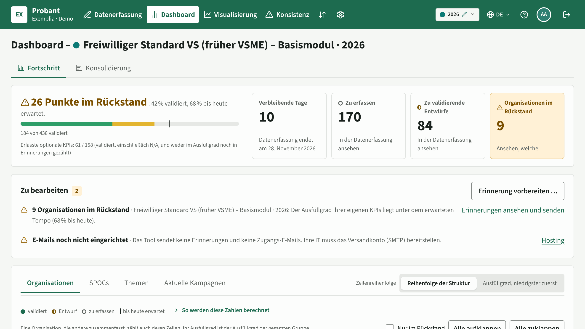
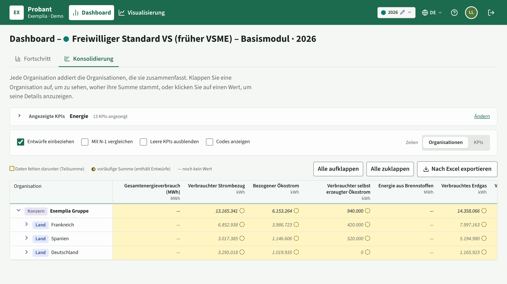
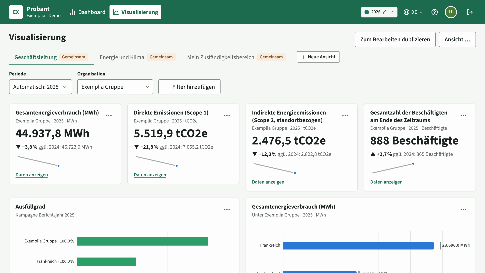
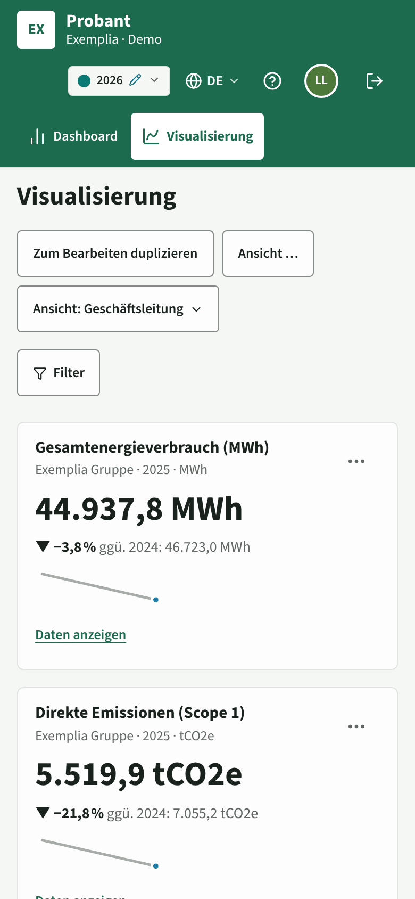

# Anleitung für Leser

Sie lesen den Fortschritt und die Zahlen. Sie ändern nie etwas: Die Rolle Leser ist schreibgeschützt. Englische Version: [`docs/guides/reader.md`](../../guides/reader.md).

## Den Fortschritt verfolgen {#dashboard}

1. Klicken Sie in der oberen Leiste auf **Dashboard**.
2. Lesen Sie das Urteil oben. Es sagt, ob die Kampagne im erwarteten Tempo liegt.
3. Lesen Sie die Tabelle nach Organisation. Eine Organisation, die andere zusammenfasst, zeigt den Ausfüllgrad der ganzen Gruppe.

## Die Summen jeder Ebene sehen {#consolidation}

1. Klicken Sie im **Dashboard** auf **Konsolidierung**.
2. Wählen Sie die anzuzeigenden KPIs. Öffnen Sie eine Zeile, um die Organisationen darunter zu sehen.

Die Seite zeigt die Werte jeder Ebene der Struktur, von der untersten bis zur obersten. Sie sehen die Organisationen Ihres Bereichs.

## Die Diagramme lesen {#visualisation}

1. Klicken Sie in der oberen Leiste auf **Visualisierung**. Die Seite öffnet sich bei einer Ansicht.
2. Klicken Sie auf ein Register, um eine andere Ansicht zu öffnen.
3. Verwenden Sie die Filter oben: die Periode, den Vergleich, die Organisation und den Berichtsrahmen.
4. Klicken Sie auf **Ansichtsfilter zurücksetzen**, um neu zu beginnen.
5. Öffnen Sie das Menü „…“ eines Diagramms, um seine Daten anzuzeigen, es im Vollbild zu öffnen oder als Bild oder Excel-Datei zu exportieren.

Entwürfe können in den Zahlen mitzählen, solange eine Kampagne offen ist. Die Seite sagt es, wenn sie mitzählen.

## Das Werkzeug auf einem Smartphone verwenden {#phone}

Die Seiten funktionieren auf einem Smartphone, in einer Spalte. Die Filter öffnen sich in einem Fenster.

## Die geführte Tour erneut anzeigen {#tour}

Bei Ihrer ersten Anmeldung zeigt eine kurze Tour, wo Sie handeln. Sie blockiert den Bildschirm nicht. Ihr Browser merkt sich, dass Sie sie gesehen haben.

1. Klicken Sie in der oberen Leiste auf **Hilfe**.
2. Klicken Sie auf **Tour erneut anzeigen**.
3. Klicken Sie auf **Weiter**, um fortzufahren, und am Ende auf **Fertig**. Zum Beenden klicken Sie auf **Tour schließen**, drücken Sie Esc oder klicken Sie auf **Nicht mehr anzeigen**.

## Die Sprache ändern {#language}

Das Werkzeug ist auf Französisch, Englisch, Spanisch, Deutsch, Italienisch, Niederländisch und Portugiesisch verfügbar.

1. Klicken Sie in der oberen Leiste auf die Sprache oder klicken Sie auf Ihren Namen und dann auf **Mein Konto**.
2. Wählen Sie unter **Sprache** die Sprache und speichern Sie.

## Mein Passwort ändern {#account}

1. Klicken Sie auf Ihren Namen und dann auf **Mein Konto**.
2. Geben Sie unter **Mein Passwort ändern** das aktuelle und das neue Passwort ein.
3. Klicken Sie auf **Mein Passwort speichern**.

Wenn Sie Ihr Passwort vergessen haben, bitten Sie einen Administrator, es zurückzusetzen.

**Meine letzten Anmeldungen** unter **Mein Konto** listet Ihre letzten Anmeldungen in diesem Bereich auf. Wenn Sie eine nicht erkennen, ändern Sie Ihr Passwort und informieren Sie einen Administrator.

## Einen Assistenten befragen {#assistant}

Hat ein Administrator Assistenten eingeschaltet, können Sie unter **Mein Konto** bei **KI-Assistenten (MCP)** einen KI-Assistenten verbinden. Mit Ihrer Rolle kann er nur lesen. Er erfasst oder ändert nie etwas. Er liest die Kampagnen, KPIs, Organisationen und den Ausfüllgrad; die Werte Ihres Bereichs liest er nur, wenn Ihr Administrator es erlaubt (**Einstellungen › Assistenten**). Auch dann liest er nur die validierten Werte, so wie die Visualisierung sie Ihnen zeigt. Hat Ihr Administrator **Sensible KPIs werden an Assistenten gegeben** ausgeschaltet, liest er nie einen als Eingeschränkt oder Vertraulich markierten KPI und auch keinen daraus berechneten KPI.
