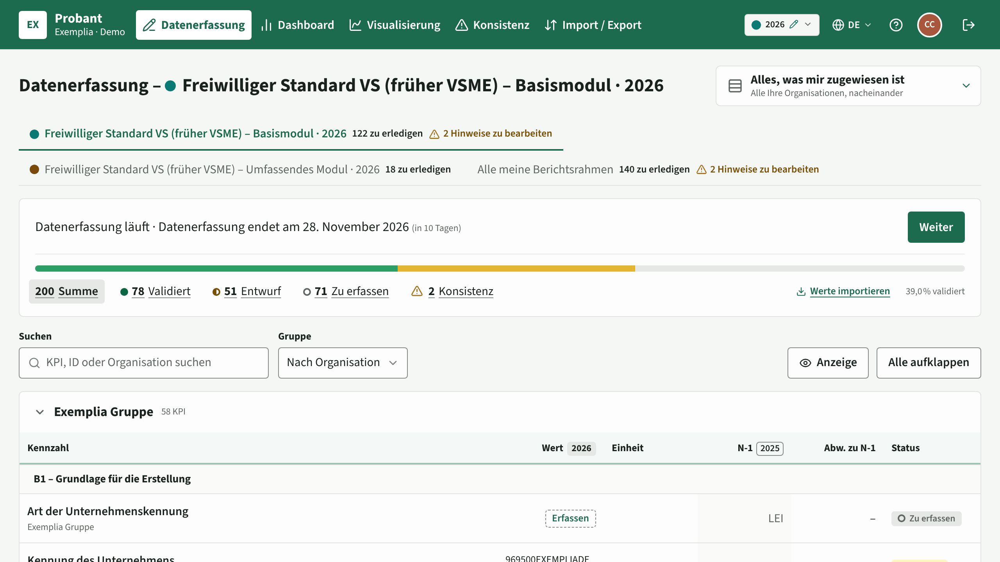
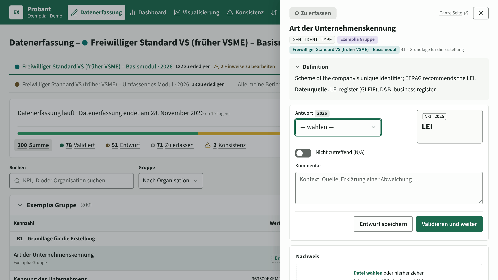
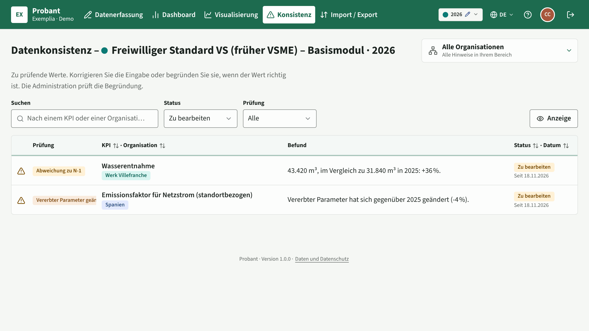
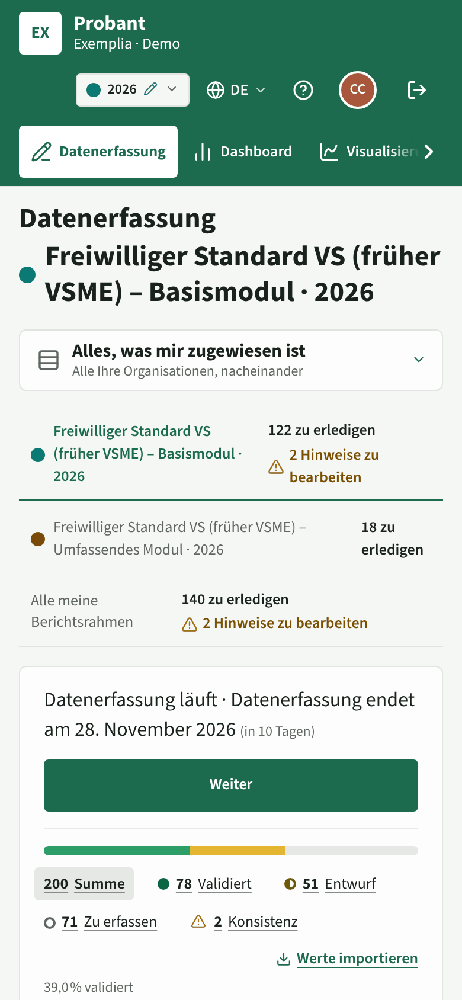

# Anleitung für Mitwirkende

Sie erfassen die Werte der KPIs, die ein Administrator Ihnen zugewiesen hat, und validieren sie. Diese Anleitung zeigt jede Aufgabe in wenigen Schritten. Englische Version: [`docs/guides/contributor.md`](../../guides/contributor.md).

## Finden, was zu erfassen ist {#find}

1. Klicken Sie in der oberen Leiste auf **Datenerfassung**. Die Seite öffnet sich bei **Alles, was mir zugewiesen ist**.
2. Wählen Sie den Berichtsrahmen und die Periode unter **Ich beantworte …** (obere Leiste) oder verwenden Sie die Register unter dem Titel.
3. Klicken Sie über der Tabelle auf **Zu erfassen** oder **Entwurf**, um nur die Zeilen zu behalten, die Sie betreffen.
4. Verwenden Sie **Suchen**, um einen KPI, eine ID oder eine Organisation zu finden.

Klicken Sie auf **Starten** (oder **Weiter**), um den ersten Wert zu öffnen, der noch offen ist. Die Zusammenfassung zeigt, wie viele Werte noch fehlen und wann die Datenerfassung endet.

## Einen Wert erfassen {#enter}

1. Klicken Sie auf die Zeile des KPIs oder drücken Sie darauf die Eingabetaste. Das Erfassungsfeld wird geöffnet.
2. Geben Sie die Zahl, die Antwort oder den Text bei **Wert** ein (oder bei **Antwort**, für eine Liste oder einen Text).
3. Klicken Sie auf **Entwurf speichern**, um ihn zu behalten und später zurückzukehren.

Das Feld zeigt den Wert der Vergleichsperiode (N-1) und die Abweichung. Überschreitet die Abweichung den Schwellenwert der Kampagne, ist der **Kommentar** Pflicht.

Wählen Sie **Ganze Seite**, wenn Sie lieber auf der ganzen Seite arbeiten.

Meldet das Erfassungsfeld, dass eine Organisation an einem Datum nach der Periode „öffnet am“, lässt sich für diese Periode noch nichts erfassen. Bitten Sie einen Administrator, das Eröffnungsdatum zu ändern. Sonst ändert sich für Sie nichts.

## Einen Wert als nicht zutreffend kennzeichnen {#na}

1. Öffnen Sie das Erfassungsfeld des KPIs.
2. Wählen Sie **Nicht zutreffend (N/A)** aus.
3. Schreiben Sie den Grund in den **Kommentar**. Der Kommentar ist bei N/A Pflicht.

## Einen Nachweis hinzufügen {#evidence}

1. Öffnen Sie das Erfassungsfeld des KPIs.
2. Klicken Sie unter **Nachweis** auf **Datei wählen** oder ziehen Sie die Datei in den Bereich.
3. Verwenden Sie eine PDF-, JPG- oder PNG-Datei. Das Feld zeigt die Größenbegrenzung (standardmäßig 5 MB).

Verlangt der KPI einen Nachweis, können Sie ohne mindestens eine Datei nicht validieren. Das gilt nicht für N/A.

## Meine Erfassung validieren {#validate}

Das Validieren bestätigt, dass Ihre Erfassung vollständig ist. Es bedeutet nicht, dass die Zahl geprüft wurde.

1. Öffnen Sie das Erfassungsfeld des KPIs.
2. Klicken Sie auf **Validieren und weiter**. Das Feld öffnet den nächsten Wert.
3. Am Ende zeigt die Zusammenfassung „Alles erledigt“.

Fehlt etwas, sagt das Werkzeug, was Sie ergänzen müssen: einen Wert oder N/A, einen Kommentar oder einen Nachweis.

## Einen validierten Wert ändern {#reopen}

Sie können einen Wert bearbeiten, den Sie validiert haben. Das Werkzeug setzt ihn zurück in den Entwurf, und Sie validieren ihn erneut.

1. Öffnen Sie das Erfassungsfeld des KPIs.
2. Ändern Sie den Wert und klicken Sie auf **Änderung speichern**. Oder klicken Sie auf **Zurück zum Entwurf**, um noch nichts zu ändern.
3. Klicken Sie auf **Validieren**, wenn der Wert stimmt.

**Wert löschen** leert den Wert und setzt die Zelle zurück auf **Zu erfassen**. Der Kommentar und die Nachweise bleiben. Der Verlauf hält jede Änderung fest.

Ist die Kampagne abgeschlossen, kann nur ein Administrator sie wieder öffnen.

## Ein KPI, den eine abgeschlossene Kampagne sperrt {#shared-closed}

Manche KPIs gehören zu zwei Berichtsrahmen mit derselben Periode. Der Wert ist gemeinsam. Ist eine der beiden Kampagnen abgeschlossen, können Sie den Wert in der anderen nicht ändern.

Das Feld zeigt dann eine Meldung, die den Berichtsrahmen und die Kampagne nennt. Bitten Sie einen Administrator, die abgeschlossene Kampagne wieder zu öffnen.

## Einen Hinweis „Zu prüfen“ bearbeiten {#check}

Das Werkzeug prüft Ihre Werte und kennzeichnet ungewöhnliche Werte mit **Zu prüfen**. Ein Hinweis blockiert die Validierung nicht, eine Regel mit der Schwere **Blockierend** schon: Sie können erst validieren, wenn die Regel erfüllt ist.

1. Öffnen Sie das Erfassungsfeld. Der Block **Zu prüfen** nennt den Grund.
2. Wenn der Wert falsch ist, korrigieren Sie ihn und speichern Sie.
3. Wenn der Wert richtig ist, klicken Sie auf **Ich erkläre es im Kommentar**, schreiben Sie die Erklärung und speichern Sie.

Die Seite **Konsistenz** listet alle Ihre Hinweise auf. Klicken Sie auf einen Hinweis, um sein Blatt zu öffnen. Im Erfassungsfeld gibt **Hinweisblatt** dieselben Einzelheiten. Ein Administrator prüft Ihre Erklärung.

Hat Ihr Administrator den KI-Assistenten eingeschaltet, klicken Sie bei einem Hinweis auf **Mit KI erklären**. Die Antwort ist nur ein Vorschlag. Klicken Sie auf **Als meine Erklärung verwenden**, um sie in den Kommentar zu kopieren, und speichern Sie.

## Werte aus einer Datei importieren {#import}

1. Klicken Sie in der oberen Leiste auf **Import / Export**. Es öffnet sich bei **Werte importieren**.
2. Folgen Sie den Schritten der Seite. Das Werkzeug zeigt eine Vorschau, bevor es etwas speichert.

Es gelten dieselben Regeln wie im Erfassungsfeld.

Zahlen in Excel-Zellen werden unverändert gelesen. Eine als Text geschriebene Zahl wird in der Sprache der Datei gelesen. In einer CSV-Datei gibt das Spaltentrennzeichen sie an: „;“ gehört zum Dezimalkomma, „,“ zum Dezimalpunkt. Sonst gibt die Überschrift der Wertespalte sie an: auf Englisch ist „1,234“ 1234, auf Deutsch 1,234. Die Vorschau sagt, wie sie die Zahlen gelesen hat, und markiert einen Wert wie „1,234“.

## Diagramme lesen {#visualisation}

**Visualisierung** zeigt den Fortschritt und die Zahlen Ihres Bereichs in Ansichten. Öffnen Sie eine Ansicht, ändern Sie oben die Filter und nutzen Sie dann das Menü „…“ eines Diagramms, um seine Daten anzuzeigen oder es zu exportieren. Entwürfe können in den Zahlen mitzählen, solange eine Kampagne offen ist.

## Das Werkzeug auf einem Smartphone verwenden {#phone}

Die Seiten funktionieren auf einem Smartphone. Das Erfassungsfeld füllt den ganzen Bildschirm. Mit der Schaltfläche zum Schließen kehren Sie zur Liste zurück.

## Die geführte Tour erneut anzeigen {#tour}

Bei Ihrer ersten Anmeldung zeigt eine kurze Tour, wo Sie handeln. Sie blockiert den Bildschirm nicht. Ihr Browser merkt sich, dass Sie sie gesehen haben.

1. Klicken Sie in der oberen Leiste auf **Hilfe**.
2. Klicken Sie auf **Tour erneut anzeigen**.
3. Klicken Sie auf **Weiter**, um fortzufahren, und am Ende auf **Fertig**. Zum Beenden klicken Sie auf **Tour schließen**, drücken Sie Esc oder klicken Sie auf **Nicht mehr anzeigen**.

## Die Sprache ändern {#language}

Das Werkzeug ist auf Französisch, Englisch, Spanisch, Deutsch, Italienisch, Niederländisch und Portugiesisch verfügbar.

1. Klicken Sie in der oberen Leiste auf die Sprache oder klicken Sie auf Ihren Namen und dann auf **Mein Konto**.
2. Wählen Sie unter **Sprache** die Sprache und speichern Sie.

Die Namen der KPIs und der Themen erscheinen in Ihrer Sprache, wenn sie eine Übersetzung haben.

## Einen KI-Assistenten verbinden {#assistant}

Hat Ihr Administrator Assistenten eingeschaltet, können Sie einen verbinden (zum Beispiel Claude). Er liest und handelt mit Ihren Rechten, nie mehr.

1. Klicken Sie auf Ihren Namen und dann auf **Mein Konto**.
2. Geben Sie unter **KI-Assistenten (MCP)** bei **Name des Tokens** einen Namen ein und wählen Sie **Läuft ab nach**.
3. Klicken Sie auf **Token erstellen**.
4. Kopieren Sie das Token jetzt. Sie sehen es nicht wieder.
5. Fügen Sie die fertige Konfiguration in Ihren Assistenten ein.

Um einen Assistenten zu stoppen, klicken Sie in seiner Zeile auf **Widerrufen**. Der Verlauf zeigt „(über MCP)“ nach jeder Änderung, die ein Assistent gemacht hat.

## Mein Passwort ändern {#account}

1. Klicken Sie auf Ihren Namen und dann auf **Mein Konto**.
2. Geben Sie unter **Mein Passwort ändern** das aktuelle und das neue Passwort ein.
3. Klicken Sie auf **Mein Passwort speichern**.

Wenn Sie Ihr Passwort vergessen haben, bitten Sie einen Administrator, es zurückzusetzen.

**Meine letzten Anmeldungen** unter **Mein Konto** listet Ihre letzten Anmeldungen in diesem Bereich auf. Wenn Sie eine nicht erkennen, ändern Sie Ihr Passwort und informieren Sie einen Administrator.
