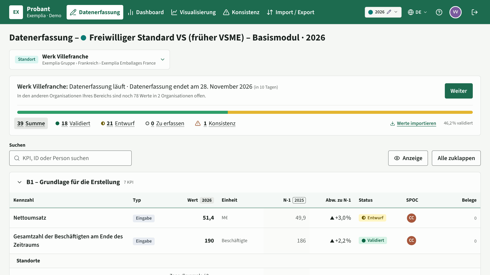
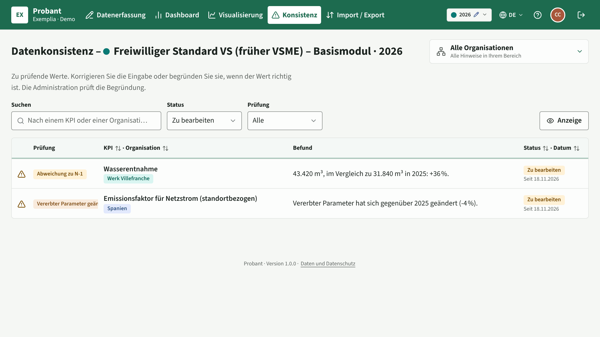
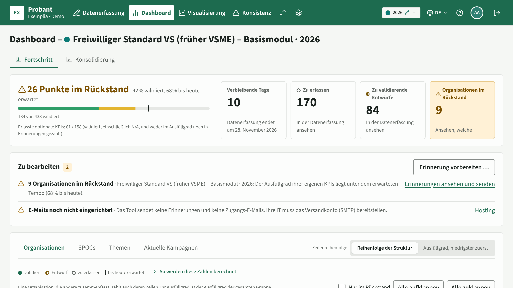
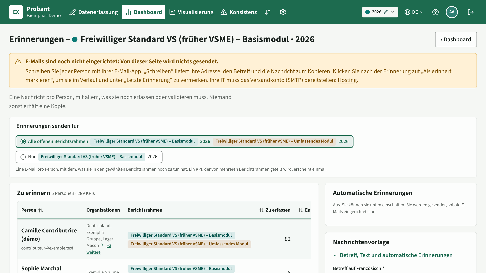

# Anleitung für Validatoren

Sie verfolgen und validieren die Erfassungen der KPIs und Organisationen, die ein Administrator Ihnen zugewiesen hat (KPI-Zuweisungen, Auswahl Validatoren), und der Organisationen darunter. Ohne Zuweisung validiert ein Administrator an Ihrer Stelle. In diesem Bereich können Sie auch Erinnerungen senden. Englische Version: [`docs/guides/validator.md`](../../guides/validator.md).

## Meinen Zuständigkeitsbereich und den Rest sehen {#scope}

1. Klicken Sie in der oberen Leiste auf **Datenerfassung**. Die Seite öffnet sich bei **Alles, was mir zugewiesen ist**.
2. Klicken Sie oben rechts auf der Seite auf den Namen der Organisation (**Alles, was mir zugewiesen ist**) und wählen Sie in der Liste eine Organisation Ihres Bereichs.
3. Klicken Sie über der Tabelle auf **Zu erfassen**, **Entwurf** oder **Validiert**, um die Zeilen zu filtern.
4. Wählen Sie eine Organisation, öffnen Sie **Anzeige** und wählen Sie **Berechnete und konsolidierte KPIs anzeigen** aus, um die Summen zu sehen. Sie sind schreibgeschützt.

## Erfassungen prüfen und validieren {#review}

1. Öffnen Sie die Zeile eines Entwurfswerts. Das Erfassungsfeld wird geöffnet.
2. Lesen Sie den Wert, den Kommentar, die Abweichung gegenüber N-1 und die Nachweise.
3. Wenn die Erfassung vollständig ist, klicken Sie auf **Validieren**.
4. Wenn sie es nicht ist, bitten Sie den Mitwirkenden, sie zu vervollständigen.

Das Validieren bestätigt, dass die Erfassung vollständig ist. Es prüft die Zahl nicht inhaltlich. Die Validierung verlangt einen Wert oder N/A, einen Kommentar (bei N/A oder bei einer großen Abweichung) und einen Nachweis, wenn der KPI ihn verlangt.

Meldet das Erfassungsfeld, dass eine Organisation an einem Datum nach der Periode „öffnet am“, lässt sich für diese Periode noch nichts erfassen oder validieren. Bitten Sie einen Administrator, das Eröffnungsdatum zu ändern. Sonst ändert sich für Sie nichts.

## Eine Erfassung zurück in den Entwurf setzen {#reopen}

1. Öffnen Sie das Erfassungsfeld des validierten Werts.
2. Klicken Sie auf **Zurück zum Entwurf**. Der Wert bleibt gleich.
3. Danach kann der Mitwirkende ihn ändern und erneut validieren.

**Wert löschen** leert stattdessen die Zelle. Der Verlauf hält beide Aktionen fest. Nach dem Enddatum der Datenerfassung können Mitwirkende einen Wert nicht mehr ändern, aber Sie können ihn weiterhin zurück in den Entwurf setzen.

## Konsistenzhinweise bearbeiten {#alerts}

1. Klicken Sie in der oberen Leiste auf **Konsistenz**. Die Seite listet die Hinweise Ihres Bereichs auf.
2. Klicken Sie auf einen Hinweis, um sein Blatt zu öffnen.
3. Lesen Sie die Feststellung und die Erklärung des Mitwirkenden.

Ein Hinweis blockiert eine Validierung nicht, eine Regel mit der Schwere **Blockierend** schon: Der Mitwirkende kann erst validieren, wenn die Regel erfüllt ist. Der Administrator entscheidet über die Erklärung.

## Einen überschriebenen Wert genehmigen oder ablehnen {#forced}

Eine Person kann beantragen, ein berechnetes Ergebnis mit einer Begründung durch einen anderen Wert zu ersetzen.

1. Klicken Sie auf der Seite **Datenerfassung** auf **Überschriebene Werte anzeigen** oder öffnen Sie den berechneten KPI.
2. Lesen Sie die Begründung.
3. Klicken Sie auf **Wert genehmigen und überschreiben**, um den Antrag anzunehmen.
4. Um ihn abzulehnen, geben Sie den Grund ein und klicken Sie auf **Ablehnen**.

## Den Fortschritt verfolgen {#dashboard}

1. Klicken Sie in der oberen Leiste auf **Dashboard**.
2. Lesen Sie das Urteil oben und dann die Tabelle nach Organisation. Sie zeigt die Organisationen im Rückstand.
3. Klicken Sie auf **Konsolidierung**, um die Summen Ihres Bereichs zu sehen.

## Erinnerungen senden {#reminders}

1. Klicken Sie im **Dashboard** auf **Erinnern …** (oder auf **Erinnerung vorbereiten …**, wenn die Installation keine E-Mails versendet). Die Seite **Erinnerungen** wird geöffnet.
2. Wählen Sie die Berichtsrahmen. Das Werkzeug wählt die Personen aus, die noch etwas erfassen oder validieren müssen.
3. Lesen Sie die Vorschau der Nachricht. Senden Sie sich bei Bedarf einen Test.
4. Klicken Sie auf **Erinnerung senden**. Die Bestätigung nennt die Personen.

Wenn die Installation keine E-Mails senden kann, zeigt die Seite ein orangefarbenes Feld. Klicken Sie auf **Schreiben**, um die Adresse, den Betreff und die Nachricht zu erhalten. Senden Sie sie mit Ihrer E-Mail-Anwendung. Klicken Sie danach auf **Als erinnert markieren**.

## Ein KPI, den eine abgeschlossene Kampagne sperrt {#shared-closed}

Ein KPI, der zu zwei Berichtsrahmen mit derselben Periode gehört, hat einen gemeinsamen Wert. Ist eine Kampagne abgeschlossen, kann der Wert in der anderen nicht geändert werden. Das Bedienfeld sagt, welche Kampagne abgeschlossen ist. Bitten Sie einen Administrator, sie wieder zu öffnen.

## Werte aus einer Datei importieren {#import}

Klicken Sie auf **Import / Export**. Das Menü öffnet sich für einen Mitwirkenden bei **Werte importieren**. Für einen Validator öffnet es sich bei **Meine Exporte**, und **Werte importieren** ist einen Klick entfernt. Das Werkzeug zeigt eine Vorschau, bevor es etwas speichert.

Zahlen für berechnete KPIs eines nicht abgeschlossenen Zeitraums: Die Vorschau fragt, ob Sie diese Werte überschreiben oder diese Zeilen ignorieren möchten. Sie können nur die Organisationen überschreiben, die Sie validieren, solange die Erfassung offen ist. Für die anderen wird die Zeile abgelehnt.

## Einen großen Export abrufen {#large-exports}

Ab einer bestimmten Größe bereitet das Werkzeug einen Export oder eine auszufüllende Datei auf dem Server vor. Öffnen Sie **Import / Export** und wählen Sie **Meine Exporte**. Die Datei steht unter „Große Dateien“. Das Werkzeug bewahrt sie 7 Tage auf.

## Die geführte Tour erneut anzeigen {#tour}

Bei Ihrer ersten Anmeldung zeigt eine kurze Tour, wo Sie handeln. Sie blockiert den Bildschirm nicht. Ihr Browser merkt sich, dass Sie sie gesehen haben.

1. Klicken Sie in der oberen Leiste auf **Hilfe**.
2. Klicken Sie auf **Tour erneut anzeigen**.
3. Klicken Sie auf **Weiter**, um fortzufahren, und am Ende auf **Fertig**. Zum Beenden klicken Sie auf **Tour schließen**, drücken Sie Esc oder klicken Sie auf **Nicht mehr anzeigen**.

## Die Sprache ändern {#language}

1. Klicken Sie in der oberen Leiste auf die Sprache oder klicken Sie auf Ihren Namen und dann auf **Mein Konto**.
2. Wählen Sie unter **Sprache** eine der sieben Sprachen und speichern Sie.

**Meine letzten Anmeldungen** unter **Mein Konto** listet Ihre letzten Anmeldungen in diesem Bereich auf. Wenn Sie eine nicht erkennen, ändern Sie Ihr Passwort und informieren Sie einen Administrator.

## Einen KI-Assistenten verbinden {#assistant}

Wenn ein Administrator Assistenten eingeschaltet hat, erstellen Sie unter **Mein Konto** bei **KI-Assistenten (MCP)** ein Token: Geben Sie den **Name des Tokens** ein, wählen Sie **Läuft ab nach**, klicken Sie auf **Token erstellen** und kopieren Sie das Token sofort. Der Assistent hat Ihre Rechte, nie mehr. Klicken Sie auf **Widerrufen**, um ihn zu stoppen.
