# Guía del administrador

Usted pone en marcha la herramienta, dirige las campañas y sigue la cumplimentación. Todo lo que puede configurar está en **Administración**. El equipo informático proporciona el alojamiento, el nombre de dominio y la cuenta de correo. Versión en inglés: [`docs/guides/administrator.md`](../../guides/administrator.md).

## Ver qué hacer primero {#overview}

1. Haga clic en **Administración** en la barra superior. Se abre la página **Vista general**.
2. Lea la lista **Por tratar**, lo más urgente primero. Cada fila tiene su enlace.
3. Haga clic en **Para qué sirve cada sección** si necesita un recordatorio de las pestañas.

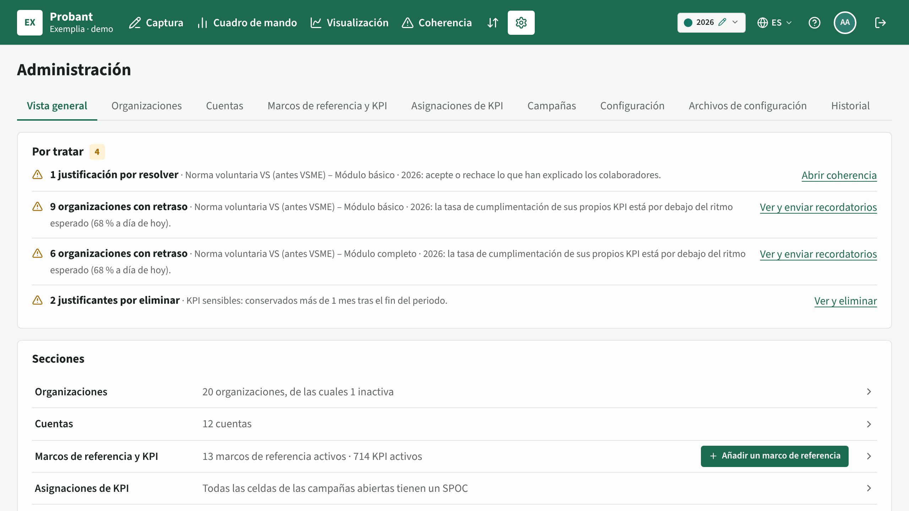

## Poner en marcha una instalación nueva {#setup}

El primer arranque abre un asistente de 8 pasos. Empieza por su propia cuenta de administrador.

1. Introduzca la cuenta, la organización y los idiomas.
2. Elija un marco de referencia de la biblioteca o componga el suyo.
3. Añada al equipo y cree la primera campaña.

Si sale del asistente, haga clic en **Administración › Configuración › Retomar la puesta en marcha** para continuar.

¿Tiene una copia de seguridad de la herramienta, hecha por otro servidor o por la versión todo en uno? Cree su cuenta en el paso 1. A partir del paso 2, mientras la instalación esté vacía, abra **Partir de una copia de seguridad**, elija el archivo y confirme. Conserva su contraseña y sigue siendo administrador. Las demás cuentas de la copia de seguridad no tienen contraseña: asígneles una contraseña provisional en **Administración › Cuentas**. En una instalación en servicio, un gestor de espacios hace lo mismo en **Administración › Configuración › Alojamiento**.

## Añadir un marco de referencia {#framework}

1. Haga clic en **Administración** en la barra superior. En la **Vista general**, haga clic en **Añadir un marco de referencia** en la línea **Marcos de referencia y KPI**.
2. Elija **Instalar desde la biblioteca**, **Componer a partir de KPI existentes** o **Importar un archivo**.
3. Abra la pestaña **Contenido** del marco de referencia para ordenar los temas y los KPI.

La ficha del KPI define el tipo de respuesta, la unidad, la fórmula y si se exige un justificante. Elija «Restringido» o «Confidencial» en **Confidencialidad** para un KPI sensible.

En cuanto un KPI tiene un valor guardado o importado, su unidad ya no puede cambiar, igual que su formato. La herramienta lo indica al guardar. Mantenga la unidad, o cree un nuevo KPI en la unidad que quiera. Para trasladar los valores antiguos, expórtelos, conviértalos en el archivo y luego impórtelos en el nuevo KPI.

Un ejercicio cerrado conserva su lista de KPI. Para añadir un KPI también a los ejercicios pasados, fije su periodo **Solicitado desde** (vea la sección siguiente).

## Elegir desde cuándo se solicita un KPI {#requested-since}

Cada KPI de un marco de referencia tiene un periodo **Solicitado desde**: el primer ejercicio, o el primer periodo, en el que el marco lo solicita. Cuando crea un KPI, la herramienta pregunta «¿Añadirlo también a los ejercicios anteriores?». Por defecto, el KPI se solicita a partir del periodo en curso, y ningún ejercicio pasado cambia.

1. Vaya a **Administración › Marcos de referencia y KPI**, abra el marco y luego la pestaña **Contenido**.
2. Lea el periodo al final de cada fila. «Desde el principio» significa que el KPI estaba antes de este ajuste.
3. Marque uno o varios KPI, o haga clic en el periodo de una fila. En la barra de acciones, elija el periodo en **Solicitado desde**.
4. Haga clic en **Aplicar**. La herramienta muestra los ejercicios que cambian y cuántas casillas añade. Confirme para guardar.

Un ejercicio cerrado no cambia mientras está cerrado: ninguna casilla, ningún total nuevo, la misma tasa de cumplimentación. El KPI aparece cuando reabre el ejercicio, en los dos modos, y se queda en el siguiente cierre. Un ejercicio ya reabierto recibe las casillas en seguida.

No puede retrasar el periodo si un ejercicio que pierde el KPI está cerrado, o tiene para él un valor, un N/A, un comentario o un justificante. Si sus casillas están vacías, la herramienta le pide que confirme. El historial registra cada cambio. Cuando un KPI calculado se solicita antes que una de sus fuentes, la herramienta le avisa: la fuente tiene casillas desde el mismo periodo.

## Elegir la moneda de los importes {#currency}

Las plantillas de la biblioteca escriben sus importes en euros. Si sus estados financieros usan otra moneda, ajústela antes de instalar una plantilla:

1. Vaya a **Administración › Marcos de referencia y KPI › Unidades y formatos**.
2. En **Moneda de referencia**, elija la moneda y haga clic en **Guardar**.

Cuando instala o actualiza una plantilla de la biblioteca, sus importes toman esta moneda: «€» pasa a «$», «M€» pasa a «M$» y «€/h» pasa a «$/h». Las pantallas de la instalación indican la moneda. Un KPI que ya existe en el espacio conserva su unidad, tenga valores o no; solo los KPI nuevos toman la moneda.

La herramienta no convierte ningún valor ni usa tipos de cambio. Si cambia la moneda más tarde, los KPI que ya existen conservan su unidad, y la página cuenta los KPI cuya unidad está en otra moneda. El libro oficial del EFRAG usa la moneda de referencia como moneda del informe. Deja vacío un importe cuya unidad está en otra moneda, y el informe de la exportación lo indica.

Cada espacio tiene su propia moneda de referencia. Un espacio nuevo empieza con el euro.

## Añadir las organizaciones {#organisations}

1. Vaya a **Administración › Organizaciones**.
2. Haga clic en **Nueva organización**, elija su organización superior y haga clic en **Crear la organización**.
3. Para un centro que abre durante el año, indique su fecha en **Abierta desde**. El centro cuenta en los totales, y se le piden valores, solo en los periodos que terminan en esa fecha o después. Si la deja vacía, el centro cuenta como abierto desde siempre. Al pegar varias organizaciones, escriba la fecha entre corchetes: «Lyon [2026-03-01]».

Los niveles del árbol (por ejemplo Grupo, País, Filial, Centro) se configuran en **Administración › Configuración › Niveles del árbol**.

En esta pantalla y en **Unidades y formatos**, los nombres de los niveles y de las unidades aparecen en su idioma. Los campos que usted escribe mantienen el idioma de referencia de la instalación, y la etiqueta lo nombra (por ejemplo «Nombre (idioma de referencia: Français)»). La traducción a su idioma se muestra junto al campo. Para cambiarla, use **Configuración › Idiomas**.

Una organización nunca abre antes que su organización superior: la fecha que cuenta es la más tardía entre la suya y las de las organizaciones que están por encima. Cuando un cambio de fecha o de organización superior sacaría valores de los totales, la ficha los cuenta, incluidos los de las organizaciones de debajo, y pide una confirmación. Un valor para una organización que aún no está abierta en el periodo se rechaza en la pantalla, en una importación y mediante un asistente. El mensaje enlaza con la ficha que lleva la fecha.

## Crear las cuentas {#accounts}

1. Vaya a **Administración › Cuentas**.
2. Haga clic en **Nueva cuenta**, o en **Varias cuentas** para crear muchas a la vez.
3. Introduzca el correo electrónico y el nombre, y elija el **Rol**: administrador, validador, colaborador, lector o auditor.
4. Haga clic en **Crear la cuenta**. Envíe la contraseña provisional a la persona.

Para dar una nueva contraseña provisional, abra la cuenta y haga clic en **Restablecer la contraseña**. La persona elige su propia contraseña en el primer inicio de sesión.

Un lector o un auditor no introduce ni valida nada. Cuando cambie el rol de una cuenta a uno de estos dos, la herramienta indica cuántas asignaciones va a retirar y pide una confirmación antes de guardar. Las retira, con una línea en el Historial. Volver al rol anterior no las devuelve. Para dárselas a otra persona, use antes **Sustituir a una persona…**. Para volver a darlas más tarde, use **Asignaciones de KPI** (opción **Validadores** para las asignaciones de validador).

**Por tratar** enumera las cuentas que pasaron a solo lectura antes de esta regla y aún tienen asignaciones. Haga clic en **Revisar** y luego en **Retirar** en una línea. Una cuenta desactivada conserva sus asignaciones hasta que use **Sustituir a una persona…**.

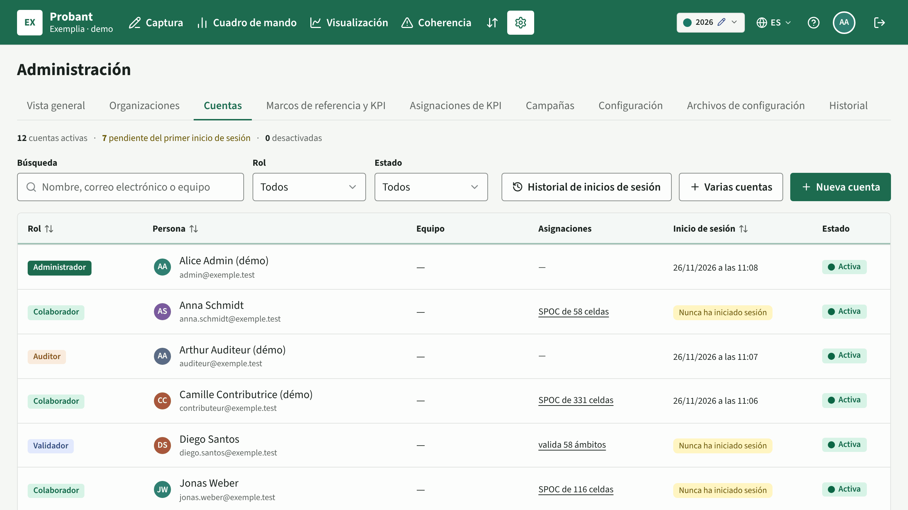

Para ver quién inició sesión y cuándo, haga clic en **Historial de inicios de sesión** en **Administración › Cuentas**. Cada línea da la fecha, la cuenta y el resultado: **Correcto**, **Fallido** o **Bloqueado: demasiados intentos**. Un usuario que no corresponde a ninguna cuenta del espacio solo aparece con una referencia, nunca con el texto escrito. Filtre por resultado o por periodo, o busque un nombre. Configure cuánto tiempo se guarda el historial en **Administración › Configuración › Alojamiento** (180 días por defecto).

## Administrador o gestor de espacios {#space-manager}

Un administrador configura su espacio: las cuentas, los marcos de referencia, las campañas y los ajustes del espacio. Un gestor de espacios configura toda la instalación. Solo un gestor de espacios puede:

- crear, cambiar el nombre y archivar los espacios, y bloquear el inicio de sesión en todos los espacios (**Administración › Configuración › Espacios**);
- cambiar el servidor de correo, las alertas por correo, la copia externa de las copias de seguridad y las actualizaciones automáticas (**Configuración › Alojamiento** y **Configuración › Estado**);
- configurar el inicio de sesión de empresa;
- restaurar una copia de seguridad procedente de otra instalación.

Solo un gestor de espacios puede también cambiar el nombre, el correo o la contraseña de otro gestor de espacios.

En **Administración › Cuentas**, la etiqueta **Gestor de espacios** aparece junto al rol. Para nombrar o retirar a un gestor de espacios, abra la cuenta y use el recuadro **Administrador o gestor de espacios**. Solo un gestor de espacios ve el botón, y solo se puede nombrar a un administrador activo del espacio principal. Un gestor de espacios que deja de ser administrador activo del espacio principal (otro rol, cuenta desactivada, inicio de sesión bloqueado) pierde este rol: la ficha de la cuenta pide una confirmación antes de guardar. La herramienta siempre conserva un gestor de espacios que puede actuar: nadie puede desactivar, cambiar de rol, eliminar ni bloquear al último, y la herramienta pide nombrar primero a otro gestor de espacios. No puede retirarse este rol. Cada cambio añade una línea al **Historial**.

## Asignar los KPI {#assign}

Cada celda de la cuadrícula es un KPI de una organización. El SPOC es la persona que lo captura.

1. Vaya a **Administración › Asignaciones de KPI**.
2. Haga clic en una celda y elija una o varias personas. También puede seleccionar una fila o una columna y hacer clic en **Asignar**.
3. Haga clic en **Sustituir a una persona…** cuando alguien se va.
4. Marque **Solo las filas por completar** para ver lo que falta.

Para elegir los validadores, seleccione **Validadores** en la lista **Rol**. Una asignación de validador vale para un KPI en una organización y en todas las organizaciones que dependen de ella: la cuadrícula tiene entonces una pestaña por nivel de organización, con los KPI capturados en ese nivel o por debajo. Una celda marcada «vía …» ya está cubierta por el validador de una organización superior. Solo se proponen los validadores y los administradores activos. Una celda sin validador la validan los administradores. Cada asignación dada o retirada escribe una línea en el Historial.

Para un grupo grande, la cuadrícula muestra un grupo de organizaciones cada vez. Elija el grupo en la lista **Organizaciones** situada encima de la cuadrícula. Los filtros y el guardado en bloque se aplican al grupo mostrado. **Todas (lento para un grupo grande)** muestra todo, pero la herramienta no lo recuerda.

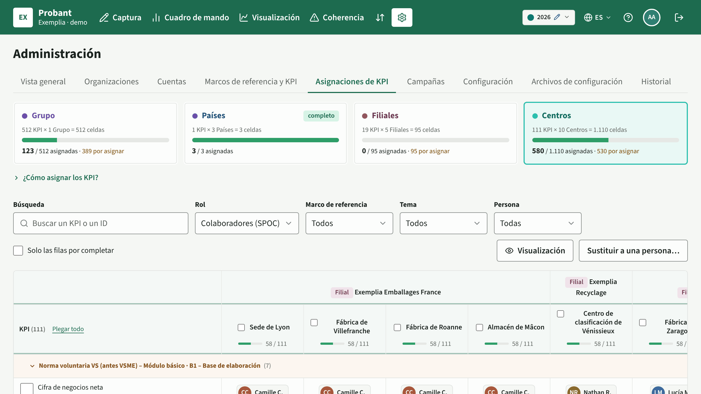

## Abrir, revisar, cerrar y reabrir una campaña {#campaign}

1. Vaya a **Administración › Campañas** y haga clic en **Nueva campaña** en la línea del marco de referencia.
2. Elija el periodo, defina las fechas y el **Umbral de desviación**, y haga clic en **Crear la campaña**.
3. Haga clic en **Gestionar** en una campaña. Use **Abrir la captura**, **Pasar a revisión** o **Cerrar definitivamente**.
4. Para modificar una campaña cerrada, haga clic en **Reabrir a los colaboradores** o en **Reabrir para corregir (revisión)**. El historial registra la reapertura.
5. Al reabrir un año cerrado, elija primero:
   - **Conservar las cifras de la época** (elegido de forma predeterminada): no se recalcula nada. Solo se recalculan la organización cuyo valor corrija y los totales que están por encima. Ejemplo: una organización que desde entonces pasó a otro país se queda en los totales de su antiguo país.
   - **Recalcular con la organización de hoy**: todos los totales del año se recalculan con el árbol y las fórmulas de hoy. Ejemplo: la organización trasladada pasa sus valores a los totales de su nuevo país.

   Un año reabierto conservando las cifras de la época conserva el árbol de organizaciones de su cierre: una corrección se recalcula con los padres de la época, y una organización creada desde entonces no tiene casilla en ese año. Su elección vale hasta el próximo cierre.

   Cuando un año tiene dos campañas (dos marcos de referencia) y una de ellas está cerrada, los KPI que pide la campaña cerrada conservan sus cifras hasta que la otra campaña también se cierre: un cambio en las organizaciones o **Rehacer los cálculos** ya no los cambia, y conservan el árbol de organizaciones del día del cierre. Un KPI común a las dos campañas también conserva sus cifras. Solo una corrección importada en la campaña cerrada recalcula la organización corregida y sus totales. Con **Recalcular con la organización de hoy**, los KPI de otra campaña del año que sigue cerrada conservan sus cifras.

Una campaña cerrada queda congelada para todos, administradores incluidos. Sus valores pasan a ser el N-1 de la siguiente. **Rehacer los cálculos** rara vez es necesario.

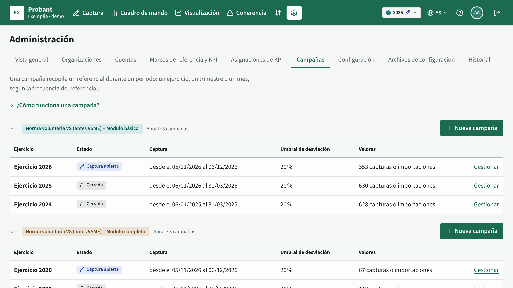

## Introducir y comprobar valores {#entry}

**Captura** enumera las casillas de la campaña abierta, por organización y por KPI. Las ve todas y puede introducir o corregir un valor en cualquier casilla. Use los filtros para encontrar un KPI, una organización o un estado y haga clic en una casilla para abrir su panel.

## Reabrir una captura validada {#reopen}

1. Vaya a **Captura** y abra la fila del valor.
2. Haga clic en **Volver a borrador**. El valor no cambia.
3. El colaborador lo modifica y lo valida de nuevo.

**Borrar el valor** vacía la celda en su lugar. Las dos acciones quedan en el historial.

## Un KPI bloqueado por una campaña cerrada {#shared-closed}

Un KPI puede pertenecer a dos marcos de referencia con el mismo periodo. Su valor es común. Si una campaña está cerrada, nadie puede cambiar el valor en la otra, usted tampoco. El panel nombra la campaña cerrada.

1. Reabra la campaña cerrada: haga clic en **Gestionar** y después en **Reabrir para corregir (revisión)**.
2. Modifique el valor en el panel de captura.
3. Cierre de nuevo la campaña.

## Enviar recordatorios {#reminders}

1. En el **Cuadro de mando**, haga clic en **Recordar…** (o en **Preparar el recordatorio…** si la instalación no envía correos electrónicos). Se abre la página **Recordatorios**.
2. Elija los marcos de referencia. La herramienta selecciona a las personas que aún tienen algo pendiente.
3. Lea la vista previa y haga clic en **Enviar el recordatorio**.

En **Plantilla del mensaje** se cambia el texto. En **Recordatorios automáticos** se definen los días anteriores al fin de la captura. Sin cuenta de correo (SMTP), **Escribir** da el texto para enviarlo usted mismo. Después haga clic en **Marcar como recordado**.

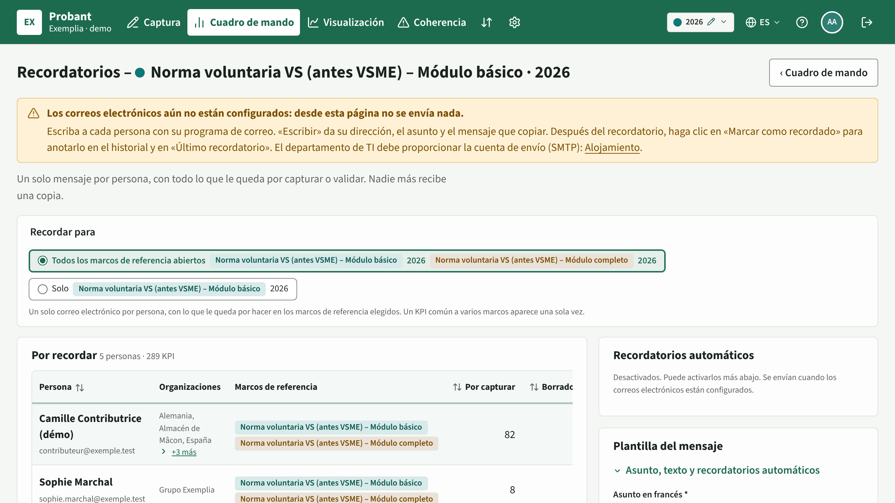

## Obtener el expediente de auditoría {#audit-file}

Un administrador o un auditor puede descargar un archivo Excel con lo que necesita una auditoría: para cada KPI y organización, el valor, el estado, quién lo introdujo y lo validó, los justificantes, las alertas de coherencia y sus justificaciones, y el historial de los cambios. La herramienta solo lee los datos. Crear el archivo no cambia nada.

1. Haga clic en **Importar / Exportar** y después en **Nueva exportación**.
2. En **Presentación**, elija **Expediente de auditoría**. Elija el ejercicio y, si solo necesita algunas, las organizaciones.
3. Haga clic en **Descargar**.

El archivo tiene cuatro hojas: **Léame**, **Auditoría** (una fila por KPI y organización), **Historial** (cada cambio de estos valores, del más antiguo al más reciente) y **Justificantes** (los nombres de los archivos, los tamaños y quién los añadió). La hoja **Léame** indica la fecha, la versión de la herramienta y los filtros. Un archivo grande se prepara en el servidor, como cualquier exportación grande.

Los validadores y los colaboradores no ven el expediente de auditoría: es para administradores y auditores. Un auditor limitado a algunas organizaciones solo obtiene esas.

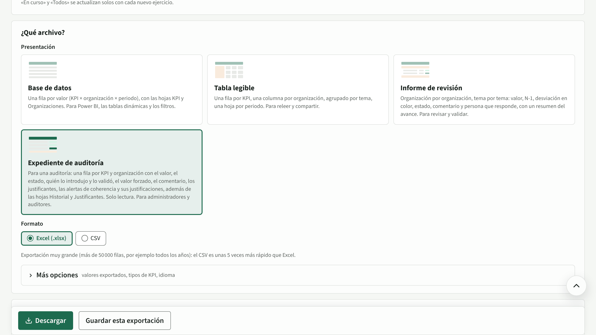

## Imprimir el certificado de cierre {#closing-certificate}

Un administrador puede imprimir una página que resume una campaña cerrada. La herramienta solo lee los datos. Abrir la página no cambia nada.

1. Haga clic en **Administración**, luego en **Campañas** y después en una campaña cerrada.
2. Haga clic en **Certificado de cierre**.
3. Haga clic en **Imprimir**. En la ventana de impresión, elija Guardar como PDF para conservar un archivo.

La página muestra el alcance, la tasa de cumplimentación, el número de valores, los justificantes y las alertas de coherencia. Indica quién cerró la campaña y cuándo, si el historial lo conserva. La huella es un código calculado a partir de todas las cifras de la campaña. Si cambia una cifra, cambia la huella. Para comprobarlo más tarde, vuelva a abrir el certificado y compare las dos huellas.

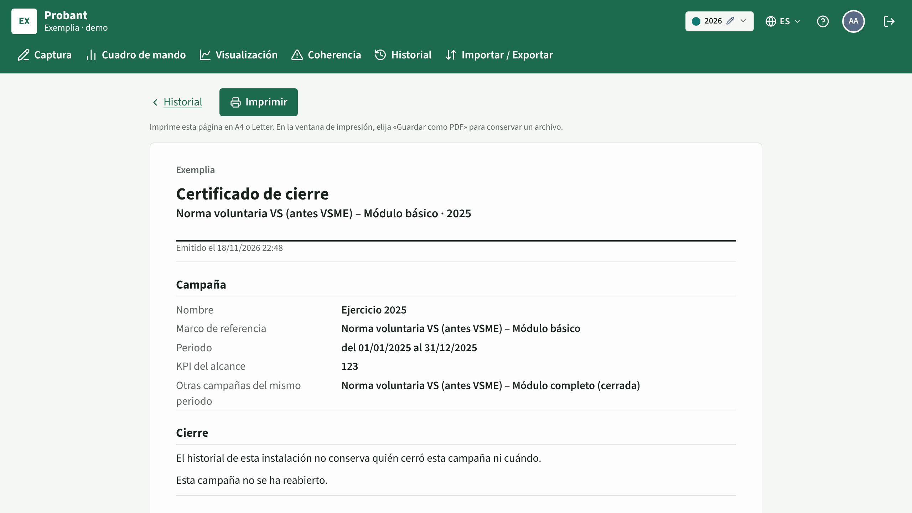

## Obtener una exportación grande {#large-exports}

Por encima de un límite de tamaño, la herramienta prepara en el servidor una exportación o un archivo para rellenar. Abra **Importar / Exportar** y elija **Mis exportaciones**. El archivo está en «Archivos grandes». La herramienta lo conserva 7 días.

Un administrador define el número de días en **Administración › Configuración › Alojamiento**, en el bloque «Exportaciones grandes».

## Eliminar los justificantes de los KPI sensibles {#evidence-delete}

La herramienta conserva los archivos de justificantes. Nunca los elimina por sí sola.

1. Vaya a **Administración › Configuración › Alojamiento**. En **Justificantes de los KPI sensibles**, introduzca el número en **Meses antes de proponer la eliminación**.
2. Haga clic en **Administración › Historial** y después en **Justificantes por eliminar**.
3. La página enumera los archivos cuyas campañas están todas cerradas y cuyo periodo terminó hace más meses que ese número.
4. Seleccione los archivos y haga clic en **Eliminar la selección**. O haga clic en **Eliminar** en una línea.

Atención: la eliminación es definitiva. El archivo no va a la papelera. El historial registra cada eliminación sin el contenido del archivo. El valor de la respuesta no cambia.

Las copias de seguridad hechas antes conservan el archivo hasta que la herramienta las sustituye. Una restauración devuelve el archivo a **Justificantes por eliminar**: elimínelo de nuevo. Las copias de las copias de seguridad que el equipo informático guarda fuera de la herramienta también conservan el archivo: pida al equipo informático que las elimine. Defina el número de copias que se conservan en **Administración › Configuración › Alojamiento**, en **Copia de seguridad automática**, para que las copias antiguas desaparezcan pronto.

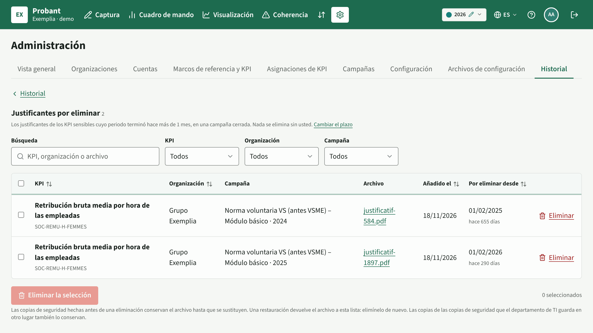

## Añadir o traducir un idioma {#languages}

Los menús y los botones existen en francés, inglés, español, alemán, italiano, neerlandés y portugués. Cada persona elige su idioma en **Mi cuenta**. Los nombres de los KPI, los temas y las unidades se configuran en **Administración › Configuración › Idiomas**.

1. Haga clic en **Añadir un idioma**, o abra un idioma y haga clic en **Traducir**.
2. Para traducir en bloque, use **Exportar** e **Importar**, o **Traducir todos los idiomas de una vez**.

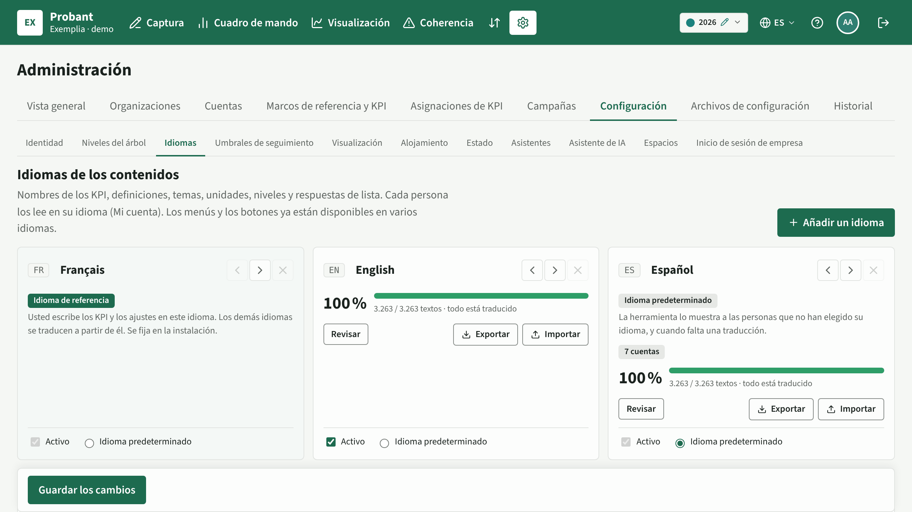

## Conectar un asistente (MCP) {#assistants}

Un asistente de IA, por ejemplo Claude, puede leer y modificar datos con los derechos de la persona que lo conecta, nunca más. Está desactivado de forma predeterminada.

1. Vaya a **Administración › Configuración › Asistentes**.
2. Marque **Permitir asistentes de IA (MCP) en este espacio**.
3. Marque **Los asistentes también pueden modificar** solo si las personas lo necesitan. Los lectores y los auditores nunca modifican nada.
   En **Lo que reciben los asistentes**, elija **Un lector puede leer los valores mediante un asistente** (desactivado de forma predeterminada) y **Los KPI sensibles se dan a los asistentes** (activado de forma predeterminada; si se desactiva, los KPI marcados como Restringido o Confidencial, y los KPI calculados a partir de ellos, se ocultan a todas las herramientas). Un lector nunca recibe un borrador, solo valores validados.
4. Haga clic en **Guardar**. Dé la **Dirección del servidor de este espacio** a las personas.

Cada persona crea un token en **Mi cuenta**. En **Tokens activos**, haga clic en **Revocar** para cortar un asistente de inmediato. El historial registra cada llamada y muestra «(vía MCP)» después de cada modificación.

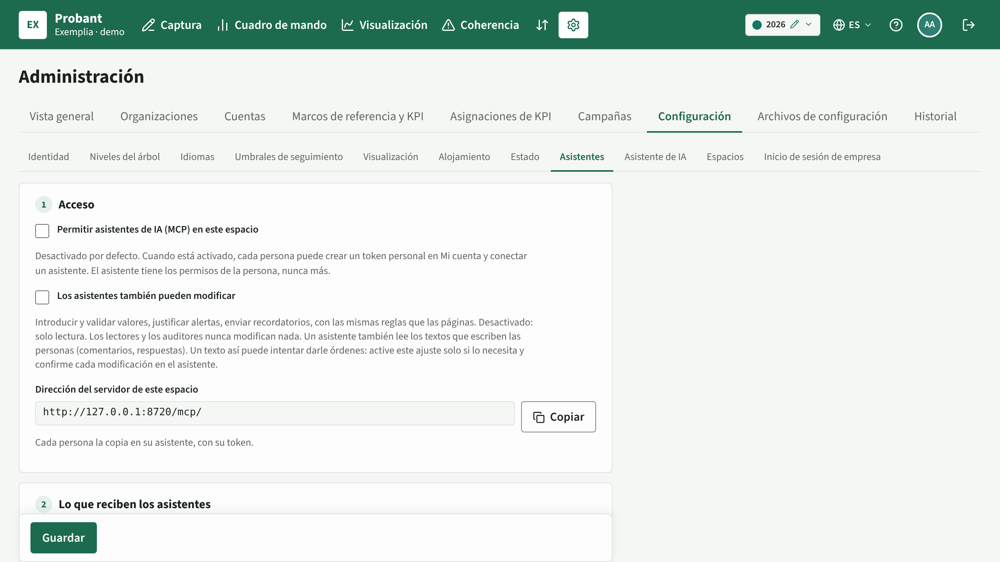

## Activar el asistente de IA {#ai}

El asistente de IA explica las alertas de coherencia, propone correspondencias de KPI en el asistente de migración y propone traducciones. Está desactivado de forma predeterminada. Nada sale de la herramienta hasta que usted lo active.

1. Vaya a **Administración › Configuración › Asistente de IA**.
2. Marque **Activar el asistente de IA**.
3. Elija el **Proveedor** y el **Modelo**.
4. Introduzca la **Clave de API de su cuenta del proveedor**. La herramienta la guarda solo para este espacio y no la vuelve a mostrar. Haga clic en **Quitar la clave** para eliminarla.
5. En **Usos**, marque los usos que desee. **Los KPI sensibles se pueden enviar al asistente de IA** está desactivado por defecto: no se envía nada de un KPI marcado como Restringido o Confidencial, ni de un KPI calculado a partir de él, y sus alertas no tienen **Explicar con IA**. Haga clic en **Guardar**.

Cada respuesta es una propuesta marcada «Propuesto por IA». Nada se guarda hasta que una persona hace clic y guarda como de costumbre. El historial registra cada llamada sin su contenido.

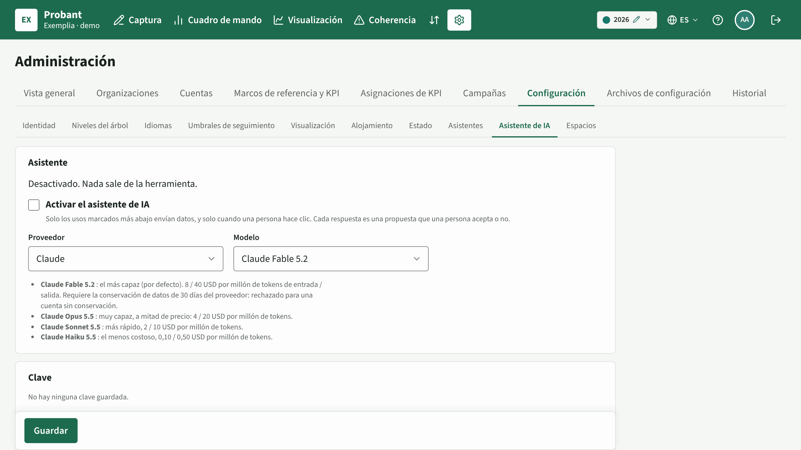

## Comprobar el alojamiento y las copias de seguridad {#hosting}

Vaya a **Administración › Configuración › Alojamiento**. La página muestra la versión, la copia de seguridad automática, el control de los datos y la configuración del correo. Haga clic en **Crear y descargar una copia de seguridad** para hacer una de inmediato. El equipo informático copia las copias de seguridad en otro lugar. O un gestor de espacios configura una copia en el bloque **Copia fuera del servidor**: la herramienta copia entonces ella misma cada copia de seguridad a un almacenamiento compatible con S3 o a un servidor SFTP que proporciona el equipo informático, y le avisa si una copia falla.

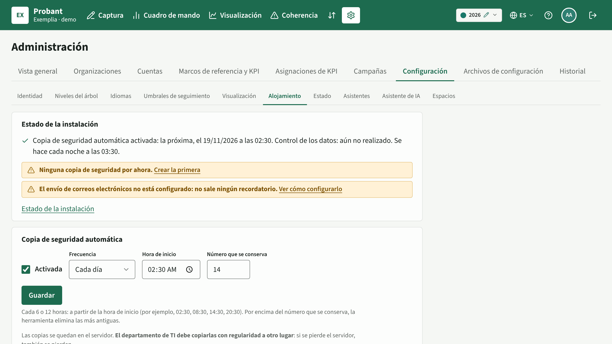

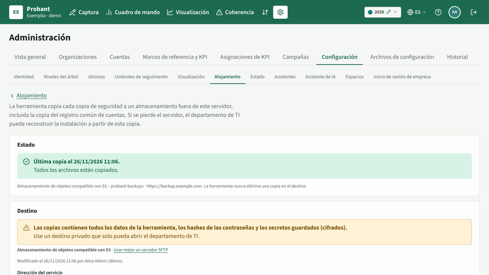

Para configurar el servidor de correo, use el bloque **Correos electrónicos** de la misma página. Estos ajustes valen para todos los espacios: solo un gestor de espacios puede cambiarlos. Introduzca el servidor, el puerto, la seguridad, el usuario, la contraseña y la dirección de envío que le proporciona el equipo informático. Haga clic en **Guardar** y luego en **Enviar un correo de prueba**. Si el correo no se envía, un mensaje da la causa con palabras sencillas. La contraseña no se vuelve a mostrar nunca. Si el equipo informático configuró el correo en el archivo de ajustes, el bloque muestra estos ajustes en solo lectura.

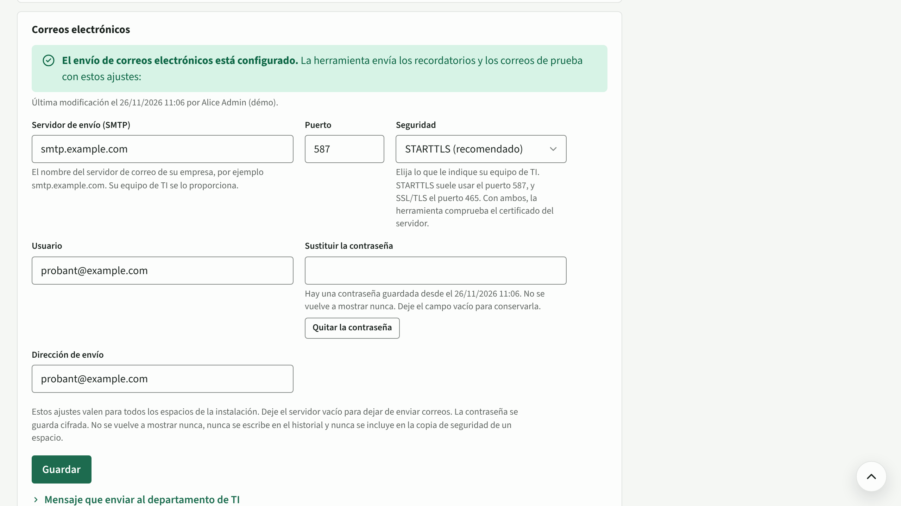

Para ver de un vistazo si todo va bien, vaya a **Administración › Configuración › Estado**. Cada línea (versión, base de datos, archivos, última copia de seguridad, espacio en disco, correo electrónico, tareas en segundo plano, actualización de la base, HTTPS) muestra **Correcto**, **Por revisar** o **Averiado**, y qué hacer. El administrador de un espacio que no es el espacio principal ve las mismas líneas, pero las líneas base de datos y actualización de la base solo comprueban su espacio y el registro común de cuentas, no los otros espacios. No ve el detalle para TI (nombres de los otros espacios, carpetas del disco): el gestor de espacios lo ve. En **Configuración › Alojamiento**, el bloque **Para TI** no le muestra la carpeta de datos, las direcciones permitidas, el servidor de la base, el usuario del correo electrónico ni la carpeta de las copias de seguridad.

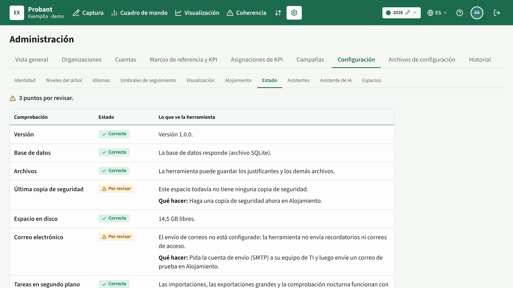

La herramienta también puede avisarle por correo. Al final de **Configuración › Estado**, un gestor de espacios activa las **Alertas por correo** y elige los destinatarios: por defecto los administradores del espacio principal y los gestores de espacios, más otras direcciones, por ejemplo el buzón del equipo de TI. Cuando aparece un problema (copia de seguridad fallida o con retraso, disco casi lleno, tarea en segundo plano detenida, correos fallidos…), los destinatarios reciben un correo que dice qué hacer. Después reciben un recordatorio como máximo una vez al día mientras dure el problema, y un correo cuando se resuelve. En una instalación nueva, las alertas están activadas desde el principio. Una instalación que ya existía antes de ellas las mantiene desactivadas hasta que un gestor de espacios las activa. La página dice qué caso se aplica. Haga clic en **Enviar una alerta de prueba** para comprobarlas. Cuando el servidor está apagado, la herramienta no puede avisar a nadie.

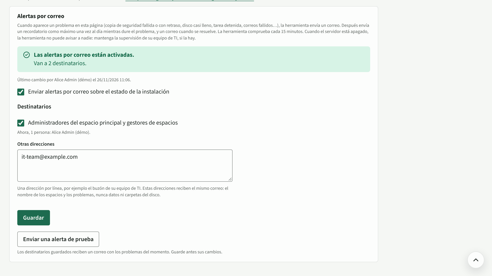

El bloque **Actualizaciones automáticas** de **Configuración › Alojamiento** muestra la última comprobación del servidor y su resultado. Un gestor de espacios elige lo que ocurre cuando se publica una nueva versión: **Instalarla automáticamente** (por la noche, después de una copia de seguridad; si la nueva versión no funciona, el servidor vuelve a la versión anterior), **Solo avisar** (el equipo de TI la instala) o **Desactivado**, y cuántos días esperar después de la publicación (3 por defecto). Tras una instalación nueva con un solo comando, la opción es **Instalarla automáticamente**. Es una tarea del servidor la que hace el trabajo, nunca la herramienta. Si la pantalla dice que la tarea no está instalada, pida al equipo de TI que la instale.

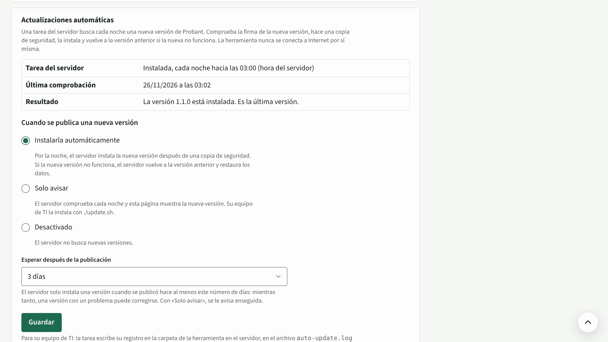

## Ver los totales de cada nivel {#consolidation}

**Consolidación** muestra el valor de cada KPI en cada nivel del árbol, desde los sitios hasta el grupo. Elija los KPI que desea mostrar, abra una fila para ver las organizaciones que hay debajo y exporte la tabla a Excel. Una mención indica cuándo un total está incompleto.

## Tratar las alertas y las reglas de coherencia {#consistency}

**Coherencia** enumera las alertas de la campaña: valores inusuales, grandes diferencias con N-1 y reglas que no se cumplen. Haga clic en una alerta para leer el hallazgo y la explicación del colaborador, y luego acéptela, recházela o descártela. En **Reglas de coherencia** se definen las reglas. Una regla **Bloqueante** impide que el colaborador valide mientras no se cumpla.

## Importar valores desde un archivo {#import-values}

Haga clic en **Importar / Exportar** y luego en **Importar valores**. Elija el archivo, lea la vista previa y confirme. La herramienta no guarda nada antes de su confirmación y aplica las mismas reglas que el panel de captura.

Los números de las celdas de Excel se leen tal cual. Un número escrito como texto se lee en el idioma del archivo. En un archivo CSV, lo indica el separador de columnas: «;» va con la coma decimal, «,» con el punto. Si no, lo indica el encabezado de la columna de valores: en inglés, «1,234» es 1234; en español, 1,234. La vista previa indica cómo leyó los números y señala un valor como «1,234». El asistente **Recuperar un sistema anterior** los lee en el idioma de su pantalla.

Si el archivo contiene cifras para KPI calculados de un periodo no cerrado, la vista previa las cuenta y le pide elegir entre forzar estos valores o ignorar estas filas. Las cifras forzadas pasan a ser valores forzados: sustituyen al resultado del cálculo, y los totales y las fórmulas que las usan se vuelven a calcular. **Por tratar** también indica las cifras importadas tal cual en celdas calculadas antes de esta regla: abra **Valores forzados** y elija **Forzar** o **Retirar** para cada una.

## Exportar a un formato oficial {#official-formats}

**Formatos oficiales** exporta los valores al libro oficial de una norma, por ejemplo el libro de la EFRAG para la norma VS. La herramienta solo escribe las celdas de captura. Abra el archivo exportado en Excel y guárdelo antes de convertirlo.

## Guardar una lista de KPI {#kpi-lists}

**Listas de KPI** agrupa bajo un nombre los KPI que sigue con frecuencia. Elija una lista con un clic en una exportación o en un archivo para completar.

## Leer los gráficos y crear vistas {#visualisation}

**Visualización** muestra los gráficos de las vistas. Abra una vista, cambie los filtros de arriba y use el menú «…» de un gráfico para mostrar sus datos o exportarlo. También puede crear una vista, modificarla y compartirla.

## Cambiar los ajustes de la herramienta {#settings}

**Configuración** reúne lo que puede ajustar en la herramienta: la identidad, los niveles del árbol de organizaciones, los umbrales, los colores de los gráficos, los idiomas, el asistente de IA, los asistentes y el alojamiento. Nadie necesita modificar código.

## Gestionar los espacios {#spaces}

**Espacios** enumera los espacios de esta instalación. Cada espacio tiene sus propios datos: marcos de referencia, organizaciones, campañas, valores, justificantes e identidad. Las cuentas son comunes: una persona inicia sesión una sola vez.

## Iniciar sesión con la cuenta de empresa {#company-sign-in}

Un gestor de espacios puede permitir que cada persona inicie sesión con su cuenta de empresa (OpenID Connect, por ejemplo Microsoft Entra ID, Google, Okta o Keycloak). La cuenta de empresa solo demuestra quién es la persona: las cuentas, los roles y las asignaciones se siguen creando en la herramienta. Una persona necesita una cuenta activa con el mismo correo electrónico.

1. Vaya a **Administración › Configuración › Inicio de sesión de empresa**.
2. Copie la **URI de redirección** en la aplicación de su proveedor. Introduzca la **Dirección del proveedor (issuer)**, el **ID de cliente** y el **Secreto de cliente**.
3. Haga clic en **Comprobar el proveedor**. Marque **Permitir el inicio de sesión con la cuenta de empresa** y haga clic en **Guardar**.

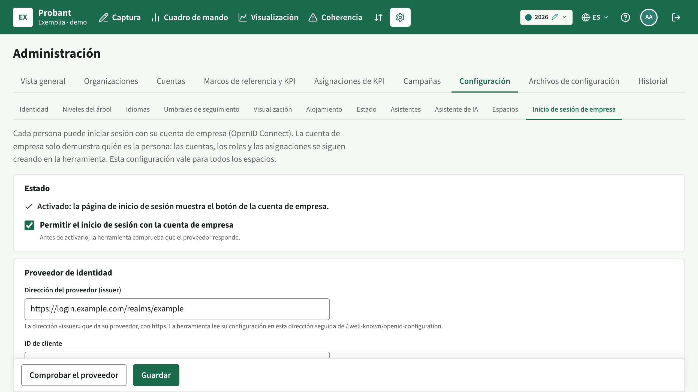

Una vez activado, solo los gestores de espacios conservan su contraseña, como cuentas de emergencia. **Cerrar sesión** cierra la sesión solo en la herramienta, no en el proveedor. El **Historial de inicios de sesión** muestra el método de cada inicio de sesión.

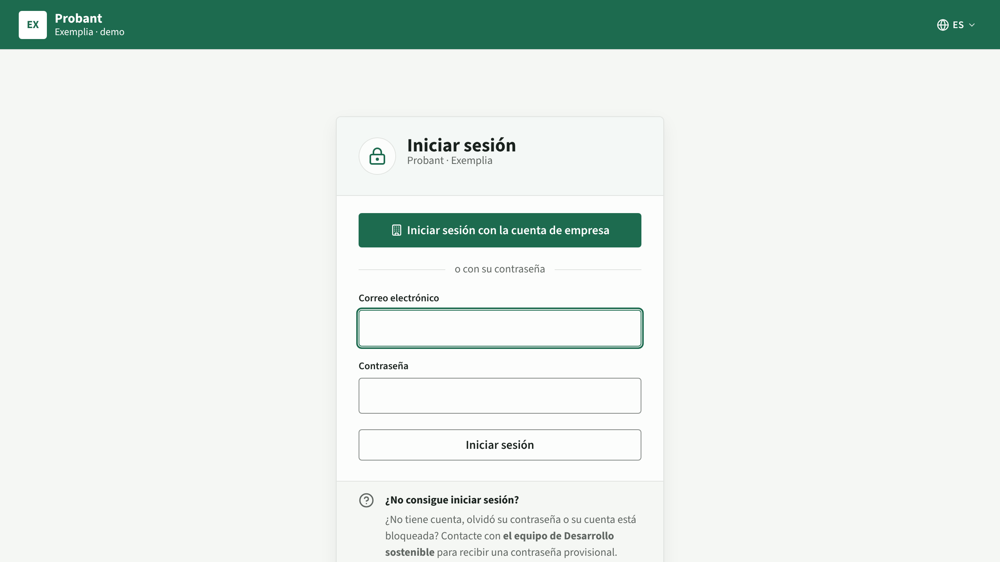

## Seguir cada cambio {#history}

Haga clic en **Administración** en la barra superior y luego en **Historial**. En **Registro**, elija **Captura de datos** para ver los valores, las validaciones y los justificantes, o **Modificaciones de administración** para ver las campañas, el marco de referencia, las organizaciones y las cuentas. La herramienta nunca elimina nada del historial.

## Ver la visita guiada otra vez {#tour}

En su primer inicio de sesión, una visita breve muestra dónde actuar. No bloquea la pantalla. Su navegador recuerda que la ha visto.

1. Haga clic en **Ayuda** en la barra superior.
2. Haga clic en **Ver la visita guiada otra vez**.
3. Haga clic en **Siguiente** para continuar y en **Terminar** al final. Para detenerla, haga clic en **Cerrar la visita**, pulse Esc o haga clic en **No volver a mostrar**.

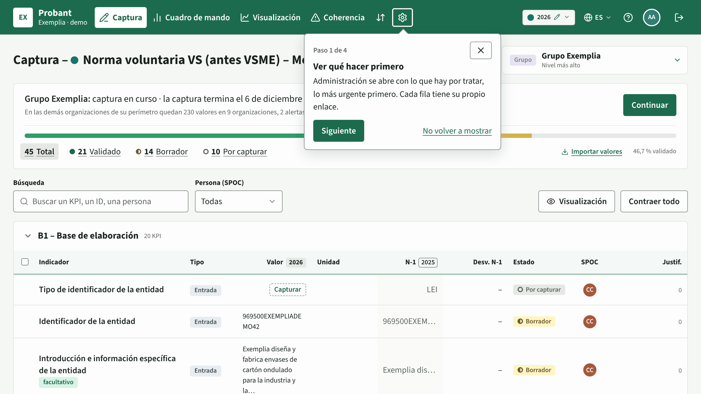

## Cambiar mi idioma o mi contraseña {#account}

Haga clic en su nombre y después en **Mi cuenta**. Elija el **Idioma** y cambie su contraseña en **Cambiar mi contraseña**.

**Mis últimos inicios de sesión**, en **Mi cuenta**, muestra sus últimos inicios de sesión en este espacio. Si no reconoce uno, cambie su contraseña y avise a un administrador.
