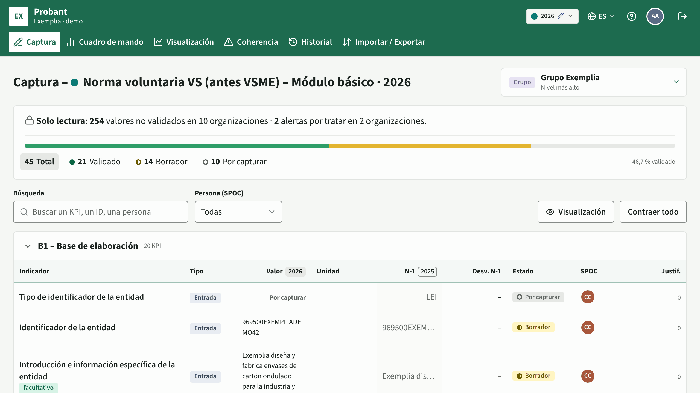
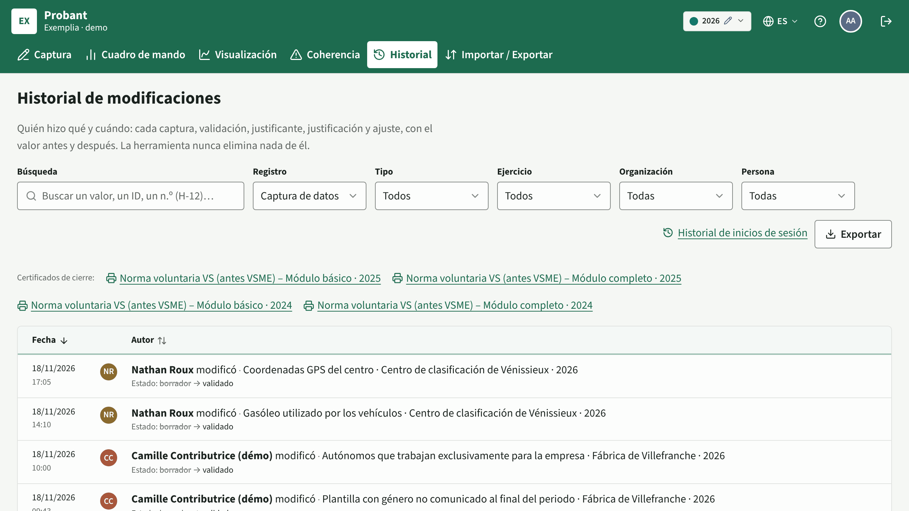
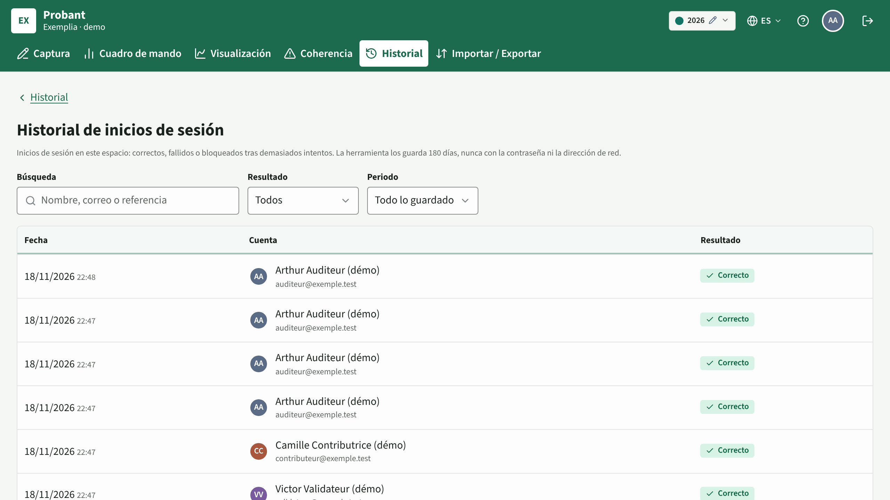
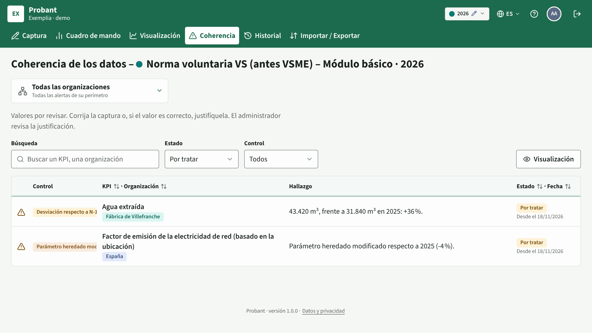
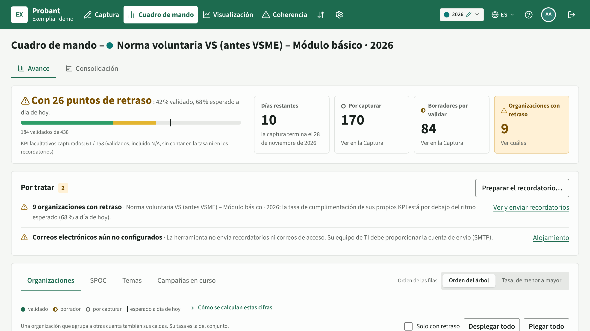
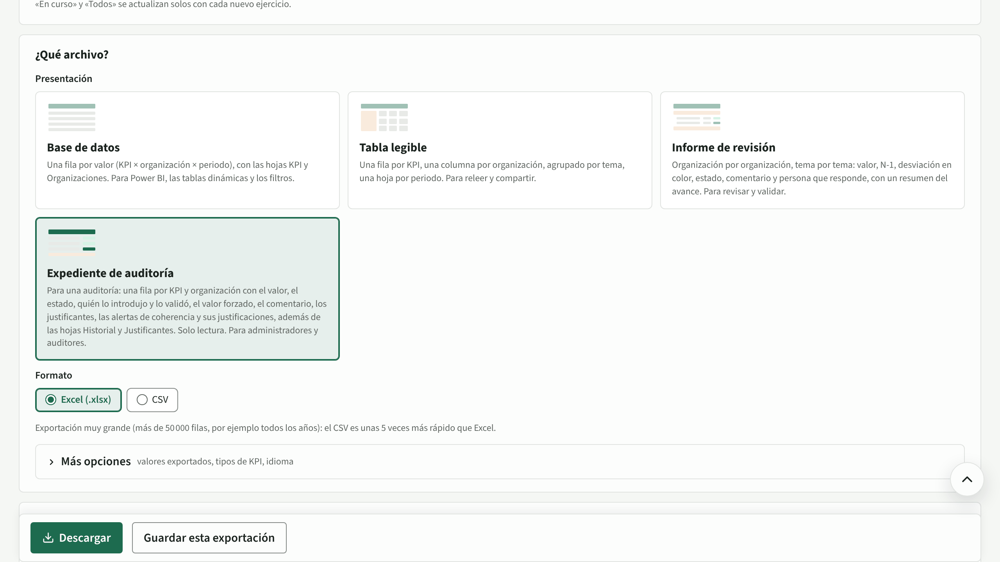
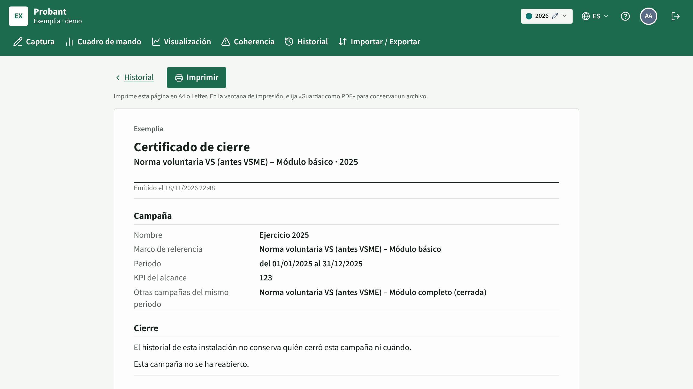

# Guía del auditor

Usted puede ver todos los valores, sus justificantes y su historial. Nunca cambia nada: el rol de auditor es de solo lectura. Versión en inglés: [`docs/guides/auditor.md`](../../guides/auditor.md).

## Consultar los valores de una organización {#read-only}

1. Haga clic en **Captura** en la barra superior. La página se abre en la organización más alta de su ámbito.
2. Haga clic en el nombre de la organización, arriba a la derecha de la página, y elija la organización en la lista.
3. Use **Buscar** y los filtros situados encima de la tabla para encontrar un KPI.
4. Haga clic en una fila para abrir el panel. Muestra el valor, el comentario, los justificantes y el historial por ejercicio.

Abra **Visualización** y marque **Mostrar los KPI calculados y consolidados** para ver los totales y los componentes de cada cálculo.

## Abrir los justificantes {#evidence}

1. Abra el panel de un valor.
2. En **Justificantes**, haga clic en el nombre de un archivo para abrirlo.

La columna **Justificantes** de la tabla muestra el número de archivos de cada KPI.

## Seguir cada cambio {#history}

1. Haga clic en **Historial** en la barra superior.
2. Elija **Captura** para ver los valores, las validaciones y los justificantes. Elija **Modificaciones de administración** para ver las campañas, el marco de referencia, las organizaciones y las cuentas.
3. Filtre por ejercicio, organización o persona.
4. Haga clic en **Exportar** para obtener el registro como archivo.

El historial muestra quién hizo qué y cuándo, con el valor anterior y el posterior. La herramienta nunca elimina nada de él. Un cambio hecho por un asistente de IA muestra «(vía MCP)».

Tres líneas de **Modificaciones de administración** necesitan una explicación:

- «retiró las asignaciones (rol de solo lectura)»: una cuenta pasó a lector o auditor y perdió sus asignaciones. La línea las enumera por rol, con «Ver el texto completo» cuando la lista es larga.
- «añadió un KPI al alcance de un periodo reabierto»: un ejercicio cerrado conserva su lista de KPI, y un administrador añadió este KPI a propósito mientras la campaña estaba reabierta.
- «eligió cómo reabrir una campaña»: el administrador conservó las cifras de la época o recalculó con la organización de hoy.

## Ver quién ha iniciado sesión {#sign-ins}

1. Haga clic en **Historial** en la barra superior.
2. Haga clic en **Historial de inicios de sesión** al final de la barra de filtros.
3. Filtre por nombre o correo electrónico, por resultado o por periodo.

Cada línea muestra la fecha, la cuenta y el resultado: **Correcto**, **Fallido** o **Bloqueado: demasiados intentos**. Para un usuario desconocido, la herramienta solo muestra una referencia, nunca el texto escrito. La página es de solo lectura. El administrador define cuánto tiempo guarda la herramienta estas líneas. Si su acceso está limitado a algunas organizaciones, esta página no está disponible para usted.

## Leer las alertas de coherencia {#consistency}

1. Haga clic en **Coherencia** en la barra superior.
2. Filtre las alertas por estado, control, KPI u organización.
3. Haga clic en una alerta para leer la constatación y la explicación del colaborador.

Una alerta no bloquea una validación, pero una regla **Bloqueante** sí: el colaborador no puede validar mientras no se cumpla la regla. El administrador decide sobre cada explicación.

## Seguir el avance y los gráficos {#dashboard}

Haga clic en **Cuadro de mando** para ver la cumplimentación por organización y en **Consolidación** para ver los totales de cada nivel. Haga clic en **Visualización** para ver los gráficos. Los borradores pueden contar en las cifras mientras una campaña está abierta. La página lo indica cuando es así.

## Obtener el expediente de auditoría {#audit-file}

Un administrador o un auditor puede descargar un archivo Excel con lo que necesita una auditoría: para cada KPI y organización, el valor, el estado, quién lo introdujo y lo validó, los justificantes, las alertas de coherencia y sus justificaciones, y el historial de los cambios. La herramienta solo lee los datos. Crear el archivo no cambia nada.

1. Haga clic en **Importar / Exportar** y después en **Nueva exportación**.
2. En **Presentación**, elija **Expediente de auditoría**. Elija el ejercicio y, si solo necesita algunas, las organizaciones.
3. Haga clic en **Descargar**.

El archivo tiene cuatro hojas: **Léame**, **Auditoría** (una fila por KPI y organización), **Historial** (cada cambio de estos valores, del más antiguo al más reciente) y **Justificantes** (los nombres de los archivos, los tamaños y quién los añadió). La hoja **Léame** indica la fecha, la versión de la herramienta y los filtros. Un archivo grande se prepara en el servidor, como cualquier exportación grande.

Ve los mismos datos que en las páginas de la herramienta. Si un administrador le limitó a algunas organizaciones, el archivo solo contiene esas.

## Imprimir el certificado de cierre {#closing-certificate}

Puede imprimir una página que resume una campaña cerrada. La herramienta solo lee los datos.

1. Haga clic en **Historial**. Encima de la lista, en **Certificados de cierre:**, haga clic en una campaña.
2. Haga clic en **Imprimir**. En la ventana de impresión, elija Guardar como PDF para conservar un archivo.

La página muestra el alcance, la tasa de cumplimentación, el número de valores, los justificantes y las alertas de coherencia. Indica quién cerró la campaña y cuándo, si el historial lo conserva. La huella es un código calculado a partir de todas las cifras de la campaña. Si cambia una cifra, cambia la huella. Si está limitado a algunas organizaciones, recibe un certificado parcial: lo indica en la parte superior de cada página, y cada cifra y la huella solo cubren sus organizaciones.

## Obtener una exportación grande {#large-exports}

Por encima de un límite de tamaño, la herramienta prepara en el servidor una exportación o un archivo para rellenar. Abra **Importar / Exportar** y elija **Mis exportaciones**. El archivo está en «Archivos grandes». La herramienta lo conserva 7 días.

## Usar la herramienta en un teléfono {#phone}

Las páginas funcionan en un teléfono, en una sola columna.

## Ver la visita guiada otra vez {#tour}

En su primer inicio de sesión, una visita breve muestra dónde actuar. No bloquea la pantalla. Su navegador recuerda que la ha visto.

1. Haga clic en **Ayuda** en la barra superior.
2. Haga clic en **Ver la visita guiada otra vez**.
3. Haga clic en **Siguiente** para continuar y en **Terminar** al final. Para detenerla, haga clic en **Cerrar la visita**, pulse Esc o haga clic en **No volver a mostrar**.

## Cambiar el idioma {#language}

1. Haga clic en el idioma de la barra superior, o haga clic en su nombre y después en **Mi cuenta**.
2. En **Idioma**, elija uno de los siete idiomas y guarde.

**Mis últimos inicios de sesión**, en **Mi cuenta**, muestra sus últimos inicios de sesión en este espacio. Si no reconoce uno, cambie su contraseña y avise a un administrador.

## Consultar a un asistente {#assistant}

Si un administrador ha activado los asistentes, puede conectar un asistente de IA en **Mi cuenta**, en **Asistentes de IA (MCP)**. Con su rol, solo puede leer. El historial registra cada llamada.
