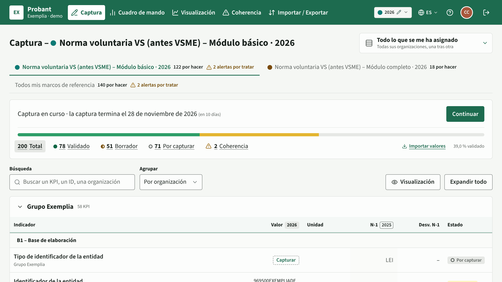
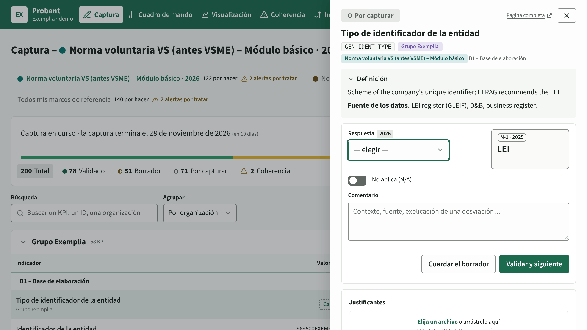
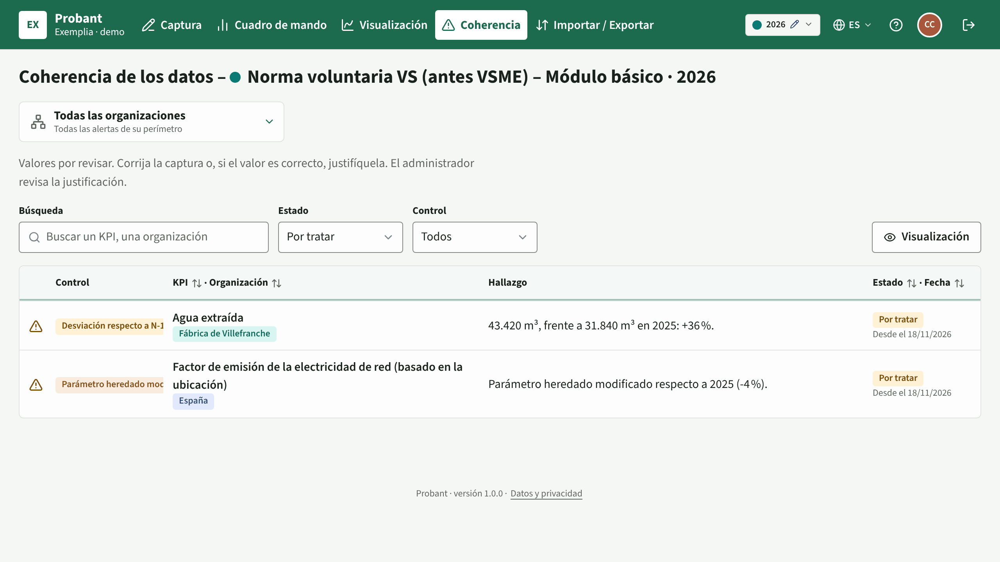
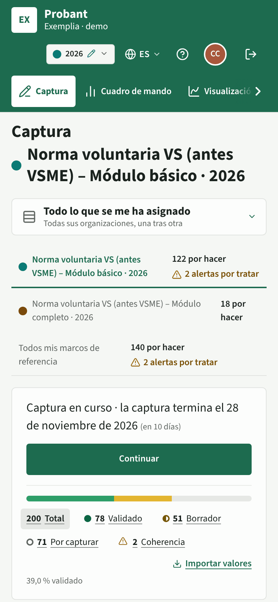

# Guía del colaborador

Usted captura los valores de los KPI que un administrador le ha asignado y los valida. Esta guía muestra cada tarea en pocos pasos. Versión en inglés: [`docs/guides/contributor.md`](../../guides/contributor.md).

## Encontrar lo que debo capturar {#find}

1. Haga clic en **Captura** en la barra superior. La página se abre en **Todo lo que se me ha asignado**.
2. Elija el marco de referencia y el periodo en **Respondo a…** (barra superior), o use las pestañas bajo el título.
3. Haga clic en **Por capturar** o **Borrador** encima de la tabla para dejar solo las filas que le corresponden.
4. Use **Buscar** para encontrar un KPI, un ID o una organización.

Haga clic en **Empezar** (o **Continuar**) para abrir el primer valor que aún queda por hacer. El resumen indica cuántos valores faltan y cuándo termina la captura.

## Capturar un valor {#enter}

1. Haga clic en la fila del KPI, o pulse Intro en ella. Se abre el panel de captura.
2. Introduzca el número, la respuesta o el texto en **Valor** (o **Respuesta**, para una lista o un texto).
3. Haga clic en **Guardar el borrador** para conservarlo y volver más tarde.

El panel muestra el valor del periodo de comparación (N-1) y la desviación. Si la desviación supera el umbral de la campaña, el **Comentario** es obligatorio.

Elija **Página completa** si prefiere trabajar en toda la página.

Si el panel dice que una organización «abre el» día de una fecha posterior al periodo, todavía no se puede introducir nada para este periodo. Pida a un administrador que cambie la fecha de apertura. Nada más cambia para usted.

## Marcar un valor como no aplicable {#na}

1. Abra el panel de captura del KPI.
2. Marque **No aplicable (N/A)**.
3. Escriba el motivo en **Comentario**. El comentario es obligatorio para N/A.

## Añadir un justificante {#evidence}

1. Abra el panel de captura del KPI.
2. En **Justificantes**, haga clic en **Elija un archivo** o arrastre el archivo a la zona.
3. Use un archivo PDF, JPG o PNG. El panel muestra el límite de tamaño (5 MB de forma predeterminada).

Si el KPI exige un justificante, no puede validar sin al menos un archivo. Esto no se aplica a N/A.

## Validar mi captura {#validate}

Validar confirma que su captura está completa. No significa que la cifra esté auditada.

1. Abra el panel de captura del KPI.
2. Haga clic en **Validar y siguiente**. El panel abre el siguiente valor.
3. Al final, el resumen muestra «Todo listo».

Si falta algo, la herramienta dice qué añadir: un valor o N/A, un comentario o un justificante.

## Modificar un valor validado {#reopen}

Puede modificar un valor que usted validó. La herramienta lo vuelve a poner en borrador y usted lo valida de nuevo.

1. Abra el panel de captura del KPI.
2. Cambie el valor y haga clic en **Guardar la modificación**. O haga clic en **Volver a borrador** para no cambiar nada todavía.
3. Haga clic en **Validar** cuando el valor sea correcto.

**Borrar el valor** vacía el valor y devuelve la celda a **Por capturar**. El comentario y los justificantes se conservan. El historial registra cada cambio.

Si la campaña está cerrada, solo un administrador puede reabrirla.

## Un KPI bloqueado por una campaña cerrada {#shared-closed}

Algunos KPI pertenecen a dos marcos de referencia con el mismo periodo. El valor es compartido. Si una de las dos campañas está cerrada, no puede cambiar el valor en la otra.

El panel muestra entonces un mensaje que nombra el marco de referencia y la campaña. Pida a un administrador que reabra la campaña cerrada.

## Tratar una alerta «Por revisar» {#check}

La herramienta comprueba sus valores y marca los inusuales con **Por revisar**. Una alerta no bloquea la validación, pero una regla **Bloqueante** sí: no puede validar mientras no se cumpla la regla.

1. Abra el panel de captura. El bloque **Por revisar** indica el motivo.
2. Si el valor es incorrecto, corríjalo y guarde.
3. Si el valor es correcto, haga clic en **Lo explico en el comentario**, escriba la explicación y guarde.

La página **Coherencia** enumera todas sus alertas. Haga clic en una alerta para abrir su ficha. En el panel de captura, **Ficha de la alerta** da los mismos detalles. Un administrador revisa su explicación.

Si su administrador ha activado el asistente de IA, haga clic en **Explicar con IA** en una alerta. La respuesta es solo una propuesta. Haga clic en **Usar como mi explicación** para copiarla en el comentario y guarde.

## Importar valores desde un archivo {#import}

1. Haga clic en **Importar / Exportar** en la barra superior. Se abre en **Importar valores**.
2. Siga los pasos de la página. La herramienta muestra una vista previa antes de guardar nada.

Se aplican las mismas reglas que en el panel de captura.

Los números de las celdas de Excel se leen tal cual. Un número escrito como texto se lee en el idioma del archivo. En un archivo CSV, lo indica el separador de columnas: «;» va con la coma decimal, «,» con el punto. Si no, lo indica el encabezado de la columna de valores: en inglés, «1,234» es 1234; en español, 1,234. La vista previa indica cómo leyó los números y señala un valor como «1,234».

## Leer los gráficos {#visualisation}

**Visualización** muestra el avance y las cifras de su perímetro en vistas. Abra una vista, cambie los filtros de arriba y use el menú «…» de un gráfico para mostrar sus datos o exportarlo. Los borradores pueden contar en las cifras mientras haya una campaña abierta.

## Usar la herramienta en un teléfono {#phone}

Las páginas funcionan en un teléfono. El panel de captura ocupa toda la pantalla. Use el botón de cerrar para volver a la lista.

## Ver la visita guiada otra vez {#tour}

En su primer inicio de sesión, una visita breve muestra dónde actuar. No bloquea la pantalla. Su navegador recuerda que la ha visto.

1. Haga clic en **Ayuda** en la barra superior.
2. Haga clic en **Ver la visita guiada otra vez**.
3. Haga clic en **Siguiente** para continuar y en **Terminar** al final. Para detenerla, haga clic en **Cerrar la visita**, pulse Esc o haga clic en **No volver a mostrar**.

## Cambiar el idioma {#language}

La herramienta está disponible en francés, inglés, español, alemán, italiano, neerlandés y portugués.

1. Haga clic en el idioma de la barra superior, o haga clic en su nombre y después en **Mi cuenta**.
2. En **Idioma**, elija el idioma y guarde.

Los nombres de los KPI y de los temas se muestran en su idioma cuando tienen traducción.

## Conectar un asistente de IA {#assistant}

Si su administrador ha activado los asistentes, puede conectar uno (por ejemplo Claude). Lee y actúa con sus derechos, nunca más.

1. Haga clic en su nombre y después en **Mi cuenta**.
2. En **Asistentes de IA (MCP)**, introduzca un nombre en **Nombre del token** y elija **Caduca después de**.
3. Haga clic en **Crear un token**.
4. Copie el token ahora. No volverá a verlo.
5. Pegue la configuración ya preparada en su asistente.

Para detener un asistente, haga clic en **Revocar** en su línea. El historial muestra «(vía MCP)» después de cada cambio que haya hecho un asistente.

## Cambiar mi contraseña {#account}

1. Haga clic en su nombre y después en **Mi cuenta**.
2. En **Cambiar mi contraseña**, introduzca la contraseña actual y la nueva.
3. Haga clic en **Guardar mi contraseña**.

Si olvidó su contraseña, pida a un administrador que la restablezca.

**Mis últimos inicios de sesión**, en **Mi cuenta**, muestra sus últimos inicios de sesión en este espacio. Si no reconoce uno, cambie su contraseña y avise a un administrador.
