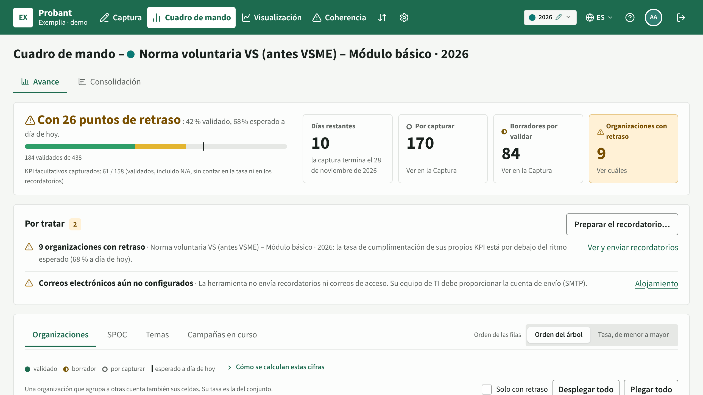
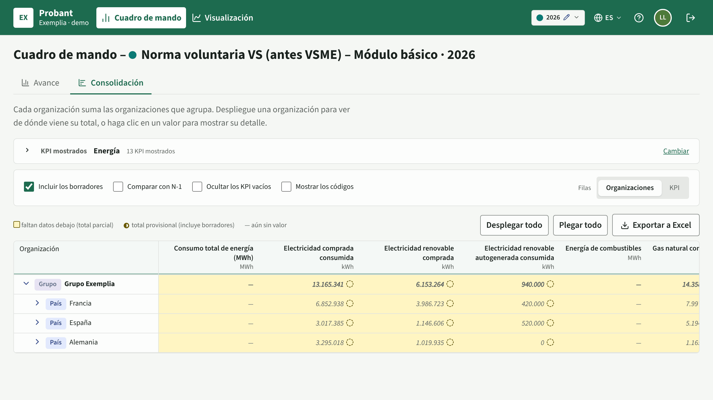
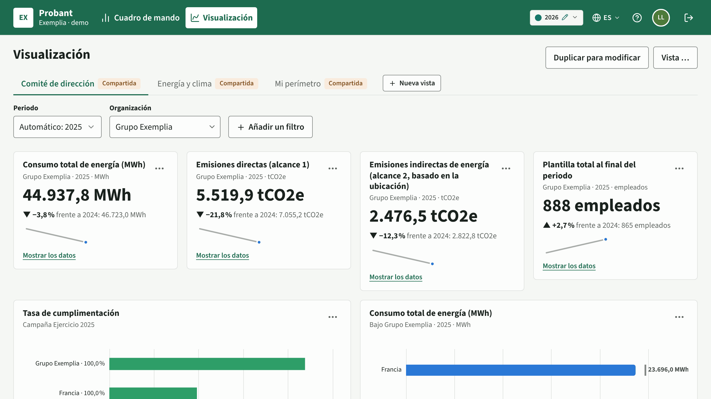
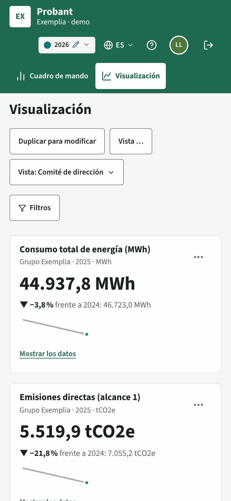

# Guía del lector

Usted consulta el avance y las cifras. Nunca cambia nada: el rol de lector es de solo lectura. Versión en inglés: [`docs/guides/reader.md`](../../guides/reader.md).

## Seguir el avance {#dashboard}

1. Haga clic en **Cuadro de mando** en la barra superior.
2. Lea el veredicto de arriba. Indica si la campaña va según el ritmo previsto.
3. Lea la tabla por organización. Una organización que agrupa a otras muestra la tasa de todo el grupo.

## Ver los totales de cada nivel {#consolidation}

1. En el **Cuadro de mando**, haga clic en **Consolidación**.
2. Elija los KPI que desea mostrar. Abra una fila para ver las organizaciones que dependen de ella.

La página muestra los valores de cada nivel del árbol, del más bajo al más alto. Usted ve las organizaciones de su ámbito.

## Leer los gráficos {#visualisation}

1. Haga clic en **Visualización** en la barra superior. La página se abre en una vista.
2. Haga clic en una pestaña para abrir otra vista.
3. Use los filtros de arriba: el periodo, la comparación, la organización y el marco de referencia.
4. Haga clic en **Restablecer los filtros de la vista** para empezar de nuevo.
5. Abra el menú «…» de un gráfico para mostrar sus datos, abrirlo a pantalla completa o exportarlo como imagen o como archivo de Excel.

Los borradores pueden contar en las cifras mientras una campaña está abierta. La página lo indica cuando es así.

## Usar la herramienta en un teléfono {#phone}

Las páginas funcionan en un teléfono, en una sola columna. Los filtros se abren en una ventana.

## Ver la visita guiada otra vez {#tour}

En su primer inicio de sesión, una visita breve muestra dónde actuar. No bloquea la pantalla. Su navegador recuerda que la ha visto.

1. Haga clic en **Ayuda** en la barra superior.
2. Haga clic en **Ver la visita guiada otra vez**.
3. Haga clic en **Siguiente** para continuar y en **Terminar** al final. Para detenerla, haga clic en **Cerrar la visita**, pulse Esc o haga clic en **No volver a mostrar**.

## Cambiar el idioma {#language}

La herramienta está disponible en francés, inglés, español, alemán, italiano, neerlandés y portugués.

1. Haga clic en el idioma de la barra superior, o haga clic en su nombre y después en **Mi cuenta**.
2. En **Idioma**, elija el idioma y guarde.

## Cambiar mi contraseña {#account}

1. Haga clic en su nombre y después en **Mi cuenta**.
2. En **Cambiar mi contraseña**, introduzca la contraseña actual y la nueva.
3. Haga clic en **Guardar mi contraseña**.

Si olvidó su contraseña, pida a un administrador que la restablezca.

**Mis últimos inicios de sesión**, en **Mi cuenta**, muestra sus últimos inicios de sesión en este espacio. Si no reconoce uno, cambie su contraseña y avise a un administrador.

## Consultar a un asistente {#assistant}

Si un administrador ha activado los asistentes, puede conectar un asistente de IA en **Mi cuenta**, en **Asistentes de IA (MCP)**. Con su rol, solo puede leer. Nunca captura ni cambia nada. Lee las campañas, los KPI, las organizaciones y la tasa de cumplimentación; también lee los valores de su ámbito solo si su administrador lo permite (**Configuración › Asistentes**). Incluso entonces, solo lee los valores validados, como se los muestra la Visualización. Si su administrador ha desactivado **Los KPI sensibles se dan a los asistentes**, nunca lee un KPI marcado como Restringido o Confidencial, ni un KPI calculado a partir de uno de ellos.
