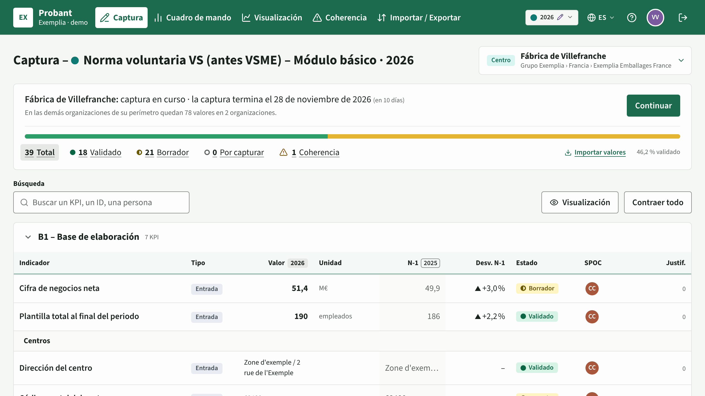
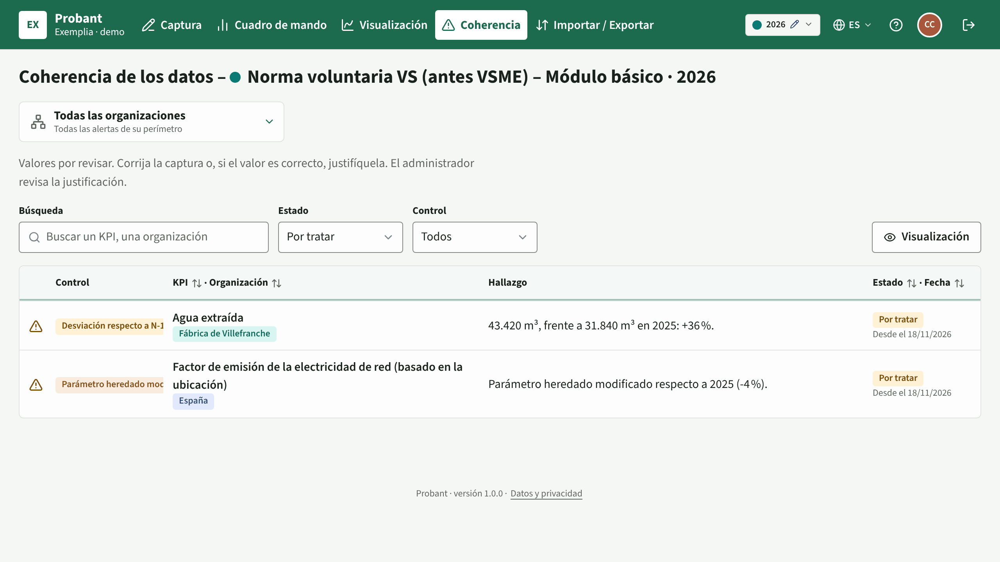
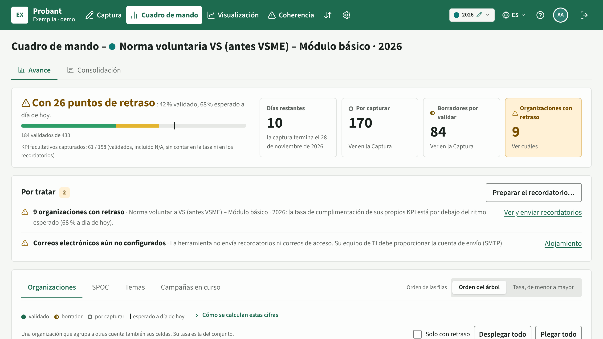
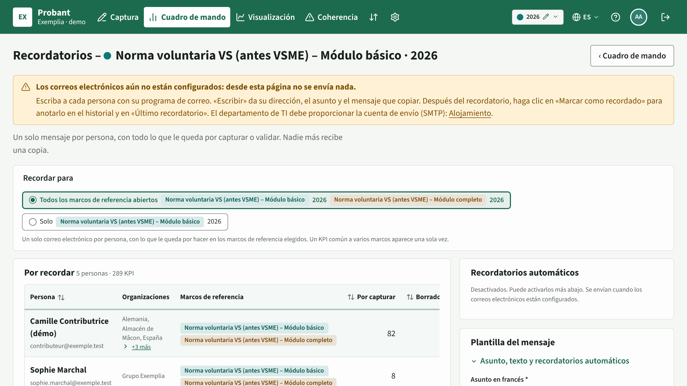

# Guía del validador

Usted sigue y valida las capturas de los KPI y las organizaciones que un administrador le ha asignado (Asignaciones de KPI, opción Validadores), y de las organizaciones que dependen de ellas. Sin asignación, un administrador valida en su lugar. También puede enviar recordatorios en este ámbito. Versión en inglés: [`docs/guides/validator.md`](../../guides/validator.md).

## Ver mi ámbito y lo que falta {#scope}

1. Haga clic en **Captura** en la barra superior. La página se abre en **Todo lo que se me ha asignado**.
2. Haga clic en el nombre de la organización, arriba a la derecha de la página (**Todo lo que se me ha asignado**), y elija en la lista una organización de su ámbito.
3. Haga clic en **Por capturar**, **Borrador** o **Validado** encima de la tabla para filtrar las filas.
4. Elija una organización, abra **Visualización** y marque **Mostrar los KPI calculados y consolidados** para ver los totales. Son de solo lectura.

## Comprobar y validar capturas {#review}

1. Abra la fila de un valor en borrador. Se abre el panel de captura.
2. Lea el valor, el comentario, la desviación respecto a N-1 y los justificantes.
3. Si la captura está completa, haga clic en **Validar**.
4. Si no lo está, pida al colaborador que la complete.

Validar confirma que la captura está completa. No audita la cifra. La validación exige un valor o N/A, un comentario (para N/A o para una desviación grande) y un justificante si el KPI lo exige.

Si el panel dice que una organización «abre el» día de una fecha posterior al periodo, todavía no se puede introducir ni validar nada para este periodo. Pida a un administrador que cambie la fecha de apertura. Nada más cambia para usted.

## Volver a poner una captura en borrador {#reopen}

1. Abra el panel de captura del valor validado.
2. Haga clic en **Volver a borrador**. El valor no cambia.
3. Después el colaborador puede modificarlo y validarlo de nuevo.

**Borrar el valor** vacía la celda en su lugar. El historial registra las dos acciones. Después de la fecha de fin de captura, los colaboradores ya no pueden cambiar un valor, pero usted todavía puede volver a ponerlo en borrador.

## Tratar las alertas de coherencia {#alerts}

1. Haga clic en **Coherencia** en la barra superior. La página enumera las alertas de su ámbito.
2. Haga clic en una alerta para abrir su ficha.
3. Lea la constatación y la explicación del colaborador.

Una alerta no bloquea una validación, pero una regla **Bloqueante** sí: el colaborador no puede validar mientras no se cumpla la regla. El administrador decide sobre la explicación.

## Aceptar o rechazar un valor forzado {#forced}

Una persona puede pedir que se sustituya un resultado calculado por otro valor, con una justificación.

1. Haga clic en **Ver los valores forzados** en la página **Captura**, o abra el KPI calculado.
2. Lea la justificación.
3. Haga clic en **Aceptar y forzar el valor** para aceptar la solicitud.
4. Para denegarla, introduzca el motivo y haga clic en **Rechazar**.

## Seguir el avance {#dashboard}

1. Haga clic en **Cuadro de mando** en la barra superior.
2. Lea el veredicto de arriba y después la tabla por organización. Muestra las organizaciones con retraso.
3. Haga clic en **Consolidación** para ver los totales de su ámbito.

## Enviar recordatorios {#reminders}

1. En el **Cuadro de mando**, haga clic en **Recordar…** (o en **Preparar el recordatorio…** si la instalación no envía correos electrónicos). Se abre la página **Recordatorios**.
2. Elija los marcos de referencia. La herramienta selecciona a las personas que aún tienen algo que capturar o validar.
3. Lea la vista previa del mensaje. Si lo desea, envíese una prueba.
4. Haga clic en **Enviar el recordatorio**. La confirmación nombra a las personas.

Si la instalación no puede enviar correos, la página muestra un recuadro naranja. Haga clic en **Escribir** para obtener la dirección, el asunto y el mensaje. Envíelos con su aplicación de correo. Después haga clic en **Marcar como recordado**.

## Un KPI bloqueado por una campaña cerrada {#shared-closed}

Un KPI que pertenece a dos marcos de referencia con el mismo periodo tiene un único valor compartido. Si una campaña está cerrada, el valor no puede cambiar en la otra. El panel indica qué campaña está cerrada. Pida a un administrador que la reabra.

## Importar valores desde un archivo {#import}

Haga clic en **Importar / Exportar**. El menú se abre en **Importar valores** para un colaborador. Para un validador, se abre en **Mis exportaciones**, y **Importar valores** queda a un clic. La herramienta muestra una vista previa antes de guardar nada.

Cifras para KPI calculados de un periodo no cerrado: la vista previa le pide elegir entre forzar estos valores o ignorar estas filas. Solo puede forzar las organizaciones que valida, mientras la entrada está abierta. Para las demás, la fila se rechaza.

## Obtener una exportación grande {#large-exports}

Por encima de un límite de tamaño, la herramienta prepara en el servidor una exportación o un archivo para rellenar. Abra **Importar / Exportar** y elija **Mis exportaciones**. El archivo está en «Archivos grandes». La herramienta lo conserva 7 días.

## Ver la visita guiada otra vez {#tour}

En su primer inicio de sesión, una visita breve muestra dónde actuar. No bloquea la pantalla. Su navegador recuerda que la ha visto.

1. Haga clic en **Ayuda** en la barra superior.
2. Haga clic en **Ver la visita guiada otra vez**.
3. Haga clic en **Siguiente** para continuar y en **Terminar** al final. Para detenerla, haga clic en **Cerrar la visita**, pulse Esc o haga clic en **No volver a mostrar**.

## Cambiar el idioma {#language}

1. Haga clic en el idioma de la barra superior, o haga clic en su nombre y después en **Mi cuenta**.
2. En **Idioma**, elija uno de los siete idiomas y guarde.

**Mis últimos inicios de sesión**, en **Mi cuenta**, muestra sus últimos inicios de sesión en este espacio. Si no reconoce uno, cambie su contraseña y avise a un administrador.

## Conectar un asistente de IA {#assistant}

Si un administrador ha activado los asistentes, usted crea un token en **Mi cuenta**, en **Asistentes de IA (MCP)**: introduzca el **Nombre del token**, elija **Caduca después de**, haga clic en **Crear un token** y copie el token de inmediato. El asistente tiene sus derechos, nunca más. Haga clic en **Revocar** para detenerlo.
