# Guide de l'administrateur

Vous mettez l'outil en place, vous pilotez les campagnes et vous suivez le remplissage. Tout ce que vous pouvez régler se trouve dans **Administration**. L'équipe informatique fournit l'hébergement, le nom de domaine et le compte e-mail. Version anglaise : [`docs/guides/administrator.md`](../../guides/administrator.md).

## Voir ce qu'il faut faire d'abord {#overview}

1. Cliquez sur **Administration** dans la barre du haut. La page **Vue d'ensemble** s'ouvre.
2. Lisez la liste **À traiter**, le plus urgent en premier. Chaque ligne a son lien.
3. Cliquez sur **À quoi sert chaque rubrique** si vous voulez un rappel des onglets.

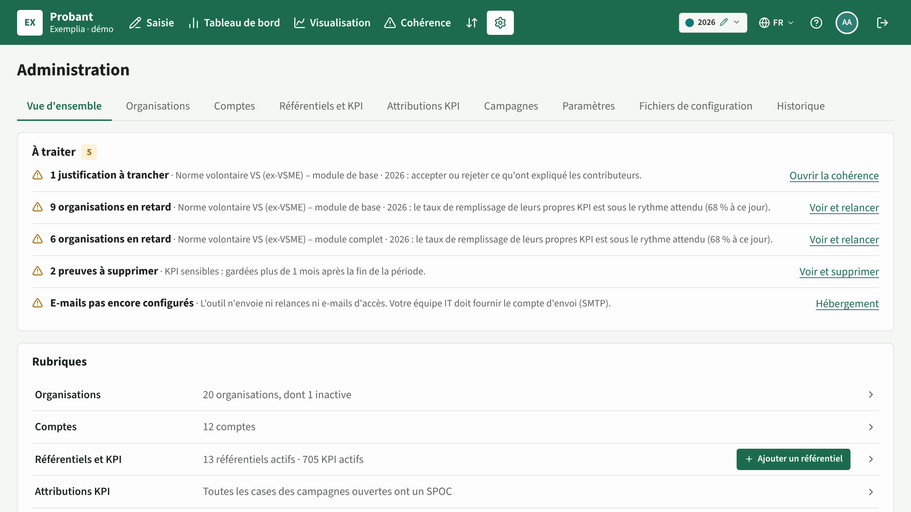

## Mettre en place une nouvelle installation {#setup}

Le premier lancement ouvre un assistant en 8 étapes. Il commence par votre propre compte administrateur.

1. Saisissez le compte, l'organisation et les langues.
2. Choisissez un référentiel dans la bibliothèque, ou composez le vôtre.
3. Ajoutez l'équipe, puis créez la première campagne.

Si vous quittez l'assistant, cliquez sur **Administration › Paramètres › Reprendre la mise en place** pour continuer.

## Ajouter un référentiel {#framework}

1. Cliquez sur **Administration** dans la barre du haut. Sur la **Vue d'ensemble**, cliquez sur **Ajouter un référentiel** sur la ligne **Référentiels et KPI**.
2. Choisissez **Installer depuis la bibliothèque**, **Composer à partir de KPI existants** ou **Importer un fichier**.
3. Ouvrez l'onglet **Contenu** du référentiel pour ranger les thèmes et les KPI.

La fiche du KPI règle le type de réponse, l'unité, la formule et l'exigence d'une preuve. Choisissez « Restreint » ou « Confidentiel » dans **Confidentialité** pour un KPI sensible.

Dès qu'un KPI a une valeur saisie ou importée, son unité ne peut plus changer, comme son format. L'outil le dit à l'enregistrement. Gardez l'unité, ou créez un nouveau KPI dans l'unité voulue. Pour reprendre les anciennes valeurs, exportez-les, convertissez-les dans le fichier, puis importez-les dans le nouveau KPI.

Un exercice clos garde sa liste de KPI. Pour ajouter un KPI aussi aux exercices passés, réglez sa période **Demandé depuis** (voir la section suivante).

## Choisir depuis quand un KPI est demandé {#requested-since}

Chaque KPI d'un référentiel a une période **Demandé depuis** : le premier exercice, ou la première période, où le référentiel le demande. Quand vous créez un KPI, l'outil demande « L'ajouter aussi aux exercices précédents ? ». Par défaut, le KPI est demandé à partir de la période en cours, et aucun exercice passé ne change.

1. Allez dans **Administration › Référentiels et KPI**, ouvrez le référentiel, puis l'onglet **Contenu**.
2. Lisez la période au bout de chaque ligne. « Depuis le début » veut dire que le KPI était là avant ce réglage.
3. Cochez un ou plusieurs KPI, ou cliquez sur la période d'une ligne. Dans la barre d'actions, choisissez la période dans **Demandé depuis**.
4. Cliquez sur **Appliquer**. L'outil montre les exercices qui changent et le nombre de cases ajoutées. Confirmez pour enregistrer.

Un exercice clos ne change pas tant qu'il est clos : aucune case, aucun total nouveau, le même taux de remplissage. Le KPI apparaît quand vous rouvrez l'exercice, dans les deux modes, et il y reste à la clôture suivante. Un exercice déjà rouvert reçoit les cases tout de suite.

Vous ne pouvez pas reculer la période si un exercice qui perd le KPI est clos, ou y a une valeur, un N/A, un commentaire ou une preuve. Si ses cases sont vides, l'outil vous demande de confirmer. L'historique note chaque changement. Quand un KPI calculé est demandé avant l'une de ses sources, l'outil vous prévient : la source a des cases dès la même période.

## Choisir la monnaie des montants {#currency}

Les modèles de la bibliothèque écrivent leurs montants en euros. Si vos états financiers sont établis dans une autre monnaie, réglez-la avant d'installer un modèle :

1. Allez dans **Administration › Référentiels et KPI › Unités et formats**.
2. Dans **Monnaie de référence**, choisissez la monnaie, puis cliquez sur **Enregistrer**.

Quand vous installez ou mettez à jour un modèle de la bibliothèque, ses montants prennent cette monnaie : « € » devient « $ », « M€ » devient « M$ », « €/h » devient « $/h ». Les écrans de l'installation indiquent la monnaie. Un KPI qui existe déjà dans l'espace garde son unité, qu'il ait des valeurs ou non ; seuls les nouveaux KPI prennent la monnaie.

L'outil ne convertit aucune valeur et n'utilise aucun taux de change. Si vous changez la monnaie plus tard, les KPI qui existent déjà gardent leur unité, et la page compte les KPI dont l'unité est dans une autre monnaie. Le classeur officiel de l'EFRAG prend la monnaie de référence comme devise du rapport. Il laisse vide un montant dont l'unité est dans une autre monnaie, et le rapport de l'export le dit.

Chaque espace a sa propre monnaie de référence. Un nouvel espace commence avec l'euro.

## Ajouter les organisations {#organisations}

1. Allez dans **Administration › Organisations**.
2. Cliquez sur **Nouvelle organisation**, choisissez son parent, puis cliquez sur **Créer l'organisation**.
3. Pour un site qui ouvre en cours d'année, saisissez sa date dans **Ouverte depuis**. Le site compte dans les totaux,
   et des valeurs lui sont demandées, seulement pour les périodes qui finissent à cette date ou après. Laissée vide, le
   site compte comme ouvert depuis toujours. Quand vous collez plusieurs organisations, écrivez la date entre crochets :
   « Lyon [2026-03-01] ».

Les niveaux de l'arbre (par exemple Groupe, Pays, Filiale, Site) se règlent dans **Administration › Paramètres › Niveaux de l'arbre**.

Sur cet écran et dans **Unités et formats**, les noms des niveaux et des unités s'affichent dans votre langue. Les champs où vous saisissez gardent la langue de référence de l'installation, et leur libellé la nomme (par exemple « Nom (langue de référence : Français) »). La traduction dans votre langue est montrée à côté du champ. Pour la modifier, utilisez **Paramètres › Langues**.

Une organisation n'ouvre jamais avant son parent : la date qui compte est la plus tardive entre la sienne et celles des organisations au-dessus. Quand un changement de date ou de parent sortirait des valeurs des totaux, la fiche les compte, celles des organisations en dessous comprises, et demande une confirmation. Une valeur pour une organisation pas encore ouverte sur la période est refusée à l'écran, à l'import et par un assistant. Le message renvoie vers la fiche qui porte la date.

## Créer les comptes {#accounts}

1. Allez dans **Administration › Comptes**.
2. Cliquez sur **Nouveau compte**, ou **Plusieurs comptes** pour en créer plusieurs d'un coup.
3. Saisissez l'e-mail, le nom, et choisissez le **Rôle** : administrateur, validateur, contributeur, lecteur ou auditeur.
4. Cliquez sur **Créer le compte**. Envoyez le mot de passe provisoire à la personne.

Pour donner un nouveau mot de passe provisoire, ouvrez le compte et cliquez sur **Réinitialiser le mot de passe**. La personne choisit son propre mot de passe à la première connexion.

Un lecteur ou un auditeur ne saisit et ne valide rien. Quand vous passez le rôle d'un compte à l'un de ces deux, l'outil indique combien d'attributions il va retirer et demande une confirmation avant d'enregistrer. Il les retire, avec une ligne dans l'historique. Revenir au rôle d'avant ne les rend pas. Pour les donner plutôt à une autre personne, utilisez d'abord **Remplacer une personne…**. Pour les redonner plus tard, utilisez **Attributions KPI** (choix **Validateurs** pour les attributions de validateur).

**À traiter** liste les comptes passés en lecture seule avant cette règle qui ont encore des attributions. Cliquez sur **Voir**, puis sur **Retirer** sur une ligne. Un compte désactivé garde ses attributions jusqu'à **Remplacer une personne…**.

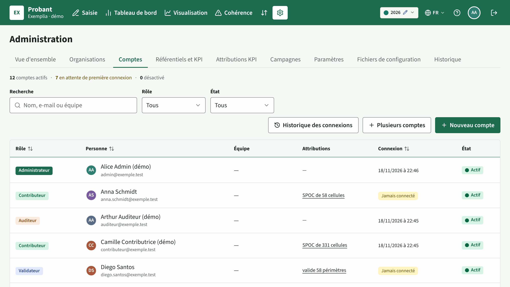

Pour voir qui s'est connecté et quand, cliquez sur **Historique des connexions** dans **Administration › Comptes**. Chaque ligne donne la date, le compte et le résultat : **Réussie**, **Manquée** ou **Bloquée : trop d'essais**. Un identifiant qui ne correspond à aucun compte de l'espace n'apparaît que par une référence, jamais par le texte tapé. Filtrez par résultat ou par période, ou cherchez un nom. Réglez la durée de conservation dans **Administration › Paramètres › Hébergement** (180 jours par défaut).

## Attribuer les KPI {#assign}

Chaque cellule de la grille est un KPI pour une organisation. Le SPOC est la personne qui le saisit.

1. Allez dans **Administration › Attributions KPI**.
2. Cliquez sur une cellule, puis choisissez une ou plusieurs personnes. Vous pouvez aussi sélectionner une ligne ou une colonne, puis cliquer sur **Attribuer**.
3. Cliquez sur **Remplacer une personne…** quand quelqu'un part.
4. Cochez **Seulement les lignes à compléter** pour voir ce qui manque.

Pour choisir les validateurs, sélectionnez **Validateurs** dans la liste **Rôle**. Une attribution de validateur vaut pour un KPI dans une organisation et dans toutes les organisations en dessous : la grille a alors un onglet par niveau d'organisation, avec les KPI saisis à ce niveau ou en dessous. Une cellule marquée « via … » est déjà couverte par le validateur d'une organisation au-dessus. Seuls les validateurs et les administrateurs actifs sont proposés. Une cellule sans validateur est validée par les administrateurs. Chaque attribution donnée ou retirée écrit une ligne dans l'historique.

Pour un grand groupe, la grille montre un groupe d'organisations à la fois. Choisissez le groupe dans la liste **Organisations** au-dessus de la grille. Les filtres et l'enregistrement en lot s'appliquent au groupe affiché. **Toutes (lent pour un grand groupe)** affiche tout, mais l'outil ne s'en souvient pas.

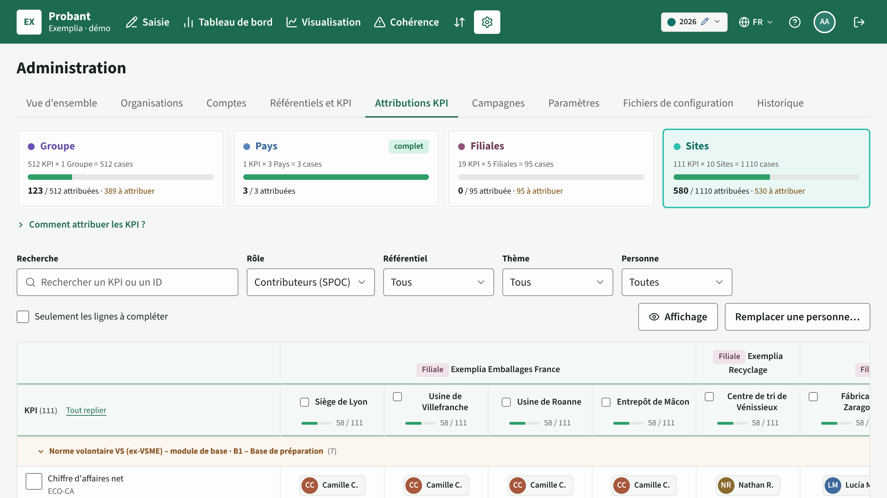

## Ouvrir, revoir, clôturer et rouvrir une campagne {#campaign}

1. Allez dans **Administration › Campagnes** et cliquez sur **Nouvelle campagne** sur la ligne du référentiel.
2. Choisissez la période, réglez les dates et le **Seuil d'écart**, puis cliquez sur **Créer la campagne**.
3. Cliquez sur **Gérer** sur une campagne. Utilisez **Ouvrir la saisie**, **Passer en revue** ou **Clôturer définitivement**.
4. Pour modifier une campagne clôturée, cliquez sur **Rouvrir aux contributeurs** ou **Rouvrir pour corriger (revue)**. L'historique garde la réouverture.
5. Quand vous rouvrez un exercice clôturé, choisissez d'abord :
   - **Garder les chiffres de l'époque** (choisi par défaut) : rien n'est recalculé. Seules une organisation dont vous
     corrigez une valeur et les totaux au-dessus d'elle sont recalculés. Exemple : une entité rattachée depuis à un
     autre pays reste dans les totaux de son ancien pays.
   - **Recalculer avec l'organisation d'aujourd'hui** : tous les totaux de l'exercice sont recalculés avec l'arbre et
     les formules d'aujourd'hui. Exemple : l'entité déplacée fait passer ses valeurs dans les totaux de son nouveau pays.

   Un exercice rouvert en gardant les chiffres de l'époque garde l'arbre des organisations de sa clôture : une
   correction est recalculée avec les parents de l'époque, et une organisation créée depuis n'a pas de case dans cet
   exercice. Votre choix
   vaut jusqu'à la prochaine clôture.

   Quand un exercice a deux campagnes (deux référentiels) et que l'une est clôturée, les KPI que demande la campagne
   clôturée gardent leurs chiffres jusqu'à la clôture de l'autre : un changement des organisations ou
   **Refaire les calculs** ne les change plus, et ils gardent l'arbre des organisations du jour de la clôture. Un KPI
   commun aux deux campagnes garde aussi ses chiffres. Seule une correction importée dans la campagne clôturée recalcule
   l'organisation corrigée et ses totaux. Avec **Recalculer avec l'organisation d'aujourd'hui**, les KPI d'une autre
   campagne de l'exercice encore clôturée gardent leurs chiffres.

Une campagne clôturée est figée pour tout le monde, administrateurs compris. Ses valeurs deviennent le N-1 de la suivante. **Refaire les calculs** est rarement utile.

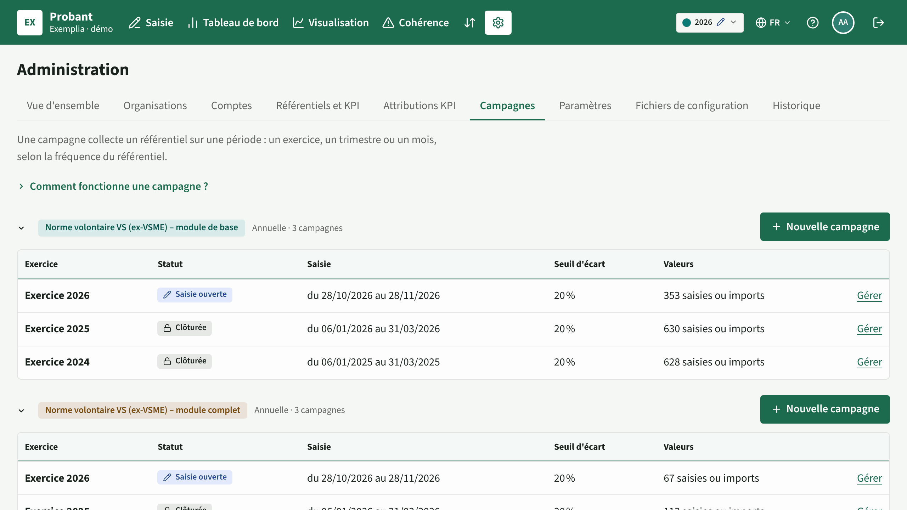

## Saisir et contrôler des valeurs {#entry}

**Saisie** liste les cases de la campagne ouverte, par organisation et par KPI. Vous les voyez toutes et vous pouvez saisir ou corriger une valeur dans n'importe quelle case. Utilisez les filtres pour trouver un KPI, une organisation ou un statut, puis cliquez sur une case pour ouvrir son panneau.

## Rouvrir une saisie validée {#reopen}

1. Allez dans **Saisie** et ouvrez la ligne de la valeur.
2. Cliquez sur **Repasser en brouillon**. La valeur ne change pas.
3. Le contributeur la modifie et la valide de nouveau.

**Effacer la valeur** vide la cellule à la place. Les deux actions sont dans l'historique.

## Un KPI bloqué par une campagne clôturée {#shared-closed}

Un KPI peut appartenir à deux référentiels qui ont la même période. Sa valeur est commune. Si une campagne est clôturée, personne ne peut changer la valeur dans l'autre, vous non plus. Le panneau nomme la campagne clôturée.

1. Rouvrez la campagne clôturée : cliquez sur **Gérer**, puis **Rouvrir pour corriger (revue)**.
2. Modifiez la valeur dans le panneau de saisie.
3. Clôturez de nouveau la campagne.

## Envoyer des relances {#reminders}

1. Dans le **Tableau de bord**, cliquez sur **Relancer…** (ou sur **Préparer la relance…** si l'installation n'envoie pas d'e-mails). La page **Relances** s'ouvre.
2. Choisissez les référentiels. L'outil sélectionne les personnes qui ont encore quelque chose à faire.
3. Lisez l'aperçu, puis cliquez sur **Envoyer la relance**.

Sous **Modèle du message**, vous changez le texte. Sous **Relances automatiques**, vous réglez les jours avant la fin de la saisie. Sans compte e-mail (SMTP), **Écrire** donne le texte à envoyer vous-même. Cliquez ensuite sur **Marquer relancé**.

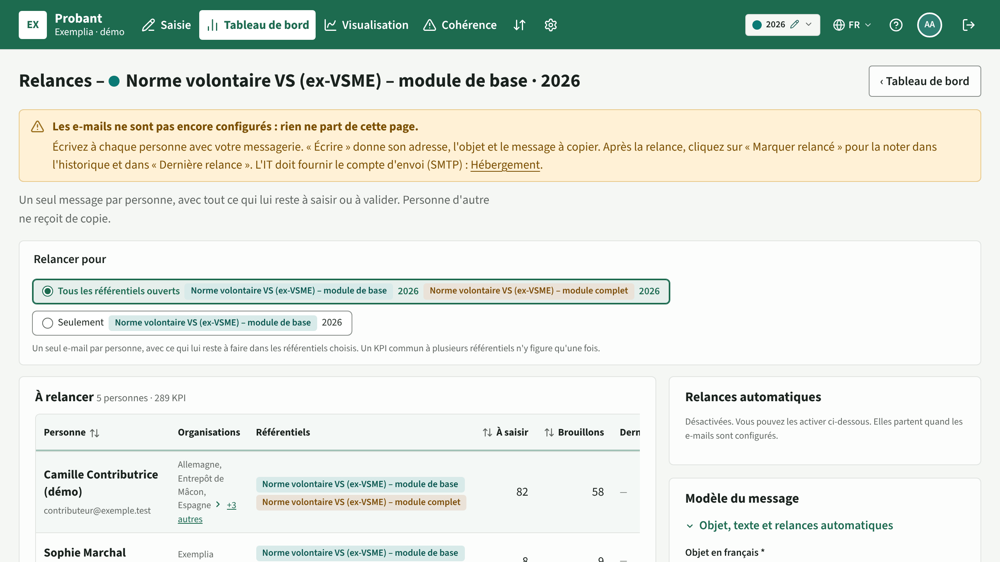

## Obtenir le dossier d'audit {#audit-file}

Un administrateur ou un auditeur peut télécharger un fichier Excel avec ce qu'il faut pour un audit : pour chaque KPI et chaque organisation, la valeur, le statut, qui l'a saisie et validée, les preuves, les alertes de cohérence et leurs justifications, et l'historique des changements. L'outil ne fait que lire les données. Fabriquer le fichier ne change rien.

1. Cliquez sur **Import / Export**, puis sur **Nouvel export**.
2. Sous **Présentation**, choisissez **Dossier d'audit**. Choisissez l'exercice, et les organisations si vous n'en voulez que quelques-unes.
3. Cliquez sur **Télécharger**.

Le fichier a quatre onglets : **À lire**, **Audit** (une ligne par KPI et par organisation), **Historique** (chaque changement de ces valeurs, du plus ancien au plus récent) et **Preuves** (les noms des fichiers, leur taille et qui les a ajoutés). L'onglet **À lire** donne la date, la version de l'outil et les filtres. Un gros fichier est préparé sur le serveur, comme tout gros export.

Les validateurs et les contributeurs ne voient pas le dossier d'audit : il est pour les administrateurs et les auditeurs. Un auditeur limité à quelques organisations n'obtient que celles-là.

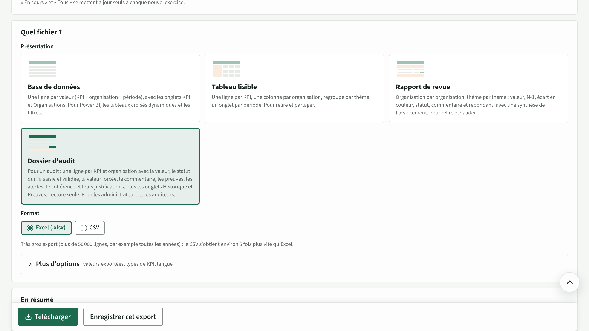

## Imprimer le certificat de clôture {#closing-certificate}

Un administrateur peut imprimer une page qui résume une campagne clôturée. L'outil ne fait que lire les données. Ouvrir la page ne change rien.

1. Cliquez sur **Administration**, puis sur **Campagnes**, puis sur une campagne clôturée.
2. Cliquez sur **Certificat de clôture**.
3. Cliquez sur **Imprimer**. Dans la fenêtre d'impression, choisissez Enregistrer au format PDF pour garder un fichier.

La page montre le périmètre, le taux de remplissage, le nombre de valeurs, les preuves et les alertes de cohérence. Elle dit qui a clôturé la campagne et quand, si l'historique le garde. L'empreinte est un code calculé à partir de tous les chiffres de la campagne. Si un chiffre change, l'empreinte change. Pour vérifier plus tard, rouvrez le certificat et comparez les deux empreintes.

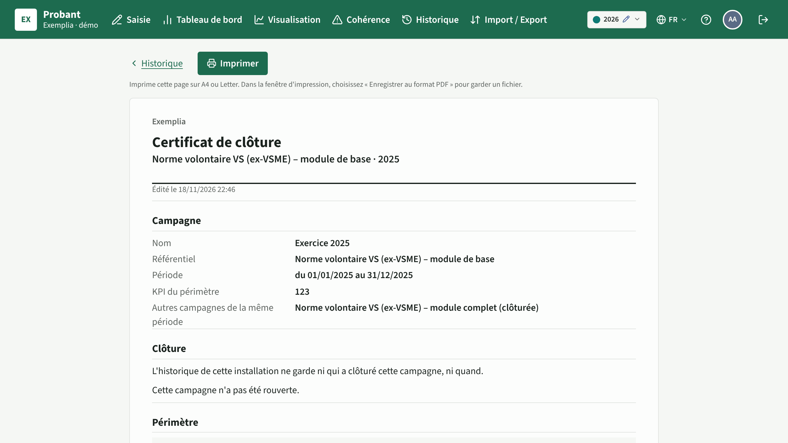

## Récupérer un gros export {#large-exports}

Au-delà d'un seuil, l'outil prépare un export ou un fichier à remplir sur le serveur. Ouvrez **Import / Export** et choisissez **Mes exports**. Le fichier se trouve sous « Fichiers volumineux ». L'outil le garde 7 jours.

Un administrateur règle le nombre de jours dans **Administration › Paramètres › Hébergement**, dans le bloc « Gros exports ».

## Supprimer les preuves des KPI sensibles {#evidence-delete}

L'outil garde les fichiers de preuve. Il ne les supprime jamais tout seul.

1. Allez dans **Administration › Paramètres › Hébergement**. Dans **Preuves des KPI sensibles**, saisissez le nombre dans **Mois avant de proposer la suppression**.
2. Cliquez sur **Administration › Historique**, puis **Preuves à supprimer**.
3. La page liste les fichiers dont toutes les campagnes sont clôturées et dont la période s'est terminée il y a plus de mois que ce nombre.
4. Sélectionnez les fichiers, puis cliquez sur **Supprimer la sélection**. Ou cliquez sur **Supprimer** sur une ligne.

Attention : la suppression est définitive. Le fichier ne va pas à la corbeille. L'historique garde chaque suppression, sans le contenu du fichier. La valeur de la réponse ne change pas.

Les sauvegardes faites avant la suppression gardent le fichier jusqu'à ce que l'outil les remplace. Une restauration remet le fichier dans **Preuves à supprimer** : supprimez-le de nouveau. Les copies des sauvegardes que l'équipe informatique garde hors de l'outil gardent aussi le fichier : demandez-lui de les supprimer. Réglez le nombre de sauvegardes gardées dans **Administration › Paramètres › Hébergement**, sous **Sauvegarde automatique**, pour que les anciennes sauvegardes disparaissent vite.

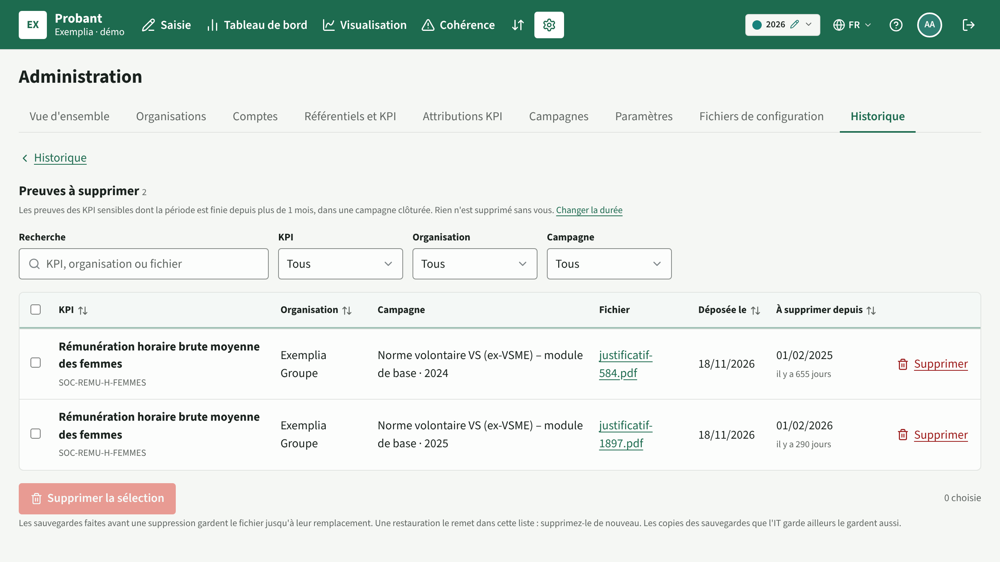

## Ajouter ou traduire une langue {#languages}

Les menus et les boutons existent en français, anglais, espagnol, allemand, italien, néerlandais et portugais. Chaque personne choisit sa langue dans **Mon compte**. Les noms des KPI, des thèmes et des unités se règlent dans **Administration › Paramètres › Langues**.

1. Cliquez sur **Ajouter une langue**, ou ouvrez une langue et cliquez sur **Traduire**.
2. Pour traduire en lot, utilisez **Exporter** et **Importer**, ou **Traduire toutes les langues d'un coup**.

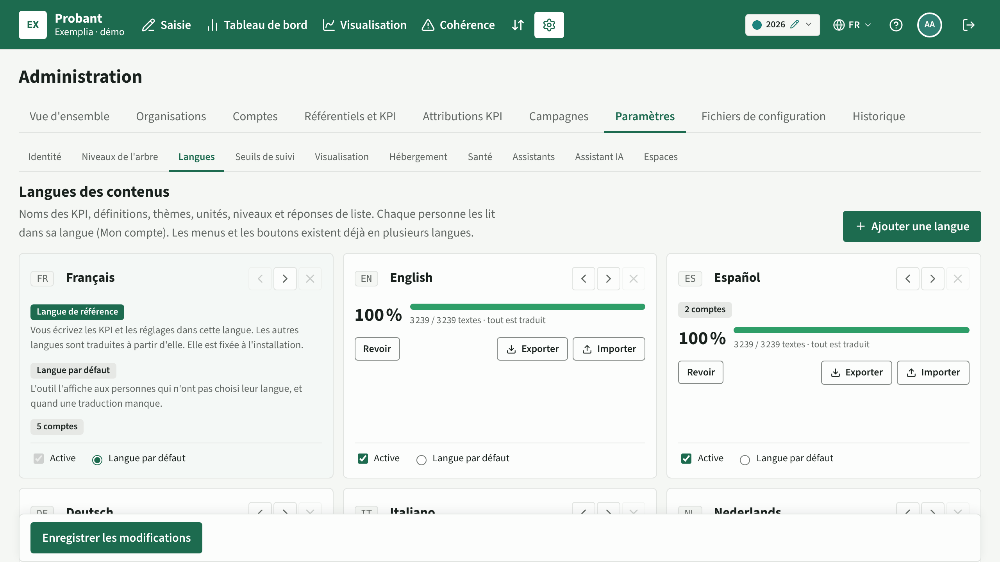

## Connecter un assistant (MCP) {#assistants}

Un assistant IA, par exemple Claude, peut lire et modifier des données avec les droits de la personne qui le connecte, jamais plus. Il est éteint par défaut.

1. Allez dans **Administration › Paramètres › Assistants**.
2. Cochez **Permettre les assistants IA (MCP) dans cet espace**.
3. Cochez **Les assistants peuvent aussi modifier** seulement si les personnes en ont besoin. Les lecteurs et les auditeurs ne modifient jamais rien.
   Sous **Ce que reçoivent les assistants**, choisissez **Un lecteur peut lire les valeurs par un assistant** (éteint
   par défaut) et **Les KPI sensibles sont donnés aux assistants** (allumé par défaut ; éteint, les KPI marqués
   Restreint ou Confidentiel, et les KPI calculés à partir d'eux, sont cachés à tous les outils). Un lecteur ne reçoit jamais un brouillon, seulement des valeurs validées.
4. Cliquez sur **Enregistrer**. Donnez l'**Adresse du serveur de cet espace** aux personnes.

Chaque personne crée un jeton dans **Mon compte**. Sous **Jetons actifs**, cliquez sur **Révoquer** pour couper un assistant tout de suite. L'historique garde chaque appel et affiche « (via MCP) » après chaque modification.

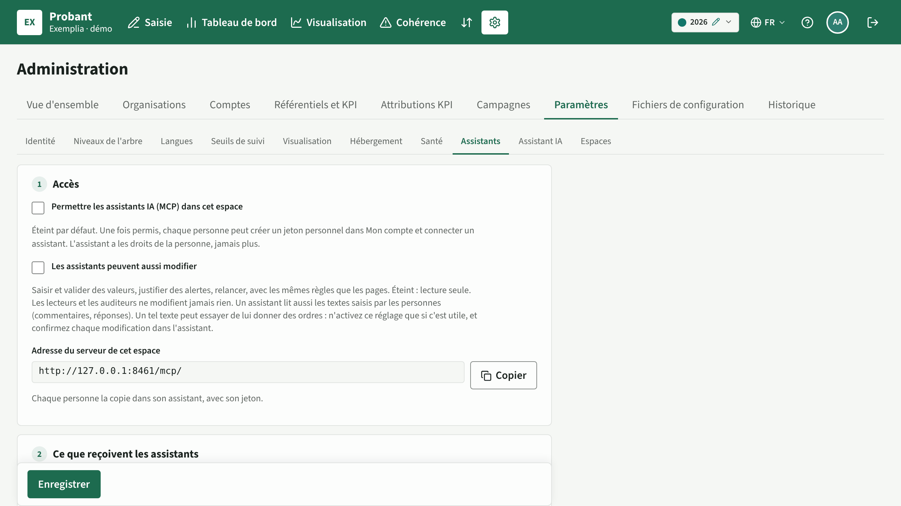

## Allumer l'assistant IA {#ai}

L'assistant IA explique les alertes de cohérence, propose des correspondances de KPI dans l'assistant de reprise, et propose des traductions. Il est éteint par défaut. Rien ne sort de l'outil tant que vous ne l'allumez pas.

1. Allez dans **Administration › Paramètres › Assistant IA**.
2. Cochez **Allumer l'assistant IA**.
3. Choisissez le **Fournisseur** et le **Modèle**.
4. Saisissez la **Clé d'API de votre compte chez le fournisseur**. L'outil la garde pour cet espace seulement et ne la montre plus. Cliquez sur **Retirer la clé** pour la supprimer.
5. Sous **Usages**, cochez les usages voulus. **Les KPI sensibles peuvent être envoyés à l'assistant IA** est éteint par défaut : rien d'un KPI marqué Restreint ou Confidentiel, ni d'un KPI calculé à partir de lui, n'est envoyé, et ses alertes n'ont pas de bouton **Expliquer avec l'IA**. Cliquez sur **Enregistrer**.

Chaque réponse est une proposition marquée « Proposé par l'IA ». Rien n'est enregistré tant qu'une personne ne clique pas, puis enregistre comme d'habitude. L'historique garde chaque appel sans son contenu.

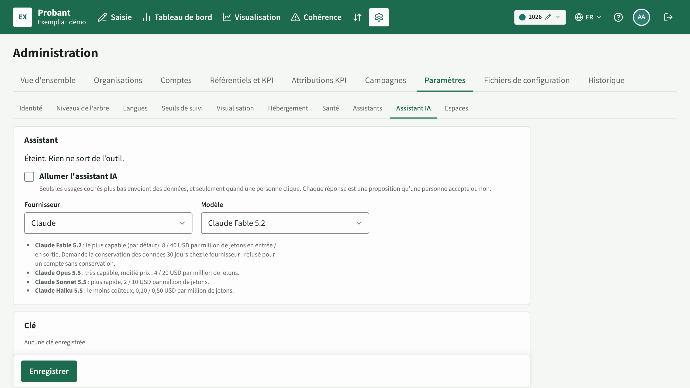

## Vérifier l'hébergement et les sauvegardes {#hosting}

Allez dans **Administration › Paramètres › Hébergement**. La page montre la version, la sauvegarde automatique, le contrôle des données et la configuration des e-mails. Cliquez sur **Créer et télécharger une sauvegarde** pour en faire une tout de suite. L'équipe informatique copie les sauvegardes ailleurs.

Pour voir d'un coup d'œil si tout va bien, allez dans **Administration › Paramètres › Santé**. Chaque ligne (version, base de données, fichiers, dernière sauvegarde, espace disque, e-mails, tâches de fond, mise à jour de la base, HTTPS) montre **Bon**, **À regarder** ou **En panne**, et que faire. L'administrateur d'un autre espace que l'espace principal voit les mêmes lignes, mais les lignes base de données et mise à jour de la base ne contrôlent que son espace et le registre commun des comptes, pas les autres espaces. Il ne voit pas le détail pour l'IT (noms des autres espaces, dossiers du disque) : le gestionnaire des espaces le voit. Dans **Paramètres › Hébergement**, le volet **Pour l'IT** ne lui montre ni le dossier des données, ni les adresses autorisées, ni le serveur de la base, ni l'identifiant des e-mails, ni le dossier des sauvegardes.

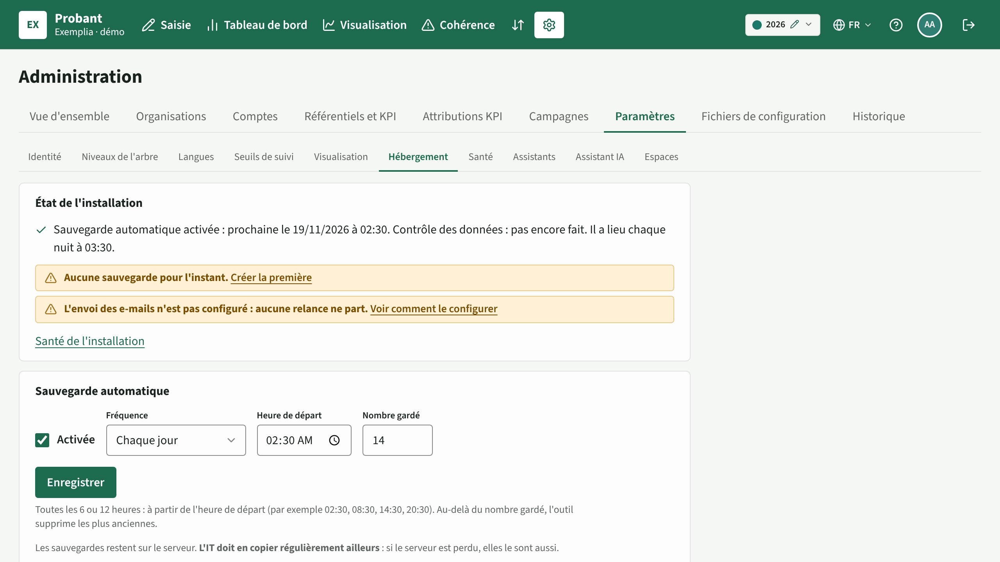

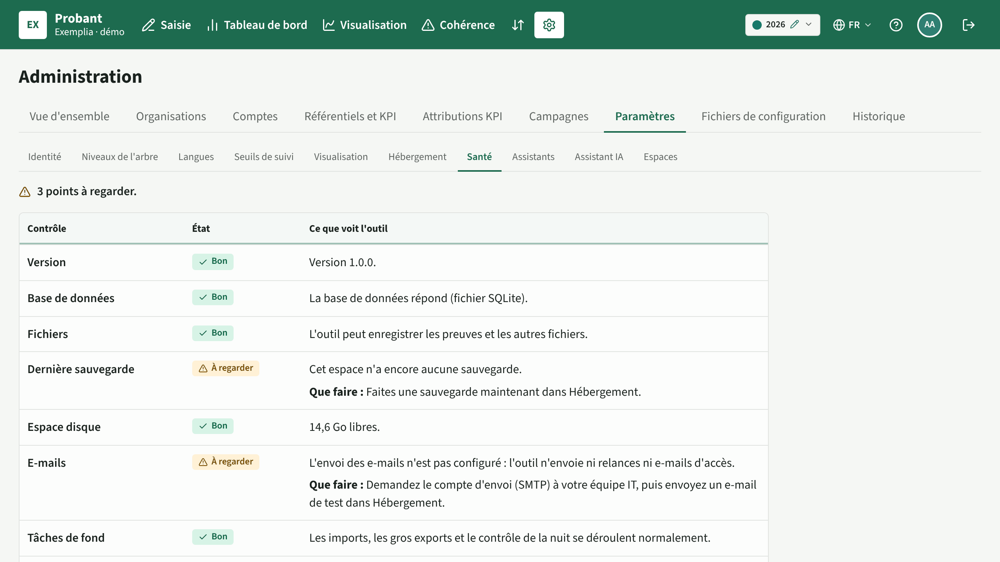

## Voir les totaux de chaque niveau {#consolidation}

**Consolidation** montre la valeur de chaque KPI à chaque niveau de l'arbre, des sites jusqu'au groupe. Choisissez les KPI à afficher, ouvrez une ligne pour voir les organisations en dessous, et exportez le tableau vers Excel. Une mention indique quand un total est incomplet.

## Traiter les alertes et les règles de cohérence {#consistency}

**Cohérence** liste les alertes de la campagne : valeurs inhabituelles, grands écarts avec N-1 et règles non respectées. Cliquez sur une alerte pour lire le constat et l'explication du contributeur, puis acceptez-la, rejetez-la ou ignorez-la. Sous **Règles de cohérence**, vous réglez les règles. Une règle **Bloquante** empêche le contributeur de valider tant qu'elle n'est pas respectée.

## Importer des valeurs depuis un fichier {#import-values}

Cliquez sur **Import / Export**, puis sur **Importer des valeurs**. Choisissez le fichier, lisez l'aperçu et confirmez. L'outil n'enregistre rien avant votre confirmation et applique les mêmes règles que le panneau de saisie.

Les nombres des cellules Excel sont lus tels quels. Un nombre écrit en texte est lu dans la langue du fichier. Dans un fichier CSV, le séparateur de colonnes la donne : « ; » va avec la virgule décimale, « , » avec le point. Sinon, l'en-tête de la colonne des valeurs la donne : en anglais, « 1,234 » vaut 1234 ; en français, 1,234. L'aperçu dit comment il a lu les nombres et signale une valeur comme « 1,234 ». L'assistant **Reprendre un ancien système** les lit dans la langue de votre écran.

Si le fichier contient des chiffres pour des KPI calculés d'une période non clôturée, l'aperçu les compte et vous demande de choisir de forcer ces valeurs ou d'ignorer ces lignes. Les chiffres forcés deviennent des valeurs forcées : ils remplacent le résultat du calcul, et les totaux et les formules qui les utilisent sont recalculés. **À traiter** signale aussi les chiffres importés tels quels sur des cases calculées avant cette règle : ouvrez **Valeurs forcées** et choisissez **Forcer** ou **Retirer** pour chacun.

## Exporter vers un format officiel {#official-formats}

**Formats officiels** exporte les valeurs dans le classeur officiel d'une norme, par exemple le classeur de l'EFRAG pour la norme VS. L'outil n'écrit que les cellules de saisie. Ouvrez le fichier exporté dans Excel et enregistrez-le avant de le convertir.

## Enregistrer une liste de KPI {#kpi-lists}

**Listes de KPI** regroupe sous un nom les KPI que vous suivez souvent. Choisissez une liste en un clic dans un export ou dans un fichier à remplir.

## Lire les graphiques et construire des vues {#visualisation}

**Visualisation** montre les graphiques des vues. Ouvrez une vue, changez les filtres en haut, puis utilisez le menu « … » d'un graphique pour afficher ses données ou l'exporter. Vous pouvez aussi créer une vue, la modifier et la partager.

## Modifier les paramètres de l'outil {#settings}

**Paramètres** réunit ce que vous pouvez régler dans l'outil : l'identité, les niveaux de l'arbre des organisations, les seuils, les couleurs des graphiques, les langues, l'assistant IA, les assistants et l'hébergement. Personne n'a besoin de modifier du code.

## Gérer les espaces {#spaces}

**Espaces** liste les espaces de cette installation. Chaque espace a ses propres données : référentiels, organisations, campagnes, valeurs, preuves et identité. Les comptes sont communs : une personne se connecte une seule fois.

## Suivre chaque modification {#history}

Cliquez sur **Administration** dans la barre du haut, puis sur **Historique**. Dans **Journal**, choisissez **Saisie des données** pour voir les valeurs, les validations et les preuves, ou **Modifications d'administration** pour voir les campagnes, le référentiel, les organisations et les comptes. L'outil ne supprime jamais rien de l'historique.

## Revoir la visite guidée {#tour}

À votre première connexion, une courte visite montre où agir. Elle ne bloque pas l'écran. Votre navigateur retient que vous l'avez vue.

1. Cliquez sur **Aide** dans la barre du haut.
2. Cliquez sur **Revoir la visite guidée**.
3. Cliquez sur **Suivant** pour continuer, et sur **Terminer** à la fin. Pour arrêter, cliquez sur **Fermer la visite**, appuyez sur Échap ou cliquez sur **Ne plus afficher**.

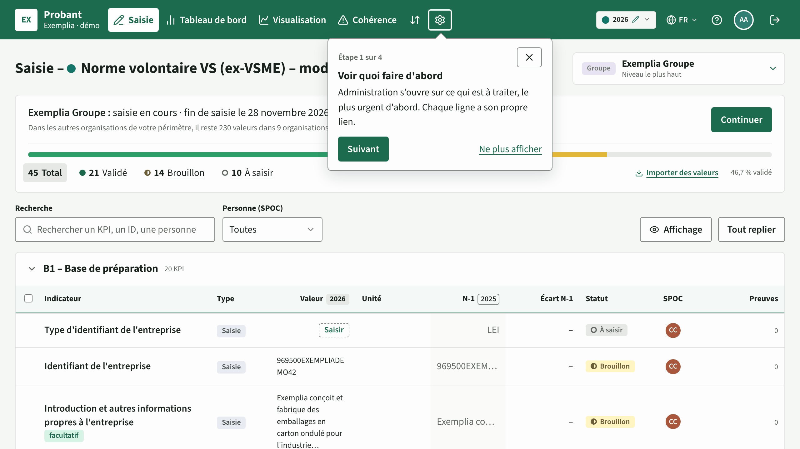

## Changer ma langue ou mon mot de passe {#account}

Cliquez sur votre nom, puis **Mon compte**. Choisissez la **Langue**, et changez votre mot de passe sous **Changer mon mot de passe**.

**Mes dernières connexions**, dans **Mon compte**, liste vos dernières connexions à cet espace. Si vous n'en reconnaissez pas une, changez votre mot de passe et prévenez un administrateur.
