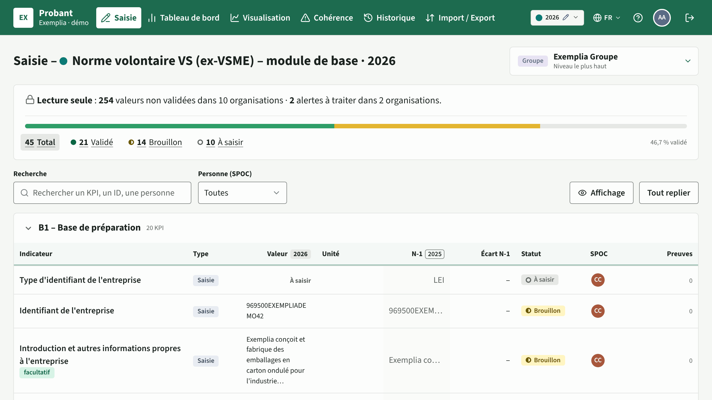
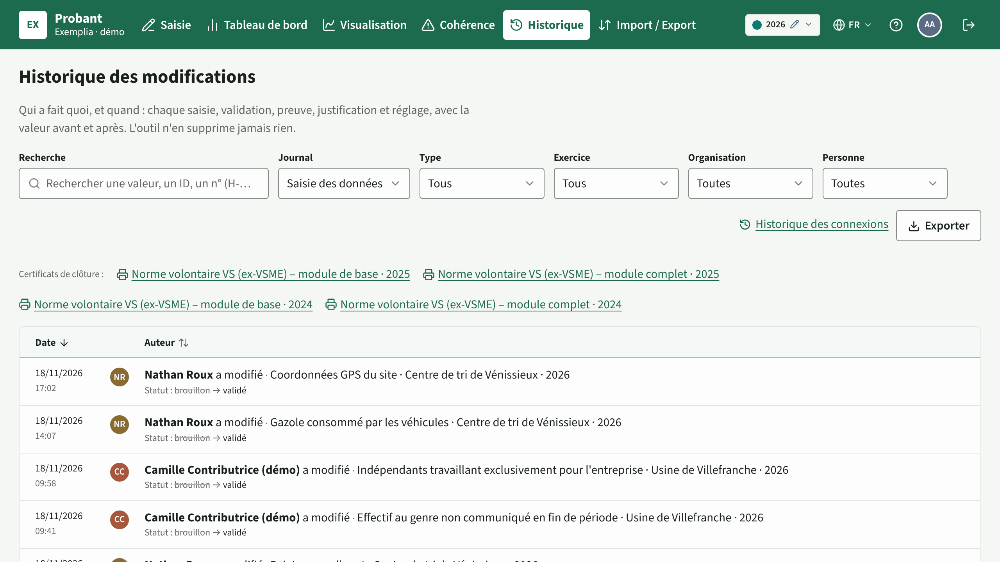
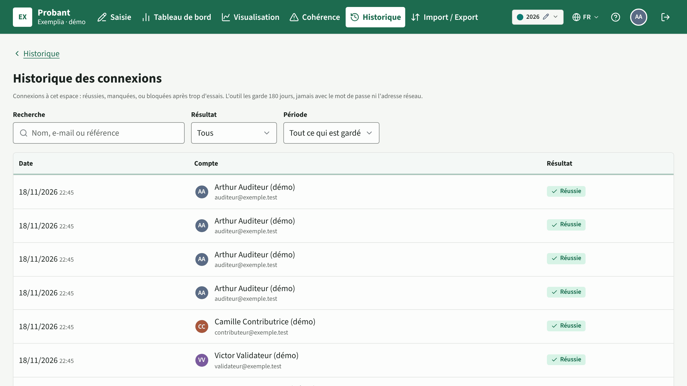
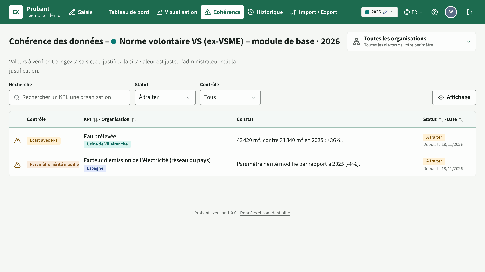
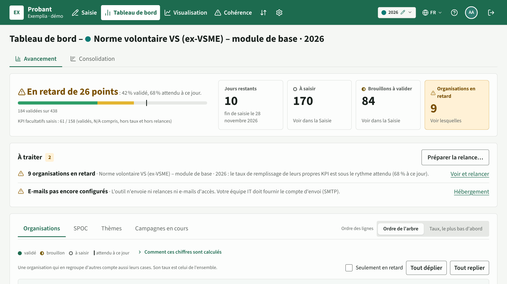
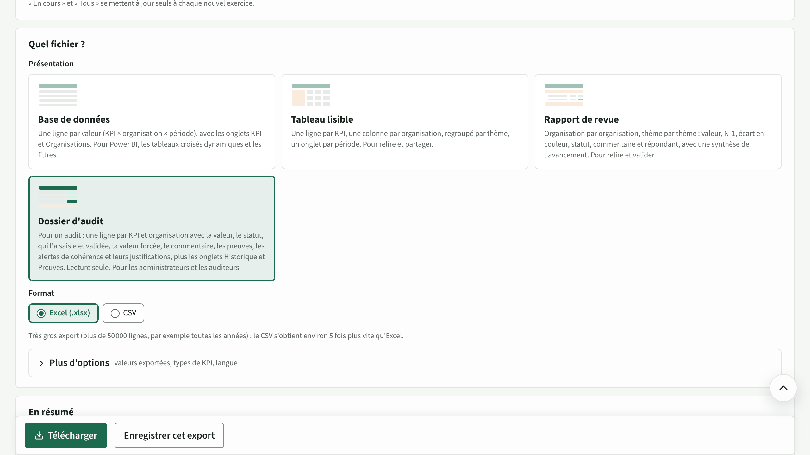
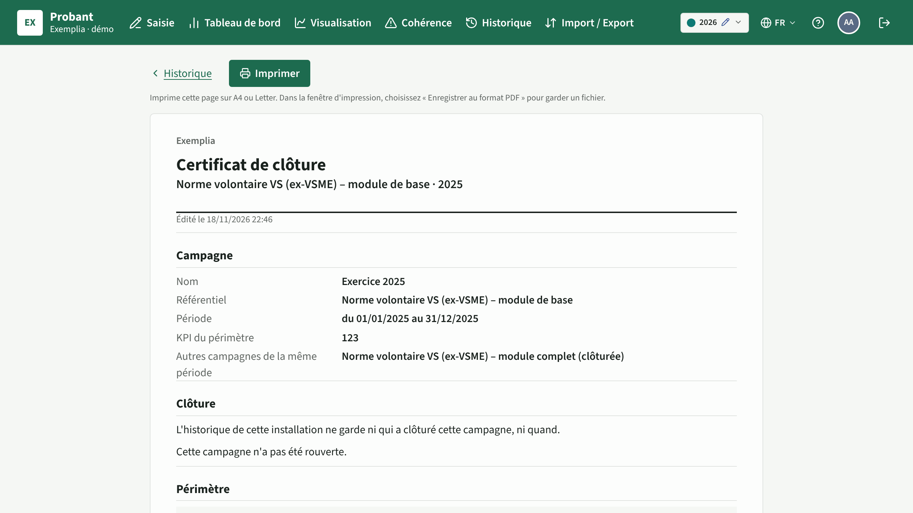

# Guide de l'auditeur

Vous pouvez voir toutes les valeurs, leurs preuves et leur historique. Vous ne changez jamais rien : le rôle d'auditeur est en lecture seule. Version anglaise : [`docs/guides/auditor.md`](../../guides/auditor.md).

## Regarder les valeurs d'une organisation {#read-only}

1. Cliquez sur **Saisie** dans la barre du haut. La page s'ouvre sur l'organisation la plus haute de votre périmètre.
2. Cliquez sur le nom de l'organisation en haut à droite de la page, puis choisissez l'organisation dans la liste.
3. Utilisez **Rechercher** et les filtres au-dessus du tableau pour trouver un KPI.
4. Cliquez sur une ligne pour ouvrir le panneau. Il montre la valeur, le commentaire, la preuve et l'historique par exercice.

Ouvrez **Affichage** et cochez **Afficher les KPI calculés et consolidés** pour voir les totaux et les composants de chaque calcul.

## Ouvrir les preuves {#evidence}

1. Ouvrez le panneau d'une valeur.
2. Sous **Preuves**, cliquez sur le nom d'un fichier pour l'ouvrir.

La colonne **Preuves** du tableau indique le nombre de fichiers de chaque KPI.

## Suivre chaque modification {#history}

1. Cliquez sur **Historique** dans la barre du haut.
2. Choisissez **Saisie** pour voir les valeurs, les validations et les preuves. Choisissez **Modifications d'administration** pour voir les campagnes, le référentiel, les organisations et les comptes.
3. Filtrez par exercice, organisation ou personne.
4. Cliquez sur **Exporter** pour obtenir le journal en fichier.

L'historique montre qui a fait quoi et quand, avec la valeur avant et après. L'outil n'en supprime jamais rien. Une modification faite par un assistant IA affiche « (via MCP) ».

Trois lignes de **Modifications d'administration** demandent un mot :

- « a retiré les attributions (rôle en lecture seule) » : un compte est devenu lecteur ou auditeur et a perdu ses attributions. La ligne les liste par rôle, avec « Voir le texte complet » quand la liste est longue.
- « a ajouté un KPI au périmètre d'une période rouverte » : un exercice clos garde sa liste de KPI, et un administrateur a ajouté ce KPI exprès pendant que la campagne était rouverte.
- « a choisi comment rouvrir une campagne » : l'administrateur a gardé les chiffres de l'époque ou recalculé avec l'organisation d'aujourd'hui.

## Voir qui s'est connecté {#sign-ins}

1. Cliquez sur **Historique** dans la barre du haut.
2. Cliquez sur **Historique des connexions** au bout de la barre de filtres.
3. Filtrez par nom ou e-mail, par résultat ou par période.

Chaque ligne donne la date, le compte et le résultat : **Réussie**, **Manquée** ou **Bloquée : trop d'essais**. Pour un identifiant inconnu, l'outil ne montre qu'une référence, jamais le texte tapé. La page est en lecture seule. L'administrateur règle combien de temps l'outil garde ces lignes. Si votre accès est limité à certaines organisations, cette page ne vous est pas ouverte.

## Lire les alertes de cohérence {#consistency}

1. Cliquez sur **Cohérence** dans la barre du haut.
2. Filtrez les alertes par statut, contrôle, KPI ou organisation.
3. Cliquez sur une alerte pour lire le constat et l'explication du contributeur.

Une alerte ne bloque pas une validation, mais une règle **Bloquante** la bloque : le contributeur ne peut pas valider tant que la règle n'est pas respectée. L'administrateur tranche sur chaque explication.

## Suivre l'avancement et les graphiques {#dashboard}

Cliquez sur **Tableau de bord** pour le taux de remplissage par organisation, et sur **Consolidation** pour les totaux de chaque niveau. Cliquez sur **Visualisation** pour les graphiques. Les brouillons peuvent compter dans les chiffres tant qu'une campagne est ouverte. La page le dit quand c'est le cas.

## Obtenir le dossier d'audit {#audit-file}

Un administrateur ou un auditeur peut télécharger un fichier Excel avec ce qu'il faut pour un audit : pour chaque KPI et chaque organisation, la valeur, le statut, qui l'a saisie et validée, les preuves, les alertes de cohérence et leurs justifications, et l'historique des changements. L'outil ne fait que lire les données. Fabriquer le fichier ne change rien.

1. Cliquez sur **Import / Export**, puis sur **Nouvel export**.
2. Sous **Présentation**, choisissez **Dossier d'audit**. Choisissez l'exercice, et les organisations si vous n'en voulez que quelques-unes.
3. Cliquez sur **Télécharger**.

Le fichier a quatre onglets : **À lire**, **Audit** (une ligne par KPI et par organisation), **Historique** (chaque changement de ces valeurs, du plus ancien au plus récent) et **Preuves** (les noms des fichiers, leur taille et qui les a ajoutés). L'onglet **À lire** donne la date, la version de l'outil et les filtres. Un gros fichier est préparé sur le serveur, comme tout gros export.

Vous voyez les mêmes données que sur les pages de l'outil. Si un administrateur vous a limité à quelques organisations, le fichier ne contient que celles-là.

## Imprimer le certificat de clôture {#closing-certificate}

Vous pouvez imprimer une page qui résume une campagne clôturée. L'outil ne fait que lire les données.

1. Cliquez sur **Historique**. Au-dessus de la liste, sous **Certificats de clôture :**, cliquez sur une campagne.
2. Cliquez sur **Imprimer**. Dans la fenêtre d'impression, choisissez Enregistrer au format PDF pour garder un fichier.

La page montre le périmètre, le taux de remplissage, le nombre de valeurs, les preuves et les alertes de cohérence. Elle dit qui a clôturé la campagne et quand, si l'historique le garde. L'empreinte est un code calculé à partir de tous les chiffres de la campagne. Si un chiffre change, l'empreinte change. Si vous êtes limité à certaines organisations, vous recevez un certificat partiel : il le dit en haut de chaque page, et chaque chiffre comme l'empreinte ne portent que sur vos organisations.

## Récupérer un gros export {#large-exports}

Au-delà d'un seuil, l'outil prépare un export ou un fichier à remplir sur le serveur. Ouvrez **Import / Export** et choisissez **Mes exports**. Le fichier se trouve sous « Fichiers volumineux ». L'outil le garde 7 jours.

## Utiliser l'outil sur un téléphone {#phone}

Les pages fonctionnent sur un téléphone, en une seule colonne.

## Revoir la visite guidée {#tour}

À votre première connexion, une courte visite montre où agir. Elle ne bloque pas l'écran. Votre navigateur retient que vous l'avez vue.

1. Cliquez sur **Aide** dans la barre du haut.
2. Cliquez sur **Revoir la visite guidée**.
3. Cliquez sur **Suivant** pour continuer, et sur **Terminer** à la fin. Pour arrêter, cliquez sur **Fermer la visite**, appuyez sur Échap ou cliquez sur **Ne plus afficher**.

## Changer de langue {#language}

1. Cliquez sur la langue dans la barre du haut, ou cliquez sur votre nom, puis **Mon compte**.
2. Sous **Langue**, choisissez l'une des sept langues et enregistrez.

**Mes dernières connexions**, dans **Mon compte**, liste vos dernières connexions à cet espace. Si vous n'en reconnaissez pas une, changez votre mot de passe et prévenez un administrateur.

## Interroger un assistant {#assistant}

Si un administrateur a permis les assistants, vous pouvez connecter un assistant IA dans **Mon compte**, sous **Assistants IA (MCP)**. Pour votre rôle, il ne peut que lire. L'historique garde chaque appel.
