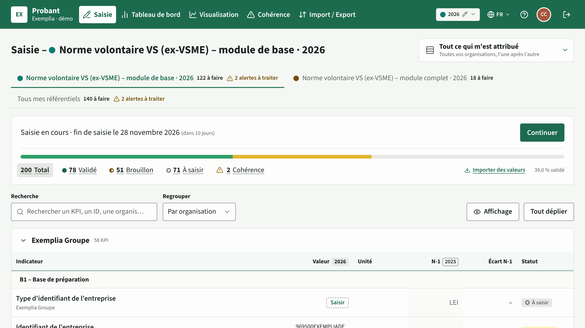
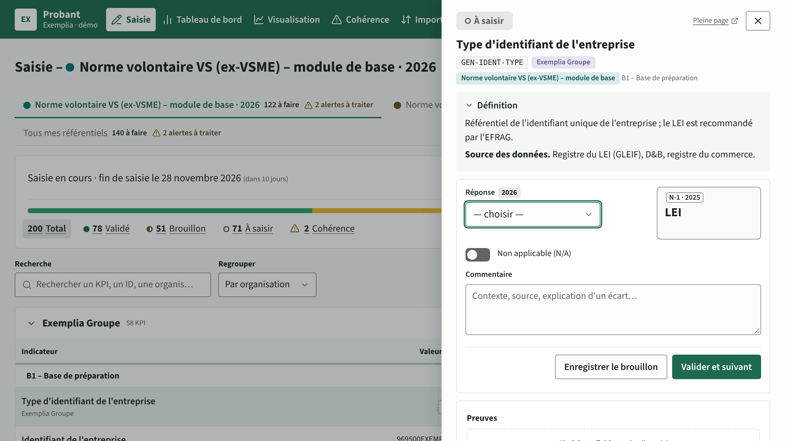
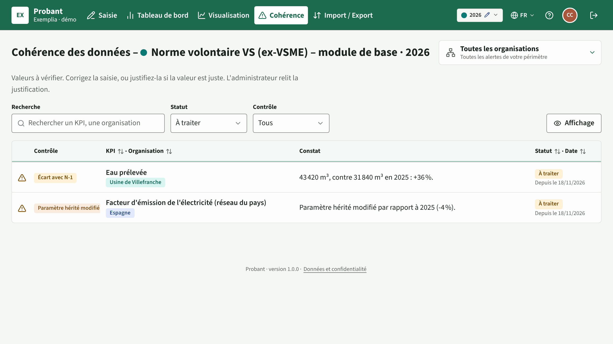
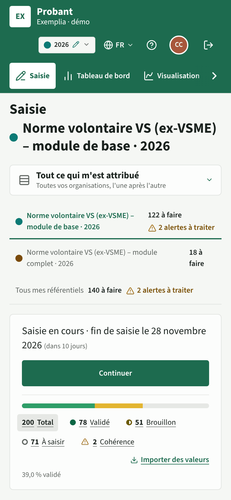

# Guide du contributeur

Vous saisissez les valeurs des KPI qu'un administrateur vous a attribués, puis vous les validez. Ce guide montre chaque tâche en quelques étapes. Version anglaise : [`docs/guides/contributor.md`](../../guides/contributor.md).

## Trouver ce qu'il faut saisir {#find}

1. Cliquez sur **Saisie** dans la barre du haut. La page s'ouvre sur **Tout ce qui m'est attribué**.
2. Choisissez le référentiel et la période dans **Je réponds à…** (barre du haut), ou utilisez les onglets sous le titre.
3. Cliquez sur **À saisir** ou **Brouillon** au-dessus du tableau pour garder les lignes qui vous attendent.
4. Utilisez **Rechercher** pour trouver un KPI, un ID ou une organisation.

Cliquez sur **Commencer** (ou **Continuer**) pour ouvrir la première valeur qui reste à faire. Le résumé indique combien de valeurs restent et la date de fin de la saisie.

## Saisir une valeur {#enter}

1. Cliquez sur la ligne du KPI, ou appuyez sur Entrée dessus. Le panneau de saisie s'ouvre.
2. Saisissez le nombre, la réponse ou le texte dans **Valeur** (ou **Réponse**, pour une liste ou un texte).
3. Cliquez sur **Enregistrer le brouillon** pour le garder et revenir plus tard.

Le panneau montre la valeur de la période de comparaison (N-1) et l'écart. Si l'écart dépasse le seuil de la campagne, le **Commentaire** est obligatoire.

Choisissez **Pleine page** si vous préférez travailler sur toute la page.

Si le panneau dit qu'une organisation « ouvre le » une date après la période, rien ne peut encore être saisi pour cette période. Demandez à un administrateur de modifier la date d'ouverture. Rien d'autre ne change pour vous.

## Indiquer qu'une valeur est non applicable {#na}

1. Ouvrez le panneau de saisie du KPI.
2. Cochez **Non applicable (N/A)**.
3. Écrivez la raison dans **Commentaire**. Le commentaire est obligatoire pour un N/A.

## Ajouter une preuve {#evidence}

1. Ouvrez le panneau de saisie du KPI.
2. Sous **Preuves**, cliquez sur **Choisir un fichier** ou glissez le fichier dans la zone.
3. Utilisez un fichier PDF, JPG ou PNG. Le panneau indique la taille maximale (5 Mo par défaut).

Si le KPI exige une preuve, vous ne pouvez pas valider sans au moins un fichier. Cette règle ne s'applique pas au N/A.

## Valider ma saisie {#validate}

Valider confirme que votre saisie est complète. Cela ne signifie pas que le chiffre est audité.

1. Ouvrez le panneau de saisie du KPI.
2. Cliquez sur **Valider et suivant**. Le panneau ouvre la valeur suivante.
3. À la fin, le résumé indique « Tout est fait ».

S'il manque quelque chose, l'outil dit quoi ajouter : une valeur ou N/A, un commentaire, ou une preuve.

## Modifier une valeur validée {#reopen}

Vous pouvez modifier une valeur que vous avez validée. L'outil la repasse en brouillon et vous la validez de nouveau.

1. Ouvrez le panneau de saisie du KPI.
2. Modifiez la valeur, puis cliquez sur **Enregistrer la modification**. Ou cliquez sur **Repasser en brouillon** pour ne rien changer pour l'instant.
3. Cliquez sur **Valider** quand la valeur est correcte.

**Effacer la valeur** vide la valeur et remet la cellule à **À saisir**. Le commentaire et la preuve restent. L'historique garde chaque modification.

Si la campagne est clôturée, seul un administrateur peut la rouvrir.

## Un KPI bloqué par une campagne clôturée {#shared-closed}

Certains KPI appartiennent à deux référentiels qui ont la même période. La valeur est commune. Si l'une des deux campagnes est clôturée, vous ne pouvez pas changer la valeur dans l'autre.

Le panneau affiche alors un message qui nomme le référentiel et la campagne. Demandez à un administrateur de rouvrir la campagne clôturée.

## Traiter une alerte « À vérifier » {#check}

L'outil contrôle vos valeurs et marque les valeurs inhabituelles avec **À vérifier**. Une alerte ne bloque pas la validation, mais une règle **Bloquante** la bloque : vous ne pouvez pas valider tant que la règle n'est pas respectée.

1. Ouvrez le panneau de saisie. Le bloc **À vérifier** donne la raison.
2. Si la valeur est fausse, corrigez-la et enregistrez.
3. Si la valeur est juste, cliquez sur **J'explique dans le commentaire**, écrivez l'explication et enregistrez.

La page **Cohérence** liste toutes vos alertes. Cliquez sur une alerte pour ouvrir sa fiche. Dans le panneau de saisie, **Fiche de l'alerte** donne le même détail. Un administrateur relit votre explication.

Si votre administrateur a allumé l'assistant IA, cliquez sur **Expliquer avec l'IA** dans une alerte. La réponse n'est qu'une proposition. Cliquez sur **Reprendre comme explication** pour la copier dans le commentaire, puis enregistrez.

## Importer des valeurs depuis un fichier {#import}

1. Cliquez sur **Import / Export** dans la barre du haut. Le menu s'ouvre sur **Importer des valeurs**.
2. Suivez les étapes de la page. L'outil montre un aperçu avant d'enregistrer quoi que ce soit.

Les mêmes règles s'appliquent que dans le panneau de saisie.

Les nombres des cellules Excel sont lus tels quels. Un nombre écrit en texte est lu dans la langue du fichier. Dans un fichier CSV, le séparateur de colonnes la donne : « ; » va avec la virgule décimale, « , » avec le point. Sinon, l'en-tête de la colonne des valeurs la donne : en anglais, « 1,234 » vaut 1234 ; en français, 1,234. L'aperçu dit comment il a lu les nombres et signale une valeur comme « 1,234 ».

## Lire les graphiques {#visualisation}

**Visualisation** montre l'avancement et les chiffres de votre périmètre dans des vues. Ouvrez une vue, changez les filtres en haut, puis utilisez le menu « … » d'un graphique pour afficher ses données ou l'exporter. Les brouillons peuvent compter dans les chiffres tant qu'une campagne est ouverte.

## Utiliser l'outil sur un téléphone {#phone}

Les pages fonctionnent sur un téléphone. Le panneau de saisie occupe tout l'écran. Utilisez le bouton de fermeture pour revenir à la liste.

## Revoir la visite guidée {#tour}

À votre première connexion, une courte visite montre où agir. Elle ne bloque pas l'écran. Votre navigateur retient que vous l'avez vue.

1. Cliquez sur **Aide** dans la barre du haut.
2. Cliquez sur **Revoir la visite guidée**.
3. Cliquez sur **Suivant** pour continuer, et sur **Terminer** à la fin. Pour arrêter, cliquez sur **Fermer la visite**, appuyez sur Échap ou cliquez sur **Ne plus afficher**.

## Changer de langue {#language}

L'outil existe en français, anglais, espagnol, allemand, italien, néerlandais et portugais.

1. Cliquez sur la langue dans la barre du haut, ou cliquez sur votre nom, puis **Mon compte**.
2. Sous **Langue**, choisissez la langue et enregistrez.

Les noms des KPI et des thèmes s'affichent dans votre langue quand ils ont une traduction.

## Connecter un assistant IA {#assistant}

Si votre administrateur a permis les assistants, vous pouvez en connecter un (par exemple Claude). Il lit et agit avec vos droits, jamais plus.

1. Cliquez sur votre nom, puis **Mon compte**.
2. Dans **Assistants IA (MCP)**, saisissez un nom dans **Nom du jeton** et choisissez **Expire après**.
3. Cliquez sur **Créer un jeton**.
4. Copiez le jeton tout de suite. Vous ne le reverrez pas.
5. Collez la configuration toute prête dans votre assistant.

Pour arrêter un assistant, cliquez sur **Révoquer** sur sa ligne. L'historique affiche « (via MCP) » après chaque modification faite par un assistant.

## Changer mon mot de passe {#account}

1. Cliquez sur votre nom, puis **Mon compte**.
2. Sous **Changer mon mot de passe**, saisissez le mot de passe actuel et le nouveau.
3. Cliquez sur **Enregistrer mon mot de passe**.

Si vous avez oublié votre mot de passe, demandez à un administrateur de le réinitialiser.

**Mes dernières connexions**, dans **Mon compte**, liste vos dernières connexions à cet espace. Si vous n'en reconnaissez pas une, changez votre mot de passe et prévenez un administrateur.
