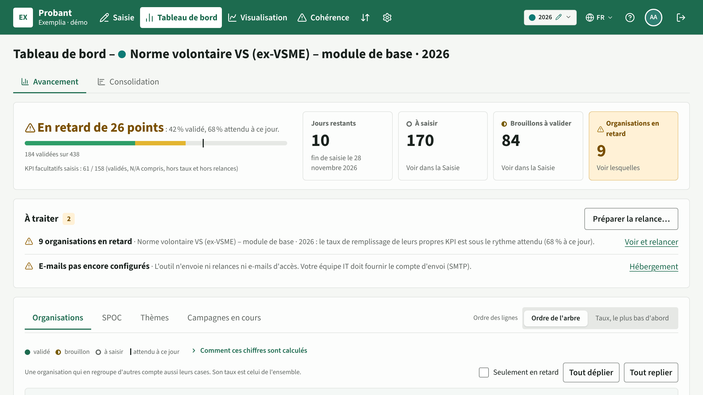
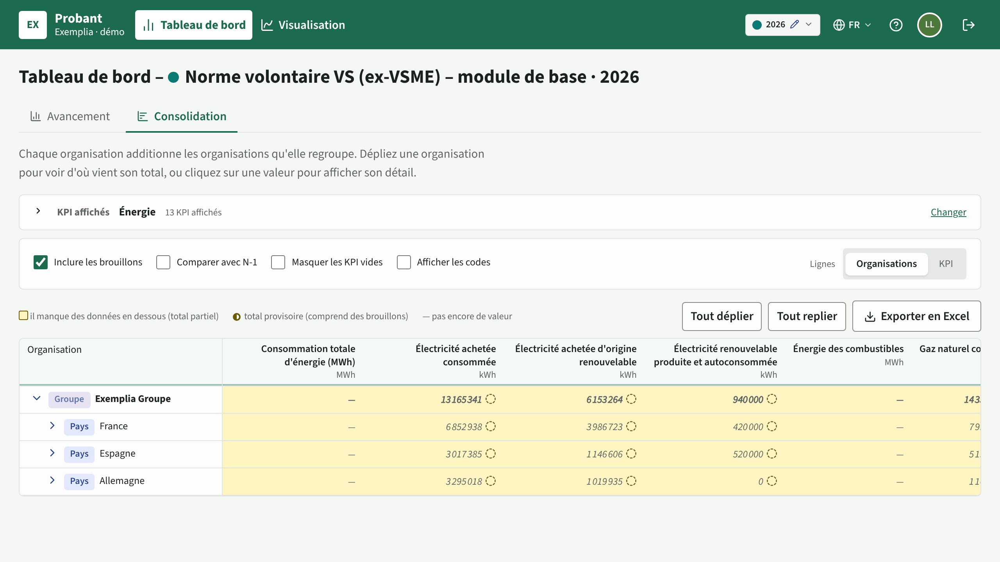
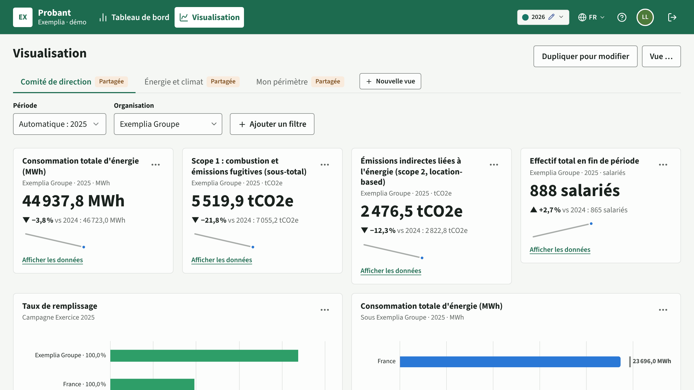
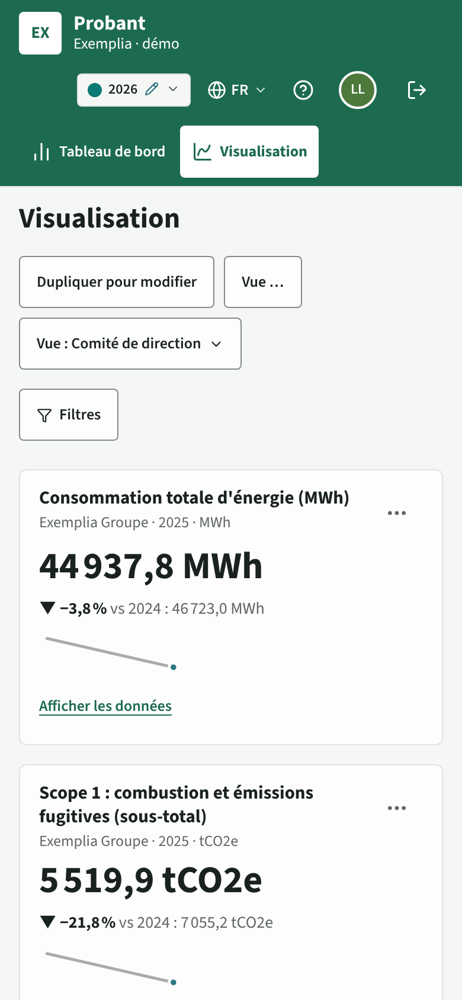

# Guide du lecteur

Vous lisez l'avancement et les chiffres. Vous ne changez jamais rien : le rôle de lecteur est en lecture seule. Version anglaise : [`docs/guides/reader.md`](../../guides/reader.md).

## Suivre l'avancement {#dashboard}

1. Cliquez sur **Tableau de bord** dans la barre du haut.
2. Lisez le verdict en haut. Il dit si la campagne est dans le rythme attendu.
3. Lisez le tableau par organisation. Une organisation qui en regroupe d'autres montre le taux de tout le groupe.

## Voir les totaux de chaque niveau {#consolidation}

1. Dans le **Tableau de bord**, cliquez sur **Consolidation**.
2. Choisissez les KPI à afficher. Ouvrez une ligne pour voir les organisations en dessous.

La page montre les valeurs de chaque niveau de l'arbre, du plus bas au plus haut. Vous voyez les organisations de votre périmètre.

## Lire les graphiques {#visualisation}

1. Cliquez sur **Visualisation** dans la barre du haut. La page s'ouvre sur une vue.
2. Cliquez sur un onglet pour ouvrir une autre vue.
3. Utilisez les filtres en haut : la période, la comparaison, l'organisation et le référentiel.
4. Cliquez sur **Rétablir les filtres de la vue** pour recommencer.
5. Ouvrez le menu « … » d'un graphique pour afficher ses données, l'ouvrir en plein écran, ou l'exporter en image ou en fichier Excel.

Les brouillons peuvent compter dans les chiffres tant qu'une campagne est ouverte. La page le dit quand c'est le cas.

## Utiliser l'outil sur un téléphone {#phone}

Les pages fonctionnent sur un téléphone, en une seule colonne. Les filtres s'ouvrent dans une fenêtre.

## Revoir la visite guidée {#tour}

À votre première connexion, une courte visite montre où agir. Elle ne bloque pas l'écran. Votre navigateur retient que vous l'avez vue.

1. Cliquez sur **Aide** dans la barre du haut.
2. Cliquez sur **Revoir la visite guidée**.
3. Cliquez sur **Suivant** pour continuer, et sur **Terminer** à la fin. Pour arrêter, cliquez sur **Fermer la visite**, appuyez sur Échap ou cliquez sur **Ne plus afficher**.

## Changer de langue {#language}

L'outil existe en français, anglais, espagnol, allemand, italien, néerlandais et portugais.

1. Cliquez sur la langue dans la barre du haut, ou cliquez sur votre nom, puis **Mon compte**.
2. Sous **Langue**, choisissez la langue et enregistrez.

## Changer mon mot de passe {#account}

1. Cliquez sur votre nom, puis **Mon compte**.
2. Sous **Changer mon mot de passe**, saisissez le mot de passe actuel et le nouveau.
3. Cliquez sur **Enregistrer mon mot de passe**.

Si vous avez oublié votre mot de passe, demandez à un administrateur de le réinitialiser.

**Mes dernières connexions**, dans **Mon compte**, liste vos dernières connexions à cet espace. Si vous n'en reconnaissez pas une, changez votre mot de passe et prévenez un administrateur.

## Interroger un assistant {#assistant}

Si un administrateur a permis les assistants, vous pouvez connecter un assistant IA dans **Mon compte**, sous **Assistants IA (MCP)**. Pour votre rôle, il ne peut que lire. Il ne saisit et ne modifie jamais rien. Il lit les campagnes, les KPI, les organisations et le taux de remplissage ; il lit aussi les valeurs de votre périmètre seulement si votre administrateur le permet (**Paramètres › Assistants**). Même alors, il ne lit que les valeurs validées, comme la Visualisation vous les montre. Si votre administrateur a éteint **Les KPI sensibles sont donnés aux assistants**, il ne lit jamais un KPI marqué Restreint ou Confidentiel, ni un KPI calculé à partir d'un tel KPI.
