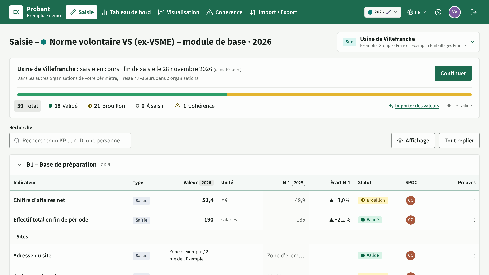
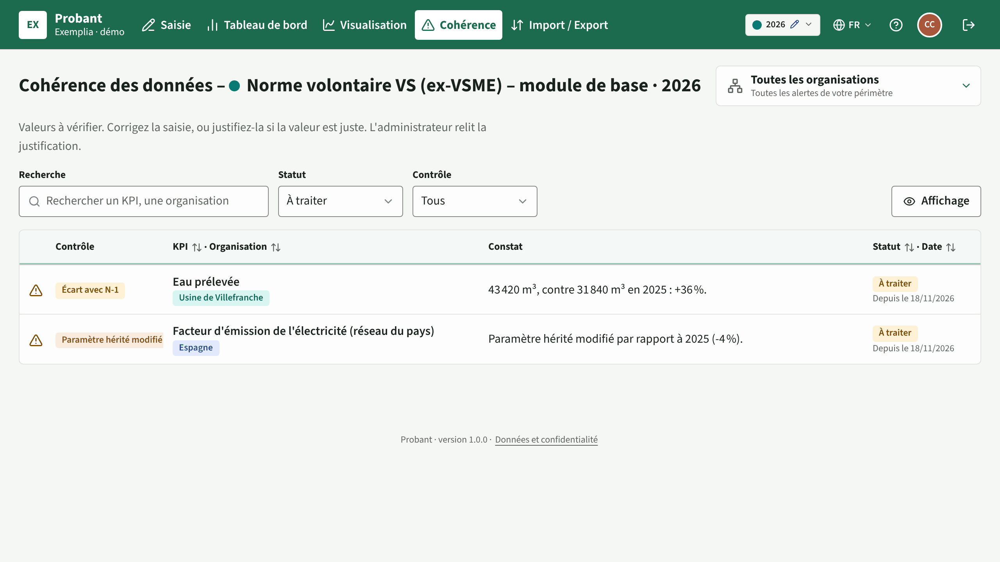
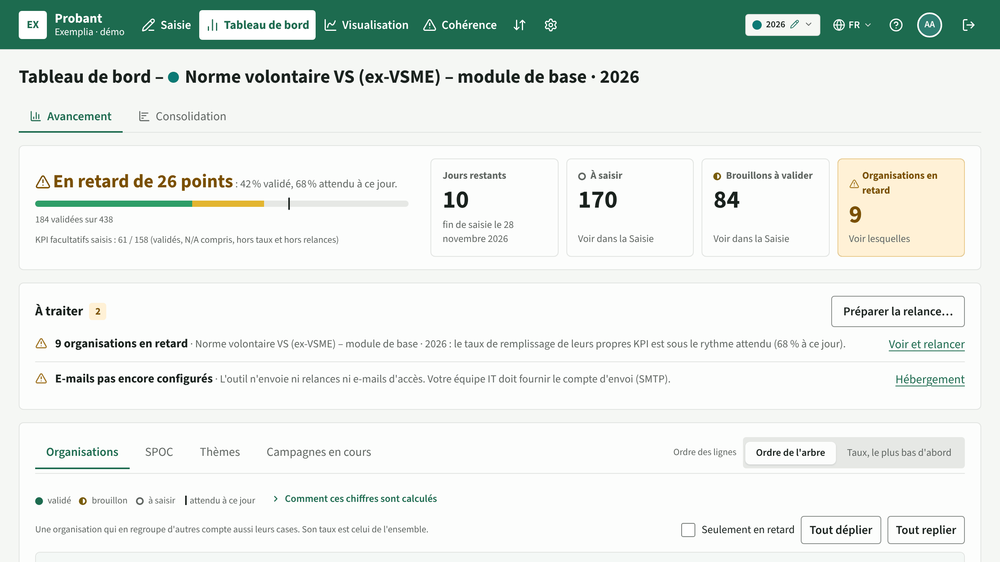
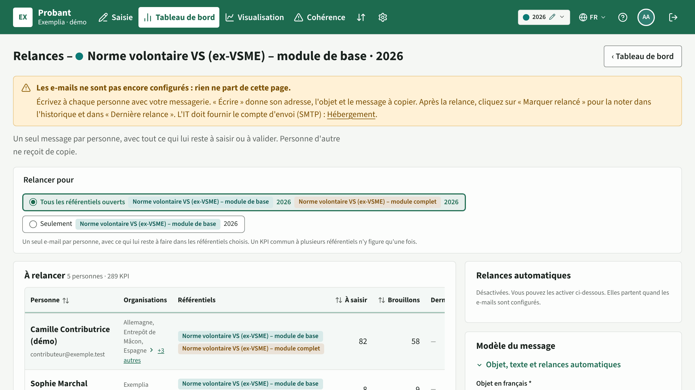

# Guide du validateur

Vous suivez et validez les saisies des KPI et des organisations qu'un administrateur vous a attribués (Attributions KPI, choix Validateurs), et des organisations qui en dépendent. Sans attribution, un administrateur valide à votre place. Vous pouvez aussi envoyer des relances dans ce périmètre. Version anglaise : [`docs/guides/validator.md`](../../guides/validator.md).

## Voir mon périmètre et ce qui reste {#scope}

1. Cliquez sur **Saisie** dans la barre du haut. La page s'ouvre sur **Tout ce qui m'est attribué**.
2. Cliquez sur le nom de l'organisation en haut à droite de la page (**Tout ce qui m'est attribué**), puis choisissez une organisation de votre périmètre dans la liste.
3. Cliquez sur **À saisir**, **Brouillon** ou **Validé** au-dessus du tableau pour filtrer les lignes.
4. Choisissez une organisation, ouvrez **Affichage**, puis cochez **Afficher les KPI calculés et consolidés** pour voir les totaux. Ils sont en lecture seule.

## Vérifier et valider les saisies {#review}

1. Ouvrez la ligne d'une valeur en brouillon. Le panneau de saisie s'ouvre.
2. Lisez la valeur, le commentaire, l'écart avec N-1 et la preuve.
3. Si la saisie est complète, cliquez sur **Valider**.
4. Si elle ne l'est pas, demandez au contributeur de la compléter.

Valider confirme que la saisie est complète. Cela n'audite pas le chiffre. La validation demande une valeur ou N/A, un commentaire (pour un N/A ou un grand écart) et une preuve si le KPI l'exige.

Si le panneau dit qu'une organisation « ouvre le » une date après la période, rien ne peut encore être saisi ni validé pour cette période. Demandez à un administrateur de modifier la date d'ouverture. Rien d'autre ne change pour vous.

## Repasser une saisie en brouillon {#reopen}

1. Ouvrez le panneau de saisie de la valeur validée.
2. Cliquez sur **Repasser en brouillon**. La valeur ne change pas.
3. Le contributeur peut alors la modifier et la valider de nouveau.

**Effacer la valeur** vide la cellule à la place. L'historique garde les deux actions. Après la date de fin de la saisie, les contributeurs ne peuvent plus modifier une valeur, mais vous pouvez encore la repasser en brouillon.

## Traiter les alertes de cohérence {#alerts}

1. Cliquez sur **Cohérence** dans la barre du haut. La page liste les alertes de votre périmètre.
2. Cliquez sur une alerte pour ouvrir sa fiche.
3. Lisez le constat et l'explication du contributeur.

Une alerte ne bloque pas une validation, mais une règle **Bloquante** la bloque : le contributeur ne peut pas valider tant que la règle n'est pas respectée. L'administrateur tranche sur l'explication.

## Accepter ou refuser une valeur forcée {#forced}

Une personne peut demander de remplacer un résultat calculé par une autre valeur, avec une justification.

1. Cliquez sur **Voir les valeurs forcées** dans la page **Saisie**, ou ouvrez le KPI calculé.
2. Lisez la justification.
3. Cliquez sur **Accepter et forcer la valeur** pour accepter la demande.
4. Pour la refuser, saisissez le motif et cliquez sur **Refuser**.

## Suivre l'avancement {#dashboard}

1. Cliquez sur **Tableau de bord** dans la barre du haut.
2. Lisez le verdict en haut, puis le tableau par organisation. Il montre les organisations en retard.
3. Cliquez sur **Consolidation** pour voir les totaux de votre périmètre.

## Envoyer des relances {#reminders}

1. Dans le **Tableau de bord**, cliquez sur **Relancer…** (ou sur **Préparer la relance…** si l'installation n'envoie pas d'e-mails). La page **Relances** s'ouvre.
2. Choisissez les référentiels. L'outil sélectionne les personnes qui ont encore quelque chose à saisir ou à valider.
3. Lisez l'aperçu du message. Envoyez-vous un essai si vous le souhaitez.
4. Cliquez sur **Envoyer la relance**. La confirmation nomme les personnes.

Si l'installation n'envoie pas d'e-mails, la page affiche un encadré orange. Cliquez sur **Écrire** pour obtenir l'adresse, l'objet et le message. Envoyez-les avec votre messagerie. Cliquez ensuite sur **Marquer relancé**.

## Un KPI bloqué par une campagne clôturée {#shared-closed}

Un KPI qui appartient à deux référentiels de même période a une valeur commune. Si une campagne est clôturée, la valeur ne peut pas changer dans l'autre. Le panneau dit quelle campagne est clôturée. Demandez à un administrateur de la rouvrir.

## Importer des valeurs depuis un fichier {#import}

Cliquez sur **Import / Export**. Pour un contributeur, le menu s'ouvre sur **Importer des valeurs**. Pour un validateur, il s'ouvre sur **Mes exports**, et **Importer des valeurs** est à un clic. L'outil montre un aperçu avant d'enregistrer quoi que ce soit.

Chiffres pour des KPI calculés d'une période non clôturée : l'aperçu vous demande de choisir de forcer ces valeurs ou d'ignorer ces lignes. Vous ne pouvez forcer que les organisations que vous validez, pendant la saisie. Pour les autres, la ligne est rejetée.

## Récupérer un gros export {#large-exports}

Au-delà d'un seuil, l'outil prépare un export ou un fichier à remplir sur le serveur. Ouvrez **Import / Export** et choisissez **Mes exports**. Le fichier se trouve sous « Fichiers volumineux ». L'outil le garde 7 jours.

## Revoir la visite guidée {#tour}

À votre première connexion, une courte visite montre où agir. Elle ne bloque pas l'écran. Votre navigateur retient que vous l'avez vue.

1. Cliquez sur **Aide** dans la barre du haut.
2. Cliquez sur **Revoir la visite guidée**.
3. Cliquez sur **Suivant** pour continuer, et sur **Terminer** à la fin. Pour arrêter, cliquez sur **Fermer la visite**, appuyez sur Échap ou cliquez sur **Ne plus afficher**.

## Changer de langue {#language}

1. Cliquez sur la langue dans la barre du haut, ou cliquez sur votre nom, puis **Mon compte**.
2. Sous **Langue**, choisissez l'une des sept langues et enregistrez.

**Mes dernières connexions**, dans **Mon compte**, liste vos dernières connexions à cet espace. Si vous n'en reconnaissez pas une, changez votre mot de passe et prévenez un administrateur.

## Connecter un assistant IA {#assistant}

Si un administrateur a permis les assistants, vous créez un jeton dans **Mon compte**, sous **Assistants IA (MCP)** : saisissez **Nom du jeton**, choisissez **Expire après**, cliquez sur **Créer un jeton**, et copiez le jeton tout de suite. L'assistant a vos droits, jamais plus. Cliquez sur **Révoquer** pour l'arrêter.
