# Administrator guide

You set up the tool, run the campaigns, and follow the completion. Everything that you can change is in **Administration**. The IT team provides the hosting, the domain name, and the email account. French version: [`docs/fr/guides/administrateur.md`](../fr/guides/administrateur.md).

## See what to do first {#overview}

1. Click **Administration** in the top bar. The page **Overview** opens.
2. Read the list **To be handled**, the most urgent first. Each row has its own link.
3. Click **What each section is for** if you need a reminder of the tabs.

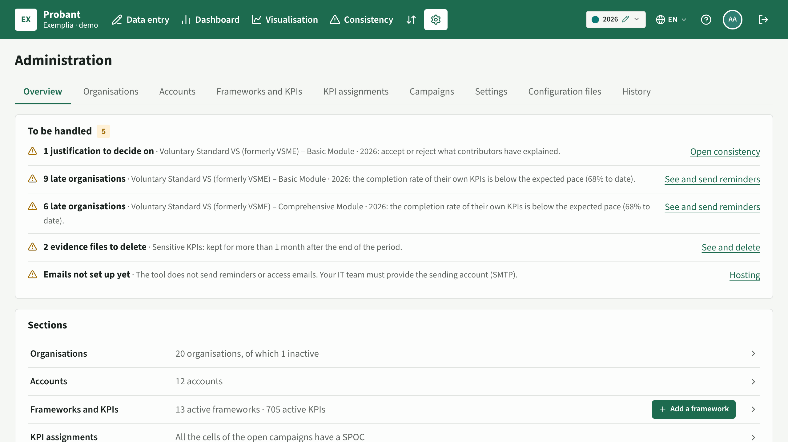

## Set up a new installation {#setup}

The first launch opens a wizard with 8 steps. It starts with your own administrator account.

1. Enter the account, the organisation, and the languages.
2. Choose a framework from the library, or compose your own.
3. Add the team, then create the first campaign.

If you leave the wizard, click **Administration › Settings › Resume the setup** to continue.

## Add a framework {#framework}

1. Click **Administration** in the top bar. On the **Overview**, click **Add a framework** on the line **Frameworks and KPIs**.
2. Choose **Install from the library**, **Compose from existing KPIs**, or **Import a file**.
3. Open the **Content** tab of the framework to arrange the themes and the KPIs.

The KPI sheet sets the answer type, the unit, the formula, and whether evidence is required. Choose “Restricted” or “Confidential” in **Confidentiality** for a sensitive KPI.

As soon as a KPI has a saved or imported value, you cannot change its unit, as for its format. The tool says so when you save. Keep the unit, or create a new KPI in the unit you want. To move the old values, export them, convert them in the file, then import them into the new KPI.

A closed year keeps its list of KPIs. To add a KPI to past years too, set its **Requested since** period (see the next section).

## Choose since when a KPI is requested {#requested-since}

Each KPI of a framework has a **Requested since** period: the first year, or the first period, in which the framework asks for it. When you create a KPI, the tool asks “Add it to previous years too?”. By default, the KPI is requested from the current period, and no past year changes.

1. Go to **Administration › Frameworks and KPIs**, open the framework, then open the **Content** tab.
2. Read the period at the end of each row. “Since the start” means that the KPI was there before this setting existed.
3. Select one or more KPIs, or click the period of a row. In the action bar, choose the period in **Requested since**.
4. Click **Apply**. The tool shows which years change and how many cells it adds. Confirm to save.

A closed year does not change while it is closed: no new cell, no new total, the same completion rate. The KPI appears when you reopen the year, in both modes, and it stays there at the next closure. A year that is reopened gets the cells at once.

You cannot move the period later if a year that loses the KPI is closed, or has a value, an N/A, a comment, or evidence for it. If its cells are empty, the tool asks you to confirm. The history records each change. When a calculated KPI is requested before one of its sources, the tool warns you: the source gets cells from the same period.

## Choose the currency of the amounts {#currency}

The library templates write their amounts in euros. If your financial statements use another currency, set it before you install a template:

1. Go to **Administration › Frameworks and KPIs › Units and formats**.
2. In **Reference currency**, choose the currency, then click **Save**.

When you install or update a library template, its amounts take this currency: “€” becomes “$”, “M€” becomes “M$”, and “€/h” becomes “$/h”. The installation screens show the currency. A KPI that already exists in the space keeps its unit, with or without values; only the new KPIs take the currency.

The tool converts no values and uses no exchange rates. If you change the currency later, the KPIs that already exist keep their unit, and the page counts the KPIs whose unit is in another currency. The EFRAG official workbook uses the reference currency as the currency of the report. It leaves empty an amount whose unit is in another currency, and the export report says so.

Each space has its own reference currency. A new space starts with the euro.

## Add the organisations {#organisations}

1. Go to **Administration › Organisations**.
2. Click **New organisation**, choose its parent, and click **Create the organisation**.
3. For a site that opens during a year, enter its date in **Open since**. The site counts in the totals, and is asked
   for values, only for the periods that end on or after this date. If you leave it empty, the site counts as open
   since always. When you paste several organisations, write the date in brackets: "Lyon [2026-03-01]".

An organisation never opens before its parent: the date that counts is the latest of its own date and the dates of the organisations above it. When a change of date or of parent would take values out of the totals, the sheet counts them, including those of the organisations below, and asks you to confirm. A value for an organisation that is not open yet for the period is refused on the screen, in an import, and through an assistant. The message links to the sheet that holds the date.

The levels of the tree (for example Group, Country, Subsidiary, Site) are in **Administration › Settings › Levels of the tree**.

On this screen and in **Units and formats**, the names of the levels and of the units appear in your language. The fields you type into keep the reference language of the installation, and the label names it (for example “Name (reference language: French)”). The translation in your language is shown next to the field. To change a translation, use **Settings › Languages**.

## Create the accounts {#accounts}

1. Go to **Administration › Accounts**.
2. Click **New account**, or **Several accounts** to create many at once.
3. Enter the email, the name, and choose the **Role**: administrator, validator, contributor, reader, or auditor.
4. Click **Create the account**. Send the temporary password to the person.

To give a new temporary password, open the account and click **Reset the password**. The person chooses their own password at the first sign-in.

A reader or an auditor never enters or validates anything. When you change the role of an account to one of these, the tool shows how many assignments it will remove and asks you to confirm before it saves. It removes them, with a line in the History. Going back to the previous role does not give them back. To give them to another person instead, first use **Replace a person…**. To give them back later, use **KPI assignments** (choose **Validators** for validator assignments).

**To be handled** lists the accounts that became read-only before this rule and still have assignments. Click **Review**, then **Remove** on a line. A deactivated account keeps its assignments until you use **Replace a person…**.

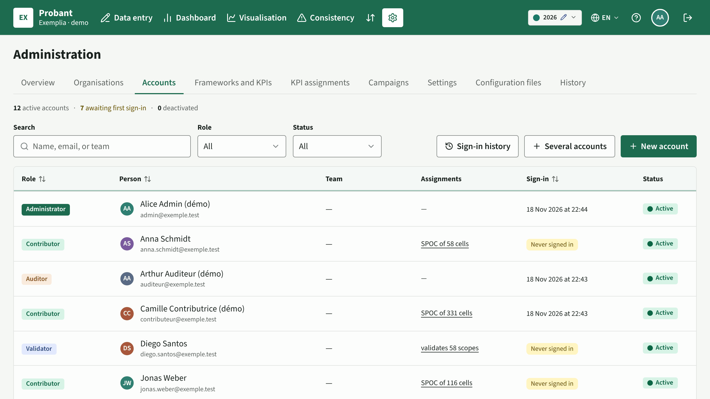

To see who signed in and when, click **Sign-in history** in **Administration › Accounts**. Each line gives the date, the account and the result: **Successful**, **Failed** or **Blocked: too many attempts**. A username that matches no account of the space shows only a reference, never the text typed. Filter by result or period, or search a name. Set how long the tool keeps the history in **Administration › Settings › Hosting** (180 days by default).

## Assign the KPIs {#assign}

Each cell of the grid is one KPI for one organisation. The SPOC is the person who enters it.

1. Go to **Administration › KPI assignments**.
2. Click a cell, then choose one or more people. You can also select a row or a column, then click **Assign**.
3. Click **Replace a person…** when someone leaves.
4. Select **Only the rows to complete** to see what is missing.

To choose the validators, select **Validators** in the list **Role**. A validator assignment is for one KPI in one organisation and in all the organisations below it: the grid then has one tab for each level of organisation, with the KPIs entered at that level or below. A cell marked “via …” is already covered by the validator of an organisation above it. Only active validators and administrators are offered. A cell without a validator is validated by the administrators. Each assignment given or removed writes a line in the History.

For a large group, the grid shows one group of organisations at a time. Choose the group in the list **Organisations** above the grid. The filters and the bulk save apply to the group that is shown. **All (slow for a large group)** shows everything, but the tool does not remember it.

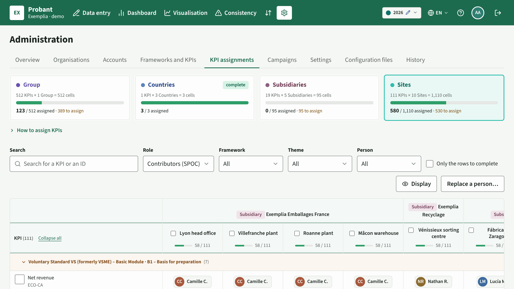

## Open, review, close, and reopen a campaign {#campaign}

1. Go to **Administration › Campaigns** and click **New campaign** on the line of the framework.
2. Choose the period, set the dates and the **Variance threshold**, then click **Create the campaign**.
3. Click **Manage** on a campaign. Use **Open data entry**, **Start the review**, or **Close for good**.
4. To change a closed campaign, click **Reopen to contributors** or **Reopen to correct (review)**. The history records the reopening.
5. When you reopen a closed year, choose first:
   - **Keep the figures of the time** (selected by default): nothing is recalculated. Only an organisation whose value
     you correct, and the totals above it, are recalculated. Example: an entity moved to another country since then
     stays in the totals of its former country.
   - **Recalculate with today's organisation**: all the totals of the year are recalculated with today's tree and
     formulas. Example: the moved entity moves its values to the totals of its new country.

   A year reopened with the figures of the time keeps the organisation tree it had when it was closed: a correction is
   recalculated with the parents of that time, and an organisation created since then has no cell in that year. Your choice is valid until the
   next closure.

   When a year has two campaigns (two frameworks) and one of them is closed, the KPIs that the closed campaign asks for
   keep their figures until the other campaign is closed too: a change of the organisations or **Redo the calculations**
   no longer changes them, and they keep the organisation tree of the day of the closure. A KPI shared by the two
   campaigns keeps its figures too. Only a correction imported into the closed campaign recalculates the corrected
   organisation and its totals. With **Recalculate with today's organisation**, the KPIs of another campaign of the year
   that is still closed keep their figures.

A closed campaign is frozen for everyone, administrators included. Its values become the N-1 of the next one. **Redo the calculations** is rarely needed.

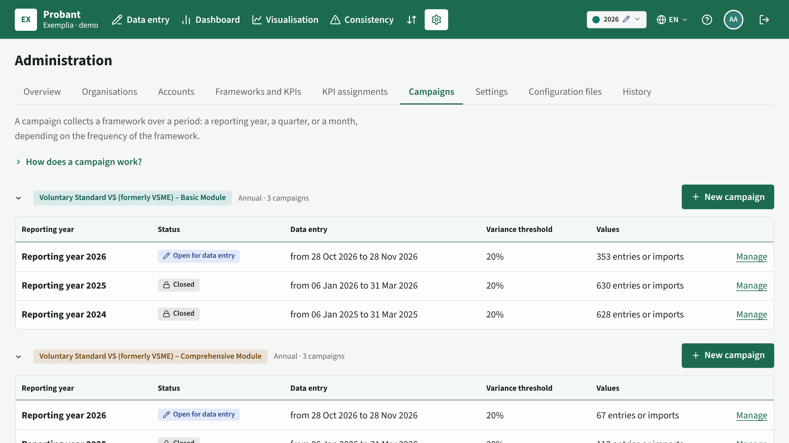

## Enter and check values {#entry}

**Data entry** lists the cells of the open campaign, by organisation and KPI. You see all of them and you can enter or correct a value in any cell. Use the filters to find a KPI, an organisation, or a status, then click a cell to open its panel.

## Reopen an entry that is validated {#reopen}

1. Go to **Data entry** and open the row of the value.
2. Click **Back to draft**. The value stays the same.
3. The contributor changes it and validates it again.

**Clear the value** empties the cell instead. Both actions are in the history.

## A KPI that is blocked by a closed campaign {#shared-closed}

A KPI can belong to two frameworks that have the same period. Its value is shared. If one campaign is closed, nobody can change the value in the other one, you included. The panel names the closed campaign.

1. Reopen the closed campaign: click **Manage**, then **Reopen to correct (review)**.
2. Change the value in the entry panel.
3. Close the campaign again.

## Send reminders {#reminders}

1. On the **Dashboard**, click **Remind…** (or **Prepare the reminder…** if the installation has no email sending). The page **Reminders** opens.
2. Choose the frameworks. The tool selects the people with something left to do.
3. Read the preview, then click **Send the reminder**.

Under **Message template** you change the text. Under **Automatic reminders** you set the days before the end of data entry. Without an email account (SMTP), **Write** gives the text to send by yourself. Then click **Mark as reminded**.

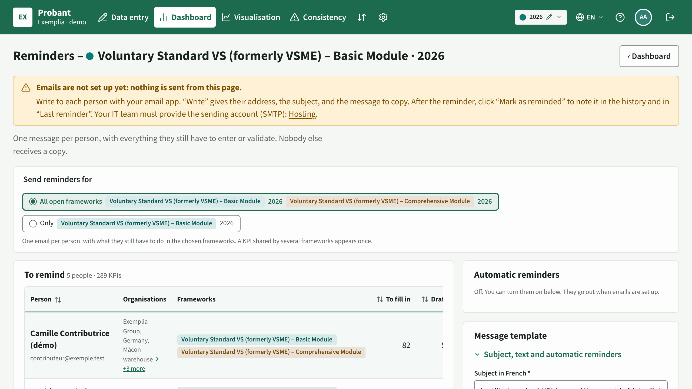

## Get the audit file {#audit-file}

An administrator or an auditor can download one Excel file with what an audit needs: for each KPI and organisation, the value, the status, who entered and validated it, the evidence, the consistency alerts and their justifications, and the history of the changes. The tool only reads the data. Making the file changes nothing.

1. Click **Import / Export**, then **New export**.
2. Under **Layout**, choose **Audit file**. Choose the year, and the organisations if you need only some of them.
3. Click **Download**.

The file has four tabs: **Read me**, **Audit** (one row per KPI and organisation), **History** (every change of these values, oldest first), and **Evidence** (the file names, the sizes, and who added them). The tab **Read me** gives the date, the version of the tool, and the filters. A large file is prepared on the server, like any large export.

Validators and contributors do not see the audit file: it is for administrators and auditors. An auditor limited to some organisations gets only those.

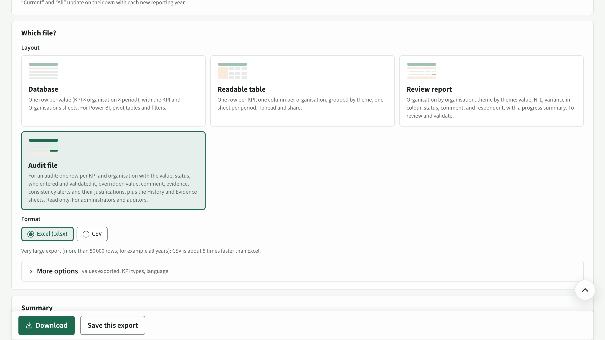

## Print the closing certificate {#closing-certificate}

An administrator can print a page that sums up a closed campaign. The tool only reads the data. Opening the page changes nothing.

1. Click **Administration**, then **Campaigns**, then a closed campaign.
2. Click **Closing certificate**.
3. Click **Print**. In the print window, choose Save as PDF to keep a file.

The page shows the scope, the completion rate, the number of values, the evidence, and the consistency alerts. It shows who closed the campaign and when, if the history keeps it. The fingerprint is a code computed from every figure of the campaign. If one figure changes, the fingerprint changes. To check later, open the certificate again and compare the two fingerprints.

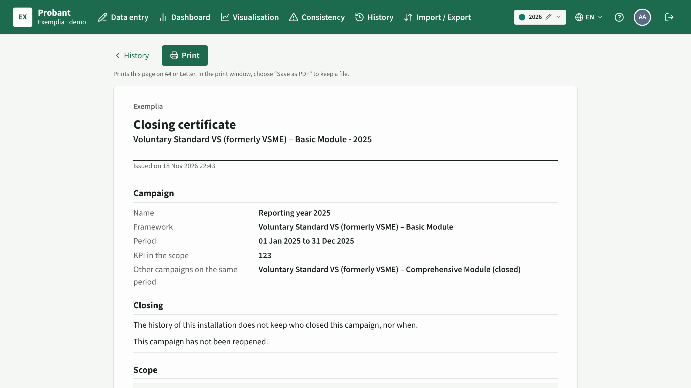

## Get a large export {#large-exports}

Above a size limit, the tool prepares an export or a file to fill in on the server. Open **Import / Export** and choose **My exports**. The file is under “Large files”. The tool keeps it for 7 days.

An administrator sets the number of days in **Administration › Settings › Hosting**, in the block “Large exports”.

## Delete the evidence of sensitive KPIs {#evidence-delete}

The tool keeps evidence files. It never deletes them by itself.

1. Go to **Administration › Settings › Hosting**. In **Evidence of sensitive KPIs**, enter the number in **Months before offering deletion**.
2. Click **Administration › History**, then **Evidence to delete**.
3. The page lists the files whose campaigns are all closed and whose period ended more than that number of months ago.
4. Select the files, then click **Delete selected**. Or click **Delete** on one line.

Warning: the deletion is final. The file does not go to the trash. The history records each deletion without the content of the file. The value of the answer does not change.

Backups made before the deletion keep the file until the tool replaces them. A restore brings the file back into **Evidence to delete**: delete it again. The copies of the backups that the IT team keeps outside the tool also keep the file: ask the IT team to delete them. Set the number of backups to keep in **Administration › Settings › Hosting**, under **Automatic backup**, so that old backups leave soon.

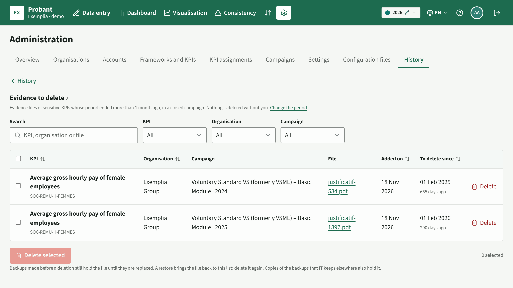

## Add or translate a language {#languages}

The menus and buttons exist in French, English, Spanish, German, Italian, Dutch, and Portuguese. Each person chooses their language in **My account**. The names of KPIs, themes, and units use **Administration › Settings › Languages**.

1. Click **Add a language**, or open a language and click **Translate**.
2. To translate in bulk, use **Export** and **Import**, or **Translate all languages at once**.

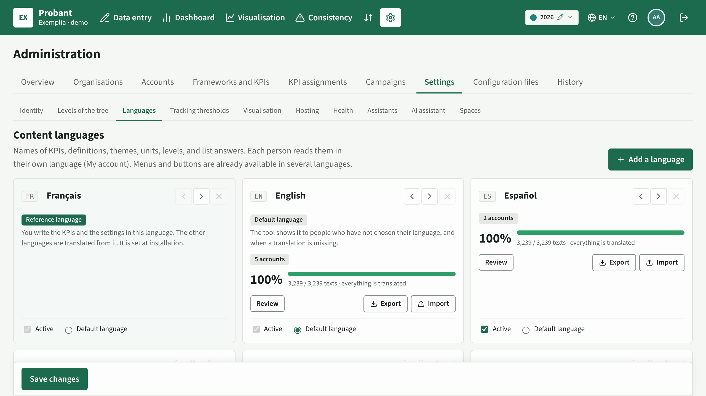

## Connect an assistant (MCP) {#assistants}

An AI assistant, for example Claude, can read and change data with the rights of the person who connects it, never more. It is off by default.

1. Go to **Administration › Settings › Assistants**.
2. Select **Allow AI assistants (MCP) in this space**.
3. Select **Assistants can also make changes** only if people need it. Readers and auditors never make changes.
   Under **What assistants receive**, choose **A reader can read values through an assistant** (off by default)
   and **Sensitive KPIs are given to assistants** (on by default; off hides from every tool the KPIs marked
   Restricted or Confidential, and the KPIs calculated from them). A reader never gets a draft, only validated values.
4. Click **Save**. Give the **Server address of this space** to the people.

Each person creates a token in **My account**. Under **Active tokens**, click **Revoke** to cut off an assistant at once. The history records every call, and shows “(via MCP)” after each change.

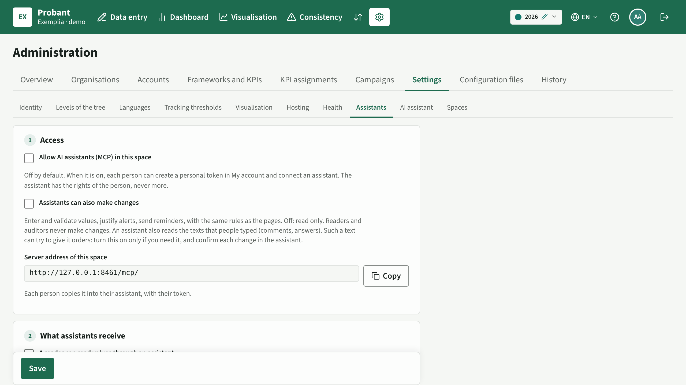

## Turn on the AI assistant {#ai}

The AI assistant explains consistency alerts, proposes KPI matches in the migration wizard, and proposes translations. It is off by default. Nothing leaves the tool until you turn it on.

1. Go to **Administration › Settings › AI assistant**.
2. Select **Turn on the AI assistant**.
3. Choose the **Provider** and the **Model**.
4. Enter the **API key of your provider account**. The tool keeps it for this space only and never shows it again. Click **Remove the key** to delete it.
5. Under **Uses**, select the uses that you want. **Sensitive KPIs can be sent to the AI assistant** is off by default: nothing about a KPI marked Restricted or Confidential, or about a KPI calculated from it, is sent, and its alerts have no **Explain with AI**. Click **Save**.

Each answer is a proposal marked “Proposed by AI”. Nothing is saved until a person clicks and saves as usual. The history records each call without its content.

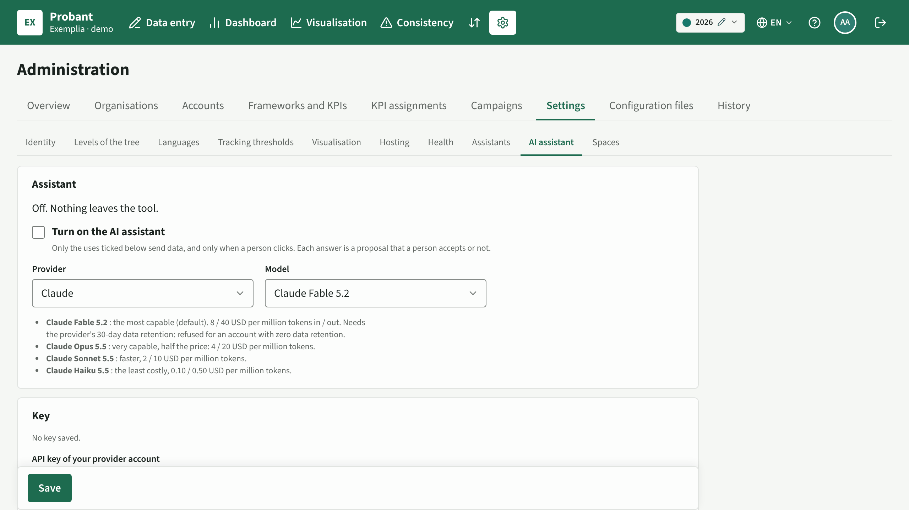

## Check the hosting and the backups {#hosting}

Go to **Administration › Settings › Hosting**. The page shows the version, the automatic backup, the data check, and the email setup. Click **Create and download a backup** to make a backup at once. The IT team copies the backups to another place.

To see at a glance if all is well, go to **Administration › Settings › Health**. Each line (version, database, files, last backup, disk space, email, background tasks, database update, HTTPS) shows **Good**, **To check** or **Failure**, and what to do. The administrator of a space other than the main space sees the same lines, but the database and database update lines check only their space and the shared account registry, not the other spaces. They do not see the detail for IT (names of the other spaces, folders on the disk): the space manager sees it. In **Settings › Hosting**, the **For IT** box does not show them the data folder, the allowed addresses, the database server, the email username or the backups folder.

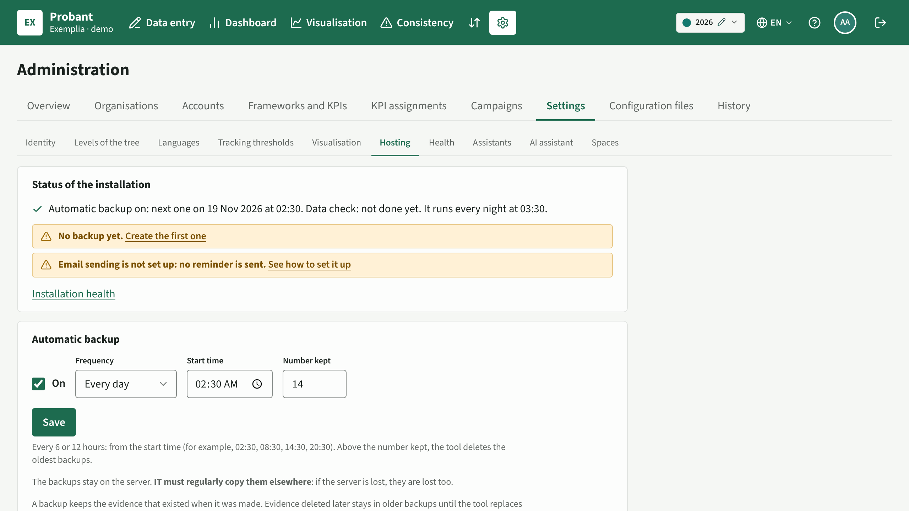

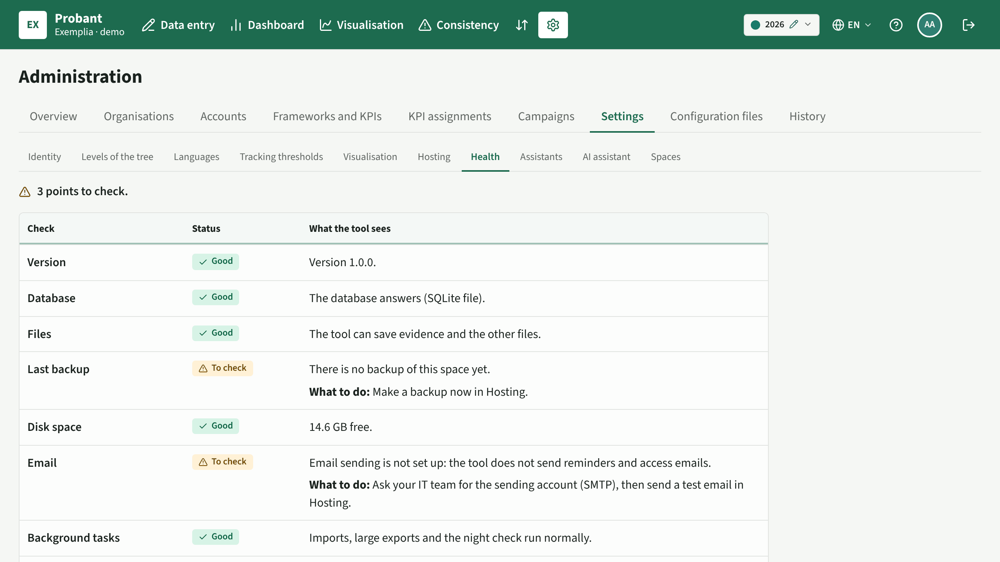

## See the totals of each level {#consolidation}

**Consolidation** shows the value of each KPI at every level of the tree, from the sites up to the group. Choose the KPIs to show, open a row to see the organisations below it, and export the table to Excel. A line says when a total is incomplete.

## Handle the consistency alerts and rules {#consistency}

**Consistency** lists the alerts of the campaign: unusual values, large gaps with N-1, and rules that are not met. Click an alert to read the finding and the explanation of the contributor, then accept, reject, or dismiss it. Under **Consistency rules**, you set the rules. A rule set to **Blocking** stops the contributor from validating until it is met.

## Import values from a file {#import-values}

Click **Import / Export**, then **Import values**. Choose the file, read the preview, and confirm. The tool saves nothing before you confirm, and applies the same rules as on the entry panel.

Numbers in Excel cells are read as they are. A number written as text is read in the language of the file. In a CSV file, the column separator tells it: “;” goes with a decimal comma, “,” with a decimal point. Otherwise, the header of the value column tells it: in English, “1,234” is 1234; in French, 1.234. The preview says how it read the numbers and flags a value such as “1,234”. The **Migrate a former system** wizard reads them in the language of your screen.

If the file has figures for calculated KPIs of a period that is not closed, the preview counts them and asks you to choose whether to force these values or to ignore these rows. Forced figures become overridden values: they replace the calculated result, and the totals and the formulas that use them are calculated again. **To be handled** also lists figures imported as is on calculated cells before this rule: open **Overridden values** and choose **Force** or **Remove** for each one.

## Export to an official format {#official-formats}

**Official formats** exports the values into the official workbook of a standard, for example the EFRAG workbook for the VS standard. The tool writes only the cells for entry. Open the exported file in Excel and save it before you convert it.

## Save a list of KPIs {#kpi-lists}

**KPI lists** groups the KPIs that you follow often under one name. Choose a list in one click in an export or in a file to fill in.

## Read the charts and build views {#visualisation}

**Visualisation** shows the charts of the views. Open a view, change the filters at the top, then use the “…” menu of a chart to show its data or export it. You can also create a view, edit it, and share it.

## Change the settings of the tool {#settings}

**Settings** gathers what you can adjust in the tool: the identity, the levels of the organisation tree, the thresholds, the colours of the charts, the languages, the AI assistant, the assistants, and the hosting. Nobody needs to change any code.

## Manage the spaces {#spaces}

**Spaces** lists the spaces of this installation. Each space has its own data: frameworks, organisations, campaigns, values, evidence, and identity. Accounts are shared: a person signs in once.

## Follow every change {#history}

Click **Administration** in the top bar, then **History**. In **Log**, choose **Data entry** to see the values, the validations, and the evidence, or **Administration changes** to see the campaigns, the framework, the organisations, and the accounts. The tool never deletes anything from the history.

## Show the guided tour again {#tour}

At your first sign-in, a short tour shows where to act. It does not block the screen. Your browser remembers that you saw it.

1. Click **Help** in the top bar.
2. Click **Show the tour again**.
3. Click **Next** to go on, and **Done** at the end. To stop, click **Close the tour**, press Esc, or click **Don't show again**.

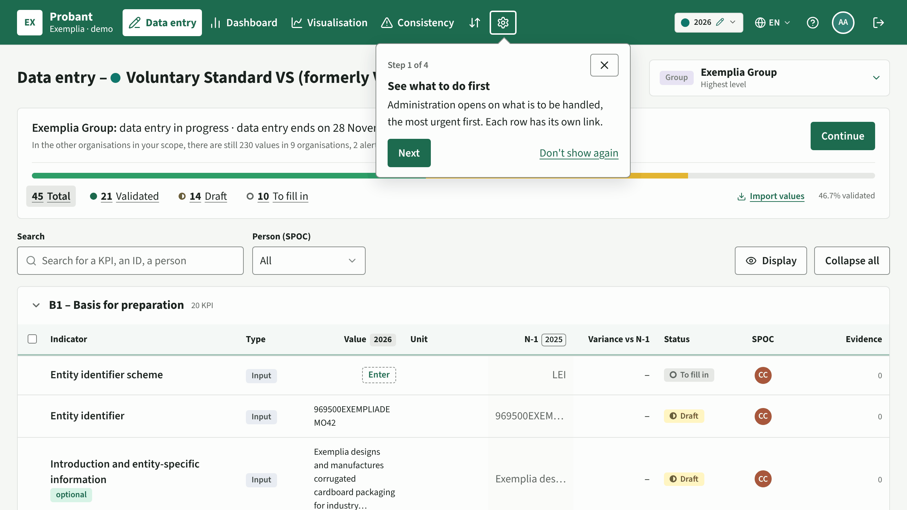

## Change my language or password {#account}

Click your name, then **My account**. Choose the **Language**, and change your password under **Change my password**.

**My last sign-ins**, in **My account**, lists your last sign-ins to this space. If you do not recognise one, change your password and tell an administrator.
