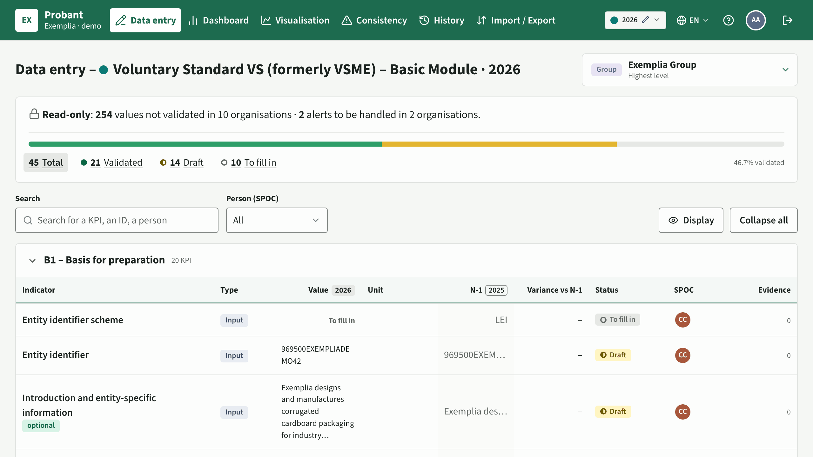
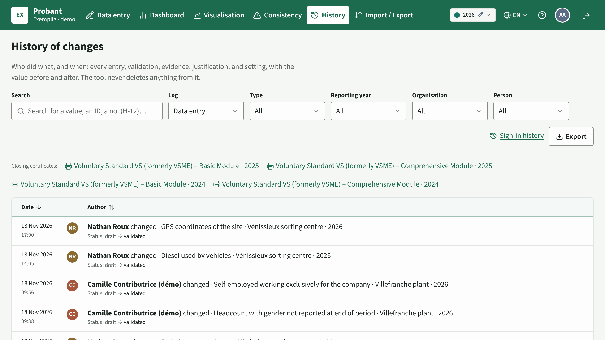
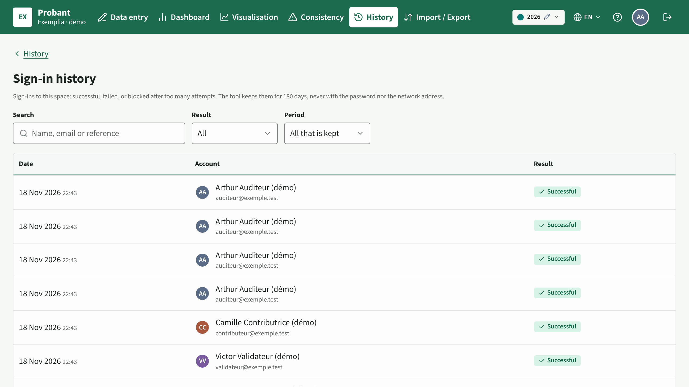
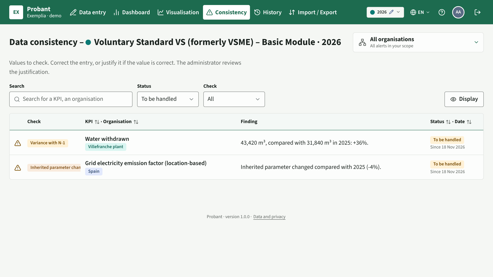
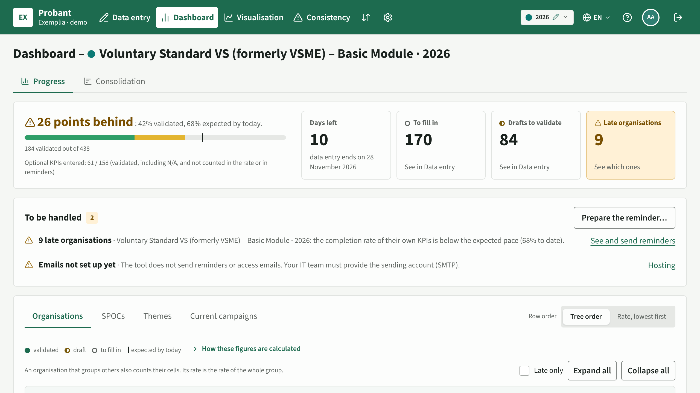
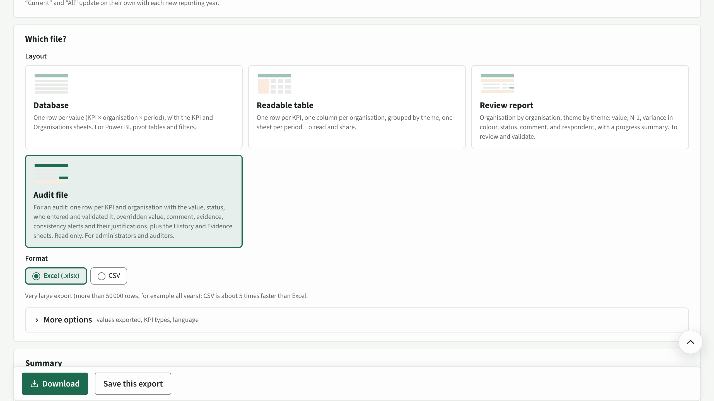
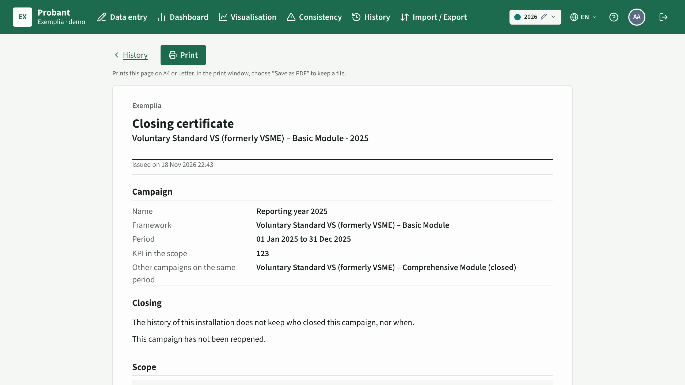

# Auditor guide

You can see all the values, their evidence, and their history. You never change anything: the auditor role is read-only. French version: [`docs/fr/guides/auditeur.md`](../fr/guides/auditeur.md).

## Look at the values of an organisation {#read-only}

1. Click **Data entry** in the top bar. The page opens on the highest organisation of your scope.
2. Click the organisation name at the top right of the page, then choose the organisation in the list.
3. Use **Search** and the filters above the table to find a KPI.
4. Click a row to open the panel. It shows the value, the comment, the evidence, and the history by reporting year.

Open **Display** and select **Show calculated and consolidated KPIs** to see the totals and the components of each calculation.

## Open the evidence {#evidence}

1. Open the panel of a value.
2. Under **Evidence**, click the name of a file to open it.

The column **Evidence** of the table shows the number of files for each KPI.

## Follow every change {#history}

1. Click **History** in the top bar.
2. Choose **Data entry** to see the values, the validations, and the evidence. Choose **Administration changes** to see the campaigns, the framework, the organisations, and the accounts.
3. Filter by reporting year, organisation, or person.
4. Click **Export** to get the log as a file.

The history shows who did what and when, with the value before and after. The tool never deletes anything from it. A change that an AI assistant made shows “(via MCP)”.

Three lines of **Administration changes** need a word:

- “removed the assignments (read-only role)”: an account became a reader or an auditor and lost its assignments. The line lists them by role, with “See the full text” when the list is long.
- “added a KPI to the scope of a reopened period”: a closed year keeps its list of KPIs, and an administrator added this KPI to it on purpose while the campaign was reopened.
- “chose how to reopen a campaign”: the administrator kept the figures of the time or recalculated with today's organisation.

## See who signed in {#sign-ins}

1. Click **History** in the top bar.
2. Click **Sign-in history** at the end of the filter bar.
3. Filter by name or email, by result, or by period.

Each line shows the date, the account, and the result: **Successful**, **Failed**, or **Blocked: too many attempts**. For an unknown username, the tool shows only a reference, never the text that was typed. The page is read-only. The administrator sets how long the tool keeps these lines. If your access is limited to some organisations, this page is not available to you.

## Read the consistency alerts {#consistency}

1. Click **Consistency** in the top bar.
2. Filter the alerts by status, check, KPI, or organisation.
3. Click an alert to read the finding and the explanation of the contributor.

An alert does not block a validation, but a rule set to **Blocking** does: the contributor cannot validate until the rule is met. The administrator decides on each explanation.

## Follow the progress and the charts {#dashboard}

Click **Dashboard** for the completion by organisation, and **Consolidation** for the totals of each level. Click **Visualisation** for the charts. The drafts can count in the figures while a campaign is open. The page says it when they do.

## Get the audit file {#audit-file}

An administrator or an auditor can download one Excel file with what an audit needs: for each KPI and organisation, the value, the status, who entered and validated it, the evidence, the consistency alerts and their justifications, and the history of the changes. The tool only reads the data. Making the file changes nothing.

1. Click **Import / Export**, then **New export**.
2. Under **Layout**, choose **Audit file**. Choose the year, and the organisations if you need only some of them.
3. Click **Download**.

The file has four tabs: **Read me**, **Audit** (one row per KPI and organisation), **History** (every change of these values, oldest first), and **Evidence** (the file names, the sizes, and who added them). The tab **Read me** gives the date, the version of the tool, and the filters. A large file is prepared on the server, like any large export.

You see the same data as on the pages of the tool. If an administrator limited you to some organisations, the file holds only those.

## Print the closing certificate {#closing-certificate}

You can print a page that sums up a closed campaign. The tool only reads the data.

1. Click **History**. Above the list, under **Closing certificates:**, click a campaign.
2. Click **Print**. In the print window, choose Save as PDF to keep a file.

The page shows the scope, the completion rate, the number of values, the evidence, and the consistency alerts. It shows who closed the campaign and when, if the history keeps it. The fingerprint is a code computed from every figure of the campaign. If one figure changes, the fingerprint changes. If you are limited to some organisations, you get a partial certificate: it says so at the top of each page, and every figure and the fingerprint cover only your organisations.

## Get a large export {#large-exports}

Above a size limit, the tool prepares an export or a file to fill in on the server. Open **Import / Export** and choose **My exports**. The file is under “Large files”. The tool keeps it for 7 days.

## Use the tool on a phone {#phone}

The pages work on a phone, in one column.

## Show the guided tour again {#tour}

At your first sign-in, a short tour shows where to act. It does not block the screen. Your browser remembers that you saw it.

1. Click **Help** in the top bar.
2. Click **Show the tour again**.
3. Click **Next** to go on, and **Done** at the end. To stop, click **Close the tour**, press Esc, or click **Don't show again**.

## Change the language {#language}

1. Click the language in the top bar, or click your name, then **My account**.
2. Under **Language**, choose one of the seven languages and save.

**My last sign-ins**, in **My account**, lists your last sign-ins to this space. If you do not recognise one, change your password and tell an administrator.

## Ask an assistant {#assistant}

If an administrator turned on assistants, you can connect an AI assistant in **My account**, under **AI assistants (MCP)**. For your role, it can only read. The history records every call.
