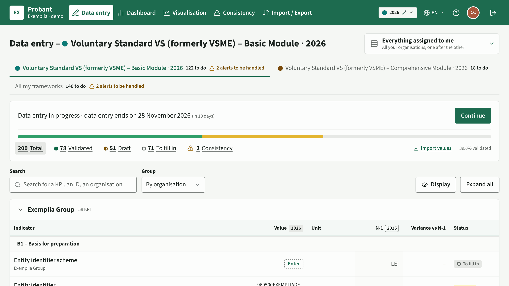
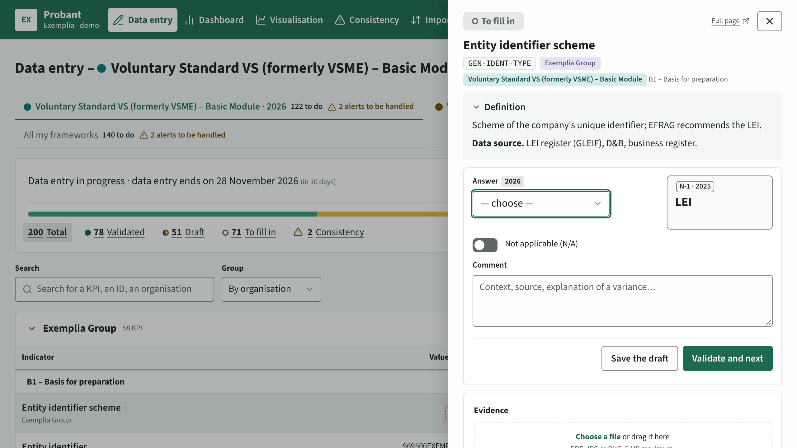
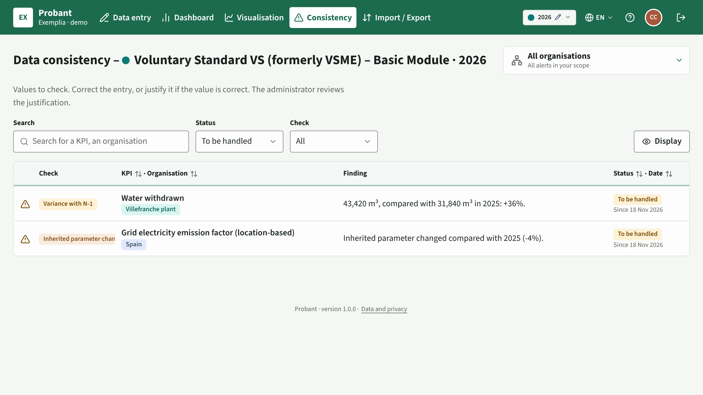
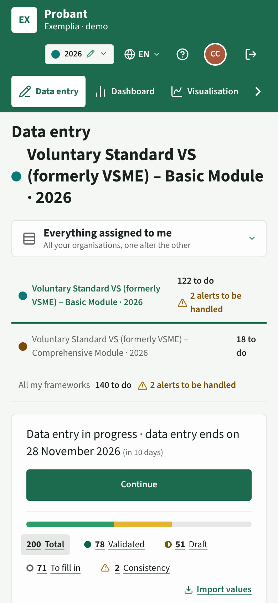

# Contributor guide

You enter the values of the KPIs that an administrator assigned to you, and you validate them. This guide shows each task in a few steps. French version: [`docs/fr/guides/contributeur.md`](../fr/guides/contributeur.md).

## Find what to enter {#find}

1. Click **Data entry** in the top bar. The page opens on **Everything assigned to me**.
2. Choose the framework and the period in **I am answering…** (top bar), or use the tabs under the title.
3. Click **To fill in** or **Draft** above the table to keep only the rows that need you.
4. Use **Search** to find a KPI, an ID, or an organisation.

Click **Start** (or **Continue**) to open the first value that is still to do. The summary shows how many values are left and when data entry ends.

## Enter a value {#enter}

1. Click the row of the KPI, or press Enter on it. The entry panel opens.
2. Enter the number, the answer, or the text in **Value** (or **Answer**, for a list or a text).
3. Click **Save the draft** to keep it and come back later.

The panel shows the value of the comparison period (N-1) and the variance. If the variance goes beyond the threshold of the campaign, the **Comment** is required.

Choose **Full page** if you prefer to work on the whole page.

If the panel says that an organisation “opens on” a date after the period, nothing can be entered for this period yet. Ask an administrator to change the opening date. Nothing else changes for you.

## Mark a value as not applicable {#na}

1. Open the entry panel of the KPI.
2. Select **Not applicable (N/A)**.
3. Write the reason in **Comment**. The comment is required for N/A.

## Add evidence {#evidence}

1. Open the entry panel of the KPI.
2. Under **Evidence**, click **Choose a file** or drag the file into the zone.
3. Use a PDF, JPG, or PNG file. The panel shows the size limit (5 MB by default).

If the KPI requires evidence, you cannot validate without at least one file. This does not apply to N/A.

## Validate my entry {#validate}

Validating confirms that your entry is complete. It does not mean that the figure is audited.

1. Open the entry panel of the KPI.
2. Click **Validate and next**. The panel opens the next value.
3. At the end, the summary shows "All done".

If something is missing, the tool says what to add: a value or N/A, a comment, or evidence.

## Change a value that is validated {#reopen}

You can edit a value that you validated. The tool puts it back to draft and you validate it again.

1. Open the entry panel of the KPI.
2. Change the value, then click **Save the change**. Or click **Back to draft** to change nothing yet.
3. Click **Validate** when the value is correct.

**Clear the value** empties the value and sets the cell back to **To fill in**. The comment and the evidence stay. The history records every change.

If the campaign is closed, only an administrator can reopen it.

## A KPI that is blocked by a closed campaign {#shared-closed}

Some KPIs belong to two frameworks that have the same period. The value is shared. If one of the two campaigns is closed, you cannot change the value in the other one.

The panel then shows a message that names the framework and the campaign. Ask an administrator to reopen the closed campaign.

## Handle a “To check” alert {#check}

The tool checks your values and marks the unusual ones with **To check**. An alert does not block the validation, but a rule set to **Blocking** does: you cannot validate until the rule is met.

1. Open the entry panel. The **To check** box gives the reason.
2. If the value is wrong, correct it and save.
3. If the value is right, click **I explain in the comment**, write the explanation, and save.

The page **Consistency** lists all your alerts. Click an alert to open its sheet. In the entry panel, **Alert sheet** gives the same details. An administrator reviews your explanation.

If your administrator turned on the AI assistant, click **Explain with AI** in an alert. The answer is only a proposal. Click **Use as my explanation** to copy it into the comment, then save.

## Import values from a file {#import}

1. Click **Import / Export** in the top bar. It opens on **Import values**.
2. Follow the steps of the page. The tool shows a preview before it saves anything.

The same rules apply as on the entry panel.

Numbers in Excel cells are read as they are. A number written as text is read in the language of the file. In a CSV file, the column separator tells it: “;” goes with a decimal comma, “,” with a decimal point. Otherwise, the header of the value column tells it: in English, “1,234” is 1234; in French, 1.234. The preview says how it read the numbers and flags a value such as “1,234”.

## Read the charts {#visualisation}

**Visualisation** shows the progress and the figures of your scope in views. Open a view, change the filters at the top, then use the “…” menu of a chart to show its data or export it. Drafts can count in the figures while a campaign is open.

## Use the tool on a phone {#phone}

The pages work on a phone. The entry panel takes the whole screen. Use the close button to come back to the list.

## Show the guided tour again {#tour}

At your first sign-in, a short tour shows where to act. It does not block the screen. Your browser remembers that you saw it.

1. Click **Help** in the top bar.
2. Click **Show the tour again**.
3. Click **Next** to go on, and **Done** at the end. To stop, click **Close the tour**, press Esc, or click **Don't show again**.

## Change the language {#language}

The tool is available in French, English, Spanish, German, Italian, Dutch, and Portuguese.

1. Click the language in the top bar, or click your name, then **My account**.
2. Under **Language**, choose the language and save.

The names of KPIs and themes show in your language when they have a translation.

## Connect an AI assistant {#assistant}

If your administrator turned on assistants, you can connect one (for example Claude). It reads and acts with your rights, never more.

1. Click your name, then **My account**.
2. In **AI assistants (MCP)**, enter a name in **Name of the token** and choose **Expires after**.
3. Click **Create a token**.
4. Copy the token now. You will not see it again.
5. Paste the ready-made configuration into your assistant.

To stop an assistant, click **Revoke** on its line. The history shows “(via MCP)” after each change that an assistant made.

## Change my password {#account}

1. Click your name, then **My account**.
2. Under **Change my password**, enter the current password and the new one.
3. Click **Save my password**.

If you forgot your password, ask an administrator to reset it.

**My last sign-ins**, in **My account**, lists your last sign-ins to this space. If you do not recognise one, change your password and tell an administrator.
