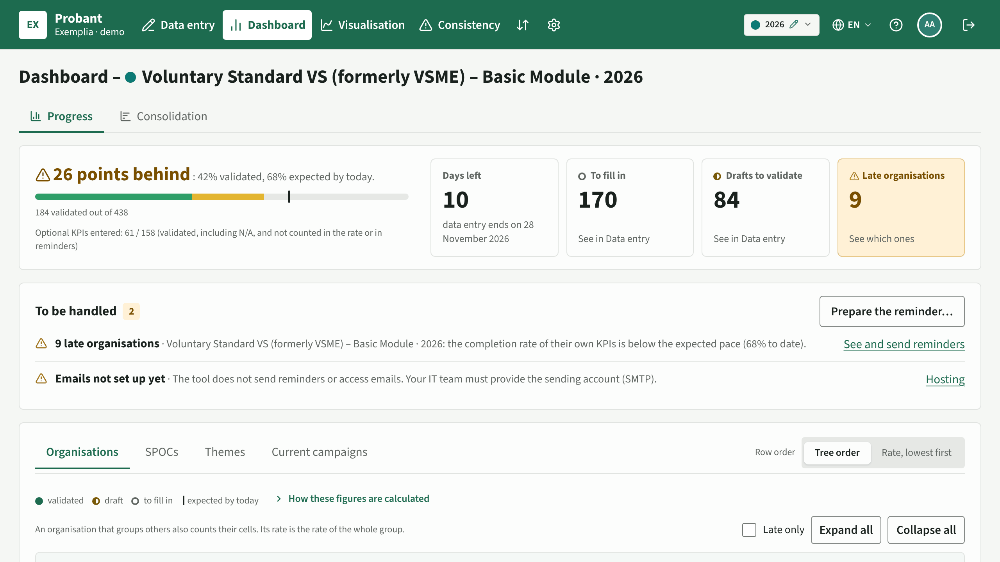
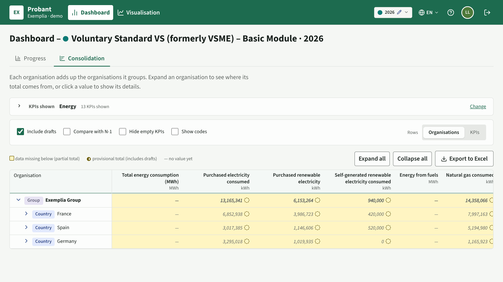
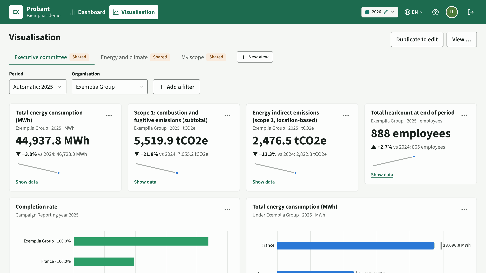
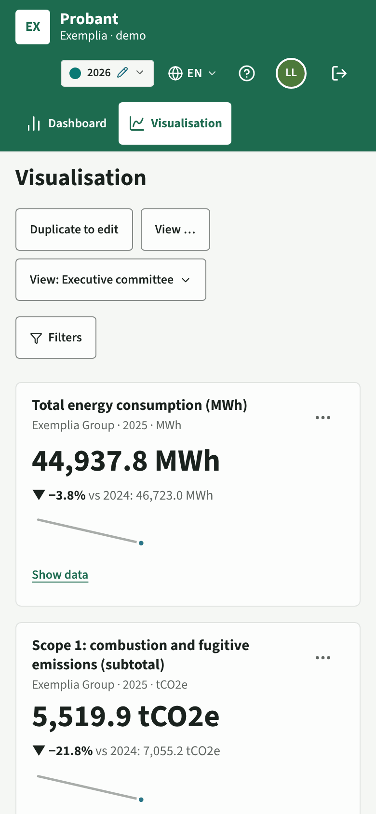

# Reader guide

You read the progress and the figures. You never change anything: the reader role is read-only. French version: [`docs/fr/guides/lecteur.md`](../fr/guides/lecteur.md).

## Follow the progress {#dashboard}

1. Click **Dashboard** in the top bar.
2. Read the verdict at the top. It says if the campaign is on track against the expected pace.
3. Read the table by organisation. An organisation that groups others shows the rate of the whole group.

## See the totals of each level {#consolidation}

1. On the **Dashboard**, click **Consolidation**.
2. Choose the KPIs to show. Open a row to see the organisations below it.

The page shows the values of each level of the tree, from the lowest to the highest. You see the organisations of your scope.

## Read the charts {#visualisation}

1. Click **Visualisation** in the top bar. The page opens on a view.
2. Click a tab to open another view.
3. Use the filters at the top: the period, the comparison, the organisation, and the framework.
4. Click **Reset view filters** to start again.
5. Open the “…” menu of a chart to show its data, open it in full screen, or export it as an image or an Excel file.

Drafts can count in the figures while a campaign is open. The page says it when they do.

## Use the tool on a phone {#phone}

The pages work on a phone, in one column. Filters open in a window.

## Show the guided tour again {#tour}

At your first sign-in, a short tour shows where to act. It does not block the screen. Your browser remembers that you saw it.

1. Click **Help** in the top bar.
2. Click **Show the tour again**.
3. Click **Next** to go on, and **Done** at the end. To stop, click **Close the tour**, press Esc, or click **Don't show again**.

## Change the language {#language}

The tool is available in French, English, Spanish, German, Italian, Dutch, and Portuguese.

1. Click the language in the top bar, or click your name, then **My account**.
2. Under **Language**, choose the language and save.

## Change my password {#account}

1. Click your name, then **My account**.
2. Under **Change my password**, enter the current password and the new one.
3. Click **Save my password**.

If you forgot your password, ask an administrator to reset it.

**My last sign-ins**, in **My account**, lists your last sign-ins to this space. If you do not recognise one, change your password and tell an administrator.

## Ask an assistant {#assistant}

If an administrator turned on assistants, you can connect an AI assistant in **My account**, under **AI assistants (MCP)**. For your role, it can only read. It never enters or changes anything. It reads the campaigns, KPIs, organisations and completion rate; it also reads the values of your scope only if your administrator allows it (**Settings › Assistants**). Even then, it reads only the validated values, as the Visualisation shows them to you. If your administrator turned off **Sensitive KPIs are given to assistants**, it never reads a KPI marked Restricted or Confidential, nor a KPI calculated from one.
