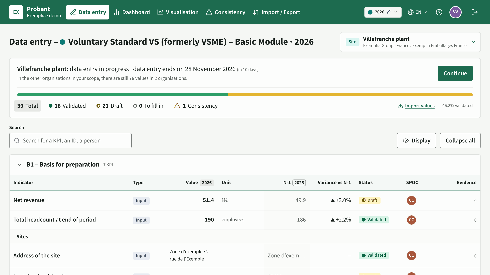
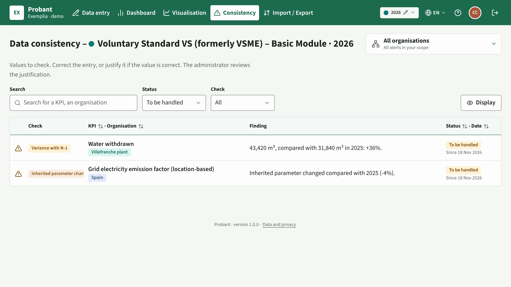
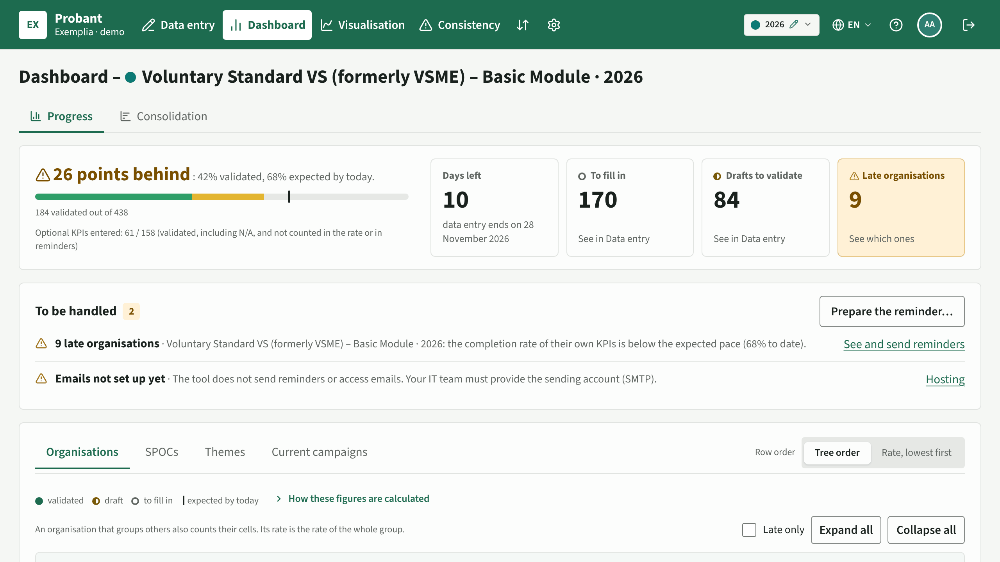
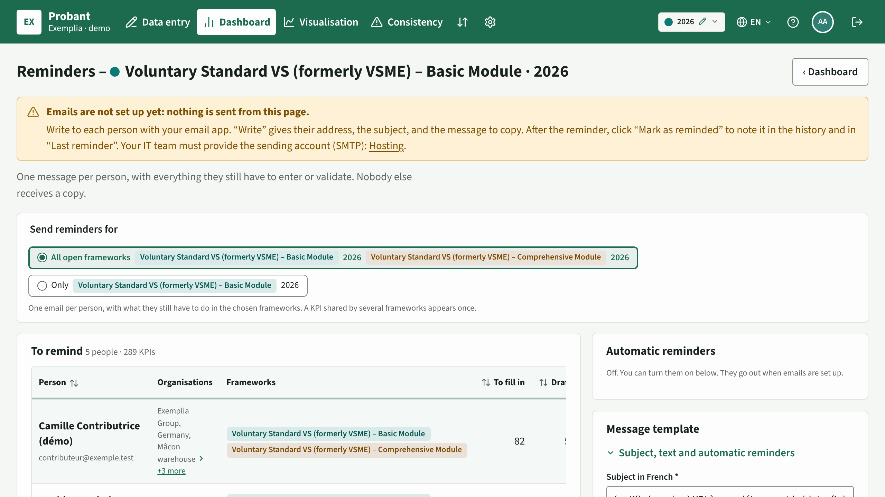

# Validator guide

You follow and validate the entries of the KPIs and organisations that an administrator assigned to you (KPI assignments, choice Validators), and of the organisations below them. If you have no assignment, an administrator validates in your place. You can also send reminders in this scope. French version: [`docs/fr/guides/validateur.md`](../fr/guides/validateur.md).

## See my scope and what is left {#scope}

1. Click **Data entry** in the top bar. The page opens on **Everything assigned to me**.
2. Click the organisation name at the top right of the page (**Everything assigned to me**), then choose one organisation of your scope in the list.
3. Click **To fill in**, **Draft**, or **Validated** above the table to filter the rows.
4. Choose one organisation, open **Display**, then select **Show calculated and consolidated KPIs** to see the totals. They are read-only.

## Check and validate entries {#review}

1. Open the row of a draft value. The entry panel opens.
2. Read the value, the comment, the variance with N-1, and the evidence.
3. If the entry is complete, click **Validate**.
4. If it is not, ask the contributor to complete it.

Validating confirms that the entry is complete. It does not audit the figure. The validation needs a value or N/A, a comment (for N/A or for a large variance), and evidence if the KPI requires it.

If the panel says that an organisation “opens on” a date after the period, nothing can be entered or validated for this period yet. Ask an administrator to change the opening date. Nothing else changes for you.

## Put an entry back to draft {#reopen}

1. Open the entry panel of the validated value.
2. Click **Back to draft**. The value stays the same.
3. The contributor can then change it and validate it again.

**Clear the value** empties the cell instead. The history records both actions. After the end date of data entry, contributors can no longer change a value, but you can still put it back to draft.

## Handle consistency alerts {#alerts}

1. Click **Consistency** in the top bar. The page lists the alerts of your scope.
2. Click an alert to open its sheet.
3. Read the finding and the explanation of the contributor.

An alert does not block a validation, but a rule set to **Blocking** does: the contributor cannot validate until the rule is met. The administrator decides on the explanation.

## Approve or reject an overridden value {#forced}

A person can ask to replace a calculated result with another value, with a justification.

1. Click **See overridden values** on the page **Data entry**, or open the calculated KPI.
2. Read the justification.
3. Click **Approve and override the value** to accept the request.
4. To refuse it, enter the reason and click **Reject**.

## Follow the progress {#dashboard}

1. Click **Dashboard** in the top bar.
2. Read the verdict at the top, then the table by organisation. It shows the late organisations.
3. Click **Consolidation** to see the totals of your scope.

## Send reminders {#reminders}

1. On the **Dashboard**, click **Remind…** (or **Prepare the reminder…** if the installation has no email sending). The page **Reminders** opens.
2. Choose the frameworks. The tool selects the people who still have something to enter or validate.
3. Read the preview of the message. Send a test to yourself if you want.
4. Click **Send the reminder**. The confirmation names the people.

If the installation has no email sending, the page shows an orange box. Click **Write** to get the address, the subject, and the message. Send them with your email app. Then click **Mark as reminded**.

## A KPI that is blocked by a closed campaign {#shared-closed}

A KPI that belongs to two frameworks with the same period has one shared value. If one campaign is closed, the value cannot change in the other one. The panel says which campaign is closed. Ask an administrator to reopen it.

## Import values from a file {#import}

Click **Import / Export**. The menu opens on **Import values** for a contributor. For a validator, it opens on **My exports**, and **Import values** is one click away. The tool shows a preview before it saves anything.

Figures for calculated KPIs of a period that is not closed: the preview asks you to choose whether to force these values or to ignore these rows. You can force only the organisations that you validate, while entry is open. For the others, the row is rejected.

## Get a large export {#large-exports}

Above a size limit, the tool prepares an export or a file to fill in on the server. Open **Import / Export** and choose **My exports**. The file is under “Large files”. The tool keeps it for 7 days.

## Show the guided tour again {#tour}

At your first sign-in, a short tour shows where to act. It does not block the screen. Your browser remembers that you saw it.

1. Click **Help** in the top bar.
2. Click **Show the tour again**.
3. Click **Next** to go on, and **Done** at the end. To stop, click **Close the tour**, press Esc, or click **Don't show again**.

## Change the language {#language}

1. Click the language in the top bar, or click your name, then **My account**.
2. Under **Language**, choose one of the seven languages and save.

**My last sign-ins**, in **My account**, lists your last sign-ins to this space. If you do not recognise one, change your password and tell an administrator.

## Connect an AI assistant {#assistant}

If an administrator turned on assistants, you create a token in **My account** under **AI assistants (MCP)**: enter **Name of the token**, choose **Expires after**, click **Create a token**, and copy the token at once. The assistant has your rights, never more. Click **Revoke** to stop it.
