# Guida dell'amministratore

L'amministratore configura lo strumento, gestisce le campagne e segue lo stato di compilazione. Tutto ciò che si può impostare si trova in **Amministrazione**. Il team informatico fornisce l'hosting, il nome di dominio e l'account di posta. Versione inglese: [`docs/guides/administrator.md`](../../guides/administrator.md).

## Vedere che cosa fare per primo {#overview}

1. Fare clic su **Amministrazione** nella barra superiore. Si apre la pagina **Panoramica**.
2. Leggere l'elenco **Da gestire**, con le voci più urgenti in alto. Ogni riga ha il proprio link.
3. Fare clic su **A che cosa serve ogni sezione** per un promemoria sulle schede.

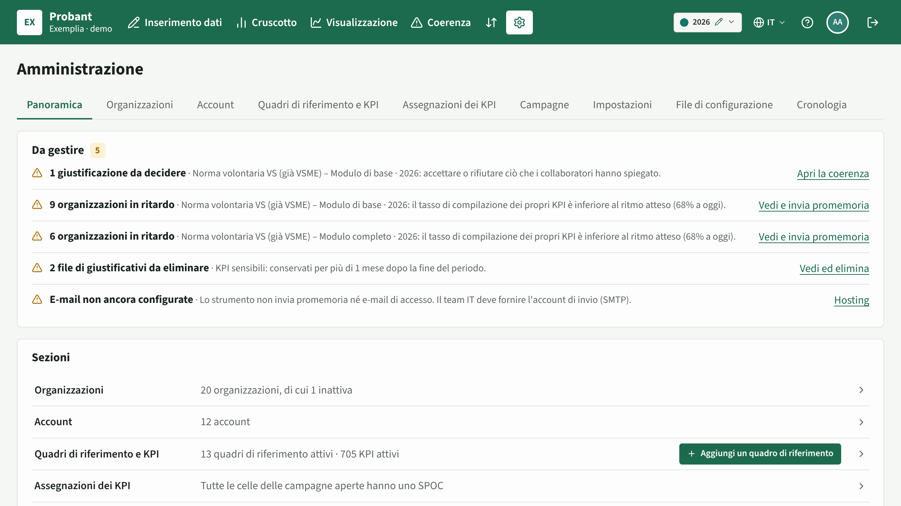

## Configurare una nuova installazione {#setup}

Al primo avvio si apre una procedura guidata in 8 passaggi. Inizia con il proprio account di amministratore.

1. Inserire l'account, l'organizzazione e le lingue.
2. Scegliere un quadro di riferimento dalla biblioteca oppure comporne uno proprio.
3. Aggiungere il team, poi creare la prima campagna.

Se si esce dalla procedura, fare clic su **Amministrazione › Impostazioni › Riprendi la configurazione** per continuare.

## Aggiungere un quadro di riferimento {#framework}

1. Fare clic su **Amministrazione** nella barra superiore. Nella **Panoramica**, fare clic su **Aggiungi un quadro di riferimento** sulla riga **Quadri di riferimento e KPI**.
2. Scegliere **Installa dalla biblioteca**, **Componi a partire da KPI esistenti** oppure **Importa un file**.
3. Aprire la scheda **Contenuto** del quadro di riferimento per ordinare i temi e i KPI.

La scheda del KPI definisce il tipo di risposta, l'unità, la formula e l'eventuale obbligo di giustificativo. Per un KPI sensibile, scegliere «Limitato» o «Riservato» in **Riservatezza**.

Appena un KPI ha un valore salvato o importato, la sua unità non può più cambiare, come il suo formato. Lo strumento lo segnala al salvataggio. Mantenere l'unità oppure creare un nuovo KPI nell'unità desiderata. Per riportare i vecchi valori, esportarli, convertirli nel file, poi importarli nel nuovo KPI.

Un esercizio chiuso conserva il proprio elenco di KPI. Per aggiungere un KPI anche agli esercizi passati, impostare il suo periodo **Richiesto dal** (vedere la sezione seguente).

## Scegliere da quando un KPI è richiesto {#requested-since}

Ogni KPI di un quadro di riferimento ha un periodo **Richiesto dal**: il primo esercizio, o il primo periodo, in cui il quadro lo richiede. Quando si crea un KPI, lo strumento chiede «Aggiungerlo anche agli esercizi precedenti?». Per impostazione predefinita, il KPI è richiesto dal periodo in corso e nessun esercizio passato cambia.

1. Andare in **Amministrazione › Quadri di riferimento e KPI**, aprire il quadro, poi la scheda **Contenuto**.
2. Leggere il periodo alla fine di ogni riga. «Dall'inizio» significa che il KPI c'era prima di questa impostazione.
3. Selezionare uno o più KPI, oppure fare clic sul periodo di una riga. Nella barra delle azioni, scegliere il periodo in **Richiesto dal**.
4. Fare clic su **Applica**. Lo strumento mostra gli esercizi che cambiano e quante celle aggiunge. Confermare per salvare.

Un esercizio chiuso non cambia finché è chiuso: nessuna cella, nessun totale nuovo, lo stesso tasso di compilazione. Il KPI compare quando si riapre l'esercizio, in entrambe le modalità, e vi resta alla chiusura seguente. Un esercizio già riaperto riceve subito le celle.

Non è possibile spostare il periodo più avanti se un esercizio che perde il KPI è chiuso, o ha per esso un valore, un N/A, un commento o un giustificativo. Se le sue celle sono vuote, lo strumento chiede di confermare. La cronologia registra ogni modifica. Quando un KPI calcolato è richiesto prima di una delle sue fonti, lo strumento avvisa: la fonte ha celle dallo stesso periodo.

## Scegliere la valuta degli importi {#currency}

I modelli della libreria scrivono i loro importi in euro. Se il bilancio usa un'altra valuta, la imposti prima di installare un modello:

1. Vada in **Amministrazione › Quadri di riferimento e KPI › Unità e formati**.
2. In **Valuta di riferimento**, scelga la valuta, poi faccia clic su **Salva**.

Quando installa o aggiorna un modello della libreria, i suoi importi prendono questa valuta: «€» diventa «$», «M€» diventa «M$» e «€/h» diventa «$/h». Le schermate dell'installazione indicano la valuta. Un KPI che ha già dei valori mantiene la sua unità.

Lo strumento non converte nessun valore e non usa tassi di cambio. Se cambia la valuta in seguito, i KPI già esistenti mantengono la loro unità, e la pagina conta i KPI la cui unità è in un'altra valuta. Il file ufficiale dell'EFRAG usa la valuta di riferimento come valuta del rapporto. Lascia vuoto un importo la cui unità è in un'altra valuta, e il rapporto dell'esportazione lo indica.

Ogni spazio ha la propria valuta di riferimento. Un nuovo spazio inizia con l'euro.

## Aggiungere le organizzazioni {#organisations}

1. Andare in **Amministrazione › Organizzazioni**.
2. Fare clic su **Nuova organizzazione**, scegliere l'organizzazione superiore e fare clic su **Crea l'organizzazione**.
3. Per una sede che apre durante l'anno, inserire la sua data in **Aperta dal**. La sede conta nei totali, e le vengono richiesti dei valori, solo per i periodi che finiscono a questa data o dopo. Se il campo resta vuoto, la sede conta come aperta da sempre. Quando si incollano più organizzazioni, scrivere la data tra parentesi quadre: «Lyon [2026-03-01]».

I livelli dell'albero (per esempio Gruppo, Paese, Filiale, Sede) si impostano in **Amministrazione › Impostazioni › Livelli dell'albero**.

In questa schermata e in **Unità e formati**, i nomi dei livelli e delle unità compaiono nella vostra lingua. I campi in cui scrivete mantengono la lingua di riferimento dell'installazione, e l'etichetta la indica (per esempio «Nome (lingua di riferimento: Français)»). La traduzione nella vostra lingua è mostrata accanto al campo. Per modificarla, usate **Impostazioni › Lingue**.

Un'organizzazione non apre mai prima di quella da cui dipende: conta la data più tarda tra la propria e quelle delle organizzazioni sopra. Quando un cambio di data o di organizzazione superiore toglierebbe valori dai totali, la scheda li conta, compresi quelli delle organizzazioni sotto, e chiede una conferma. Un valore per un'organizzazione non ancora aperta nel periodo viene rifiutato a schermo, in un'importazione e tramite un assistente. Il messaggio rimanda alla scheda che porta la data.

## Creare gli account {#accounts}

1. Andare in **Amministrazione › Account**.
2. Fare clic su **Nuovo account** oppure su **Più account** per crearne molti insieme.
3. Inserire l'e-mail e il nome, poi scegliere il **Ruolo**: amministratore, validatore, collaboratore, lettore o auditor.
4. Fare clic su **Crea l'account**. Inviare la password provvisoria alla persona.

Per assegnare una nuova password provvisoria, aprire l'account e fare clic su **Reimposta la password**. La persona sceglie la propria password al primo accesso.

Un lettore o un auditor non inserisce e non convalida nulla. Quando si cambia il ruolo di un account in uno di questi due, lo strumento indica quante assegnazioni rimuoverà e chiede una conferma prima di salvare. Le rimuove, con una riga nella Cronologia. Tornare al ruolo precedente non le restituisce. Per darle invece a un'altra persona, usare prima **Sostituisci una persona…**. Per ridarle in seguito, usare **Assegnazioni dei KPI** (scelta **Validatori** per le assegnazioni da validatore).

**Da gestire** elenca gli account passati in sola lettura prima di questa regola che hanno ancora assegnazioni. Fare clic su **Verificare**, poi su **Rimuovi** su una riga. Un account disattivato conserva le proprie assegnazioni finché non si usa **Sostituisci una persona…**.

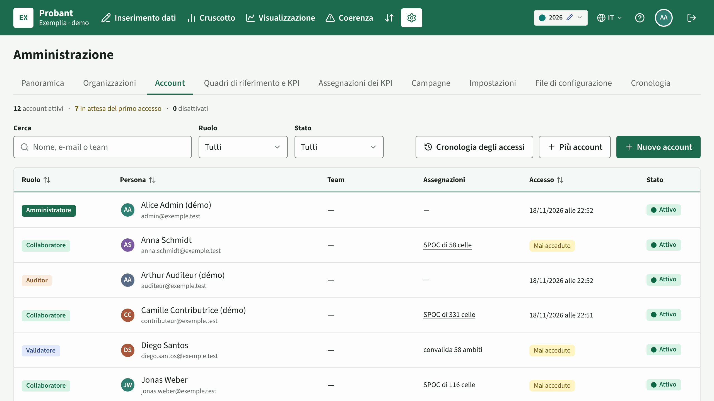

Per vedere chi ha effettuato l'accesso e quando, fare clic su **Cronologia degli accessi** in **Amministrazione › Account**. Ogni riga indica la data, l'account e l'esito: **Riuscito**, **Fallito** o **Bloccato: troppi tentativi**. Un nome utente che non corrisponde a nessun account dello spazio compare solo con un riferimento, mai con il testo digitato. Filtrare per esito o per periodo, o cercare un nome. Impostare per quanto tempo lo strumento conserva la cronologia in **Amministrazione › Impostazioni › Hosting** (180 giorni per impostazione predefinita).

## Assegnare i KPI {#assign}

Ogni cella della griglia è un KPI per un'organizzazione. Il SPOC (referente) è la persona che lo inserisce.

1. Andare in **Amministrazione › Assegnazioni dei KPI**.
2. Fare clic su una cella, poi scegliere una o più persone. Si può anche selezionare una riga o una colonna e fare clic su **Assegna**.
3. Fare clic su **Sostituisci una persona…** quando qualcuno lascia l'incarico.
4. Selezionare **Solo le righe da completare** per vedere che cosa manca.

Per scegliere i validatori, selezionare **Validatori** nell'elenco **Ruolo**. Un'assegnazione di validatore vale per un KPI in un'organizzazione e in tutte le organizzazioni sottostanti: la griglia ha allora una scheda per livello di organizzazione, con i KPI inseriti a quel livello o sotto. Una cella con «tramite …» è già coperta dal validatore di un'organizzazione superiore. Vengono proposti solo i validatori e gli amministratori attivi. Una cella senza validatore viene convalidata dagli amministratori. Ogni assegnazione data o rimossa scrive una riga nella Cronologia.

Per un grande gruppo, la griglia mostra un gruppo di organizzazioni alla volta. Scegliere il gruppo nell'elenco **Organizzazioni** sopra la griglia. I filtri e il salvataggio in blocco si applicano al gruppo mostrato. **Tutte (lento per un grande gruppo)** mostra tutto, ma lo strumento non ricorda questa scelta.

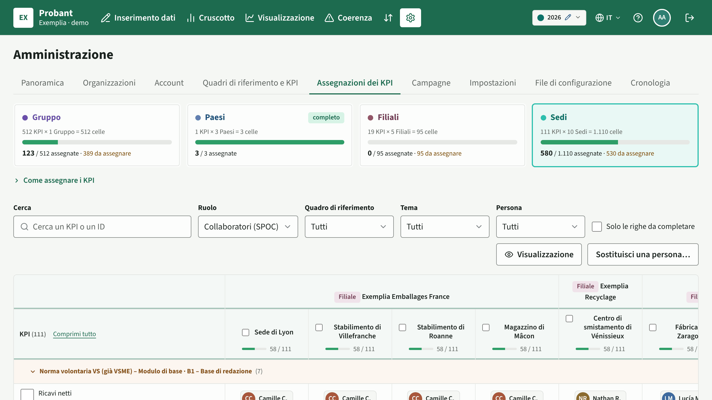

## Aprire, rivedere, chiudere e riaprire una campagna {#campaign}

1. Andare in **Amministrazione › Campagne** e fare clic su **Nuova campagna** sulla riga del quadro di riferimento.
2. Scegliere il periodo, impostare le date e la **Soglia di scostamento**, poi fare clic su **Crea la campagna**.
3. Fare clic su **Gestisci** su una campagna. Usare **Apri l'inserimento dati**, **Avvia la revisione** o **Chiudi definitivamente**.
4. Per modificare una campagna chiusa, fare clic su **Riapri ai collaboratori** o su **Riapri per correggere (revisione)**. La cronologia registra la riapertura.
5. Quando si riapre un anno chiuso, scegliere prima:
   - **Mantenere i dati dell'epoca** (selezionato per impostazione predefinita): nulla viene ricalcolato. Vengono ricalcolati solo l'organizzazione di cui si corregge un valore e i totali sopra di essa. Esempio: un'organizzazione spostata da allora in un altro paese resta nei totali del suo ex paese.
   - **Ricalcolare con l'organizzazione di oggi**: tutti i totali dell'anno vengono ricalcolati con l'albero e le formule di oggi. Esempio: l'organizzazione spostata porta i suoi valori nei totali del suo nuovo paese.

   Un anno riaperto mantenendo i dati dell'epoca conserva l'albero delle organizzazioni della sua chiusura: una correzione viene ricalcolata con i genitori dell'epoca, e un'organizzazione creata da allora non ha caselle in quell'anno. La scelta vale fino alla prossima chiusura.

   Quando un anno ha due campagne (due quadri di riferimento) e una di esse è chiusa, i KPI richiesti dalla campagna chiusa mantengono i loro dati finché anche l'altra campagna non viene chiusa: una modifica delle organizzazioni o **Rifai i calcoli** non li cambia più, e mantengono l'albero delle organizzazioni del giorno della chiusura. Anche un KPI comune alle due campagne mantiene i suoi dati. Solo una correzione importata nella campagna chiusa ricalcola l'organizzazione corretta e i suoi totali. Con **Ricalcolare con l'organizzazione di oggi**, i KPI di un'altra campagna dell'anno ancora chiusa mantengono i loro dati.

Una campagna chiusa è bloccata per tutti, amministratori compresi. I suoi valori diventano il N-1 della campagna successiva. **Rifai i calcoli** serve raramente.

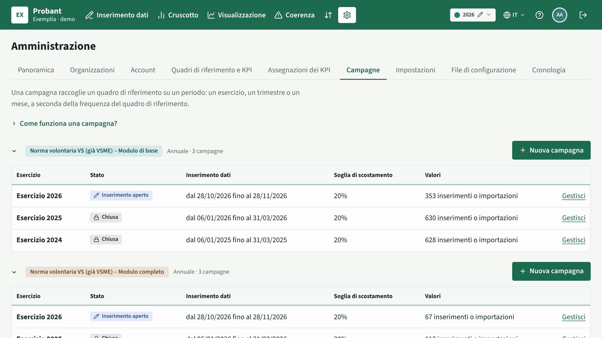

## Inserire e controllare i valori {#entry}

**Inserimento dati** elenca le celle della campagna aperta, per organizzazione e per KPI. Le vedi tutte e puoi inserire o correggere un valore in qualsiasi cella. Usa i filtri per trovare un KPI, un'organizzazione o uno stato, poi fai clic su una cella per aprire il suo pannello.

## Riaprire un inserimento convalidato {#reopen}

1. Andare in **Inserimento dati** e aprire la riga del valore.
2. Fare clic su **Torna in bozza**. Il valore non cambia.
3. Il collaboratore lo modifica e lo convalida di nuovo.

**Cancella il valore** svuota invece la cella. Entrambe le azioni sono nella cronologia.

## Un KPI bloccato da una campagna chiusa {#shared-closed}

Un KPI può appartenere a due quadri di riferimento con lo stesso periodo. Il suo valore è condiviso. Se una campagna è chiusa, nessuno può modificare il valore nell'altra, nemmeno l'amministratore. Il pannello indica la campagna chiusa.

1. Riaprire la campagna chiusa: fare clic su **Gestisci**, poi su **Riapri per correggere (revisione)**.
2. Modificare il valore nel pannello di inserimento.
3. Chiudere di nuovo la campagna.

## Inviare promemoria {#reminders}

1. Nel **Cruscotto**, fare clic su **Invia promemoria…** (o su **Prepara il promemoria…** se l'installazione non invia e-mail). Si apre la pagina **Promemoria**.
2. Scegliere i quadri di riferimento. Lo strumento seleziona le persone che hanno ancora qualcosa da fare.
3. Leggere l'anteprima, poi fare clic su **Invia il promemoria**.

In **Modello del messaggio** si modifica il testo. In **Promemoria automatici** si impostano i giorni prima della fine dell'inserimento dati. Senza un account di posta (SMTP), **Scrivi** fornisce il testo da inviare manualmente. Poi fare clic su **Registra promemoria**.

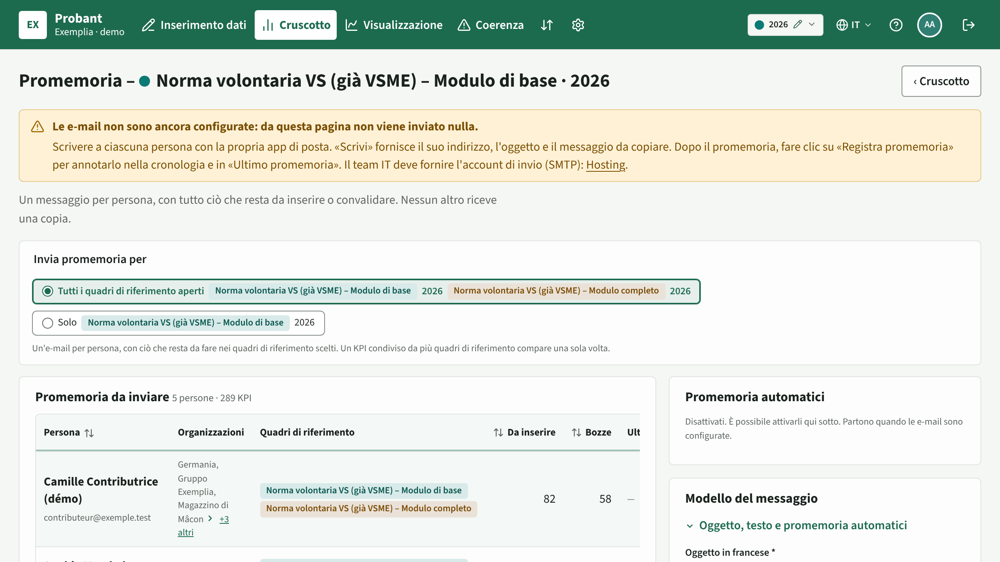

## Ottenere il dossier di audit {#audit-file}

Un amministratore o un auditor può scaricare un file Excel con ciò che serve a un audit: per ogni KPI e organizzazione, il valore, lo stato, chi lo ha inserito e convalidato, i giustificativi, gli avvisi di coerenza con le loro giustificazioni e la cronologia delle modifiche. Lo strumento si limita a leggere i dati. Creare il file non cambia nulla.

1. Fai clic su **Importazione / Esportazione** e poi su **Nuova esportazione**.
2. In **Disposizione**, scegli **Dossier di audit**. Scegli l'esercizio e, se ti servono solo alcune, le organizzazioni.
3. Fai clic su **Scarica**.

Il file ha quattro fogli: **Leggimi**, **Audit** (una riga per KPI e organizzazione), **Cronologia** (ogni modifica di questi valori, dalla più vecchia) e **Giustificativi** (i nomi dei file, le dimensioni e chi li ha aggiunti). Il foglio **Leggimi** indica la data, la versione dello strumento e i filtri. Un file grande viene preparato sul server, come ogni esportazione grande.

I validatori e i collaboratori non vedono il dossier di audit: è per amministratori e auditor. Un auditor limitato ad alcune organizzazioni ottiene solo quelle.

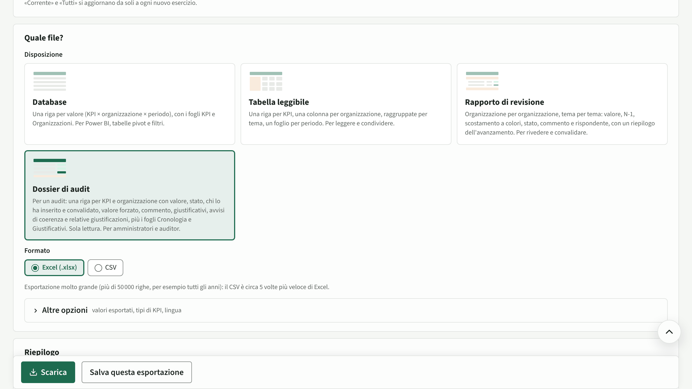

## Stampare il certificato di chiusura {#closing-certificate}

Un amministratore può stampare una pagina che riassume una campagna chiusa. Lo strumento si limita a leggere i dati. Aprire la pagina non cambia nulla.

1. Fare clic su **Amministrazione**, poi su **Campagne** e su una campagna chiusa.
2. Fare clic su **Certificato di chiusura**.
3. Fare clic su **Stampa**. Nella finestra di stampa scegliere Salva come PDF per conservare un file.

La pagina mostra il perimetro, il tasso di compilazione, il numero di valori, i giustificativi e gli avvisi di coerenza. Indica chi ha chiuso la campagna e quando, se la cronologia lo conserva. L'impronta è un codice calcolato da tutte le cifre della campagna. Se una cifra cambia, cambia l'impronta. Per verificare più tardi, riaprire il certificato e confrontare le due impronte.

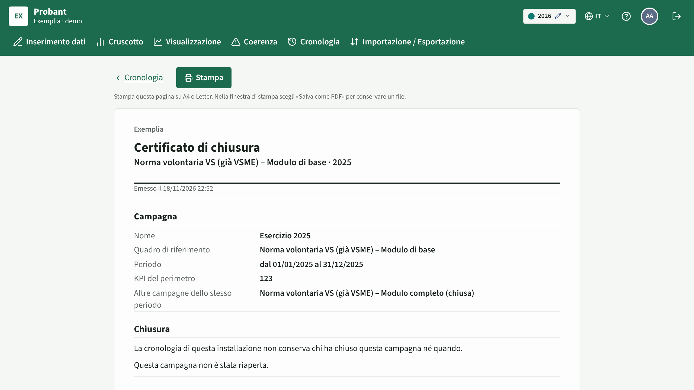

## Ottenere un'esportazione di grandi dimensioni {#large-exports}

Oltre un limite di dimensione, lo strumento prepara sul server un'esportazione o un file da compilare. Aprire **Importazione / Esportazione** e scegliere **Le mie esportazioni**. Il file si trova in «File di grandi dimensioni». Lo strumento lo conserva per 7 giorni.

Un amministratore imposta il numero di giorni in **Amministrazione › Impostazioni › Hosting**, nel blocco «Esportazioni di grandi dimensioni».

## Eliminare i giustificativi dei KPI sensibili {#evidence-delete}

Lo strumento conserva i file dei giustificativi. Non li elimina mai da solo.

1. Andare in **Amministrazione › Impostazioni › Hosting**. In **Giustificativi dei KPI sensibili**, inserire il numero in **Mesi prima di proporre l'eliminazione**.
2. Fare clic su **Amministrazione › Cronologia**, poi su **Giustificativi da eliminare**.
3. La pagina elenca i file le cui campagne sono tutte chiuse e il cui periodo è terminato da più mesi di questo numero.
4. Selezionare i file, poi fare clic su **Elimina i selezionati**. Oppure fare clic su **Elimina** su una riga.

Attenzione: l'eliminazione è definitiva. Il file non va nel cestino. La cronologia registra ogni eliminazione senza il contenuto del file. Il valore della risposta non cambia.

I backup fatti prima conservano il file finché lo strumento non li sostituisce. Un ripristino riporta il file in **Giustificativi da eliminare**: eliminarlo di nuovo. Anche le copie dei backup che il team informatico conserva fuori dallo strumento contengono il file: chiedere al team informatico di eliminarlo. Impostare il numero di backup da conservare in **Amministrazione › Impostazioni › Hosting**, in **Backup automatico**, in modo che i backup vecchi scompaiano presto.

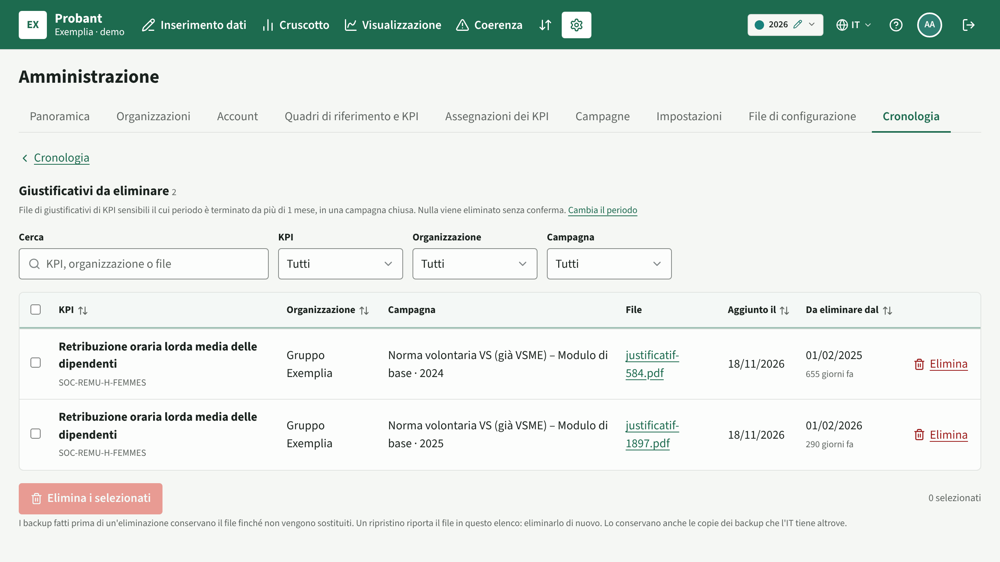

## Aggiungere o tradurre una lingua {#languages}

I menu e i pulsanti esistono in francese, inglese, spagnolo, tedesco, italiano, olandese e portoghese. Ogni persona sceglie la propria lingua in **Il mio account**. I nomi dei KPI, dei temi e delle unità si impostano in **Amministrazione › Impostazioni › Lingue**.

1. Fare clic su **Aggiungi una lingua**, oppure aprire una lingua e fare clic su **Traduci**.
2. Per tradurre in blocco, usare **Esporta** e **Importa**, oppure **Traduci tutte le lingue insieme**.

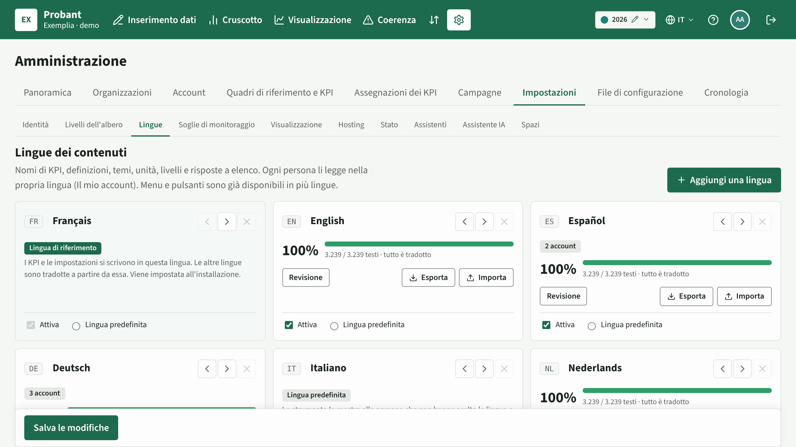

## Collegare un assistente (MCP) {#assistants}

Un assistente IA, per esempio Claude, può leggere e modificare i dati con i diritti della persona che lo collega, mai di più. È disattivato per impostazione predefinita.

1. Andare in **Amministrazione › Impostazioni › Assistenti**.
2. Selezionare **Consenti gli assistenti IA (MCP) in questo spazio**.
3. Selezionare **Gli assistenti possono anche apportare modifiche** solo se le persone ne hanno bisogno. I lettori e gli auditor non modificano mai nulla.
   In **Cosa ricevono gli assistenti**, scegliere **Un lettore può leggere i valori tramite un assistente** (disattivato per impostazione predefinita) e **I KPI sensibili sono dati agli assistenti** (attivato per impostazione predefinita; se disattivato, i KPI contrassegnati come Limitato o Riservato, e i KPI calcolati a partire da essi, sono nascosti a tutti gli strumenti). Un lettore non riceve mai una bozza, solo valori convalidati.
4. Fare clic su **Salva**. Comunicare alle persone l'**Indirizzo del server di questo spazio**.

Ogni persona crea un token in **Il mio account**. In **Token attivi**, fare clic su **Revoca** per escludere subito un assistente. La cronologia registra ogni chiamata e mostra «(tramite MCP)» dopo ogni modifica.

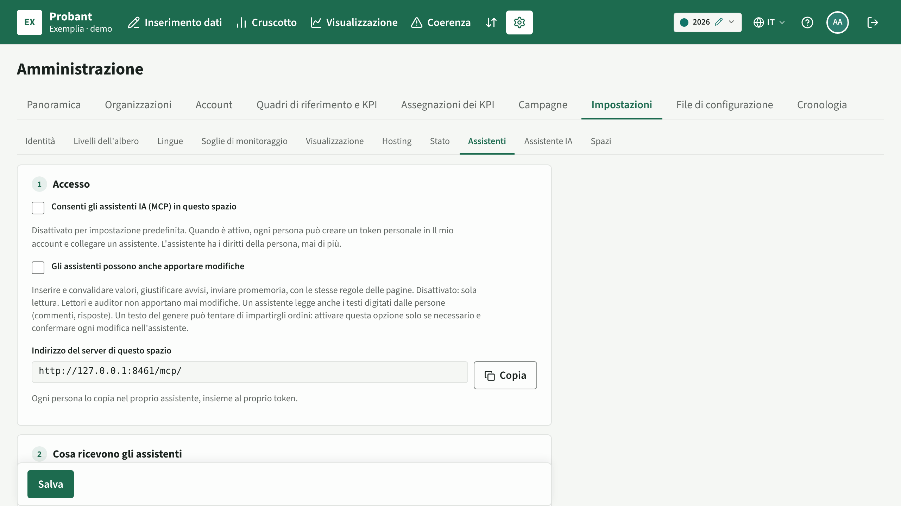

## Attivare l'assistente IA {#ai}

L'assistente IA spiega gli avvisi di coerenza, propone corrispondenze di KPI nella procedura guidata di migrazione e propone traduzioni. È disattivato per impostazione predefinita. Nulla esce dallo strumento finché non lo si attiva.

1. Andare in **Amministrazione › Impostazioni › Assistente IA**.
2. Selezionare **Attiva l'assistente IA**.
3. Scegliere il **Provider** e il **Modello**.
4. Inserire la **Chiave API dell'account del provider**. Lo strumento la conserva solo per questo spazio e non la mostra più. Fare clic su **Rimuovi la chiave** per eliminarla.
5. In **Usi**, selezionare gli usi desiderati. **I KPI sensibili possono essere inviati all'assistente IA** è disattivato per impostazione predefinita: nulla di un KPI segnato come Limitato o Riservato, né di un KPI calcolato a partire da esso, è inviato, e i suoi avvisi non hanno **Spiega con l'IA**. Fare clic su **Salva**.

Ogni risposta è una proposta contrassegnata «Proposto dall'IA». Nulla viene salvato finché una persona non fa clic e salva come di consueto. La cronologia registra ogni chiamata senza il suo contenuto.

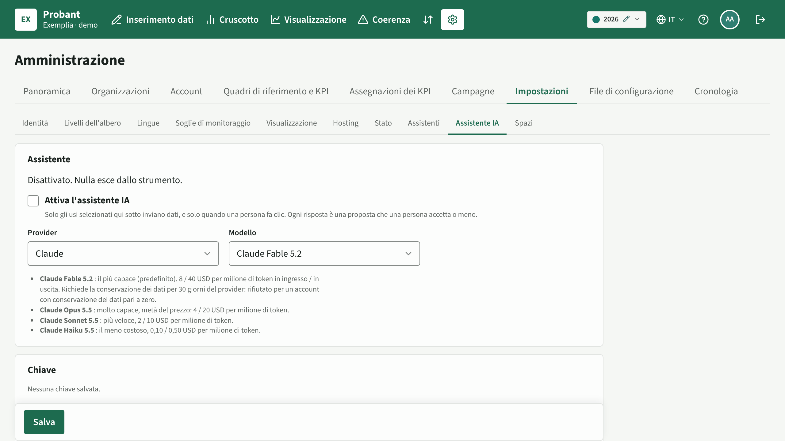

## Controllare l'hosting e i backup {#hosting}

Andare in **Amministrazione › Impostazioni › Hosting**. La pagina mostra la versione, il backup automatico, il controllo dei dati e la configurazione dell'e-mail. Fare clic su **Crea e scarica un backup** per farne uno subito. Il team informatico copia i backup in un altro luogo.

Per vedere a colpo d'occhio se tutto va bene, andare in **Amministrazione › Impostazioni › Stato**. Ogni riga (versione, database, file, ultimo backup, spazio su disco, e-mail, attività in background, aggiornamento del database, HTTPS) mostra **Buono**, **Da controllare** o **Guasto**, e cosa fare. L'amministratore di uno spazio diverso dallo spazio principale vede le stesse righe, ma le righe database e aggiornamento del database controllano solo il suo spazio e il registro comune degli account, non gli altri spazi. Non vede il dettaglio per l'IT (nomi degli altri spazi, cartelle del disco): lo vede il gestore degli spazi. In **Impostazioni › Hosting**, il riquadro **Per l'IT** non gli mostra la cartella dei dati, gli indirizzi consentiti, il server del database, il nome utente delle email né la cartella dei backup.

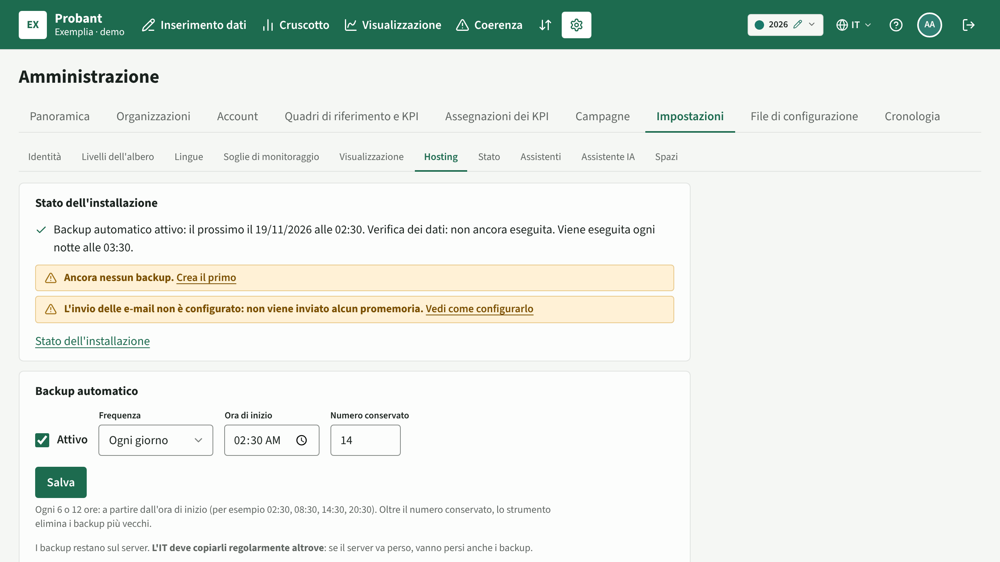

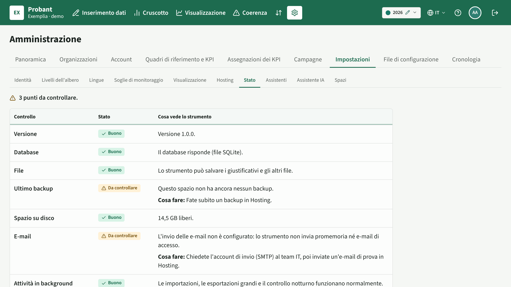

## Vedere i totali di ogni livello {#consolidation}

**Consolidamento** mostra il valore di ogni KPI a ogni livello dell'albero, dai siti fino al gruppo. Scegli i KPI da mostrare, apri una riga per vedere le organizzazioni sotto di essa ed esporta la tabella in Excel. Una nota indica quando un totale è incompleto.

## Gestire gli avvisi e le regole di coerenza {#consistency}

**Coerenza** elenca gli avvisi della campagna: valori insoliti, grandi scarti rispetto a N-1 e regole non rispettate. Fai clic su un avviso per leggere la rilevazione e la spiegazione del collaboratore, poi accettalo, respingilo o ignoralo. In **Regole di coerenza** si impostano le regole. Una regola **Bloccante** impedisce al collaboratore di convalidare finché non è rispettata.

## Importare valori da un file {#import-values}

Fai clic su **Importazione / Esportazione**, poi su **Importa valori**. Scegli il file, leggi l'anteprima e conferma. Lo strumento non salva nulla prima della tua conferma e applica le stesse regole del pannello di inserimento.

I numeri delle celle Excel sono letti così come sono. Un numero scritto come testo è letto nella lingua del file. In un file CSV la indica il separatore delle colonne: «;» va con la virgola decimale, «,» con il punto. Altrimenti la indica l'intestazione della colonna dei valori: in inglese «1,234» vale 1234, in italiano 1,234. L'anteprima indica come ha letto i numeri e segnala un valore come «1,234». La procedura **Migra un vecchio sistema** li legge nella lingua del suo schermo.

Se il file contiene cifre per KPI calcolati di un periodo non chiuso, l'anteprima le conta e le chiede di scegliere se forzare questi valori o ignorare queste righe. Le cifre forzate diventano valori forzati: sostituiscono il risultato del calcolo, e i totali e le formule che le usano vengono ricalcolati. **Da gestire** segnala anche le cifre importate così come sono su celle calcolate prima di questa regola: apra **Valori forzati** e scelga **Forzare** o **Rimuovere** per ciascuna.

## Esportare in un formato ufficiale {#official-formats}

**Formati ufficiali** esporta i valori nella cartella di lavoro ufficiale di una norma, per esempio quella dell'EFRAG per la norma VS. Lo strumento scrive solo le celle di inserimento. Apri il file esportato in Excel e salvalo prima di convertirlo.

## Salvare un elenco di KPI {#kpi-lists}

**Elenchi di KPI** raggruppa sotto un nome i KPI che segui spesso. Scegli un elenco con un clic in un'esportazione o in un file da compilare.

## Leggere i grafici e creare viste {#visualisation}

**Visualizzazione** mostra i grafici delle viste. Apri una vista, cambia i filtri in alto, poi usa il menu «…» di un grafico per mostrarne i dati o esportarlo. Puoi anche creare una vista, modificarla e condividerla.

## Modificare le impostazioni dello strumento {#settings}

**Impostazioni** raccoglie ciò che puoi regolare nello strumento: l'identità, i livelli dell'albero delle organizzazioni, le soglie, i colori dei grafici, le lingue, l'assistente IA, gli assistenti e l'hosting. Nessuno deve modificare il codice.

## Gestire gli spazi {#spaces}

**Spazi** elenca gli spazi di questa installazione. Ogni spazio ha i propri dati: quadri di riferimento, organizzazioni, campagne, valori, giustificativi e identità. Gli account sono condivisi: una persona accede una sola volta.

## Seguire ogni modifica {#history}

Fare clic su **Amministrazione** nella barra superiore, poi su **Cronologia**. In **Registro**, scegliere **Inserimento dati** per vedere i valori, le convalide e i giustificativi, oppure **Modifiche di amministrazione** per vedere le campagne, il quadro di riferimento, le organizzazioni e gli account. Lo strumento non elimina mai nulla dalla cronologia.

## Rivedere la visita guidata {#tour}

Al primo accesso, una breve visita mostra dove intervenire. Non blocca lo schermo. Il browser ricorda che è stata vista.

1. Fare clic su **Guida** nella barra in alto.
2. Fare clic su **Mostra di nuovo la visita**.
3. Fare clic su **Avanti** per proseguire e su **Fine** alla fine. Per interrompere, fare clic su **Chiudi la visita**, premere Esc o fare clic su **Non mostrare più**.

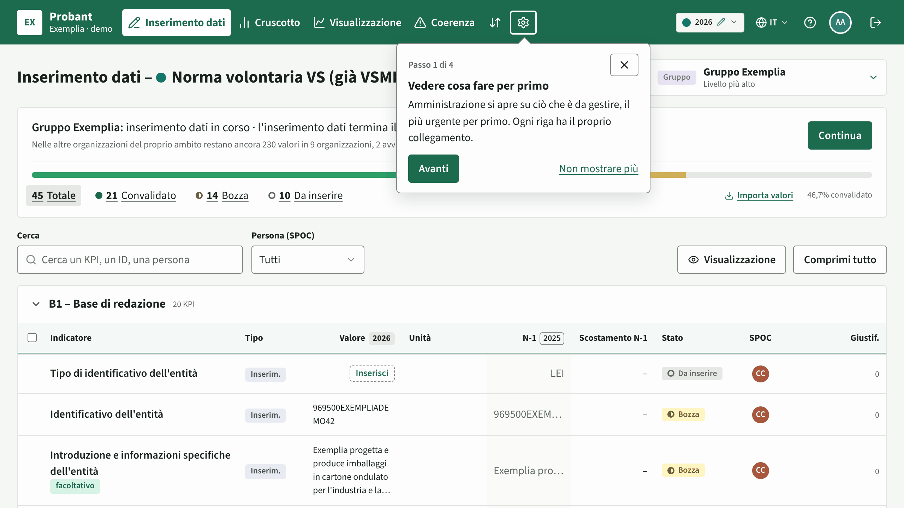

## Cambiare la mia lingua o la mia password {#account}

Fare clic sul proprio nome, poi su **Il mio account**. Scegliere la **Lingua** e cambiare la password in **Modifica la mia password**.

**I miei ultimi accessi**, in **Il mio account**, elenca i vostri ultimi accessi a questo spazio. Se non ne riconoscete uno, cambiate la password e avvisate un amministratore.
