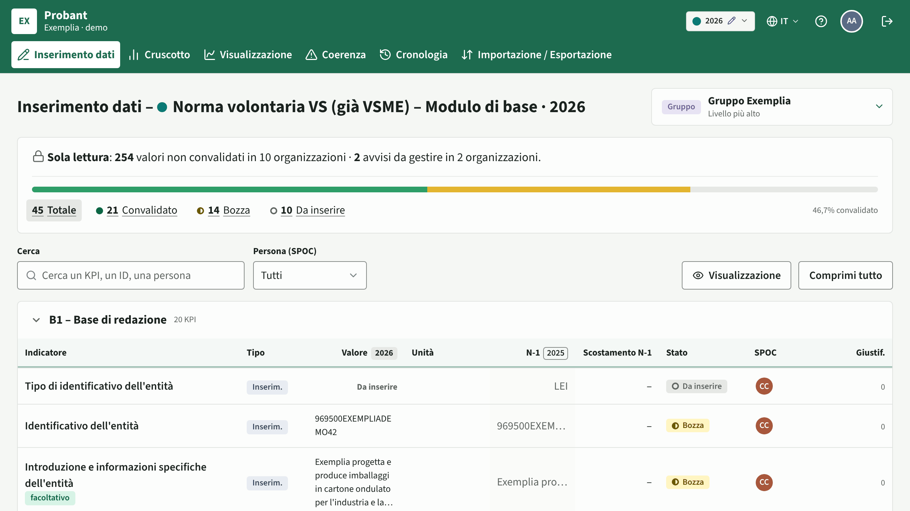
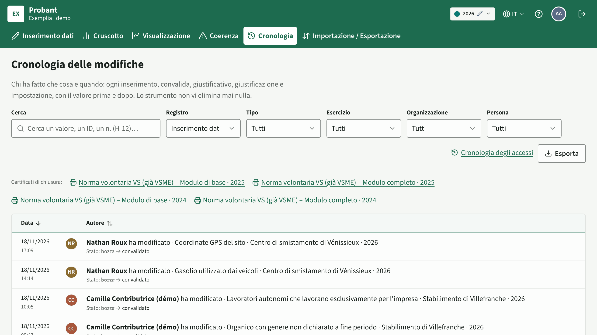
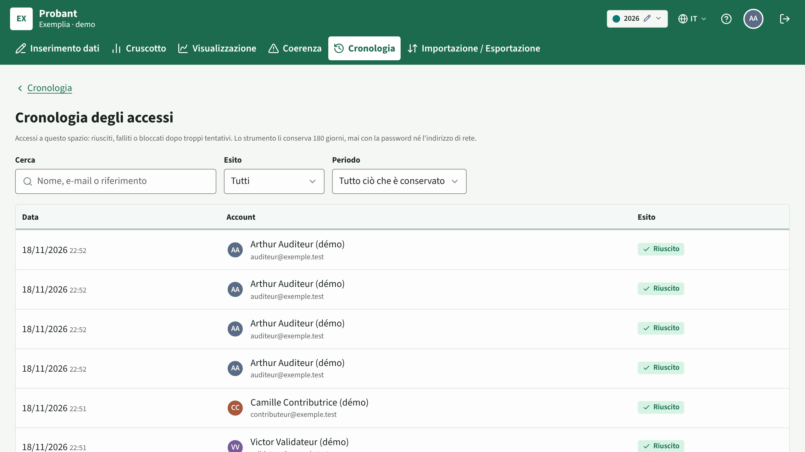
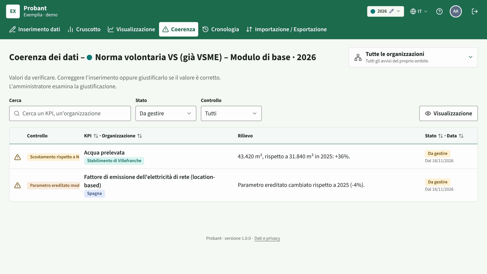
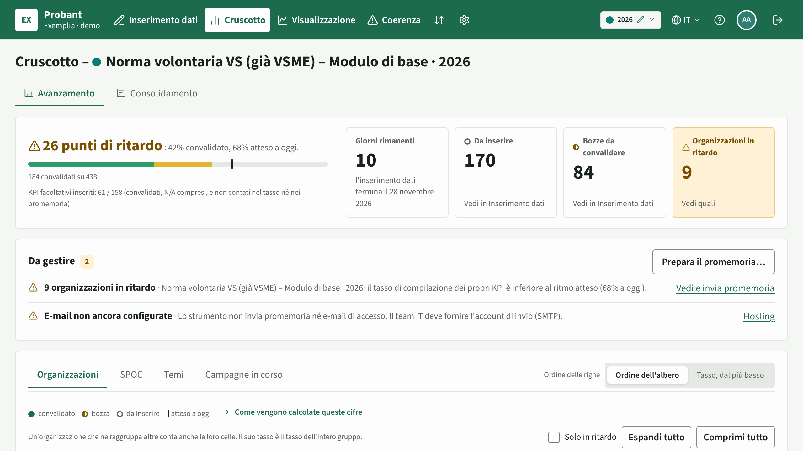
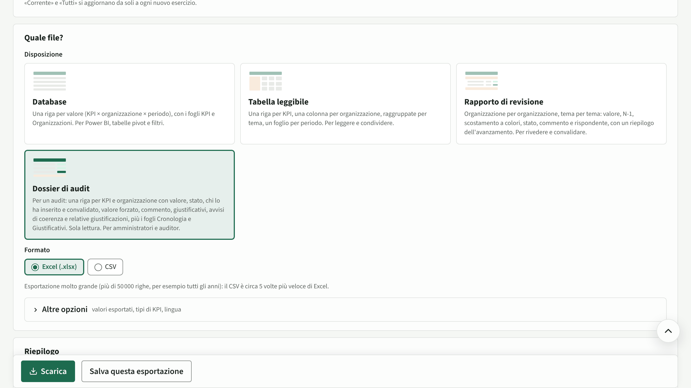
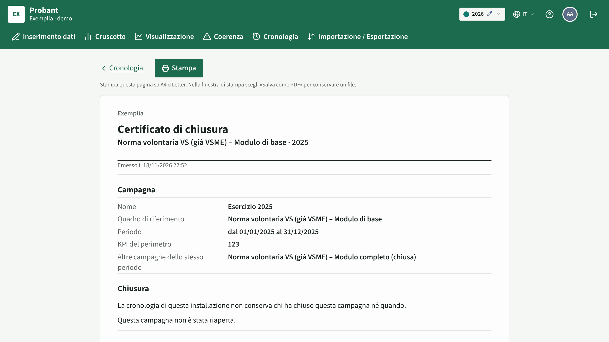

# Guida dell'auditor

L'auditor può vedere tutti i valori, i loro giustificativi e la loro cronologia. Non modifica mai nulla: il ruolo di auditor è di sola lettura. Versione inglese: [`docs/guides/auditor.md`](../../guides/auditor.md).

## Consultare i valori di un'organizzazione {#read-only}

1. Fare clic su **Inserimento dati** nella barra superiore. La pagina si apre sull'organizzazione più alta del proprio ambito.
2. Fare clic sul nome dell'organizzazione in alto a destra nella pagina, poi scegliere l'organizzazione nell'elenco.
3. Usare **Cerca** e i filtri sopra la tabella per trovare un KPI.
4. Fare clic su una riga per aprire il pannello. Mostra il valore, il commento, i giustificativi e la cronologia per esercizio.

Aprire **Visualizzazione** e selezionare **Mostra i KPI calcolati e consolidati** per vedere i totali e le componenti di ogni calcolo.

## Aprire i giustificativi {#evidence}

1. Aprire il pannello di un valore.
2. In **Giustificativo**, fare clic sul nome di un file per aprirlo.

La colonna **Giustif.** della tabella mostra il numero di file per ogni KPI.

## Seguire ogni modifica {#history}

1. Fare clic su **Cronologia** nella barra superiore.
2. Scegliere **Inserimento dati** per vedere i valori, le convalide e i giustificativi. Scegliere **Modifiche di amministrazione** per vedere le campagne, il quadro di riferimento, le organizzazioni e gli account.
3. Filtrare per esercizio, organizzazione o persona.
4. Fare clic su **Esporta** per ottenere il registro come file.

La cronologia mostra chi ha fatto che cosa e quando, con il valore prima e dopo. Lo strumento non elimina mai nulla dalla cronologia. Una modifica fatta da un assistente IA mostra «(tramite MCP)».

Tre righe di **Modifiche di amministrazione** richiedono una spiegazione:

- «ha rimosso le assegnazioni (ruolo in sola lettura)»: un account è diventato lettore o auditor e ha perso le assegnazioni. La riga le elenca per ruolo, con «Vedi il testo completo» quando l'elenco è lungo.
- «ha aggiunto un KPI al perimetro di un periodo riaperto»: un esercizio chiuso conserva il proprio elenco di KPI, e un amministratore ha aggiunto questo KPI di proposito mentre la campagna era riaperta.
- «ha scelto come riaprire una campagna»: l'amministratore ha mantenuto i dati dell'epoca o ha ricalcolato con l'organizzazione di oggi.

## Vedere chi ha effettuato l'accesso {#sign-ins}

1. Fare clic su **Cronologia** nella barra in alto.
2. Fare clic su **Cronologia degli accessi** alla fine della barra dei filtri.
3. Filtrare per nome o e-mail, per esito o per periodo.

Ogni riga mostra la data, l'account e l'esito: **Riuscito**, **Fallito** o **Bloccato: troppi tentativi**. Per un nome utente sconosciuto, lo strumento mostra solo un riferimento, mai il testo digitato. La pagina è in sola lettura. L'amministratore stabilisce per quanto tempo lo strumento conserva queste righe. Se il suo accesso è limitato ad alcune organizzazioni, questa pagina non è disponibile.

## Leggere gli avvisi di coerenza {#consistency}

1. Fare clic su **Coerenza** nella barra superiore.
2. Filtrare gli avvisi per stato, controllo, KPI o organizzazione.
3. Fare clic su un avviso per leggere il rilievo e la spiegazione del collaboratore.

Un avviso non blocca una convalida, ma una regola **Bloccante** sì: il collaboratore non può convalidare finché la regola non è rispettata. L'amministratore decide su ogni spiegazione.

## Seguire l'avanzamento e i grafici {#dashboard}

Fare clic su **Cruscotto** per lo stato di compilazione per organizzazione e su **Consolidamento** per i totali di ogni livello. Fare clic su **Visualizzazione** per i grafici. Le bozze possono contare nelle cifre mentre una campagna è aperta. La pagina lo segnala quando succede.

## Ottenere il dossier di audit {#audit-file}

Un amministratore o un auditor può scaricare un file Excel con ciò che serve a un audit: per ogni KPI e organizzazione, il valore, lo stato, chi lo ha inserito e convalidato, i giustificativi, gli avvisi di coerenza con le loro giustificazioni e la cronologia delle modifiche. Lo strumento si limita a leggere i dati. Creare il file non cambia nulla.

1. Fai clic su **Importazione / Esportazione** e poi su **Nuova esportazione**.
2. In **Disposizione**, scegli **Dossier di audit**. Scegli l'esercizio e, se ti servono solo alcune, le organizzazioni.
3. Fai clic su **Scarica**.

Il file ha quattro fogli: **Leggimi**, **Audit** (una riga per KPI e organizzazione), **Cronologia** (ogni modifica di questi valori, dalla più vecchia) e **Giustificativi** (i nomi dei file, le dimensioni e chi li ha aggiunti). Il foglio **Leggimi** indica la data, la versione dello strumento e i filtri. Un file grande viene preparato sul server, come ogni esportazione grande.

Vedi gli stessi dati delle pagine dello strumento. Se un amministratore ti ha limitato ad alcune organizzazioni, il file contiene solo quelle.

## Stampare il certificato di chiusura {#closing-certificate}

È possibile stampare una pagina che riassume una campagna chiusa. Lo strumento si limita a leggere i dati.

1. Fare clic su **Cronologia**. Sopra l'elenco, sotto **Certificati di chiusura:**, fare clic su una campagna.
2. Fare clic su **Stampa**. Nella finestra di stampa scegliere Salva come PDF per conservare un file.

La pagina mostra il perimetro, il tasso di compilazione, il numero di valori, i giustificativi e gli avvisi di coerenza. Indica chi ha chiuso la campagna e quando, se la cronologia lo conserva. L'impronta è un codice calcolato da tutte le cifre della campagna. Se una cifra cambia, cambia l'impronta. Se è limitato ad alcune organizzazioni, riceve un certificato parziale: lo indica in alto in ogni pagina, e ogni cifra e l'impronta riguardano solo le sue organizzazioni.

## Ottenere un'esportazione di grandi dimensioni {#large-exports}

Oltre un limite di dimensione, lo strumento prepara sul server un'esportazione o un file da compilare. Aprire **Importazione / Esportazione** e scegliere **Le mie esportazioni**. Il file si trova in «File di grandi dimensioni». Lo strumento lo conserva per 7 giorni.

## Usare lo strumento su uno smartphone {#phone}

Le pagine funzionano su uno smartphone, in una sola colonna.

## Rivedere la visita guidata {#tour}

Al primo accesso, una breve visita mostra dove intervenire. Non blocca lo schermo. Il browser ricorda che è stata vista.

1. Fare clic su **Guida** nella barra in alto.
2. Fare clic su **Mostra di nuovo la visita**.
3. Fare clic su **Avanti** per proseguire e su **Fine** alla fine. Per interrompere, fare clic su **Chiudi la visita**, premere Esc o fare clic su **Non mostrare più**.

## Cambiare la lingua {#language}

1. Fare clic sulla lingua nella barra superiore, oppure fare clic sul proprio nome, poi su **Il mio account**.
2. In **Lingua**, scegliere una delle sette lingue e salvare.

**I miei ultimi accessi**, in **Il mio account**, elenca i vostri ultimi accessi a questo spazio. Se non ne riconoscete uno, cambiate la password e avvisate un amministratore.

## Interpellare un assistente {#assistant}

Se un amministratore ha attivato gli assistenti, è possibile collegare un assistente IA in **Il mio account**, in **Assistenti IA (MCP)**. Con il ruolo di auditor può solo leggere. La cronologia registra ogni chiamata.
