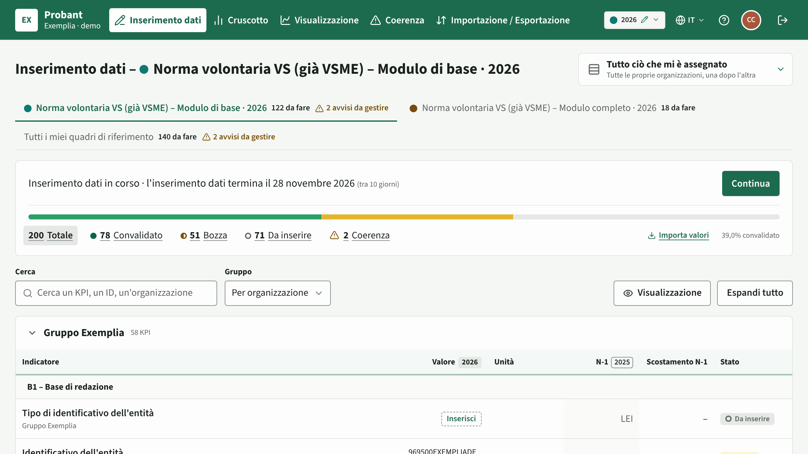
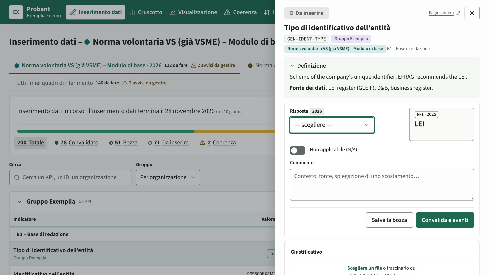
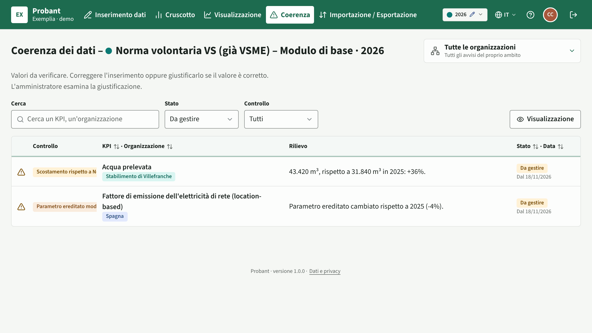
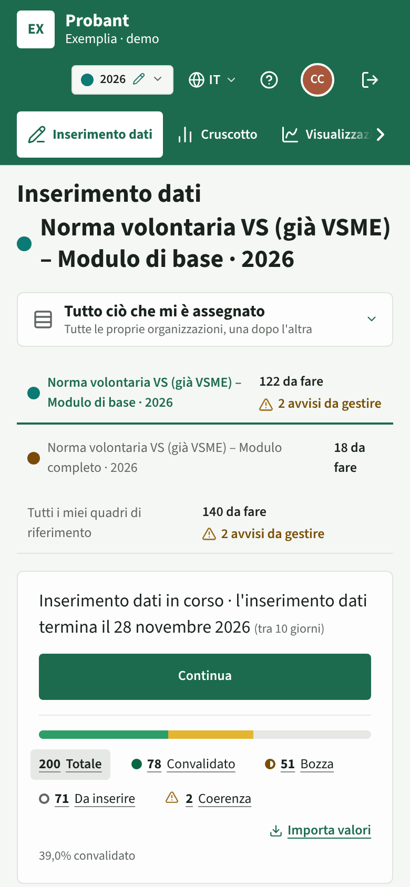

# Guida del collaboratore

Il collaboratore inserisce i valori dei KPI che un amministratore gli ha assegnato e li convalida. Questa guida mostra ogni attività in pochi passaggi. Versione inglese: [`docs/guides/contributor.md`](../../guides/contributor.md).

## Trovare che cosa inserire {#find}

1. Fare clic su **Inserimento dati** nella barra superiore. La pagina si apre su **Tutto ciò che mi è assegnato**.
2. Scegliere il quadro di riferimento e il periodo in **Sto rispondendo…** (barra superiore), oppure usare le schede sotto il titolo.
3. Fare clic su **Da inserire** o **Bozza** sopra la tabella per mantenere solo le righe di propria competenza.
4. Usare **Cerca** per trovare un KPI, un ID o un'organizzazione.

Fare clic su **Inizia** (o **Continua**) per aprire il primo valore ancora da completare. Il riepilogo indica quanti valori restano e quando termina l'inserimento dati.

## Inserire un valore {#enter}

1. Fare clic sulla riga del KPI, oppure premere Invio su di essa. Si apre il pannello di inserimento.
2. Inserire il numero, la risposta o il testo in **Valore** (o in **Risposta**, per un elenco o un testo).
3. Fare clic su **Salva la bozza** per conservarlo e tornare più tardi.

Il pannello mostra il valore del periodo di confronto (N-1) e lo scostamento. Se lo scostamento supera la soglia della campagna, il **Commento** è obbligatorio.

Scegliere **Pagina intera** per lavorare su tutta la pagina.

Se il pannello dice che un'organizzazione «apre il» giorno di una data successiva al periodo, per questo periodo non si può ancora inserire nulla. Chiedere a un amministratore di modificare la data di apertura. Per il resto non cambia nulla.

## Segnare un valore come non applicabile {#na}

1. Aprire il pannello di inserimento del KPI.
2. Selezionare **Non applicabile (N/A)**.
3. Scrivere il motivo in **Commento**. Il commento è obbligatorio per N/A.

## Aggiungere un giustificativo {#evidence}

1. Aprire il pannello di inserimento del KPI.
2. In **Giustificativo**, fare clic su **Scegliere un file** oppure trascinare il file nell'area.
3. Usare un file PDF, JPG o PNG. Il pannello mostra il limite di dimensione (5 MB per impostazione predefinita).

Se il KPI richiede un giustificativo, non è possibile convalidare senza almeno un file. Questo non vale per N/A.

## Convalidare il proprio inserimento {#validate}

La convalida conferma che l'inserimento è completo. Non significa che la cifra sia stata verificata da un audit.

1. Aprire il pannello di inserimento del KPI.
2. Fare clic su **Convalida e avanti**. Il pannello apre il valore successivo.
3. Alla fine, il riepilogo mostra «Tutto fatto».

Se manca qualcosa, lo strumento indica che cosa aggiungere: un valore o N/A, un commento o un giustificativo.

## Modificare un valore convalidato {#reopen}

È possibile modificare un valore già convalidato. Lo strumento lo riporta in bozza e lo si convalida di nuovo.

1. Aprire il pannello di inserimento del KPI.
2. Modificare il valore, poi fare clic su **Salva la modifica**. Oppure fare clic su **Torna in bozza** per non cambiare ancora nulla.
3. Fare clic su **Convalida** quando il valore è corretto.

**Cancella il valore** svuota il valore e riporta la cella a **Da inserire**. Il commento e i giustificativi restano. La cronologia registra ogni modifica.

Se la campagna è chiusa, solo un amministratore può riaprirla.

## Un KPI bloccato da una campagna chiusa {#shared-closed}

Alcuni KPI appartengono a due quadri di riferimento con lo stesso periodo. Il valore è condiviso. Se una delle due campagne è chiusa, non è possibile modificare il valore nell'altra.

Il pannello mostra allora un messaggio che indica il quadro di riferimento e la campagna. Chiedere a un amministratore di riaprire la campagna chiusa.

## Gestire un avviso «Da verificare» {#check}

Lo strumento controlla i valori e segna quelli insoliti con **Da verificare**. Un avviso non blocca la convalida, ma una regola **Bloccante** sì: non puoi convalidare finché la regola non è rispettata.

1. Aprire il pannello di inserimento. Il blocco **Da verificare** indica il motivo.
2. Se il valore è sbagliato, correggerlo e salvare.
3. Se il valore è giusto, fare clic su **Spiego nel commento**, scrivere la spiegazione e salvare.

La pagina **Coerenza** elenca tutti gli avvisi. Fare clic su un avviso per aprire la sua scheda. Nel pannello di inserimento, **Scheda dell'avviso** dà gli stessi dettagli. Un amministratore esamina la spiegazione.

Se l'amministratore ha attivato l'assistente IA, fare clic su **Spiega con l'IA** in un avviso. La risposta è solo una proposta. Fare clic su **Usa come mia spiegazione** per copiarla nel commento, poi salvare.

## Importare valori da un file {#import}

1. Fare clic su **Importazione / Esportazione** nella barra superiore. Si apre su **Importa valori**.
2. Seguire i passaggi della pagina. Lo strumento mostra un'anteprima prima di salvare qualsiasi cosa.

Valgono le stesse regole del pannello di inserimento.

I numeri delle celle Excel sono letti così come sono. Un numero scritto come testo è letto nella lingua del file. In un file CSV la indica il separatore delle colonne: «;» va con la virgola decimale, «,» con il punto. Altrimenti la indica l'intestazione della colonna dei valori: in inglese «1,234» vale 1234, in italiano 1,234. L'anteprima indica come ha letto i numeri e segnala un valore come «1,234».

## Leggere i grafici {#visualisation}

**Visualizzazione** mostra l'avanzamento e le cifre del tuo perimetro in viste. Apri una vista, cambia i filtri in alto, poi usa il menu «…» di un grafico per mostrarne i dati o esportarlo. Le bozze possono contare nelle cifre finché una campagna è aperta.

## Usare lo strumento su uno smartphone {#phone}

Le pagine funzionano su uno smartphone. Il pannello di inserimento occupa tutto lo schermo. Usare il pulsante di chiusura per tornare all'elenco.

## Rivedere la visita guidata {#tour}

Al primo accesso, una breve visita mostra dove intervenire. Non blocca lo schermo. Il browser ricorda che è stata vista.

1. Fare clic su **Guida** nella barra in alto.
2. Fare clic su **Mostra di nuovo la visita**.
3. Fare clic su **Avanti** per proseguire e su **Fine** alla fine. Per interrompere, fare clic su **Chiudi la visita**, premere Esc o fare clic su **Non mostrare più**.

## Cambiare la lingua {#language}

Lo strumento è disponibile in francese, inglese, spagnolo, tedesco, italiano, olandese e portoghese.

1. Fare clic sulla lingua nella barra superiore, oppure fare clic sul proprio nome, poi su **Il mio account**.
2. In **Lingua**, scegliere la lingua e salvare.

I nomi dei KPI e dei temi compaiono nella propria lingua quando hanno una traduzione.

## Collegare un assistente IA {#assistant}

Se l'amministratore ha attivato gli assistenti, è possibile collegarne uno (per esempio Claude). Legge e agisce con i diritti della persona, mai di più.

1. Fare clic sul proprio nome, poi su **Il mio account**.
2. In **Assistenti IA (MCP)**, inserire un nome in **Nome del token** e scegliere **Scade dopo**.
3. Fare clic su **Crea un token**.
4. Copiare subito il token. Non sarà più visibile.
5. Incollare la configurazione già pronta nell'assistente.

Per fermare un assistente, fare clic su **Revoca** sulla sua riga. La cronologia mostra «(tramite MCP)» dopo ogni modifica fatta da un assistente.

## Cambiare la mia password {#account}

1. Fare clic sul proprio nome, poi su **Il mio account**.
2. In **Modifica la mia password**, inserire la password attuale e quella nuova.
3. Fare clic su **Salva la mia password**.

In caso di password dimenticata, chiedere a un amministratore di reimpostarla.

**I miei ultimi accessi**, in **Il mio account**, elenca i vostri ultimi accessi a questo spazio. Se non ne riconoscete uno, cambiate la password e avvisate un amministratore.
