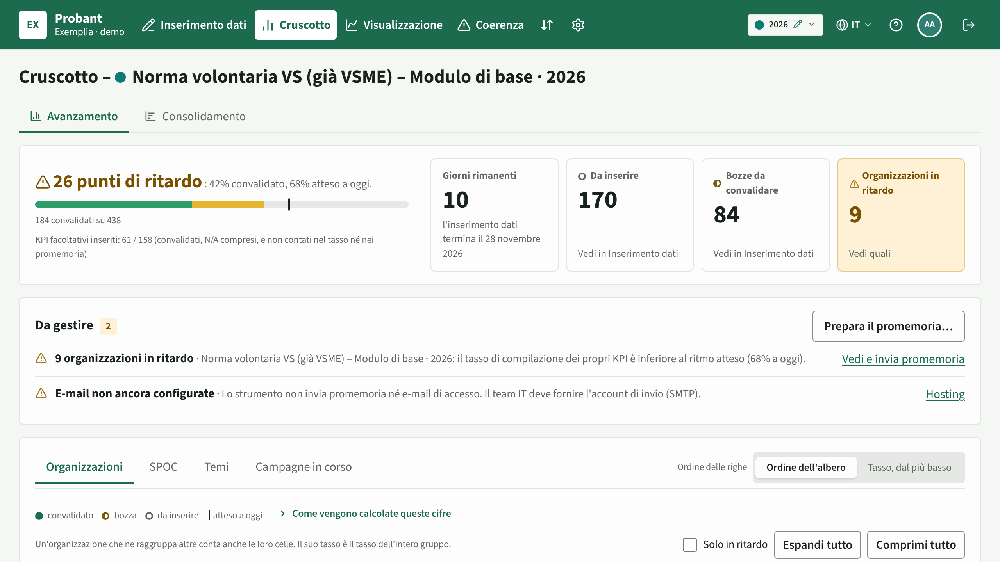
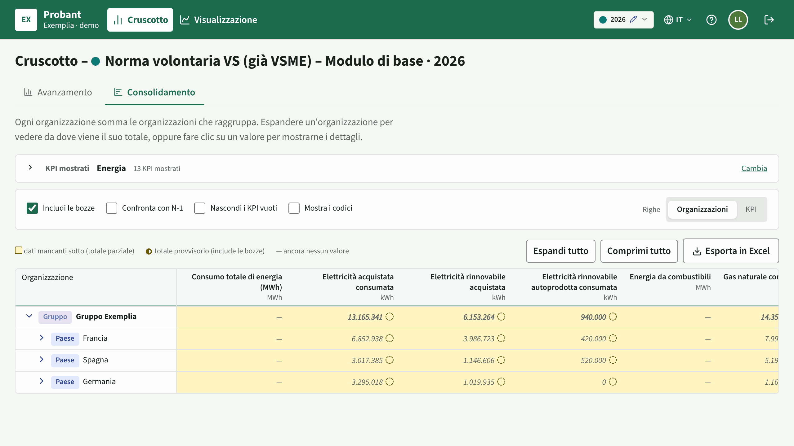
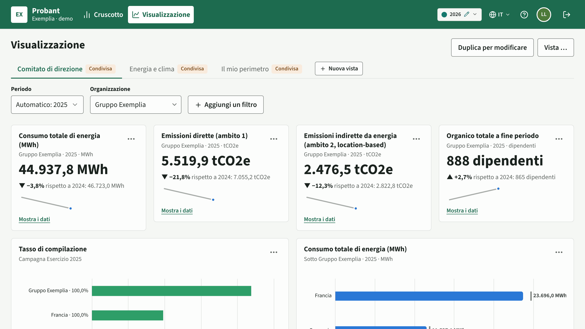
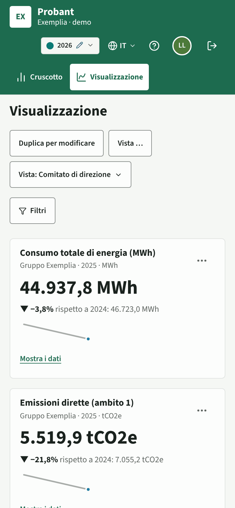

# Guida del lettore

Il lettore consulta l'avanzamento e le cifre. Non modifica mai nulla: il ruolo di lettore è di sola lettura. Versione inglese: [`docs/guides/reader.md`](../../guides/reader.md).

## Seguire l'avanzamento {#dashboard}

1. Fare clic su **Cruscotto** nella barra superiore.
2. Leggere il giudizio in alto. Indica se la campagna è in linea con il ritmo previsto.
3. Leggere la tabella per organizzazione. Un'organizzazione che ne raggruppa altre mostra il tasso dell'intero gruppo.

## Vedere i totali di ogni livello {#consolidation}

1. Nel **Cruscotto**, fare clic su **Consolidamento**.
2. Scegliere i KPI da mostrare. Aprire una riga per vedere le organizzazioni sottostanti.

La pagina mostra i valori di ogni livello dell'albero, dal più basso al più alto. Sono visibili le organizzazioni del proprio ambito.

## Leggere i grafici {#visualisation}

1. Fare clic su **Visualizzazione** nella barra superiore. La pagina si apre su una vista.
2. Fare clic su una scheda per aprire un'altra vista.
3. Usare i filtri in alto: il periodo, il confronto, l'organizzazione e il quadro di riferimento.
4. Fare clic su **Reimposta i filtri della vista** per ricominciare.
5. Aprire il menu «…» di un grafico per mostrarne i dati, aprirlo a schermo intero oppure esportarlo come immagine o come file Excel.

Le bozze possono contare nelle cifre mentre una campagna è aperta. La pagina lo segnala quando succede.

## Usare lo strumento su uno smartphone {#phone}

Le pagine funzionano su uno smartphone, in una sola colonna. I filtri si aprono in una finestra.

## Rivedere la visita guidata {#tour}

Al primo accesso, una breve visita mostra dove intervenire. Non blocca lo schermo. Il browser ricorda che è stata vista.

1. Fare clic su **Guida** nella barra in alto.
2. Fare clic su **Mostra di nuovo la visita**.
3. Fare clic su **Avanti** per proseguire e su **Fine** alla fine. Per interrompere, fare clic su **Chiudi la visita**, premere Esc o fare clic su **Non mostrare più**.

## Cambiare la lingua {#language}

Lo strumento è disponibile in francese, inglese, spagnolo, tedesco, italiano, olandese e portoghese.

1. Fare clic sulla lingua nella barra superiore, oppure fare clic sul proprio nome, poi su **Il mio account**.
2. In **Lingua**, scegliere la lingua e salvare.

## Cambiare la mia password {#account}

1. Fare clic sul proprio nome, poi su **Il mio account**.
2. In **Modifica la mia password**, inserire la password attuale e quella nuova.
3. Fare clic su **Salva la mia password**.

In caso di password dimenticata, chiedere a un amministratore di reimpostarla.

**I miei ultimi accessi**, in **Il mio account**, elenca i vostri ultimi accessi a questo spazio. Se non ne riconoscete uno, cambiate la password e avvisate un amministratore.

## Interpellare un assistente {#assistant}

Se un amministratore ha attivato gli assistenti, è possibile collegare un assistente IA in **Il mio account**, in **Assistenti IA (MCP)**. Con il ruolo di lettore può solo leggere. Non inserisce e non modifica mai nulla. Legge le campagne, i KPI, le organizzazioni e il tasso di compilazione; legge anche i valori del proprio ambito solo se l'amministratore lo consente (**Impostazioni › Assistenti**). Anche allora legge solo i valori convalidati, come la Visualizzazione li mostra. Se l'amministratore ha disattivato **I KPI sensibili sono dati agli assistenti**, non legge mai un KPI contrassegnato come Limitato o Riservato, né un KPI calcolato a partire da uno di essi.
