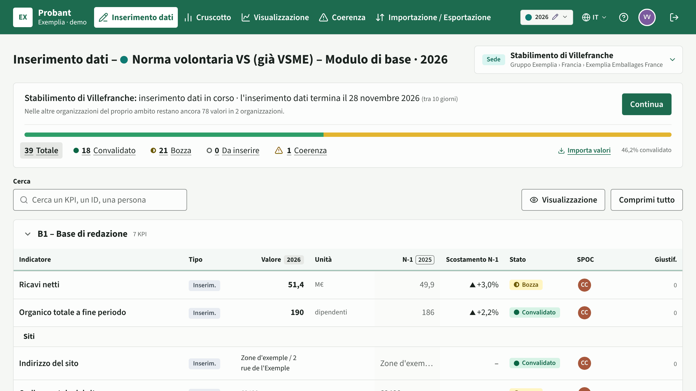
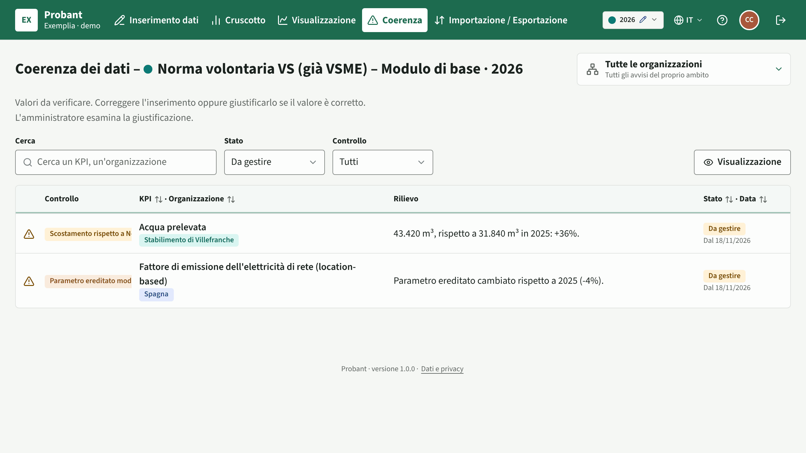
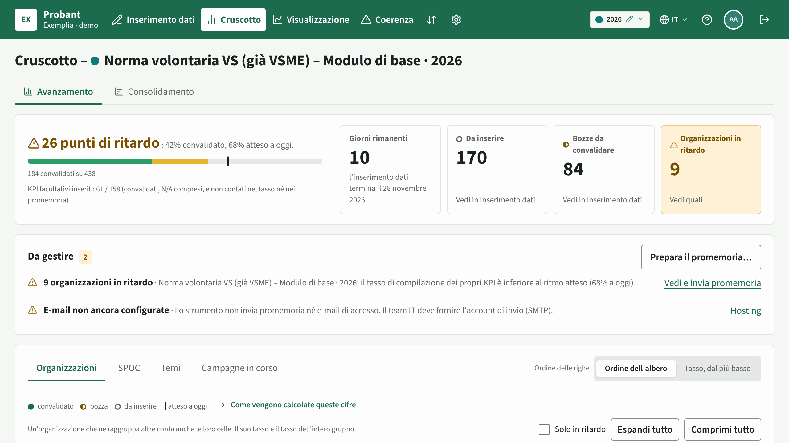
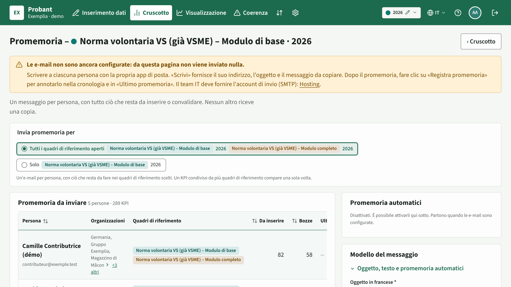

# Guida del validatore

Il validatore segue e convalida gli inserimenti dei KPI e delle organizzazioni che un amministratore gli ha assegnato (Assegnazioni dei KPI, scelta Validatori) e delle organizzazioni sottostanti. Senza assegnazione, convalida un amministratore. In questo ambito può anche inviare promemoria. Versione inglese: [`docs/guides/validator.md`](../../guides/validator.md).

## Vedere il proprio ambito e ciò che resta da fare {#scope}

1. Fare clic su **Inserimento dati** nella barra superiore. La pagina si apre su **Tutto ciò che mi è assegnato**.
2. Fare clic sul nome dell'organizzazione in alto a destra nella pagina (**Tutto ciò che mi è assegnato**), poi scegliere nell'elenco un'organizzazione del proprio ambito.
3. Fare clic su **Da inserire**, **Bozza** o **Convalidato** sopra la tabella per filtrare le righe.
4. Scegliere un'organizzazione, aprire **Visualizzazione**, poi selezionare **Mostra i KPI calcolati e consolidati** per vedere i totali. Sono di sola lettura.

## Controllare e convalidare gli inserimenti {#review}

1. Aprire la riga di un valore in bozza. Si apre il pannello di inserimento.
2. Leggere il valore, il commento, lo scostamento rispetto a N-1 e i giustificativi.
3. Se l'inserimento è completo, fare clic su **Convalida**.
4. In caso contrario, chiedere al collaboratore di completarlo.

La convalida conferma che l'inserimento è completo. Non verifica la correttezza della cifra. La convalida richiede un valore o N/A, un commento (per N/A o per uno scostamento elevato) e un giustificativo se il KPI lo prevede.

Se il pannello dice che un'organizzazione «apre il» giorno di una data successiva al periodo, per questo periodo non si può ancora inserire né convalidare nulla. Chiedere a un amministratore di modificare la data di apertura. Per il resto non cambia nulla.

## Riportare un inserimento in bozza {#reopen}

1. Aprire il pannello di inserimento del valore convalidato.
2. Fare clic su **Torna in bozza**. Il valore non cambia.
3. Il collaboratore può poi modificarlo e convalidarlo di nuovo.

**Cancella il valore** svuota invece la cella. La cronologia registra entrambe le azioni. Dopo la data di fine dell'inserimento dati, i collaboratori non possono più modificare un valore, ma il validatore può ancora riportarlo in bozza.

## Gestire gli avvisi di coerenza {#alerts}

1. Fare clic su **Coerenza** nella barra superiore. La pagina elenca gli avvisi del proprio ambito.
2. Fare clic su un avviso per aprire la sua scheda.
3. Leggere il rilievo e la spiegazione del collaboratore.

Un avviso non blocca una convalida, ma una regola **Bloccante** sì: il collaboratore non può convalidare finché la regola non è rispettata. L'amministratore decide sulla spiegazione.

## Approvare o rifiutare un valore forzato {#forced}

Una persona può chiedere di sostituire un risultato calcolato con un altro valore, con una giustificazione.

1. Fare clic su **Vedi i valori forzati** nella pagina **Inserimento dati**, oppure aprire il KPI calcolato.
2. Leggere la giustificazione.
3. Fare clic su **Approva e forza il valore** per accettare la richiesta.
4. Per rifiutarla, inserire il motivo e fare clic su **Rifiuta**.

## Seguire l'avanzamento {#dashboard}

1. Fare clic su **Cruscotto** nella barra superiore.
2. Leggere il giudizio in alto, poi la tabella per organizzazione. Mostra le organizzazioni in ritardo.
3. Fare clic su **Consolidamento** per vedere i totali del proprio ambito.

## Inviare promemoria {#reminders}

1. Nel **Cruscotto**, fare clic su **Invia promemoria…** (o su **Prepara il promemoria…** se l'installazione non invia e-mail). Si apre la pagina **Promemoria**.
2. Scegliere i quadri di riferimento. Lo strumento seleziona le persone che hanno ancora qualcosa da inserire o da convalidare.
3. Leggere l'anteprima del messaggio. Se lo si desidera, inviare una prova a se stessi.
4. Fare clic su **Invia il promemoria**. La conferma indica le persone.

Se l'installazione non può inviare e-mail, la pagina mostra un riquadro arancione. Fare clic su **Scrivi** per ottenere l'indirizzo, l'oggetto e il messaggio. Inviarli con la propria applicazione di posta. Poi fare clic su **Registra promemoria**.

## Un KPI bloccato da una campagna chiusa {#shared-closed}

Un KPI che appartiene a due quadri di riferimento con lo stesso periodo ha un solo valore condiviso. Se una campagna è chiusa, il valore non può cambiare nell'altra. Il pannello indica quale campagna è chiusa. Chiedere a un amministratore di riaprirla.

## Importare valori da un file {#import}

Fare clic su **Importazione / Esportazione**. Per un collaboratore il menu si apre su **Importa valori**. Per un validatore si apre su **Le mie esportazioni**, e **Importa valori** è a un clic di distanza. Lo strumento mostra un'anteprima prima di salvare qualsiasi cosa.

Cifre per KPI calcolati di un periodo non chiuso: l'anteprima le chiede di scegliere se forzare questi valori o ignorare queste righe. Può forzare solo le organizzazioni che convalida, mentre l'inserimento è aperto. Per le altre, la riga viene rifiutata.

## Ottenere un'esportazione di grandi dimensioni {#large-exports}

Oltre un limite di dimensione, lo strumento prepara sul server un'esportazione o un file da compilare. Aprire **Importazione / Esportazione** e scegliere **Le mie esportazioni**. Il file si trova in «File di grandi dimensioni». Lo strumento lo conserva per 7 giorni.

## Rivedere la visita guidata {#tour}

Al primo accesso, una breve visita mostra dove intervenire. Non blocca lo schermo. Il browser ricorda che è stata vista.

1. Fare clic su **Guida** nella barra in alto.
2. Fare clic su **Mostra di nuovo la visita**.
3. Fare clic su **Avanti** per proseguire e su **Fine** alla fine. Per interrompere, fare clic su **Chiudi la visita**, premere Esc o fare clic su **Non mostrare più**.

## Cambiare la lingua {#language}

1. Fare clic sulla lingua nella barra superiore, oppure fare clic sul proprio nome, poi su **Il mio account**.
2. In **Lingua**, scegliere una delle sette lingue e salvare.

**I miei ultimi accessi**, in **Il mio account**, elenca i vostri ultimi accessi a questo spazio. Se non ne riconoscete uno, cambiate la password e avvisate un amministratore.

## Collegare un assistente IA {#assistant}

Se un amministratore ha attivato gli assistenti, si crea un token in **Il mio account**, in **Assistenti IA (MCP)**: inserire il **Nome del token**, scegliere **Scade dopo**, fare clic su **Crea un token** e copiare subito il token. L'assistente ha i diritti della persona, mai di più. Fare clic su **Revoca** per fermarlo.
