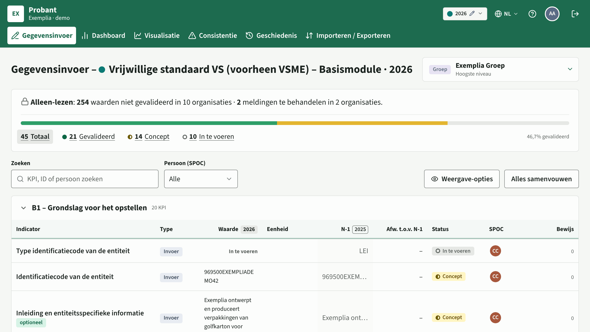
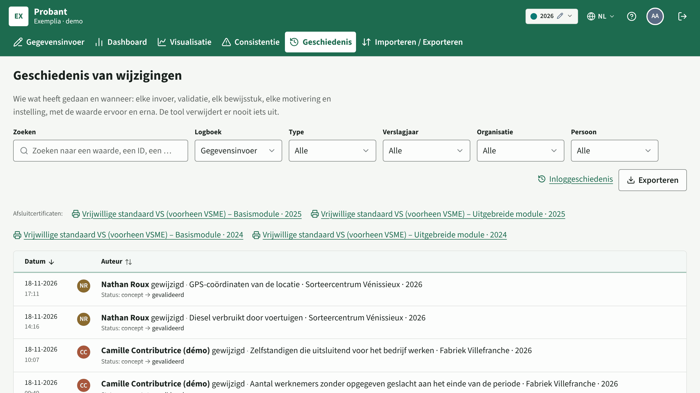
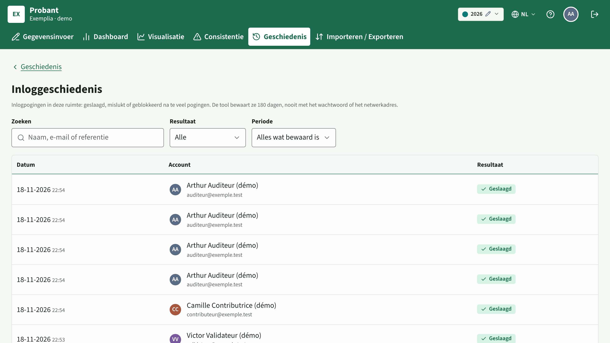
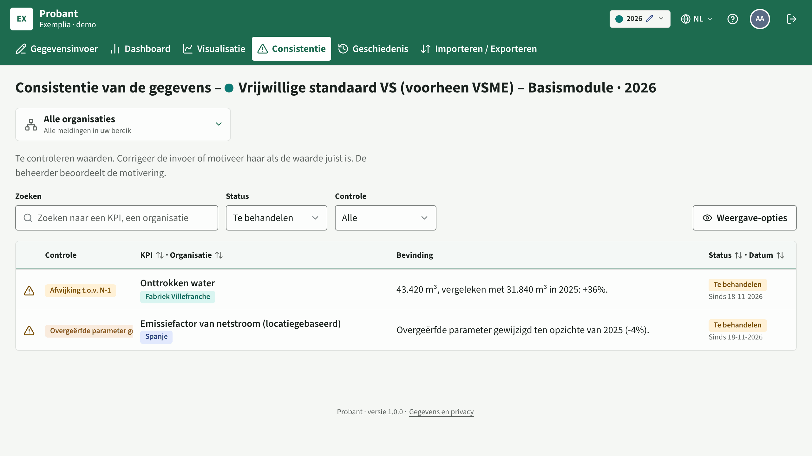
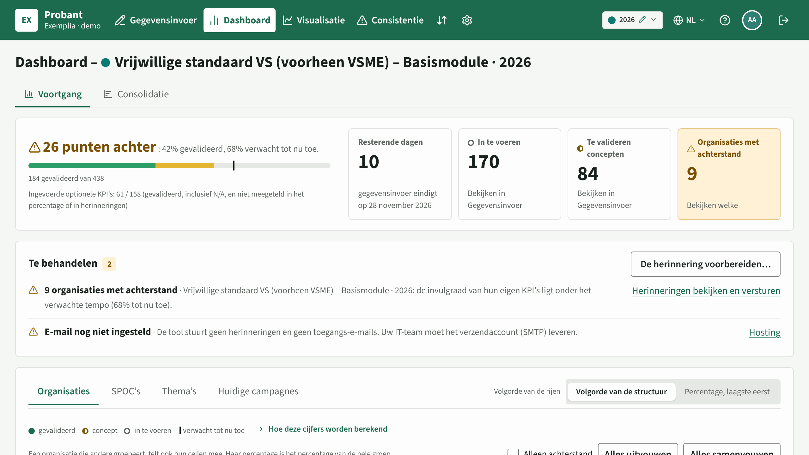
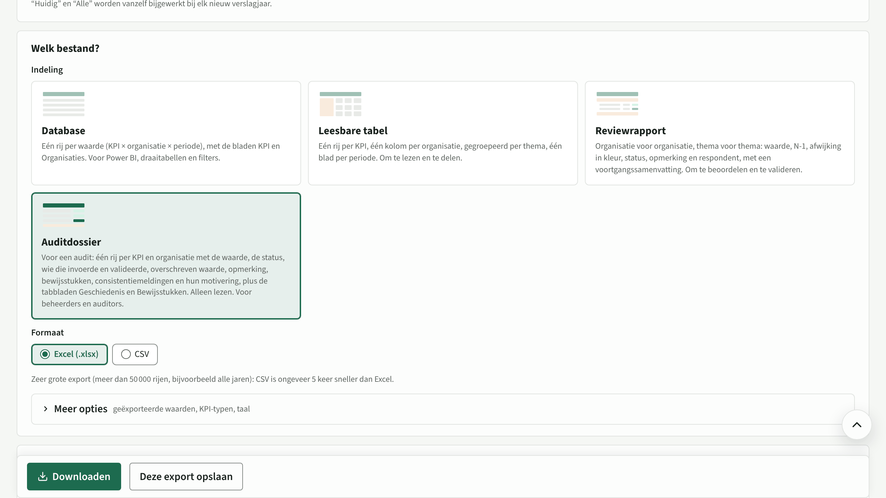
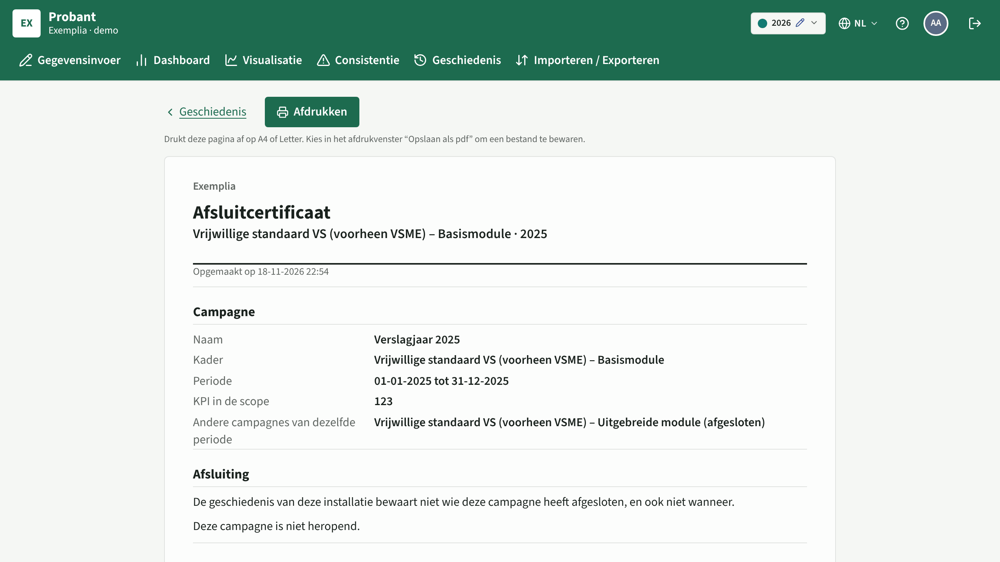

# Handleiding voor auditors

U kunt alle waarden, hun bewijsstukken en hun geschiedenis zien. U wijzigt nooit iets: de rol auditor is alleen-lezen. Engelse versie: [`docs/guides/auditor.md`](../../guides/auditor.md).

## De waarden van een organisatie bekijken {#read-only}

1. Klik in de bovenbalk op **Gegevensinvoer**. De pagina opent bij de hoogste organisatie van uw bereik.
2. Klik rechtsboven op de pagina op de naam van de organisatie en kies de organisatie in de lijst.
3. Gebruik **Zoeken** en de filters boven de tabel om een KPI te vinden.
4. Klik op een rij om het paneel te openen. Het toont de waarde, de opmerking, de bewijsstukken en de geschiedenis per verslagjaar.

Open **Weergave-opties** en vink **Berekende en geconsolideerde KPI’s tonen** aan om de totalen en de onderdelen van elke berekening te zien.

## De bewijsstukken openen {#evidence}

1. Open het paneel van een waarde.
2. Klik onder **Bewijsstuk** op de naam van een bestand om het te openen.

De kolom **Bewijs** van de tabel toont het aantal bestanden per KPI.

## Elke wijziging volgen {#history}

1. Klik in de bovenbalk op **Geschiedenis**.
2. Kies **Gegevensinvoer** om de waarden, de validaties en de bewijsstukken te zien. Kies **Beheerwijzigingen** om de campagnes, het kader, de organisaties en de accounts te zien.
3. Filter op verslagjaar, organisatie of persoon.
4. Klik op **Exporteren** om het logboek als bestand te krijgen.

De geschiedenis toont wie wat wanneer heeft gedaan, met de waarde ervoor en erna. De tool verwijdert er nooit iets uit. Een wijziging die een AI-assistent heeft gemaakt, toont “(via MCP)”.

Drie regels van **Beheerwijzigingen** hebben uitleg nodig:

- “toewijzingen verwijderd (alleen-lezenrol)”: een account werd lezer of auditor en verloor zijn toewijzingen. De regel somt ze op per rol, met “De volledige tekst bekijken” als de lijst lang is.
- “voegde een KPI toe aan de reikwijdte van een heropende periode”: een afgesloten jaar behoudt zijn lijst met KPI's, en een beheerder voegde deze KPI met opzet toe terwijl de campagne heropend was.
- “koos hoe een campagne wordt heropend”: de beheerder behield de cijfers van toen of herberekende met de organisatie van vandaag.

## Zien wie heeft ingelogd {#sign-ins}

1. Klik in de bovenste balk op **Geschiedenis**.
2. Klik aan het einde van de filterbalk op **Inloggeschiedenis**.
3. Filter op naam of e-mail, op resultaat of op periode.

Elke regel toont de datum, het account en het resultaat: **Geslaagd**, **Mislukt** of **Geblokkeerd: te veel pogingen**. Bij een onbekende gebruikersnaam toont de tool alleen een referentie, nooit de getypte tekst. De pagina is alleen-lezen. De beheerder bepaalt hoe lang de tool deze regels bewaart. Als uw toegang beperkt is tot enkele organisaties, is deze pagina niet voor u beschikbaar.

## De consistentiemeldingen lezen {#consistency}

1. Klik in de bovenbalk op **Consistentie**.
2. Filter de meldingen op status, controle, KPI of organisatie.
3. Klik op een melding om de bevinding en de toelichting van de bijdrager te lezen.

Een melding blokkeert een validatie niet, maar een regel met de ernst **Blokkerend** wel: de bijdrager kan pas valideren als de regel is gehaald. De beheerder beslist over elke toelichting.

## De voortgang en de grafieken volgen {#dashboard}

Klik op **Dashboard** voor de invulgraad per organisatie en op **Consolidatie** voor de totalen van elk niveau. Klik op **Visualisatie** voor de grafieken. Concepten kunnen meetellen in de cijfers zolang een campagne open is. De pagina zegt het als ze meetellen.

## Het auditdossier ophalen {#audit-file}

Een beheerder of een auditor kan één Excel-bestand downloaden met wat een audit nodig heeft: per KPI en organisatie de waarde, de status, wie die invoerde en valideerde, de bewijsstukken, de consistentiemeldingen met hun motivering en de geschiedenis van de wijzigingen. De tool leest de gegevens alleen. Het bestand maken wijzigt niets.

1. Klik op **Importeren / Exporteren** en daarna op **Nieuwe export**.
2. Kies onder **Indeling** de optie **Auditdossier**. Kies het jaar en, als u er maar een paar nodig hebt, de organisaties.
3. Klik op **Downloaden**.

Het bestand heeft vier tabbladen: **Lees mij**, **Audit** (één rij per KPI en organisatie), **Geschiedenis** (elke wijziging van deze waarden, de oudste eerst) en **Bewijsstukken** (de bestandsnamen, de groottes en wie ze toevoegde). Het tabblad **Lees mij** geeft de datum, de versie van de tool en de filters. Een groot bestand wordt op de server voorbereid, zoals elke grote export.

U ziet dezelfde gegevens als op de pagina's van de tool. Als een beheerder u tot enkele organisaties heeft beperkt, bevat het bestand alleen die.

## Het afsluitcertificaat afdrukken {#closing-certificate}

U kunt een pagina afdrukken die een afgesloten campagne samenvat. De tool leest de gegevens alleen.

1. Klik op **Geschiedenis**. Klik boven de lijst onder **Afsluitcertificaten:** op een campagne.
2. Klik op **Afdrukken**. Kies in het afdrukvenster Opslaan als pdf om een bestand te bewaren.

De pagina toont de scope, de invulgraad, het aantal waarden, de bewijsstukken en de consistentiemeldingen. Ze toont wie de campagne heeft afgesloten en wanneer, als de geschiedenis dat bewaart. De vingerafdruk is een code die wordt berekend uit alle cijfers van de campagne. Verandert er één cijfer, dan verandert de vingerafdruk. Bent u tot enkele organisaties beperkt, dan krijgt u een gedeeltelijk certificaat: dat staat bovenaan elke pagina, en elk cijfer en de vingerafdruk gelden alleen voor uw organisaties.

## Een grote export ophalen {#large-exports}

Boven een bepaalde grootte bereidt de tool een export of een in te vullen bestand voor op de server. Open **Importeren / Exporteren** en kies **Mijn exports**. Het bestand staat onder “Grote bestanden”. De tool bewaart het 7 dagen.

## De tool op een telefoon gebruiken {#phone}

De pagina’s werken op een telefoon, in één kolom.

## De rondleiding opnieuw bekijken {#tour}

Bij uw eerste aanmelding toont een korte rondleiding waar u kunt handelen. Ze blokkeert het scherm niet. Uw browser onthoudt dat u haar hebt gezien.

1. Klik in de bovenbalk op **Help**.
2. Klik op **Rondleiding opnieuw tonen**.
3. Klik op **Volgende** om verder te gaan en aan het einde op **Klaar**. Om te stoppen klikt u op **Rondleiding sluiten**, drukt u op Esc of klikt u op **Niet meer tonen**.

## De taal wijzigen {#language}

1. Klik in de bovenbalk op de taal, of klik op uw naam en dan op **Mijn account**.
2. Kies onder **Taal** een van de zeven talen en sla op.

**Mijn laatste inlogpogingen**, in **Mijn account**, toont uw laatste inlogpogingen in deze ruimte. Herkent u er een niet, wijzig dan uw wachtwoord en waarschuw een beheerder.

## Een assistent raadplegen {#assistant}

Heeft een beheerder assistenten ingeschakeld, dan kunt u onder **Mijn account** bij **AI-assistenten (MCP)** een AI-assistent koppelen. Voor uw rol kan hij alleen lezen. De geschiedenis bewaart elke aanroep.
