# Handleiding voor beheerders

U richt de tool in, stuurt de campagnes aan en volgt de invulgraad. Alles wat u kunt instellen, staat onder **Beheer**. Het IT-team zorgt voor de hosting, de domeinnaam en het e-mailaccount. Engelse versie: [`docs/guides/administrator.md`](../../guides/administrator.md).

## Zien wat eerst moet gebeuren {#overview}

1. Klik in de bovenbalk op **Beheer**. De pagina **Overzicht** wordt geopend.
2. Lees de lijst **Te behandelen**, het dringendste eerst. Elke rij heeft een eigen link.
3. Klik op **Waarvoor elke sectie dient** als u een herinnering aan de tabbladen nodig hebt.

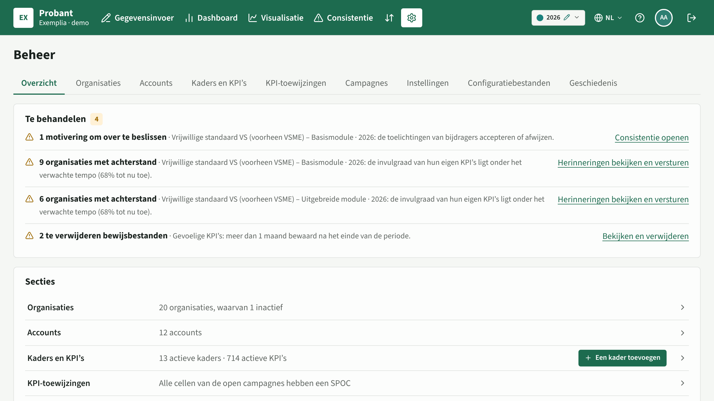

## Een nieuwe installatie inrichten {#setup}

Bij de eerste start opent een assistent met 8 stappen. Die begint met uw eigen beheerdersaccount.

1. Voer het account, de organisatie en de talen in.
2. Kies een kader uit de bibliotheek of stel een eigen kader samen.
3. Voeg het team toe en maak de eerste campagne aan.

Als u de assistent verlaat, klikt u op **Beheer › Instellingen › De installatie hervatten** om verder te gaan.

## Een kader toevoegen {#framework}

1. Klik in de bovenbalk op **Beheer**. Klik op het **Overzicht** op de regel **Kaders en KPI’s** op **Een kader toevoegen**.
2. Kies **Installeren uit de bibliotheek**, **Samenstellen uit bestaande KPI’s** of **Een bestand importeren**.
3. Open het tabblad **Inhoud** van het kader om de thema’s en de KPI’s te ordenen.

De KPI-fiche bepaalt het antwoordtype, de eenheid, de formule en of een bewijsstuk verplicht is. Kies bij **Vertrouwelijkheid** “Beperkt” of “Vertrouwelijk” voor een gevoelige KPI.

Zodra een KPI een opgeslagen of geïmporteerde waarde heeft, kan zijn eenheid niet meer veranderen, net als zijn formaat. De tool meldt dat bij het opslaan. Behoud de eenheid of maak een nieuwe KPI aan in de gewenste eenheid. Om de oude waarden over te zetten, exporteert u ze, zet u ze om in het bestand en importeert u ze daarna in de nieuwe KPI.

Een afgesloten verslagjaar behoudt zijn lijst met KPI’s. Om een KPI ook aan vorige verslagjaren toe te voegen, stelt u de periode **Gevraagd sinds** in (zie de volgende sectie).

## Kiezen sinds wanneer een KPI wordt gevraagd {#requested-since}

Elke KPI van een kader heeft een periode **Gevraagd sinds**: het eerste verslagjaar, of de eerste periode, waarin het kader hem vraagt. Als u een KPI aanmaakt, vraagt de tool ‘Ook aan eerdere verslagjaren toevoegen?’. Standaard wordt de KPI gevraagd vanaf de lopende periode, en verandert er geen enkel vorig verslagjaar.

1. Ga naar **Beheer › Kaders en KPI’s**, open het kader en daarna het tabblad **Inhoud**.
2. Lees de periode aan het einde van elke rij. “Vanaf het begin” betekent dat de KPI er al was vóór deze instelling.
3. Vink een of meer KPI’s aan, of klik op de periode van een rij. Kies in de actiebalk de periode bij **Gevraagd sinds**.
4. Klik op **Toepassen**. De tool toont welke verslagjaren veranderen en hoeveel cellen erbij komen. Bevestig om op te slaan.

Een afgesloten verslagjaar verandert niet zolang het afgesloten is: geen nieuwe cel, geen nieuw totaal, dezelfde invulgraad. De KPI verschijnt als u het verslagjaar heropent, in beide modi, en blijft bij de volgende afsluiting. Een al heropend verslagjaar krijgt de cellen meteen.

U kunt de periode niet later zetten als een verslagjaar dat de KPI verliest afgesloten is, of er een waarde, een N/A, een opmerking of een bewijsstuk voor heeft. Zijn de cellen leeg, dan vraagt de tool om bevestiging. De geschiedenis legt elke wijziging vast. Wordt een berekende KPI eerder gevraagd dan een van zijn bronnen, dan waarschuwt de tool: de bron krijgt cellen vanaf dezelfde periode.

## De valuta van de bedragen kiezen {#currency}

De bibliotheeksjablonen schrijven hun bedragen in euro. Als uw jaarrekening een andere valuta gebruikt, stel die dan in voordat u een sjabloon installeert:

1. Ga naar **Beheer › Kaders en KPI’s › Eenheden en formaten**.
2. Kies bij **Referentievaluta** de valuta en klik op **Opslaan**.

Wanneer u een bibliotheeksjabloon installeert of bijwerkt, krijgen de bedragen deze valuta: “€” wordt “$”, “M€” wordt “M$” en “€/h” wordt “$/h”. De installatieschermen tonen de valuta. Een KPI die al waarden heeft, houdt zijn eenheid.

De tool rekent geen waarden om en gebruikt geen wisselkoersen. Als u de valuta later wijzigt, houden de bestaande KPI’s hun eenheid, en de pagina telt de KPI’s waarvan de eenheid in een andere valuta is. De officiële EFRAG-werkmap gebruikt de referentievaluta als valuta van het rapport. Een bedrag waarvan de eenheid in een andere valuta is, blijft leeg, en het exportrapport meldt dat.

Elke ruimte heeft een eigen referentievaluta. Een nieuwe ruimte begint met de euro.

## De organisaties toevoegen {#organisations}

1. Ga naar **Beheer › Organisaties**.
2. Klik op **Nieuwe organisatie**, kies de bovenliggende organisatie en klik op **De organisatie aanmaken**.
3. Voor een locatie die tijdens het jaar opent, vult u de datum in bij **Open sinds**. De locatie telt mee in de totalen, en er worden waarden voor gevraagd, alleen voor de periodes die op of na deze datum eindigen. Laat u het veld leeg, dan telt de locatie als altijd al open. Als u meerdere organisaties plakt, schrijft u de datum tussen vierkante haken: “Lyon [2026-03-01]”.

De niveaus van de structuur (bijvoorbeeld Groep, Land, Dochteronderneming, Locatie) stelt u in onder **Beheer › Instellingen › Niveaus van de structuur**.

Op dit scherm en onder **Eenheden en formaten** verschijnen de namen van de niveaus en van de eenheden in uw taal. De velden waarin u typt, behouden de referentietaal van de installatie, en het label noemt die (bijvoorbeeld „Naam (referentietaal: Français)”). De vertaling in uw taal staat naast het veld. Om die te wijzigen, gebruikt u **Instellingen › Talen**.

Een organisatie opent nooit vóór haar bovenliggende organisatie: de datum die telt is de laatste van haar eigen datum en die van de organisaties erboven. Als een andere datum of een andere bovenliggende organisatie waarden uit de totalen zou halen, telt de fiche ze, die van de organisaties eronder inbegrepen, en vraagt een bevestiging. Een waarde voor een organisatie die in de periode nog niet open is, wordt geweigerd op het scherm, bij een import en via een assistent. De melding verwijst naar de fiche die de datum draagt.

## De accounts aanmaken {#accounts}

1. Ga naar **Beheer › Accounts**.
2. Klik op **Nieuw account** of op **Meerdere accounts** om er veel tegelijk aan te maken.
3. Voer het e-mailadres en de naam in en kies de **Rol**: beheerder, validator, bijdrager, lezer of auditor.
4. Klik op **Het account aanmaken**. Stuur het tijdelijke wachtwoord naar de persoon.

Om een nieuw tijdelijk wachtwoord te geven, opent u het account en klikt u op **Wachtwoord opnieuw instellen**. De persoon kiest bij de eerste keer inloggen een eigen wachtwoord.

Een lezer of een auditor voert niets in en valideert niets. Als u de rol van een account wijzigt in een van deze twee, toont de tool hoeveel toewijzingen het verwijdert en vraagt het een bevestiging voor het opslaan. Het verwijdert ze, met een regel in de geschiedenis. Terug naar de vorige rol geeft ze niet terug. Om ze in plaats daarvan aan iemand anders te geven, gebruikt u eerst **Een persoon vervangen…**. Om ze later opnieuw te geven, gebruikt u **KPI-toewijzingen** (keuze **Validators** voor toewijzingen als validator).

**Te behandelen** somt de accounts op die vóór deze regel alleen-lezen werden en nog toewijzingen hebben. Klik op **Bekijken** en daarna op **Verwijderen** op een regel. Een gedeactiveerd account behoudt zijn toewijzingen tot u **Een persoon vervangen…** gebruikt.

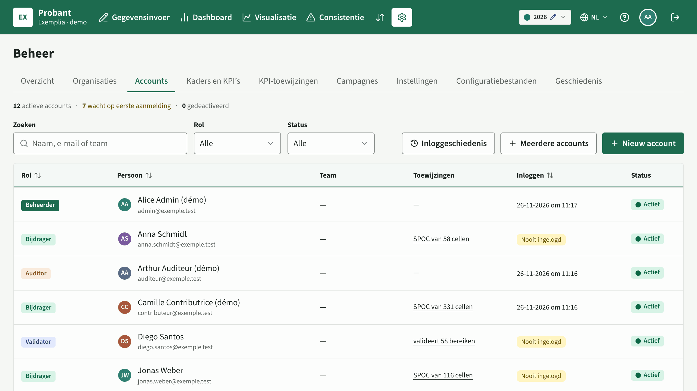

Om te zien wie wanneer heeft ingelogd, klikt u op **Inloggeschiedenis** in **Beheer › Accounts**. Elke regel geeft de datum, het account en het resultaat: **Geslaagd**, **Mislukt** of **Geblokkeerd: te veel pogingen**. Een gebruikersnaam die bij geen account van de ruimte hoort, verschijnt alleen met een referentie, nooit met de getypte tekst. Filter op resultaat of periode, of zoek een naam. Hoelang de tool de geschiedenis bewaart, stelt u in bij **Beheer › Instellingen › Hosting** (standaard 180 dagen).

## De KPI’s toewijzen {#assign}

Elke cel van het raster is één KPI voor één organisatie. Het aanspreekpunt (SPOC) is de persoon die de KPI invoert.

1. Ga naar **Beheer › KPI-toewijzingen**.
2. Klik op een cel en kies een of meer personen. U kunt ook een rij of een kolom selecteren en dan op **Toewijzen** klikken.
3. Klik op **Een persoon vervangen…** als iemand vertrekt.
4. Vink **Alleen de rijen die nog moeten worden ingevuld** aan om te zien wat ontbreekt.

Om de validators te kiezen, selecteert u **Validators** in de lijst **Rol**. Een validatortoewijzing geldt voor één KPI in één organisatie en in alle organisaties daaronder: het raster heeft dan één tabblad per organisatieniveau, met de KPI’s die op dat niveau of lager worden ingevoerd. Een cel met “via …” valt al onder de validator van een organisatie erboven. Alleen actieve validators en beheerders worden voorgesteld. Een cel zonder validator wordt gevalideerd door de beheerders. Elke gegeven of weggehaalde toewijzing schrijft een regel in de geschiedenis.

Bij een grote groep toont het raster telkens één groep organisaties. Kies de groep in de lijst **Organisaties** boven het raster. De filters en het gezamenlijk opslaan gelden voor de getoonde groep. **Alle (traag voor een grote groep)** toont alles, maar de tool onthoudt dat niet.

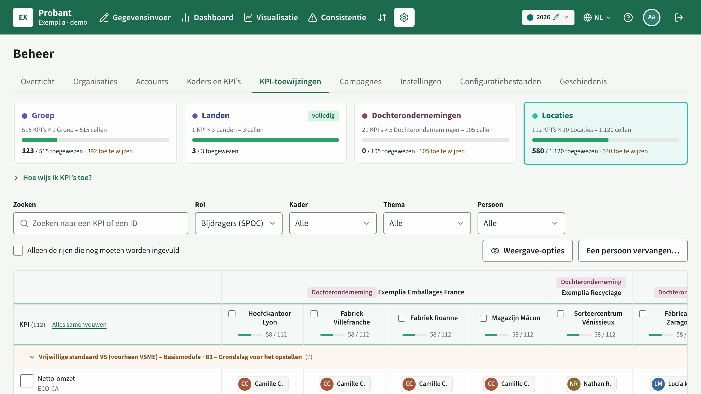

## Een campagne openen, beoordelen, afsluiten en heropenen {#campaign}

1. Ga naar **Beheer › Campagnes** en klik op **Nieuwe campagne** op de regel van het kader.
2. Kies de periode, stel de data en de **Afwijkingsdrempel** in en klik op **De campagne aanmaken**.
3. Klik bij een campagne op **Beheren**. Gebruik **Gegevensinvoer openen**, **De review starten** of **Definitief afsluiten**.
4. Om een afgesloten campagne te wijzigen, klikt u op **Heropenen voor bijdragers** of **Heropenen om te corrigeren (review)**. De geschiedenis bewaart de heropening.
5. Als u een afgesloten jaar heropent, kiest u eerst:
   - **De cijfers van toen behouden** (standaard geselecteerd): er wordt niets herberekend. Alleen een organisatie waarvan u een waarde corrigeert, en de totalen erboven worden herberekend. Voorbeeld: een organisatie die sindsdien naar een ander land is overgeplaatst, blijft in de totalen van haar vroegere land.
   - **Herberekenen met de organisatie van vandaag**: alle totalen van het jaar worden herberekend met de structuur en de formules van vandaag. Voorbeeld: de verplaatste organisatie brengt haar waarden over naar de totalen van haar nieuwe land.

   Een jaar dat met de cijfers van toen wordt heropend, behoudt de organisatiestructuur van bij de afsluiting: een correctie wordt herberekend met de bovenliggende organisaties van toen, en een organisatie die sindsdien is aangemaakt, heeft geen cel in dat jaar. Uw keuze geldt tot de volgende afsluiting.

   Als een jaar twee campagnes heeft (twee kaders) en een ervan is afgesloten, behouden de KPI's die de afgesloten campagne vraagt hun cijfers tot ook de andere campagne is afgesloten: een wijziging van de organisaties of **De berekeningen opnieuw uitvoeren** verandert ze niet meer, en ze behouden de organisatiestructuur van de dag van de afsluiting. Een KPI die in beide campagnes zit, behoudt ook zijn cijfers. Alleen een correctie die in de afgesloten campagne wordt geïmporteerd, herberekent de gecorrigeerde organisatie en haar totalen. Met **Herberekenen met de organisatie van vandaag** behouden de KPI's van een andere campagne van het jaar die nog afgesloten is hun cijfers.

Een afgesloten campagne is voor iedereen bevroren, beheerders inbegrepen. De waarden ervan worden de N-1 van de volgende campagne. **De berekeningen opnieuw uitvoeren** is zelden nodig.

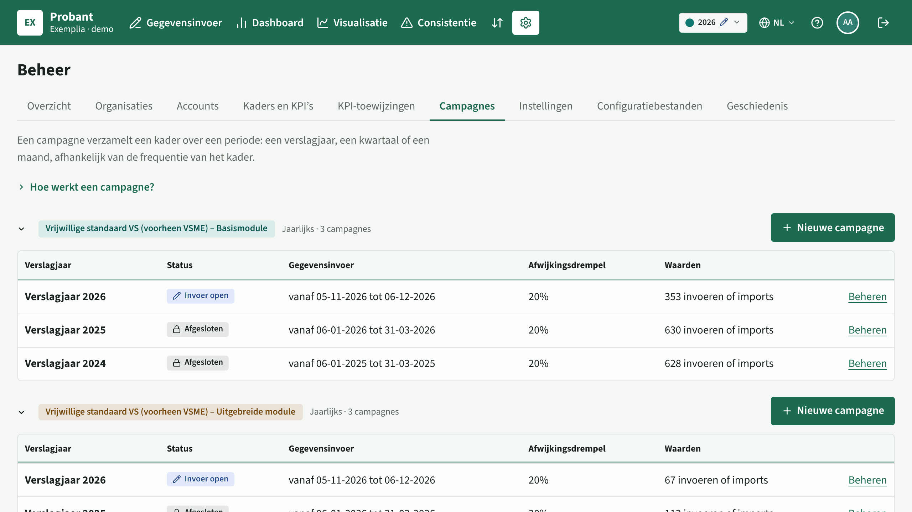

## Waarden invoeren en controleren {#entry}

**Gegevensinvoer** toont de cellen van de open campagne, per organisatie en per KPI. U ziet ze allemaal en kunt in elke cel een waarde invoeren of corrigeren. Zoek met de filters een KPI, een organisatie of een status en klik op een cel om het paneel te openen.

## Een gevalideerde invoer heropenen {#reopen}

1. Ga naar **Gegevensinvoer** en open de rij van de waarde.
2. Klik op **Terug naar concept**. De waarde blijft gelijk.
3. De bijdrager wijzigt de waarde en valideert die opnieuw.

**De waarde wissen** maakt in plaats daarvan de cel leeg. Beide acties staan in de geschiedenis.

## Een KPI die door een afgesloten campagne is geblokkeerd {#shared-closed}

Een KPI kan bij twee kaders met dezelfde periode horen. De waarde wordt gedeeld. Is één campagne afgesloten, dan kan niemand de waarde in de andere wijzigen, ook u niet. Het paneel noemt de afgesloten campagne.

1. Heropen de afgesloten campagne: klik op **Beheren** en dan op **Heropenen om te corrigeren (review)**.
2. Wijzig de waarde in het invoerpaneel.
3. Sluit de campagne opnieuw af.

## Herinneringen sturen {#reminders}

1. Klik in het **Dashboard** op **Herinneren…** (of op **De herinnering voorbereiden…** als de installatie geen e-mails verstuurt). De pagina **Herinneringen** wordt geopend.
2. Kies de kaders. De tool selecteert de personen die nog iets te doen hebben.
3. Lees het voorbeeld en klik op **De herinnering sturen**.

Onder **Berichtsjabloon** wijzigt u de tekst. Onder **Automatische herinneringen** stelt u de dagen vóór het einde van de gegevensinvoer in. Zonder e-mailaccount (SMTP) geeft **Schrijven** de tekst die u zelf verstuurt. Klik daarna op **Markeren als herinnerd**.

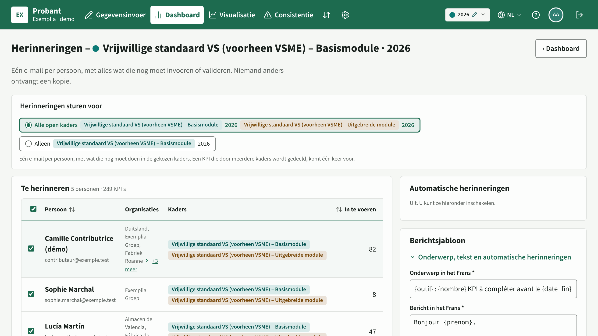

## Het auditdossier ophalen {#audit-file}

Een beheerder of een auditor kan één Excel-bestand downloaden met wat een audit nodig heeft: per KPI en organisatie de waarde, de status, wie die invoerde en valideerde, de bewijsstukken, de consistentiemeldingen met hun motivering en de geschiedenis van de wijzigingen. De tool leest de gegevens alleen. Het bestand maken wijzigt niets.

1. Klik op **Importeren / Exporteren** en daarna op **Nieuwe export**.
2. Kies onder **Indeling** de optie **Auditdossier**. Kies het jaar en, als u er maar een paar nodig hebt, de organisaties.
3. Klik op **Downloaden**.

Het bestand heeft vier tabbladen: **Lees mij**, **Audit** (één rij per KPI en organisatie), **Geschiedenis** (elke wijziging van deze waarden, de oudste eerst) en **Bewijsstukken** (de bestandsnamen, de groottes en wie ze toevoegde). Het tabblad **Lees mij** geeft de datum, de versie van de tool en de filters. Een groot bestand wordt op de server voorbereid, zoals elke grote export.

Validators en bijdragers zien het auditdossier niet: het is voor beheerders en auditors. Een auditor die tot enkele organisaties is beperkt, krijgt alleen die.

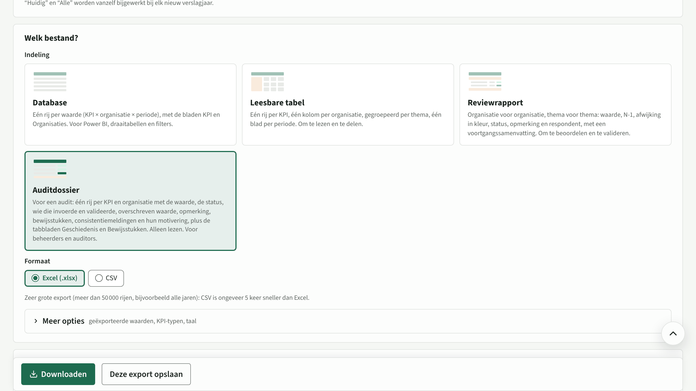

## Het afsluitcertificaat afdrukken {#closing-certificate}

Een beheerder kan een pagina afdrukken die een afgesloten campagne samenvat. De tool leest de gegevens alleen. De pagina openen verandert niets.

1. Klik op **Beheer**, daarna op **Campagnes** en op een afgesloten campagne.
2. Klik op **Afsluitcertificaat**.
3. Klik op **Afdrukken**. Kies in het afdrukvenster Opslaan als pdf om een bestand te bewaren.

De pagina toont de scope, de invulgraad, het aantal waarden, de bewijsstukken en de consistentiemeldingen. Ze toont wie de campagne heeft afgesloten en wanneer, als de geschiedenis dat bewaart. De vingerafdruk is een code die wordt berekend uit alle cijfers van de campagne. Verandert er één cijfer, dan verandert de vingerafdruk. Open het certificaat later opnieuw en vergelijk de twee vingerafdrukken om te controleren.

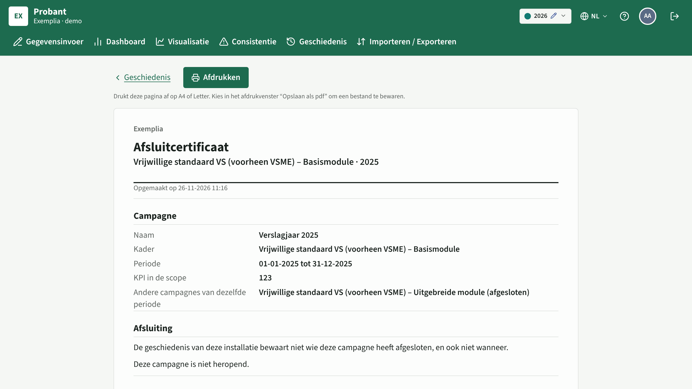

## Een grote export ophalen {#large-exports}

Boven een bepaalde grootte bereidt de tool een export of een in te vullen bestand voor op de server. Open **Importeren / Exporteren** en kies **Mijn exports**. Het bestand staat onder “Grote bestanden”. De tool bewaart het 7 dagen.

Een beheerder stelt het aantal dagen in onder **Beheer › Instellingen › Hosting**, in het blok “Grote exports”.

## De bewijsstukken van gevoelige KPI’s verwijderen {#evidence-delete}

De tool bewaart bewijsbestanden. Ze worden nooit vanzelf verwijderd.

1. Ga naar **Beheer › Instellingen › Hosting**. Voer bij **Bewijsstukken van gevoelige KPI’s** het getal in bij **Maanden voordat verwijdering wordt voorgesteld**.
2. Klik op **Beheer › Geschiedenis** en dan op **Te verwijderen bewijsstukken**.
3. De pagina toont de bestanden waarvan alle campagnes zijn afgesloten en waarvan de periode langer dan dat aantal maanden geleden eindigde.
4. Selecteer de bestanden en klik op **Geselecteerde verwijderen**. Of klik op **Verwijderen** op één regel.

Let op: het verwijderen is definitief. Het bestand gaat niet naar de prullenbak. De geschiedenis bewaart elke verwijdering zonder de inhoud van het bestand. De waarde van het antwoord verandert niet.

Eerder gemaakte back-ups bevatten het bestand nog totdat de tool ze vervangt. Een herstel brengt het bestand terug in **Te verwijderen bewijsstukken**: verwijder het opnieuw. Ook de kopieën van de back-ups die het IT-team buiten de tool bewaart, bevatten het bestand: vraag het IT-team ze te verwijderen. Stel onder **Beheer › Instellingen › Hosting** bij **Automatische back-up** het aantal te bewaren back-ups in, zodat oude back-ups snel verdwijnen.

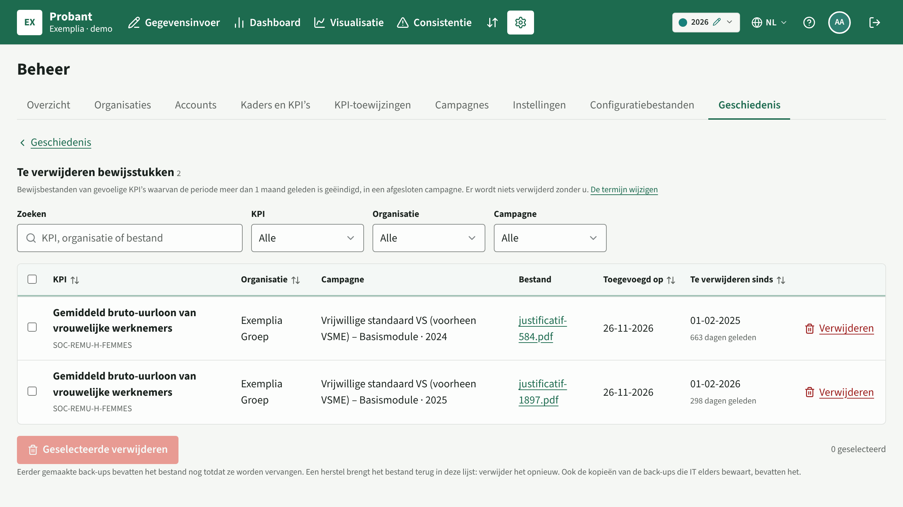

## Een taal toevoegen of vertalen {#languages}

De menu’s en knoppen bestaan in het Frans, Engels, Spaans, Duits, Italiaans, Nederlands en Portugees. Elke persoon kiest de eigen taal onder **Mijn account**. De namen van KPI’s, thema’s en eenheden stelt u in onder **Beheer › Instellingen › Talen**.

1. Klik op **Een taal toevoegen** of open een taal en klik op **Vertalen**.
2. Om in bulk te vertalen, gebruikt u **Exporteren** en **Importeren** of **Alle talen tegelijk vertalen**.

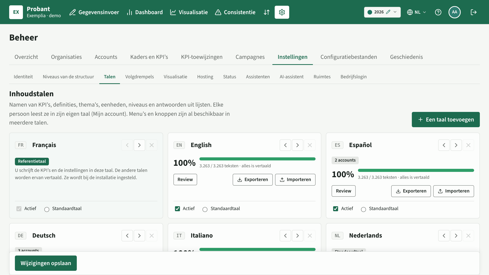

## Een assistent (MCP) koppelen {#assistants}

Een AI-assistent, bijvoorbeeld Claude, kan gegevens lezen en wijzigen met de rechten van de persoon die hem koppelt, nooit meer. Standaard staat hij uit.

1. Ga naar **Beheer › Instellingen › Assistenten**.
2. Vink **AI-assistenten (MCP) toestaan in deze ruimte** aan.
3. Vink **Assistenten kunnen ook wijzigingen aanbrengen** alleen aan als mensen dat nodig hebben. Lezers en auditors wijzigen nooit iets.
   Kies onder **Wat assistenten ontvangen** de opties **Een lezer kan waarden lezen via een assistent** (standaard uit) en **Gevoelige KPI's worden aan assistenten gegeven** (standaard aan; uitgeschakeld zijn de KPI's die als Beperkt of Vertrouwelijk zijn gemarkeerd, en de KPI's die ermee worden berekend, voor alle tools verborgen). Een lezer ontvangt nooit een concept, alleen gevalideerde waarden.
4. Klik op **Opslaan**. Geef het **Serveradres van deze ruimte** aan de personen.

Elke persoon maakt onder **Mijn account** een token aan. Klik onder **Actieve tokens** op **Intrekken** om een assistent direct af te sluiten. De geschiedenis bewaart elke aanroep en toont “(via MCP)” na elke wijziging.

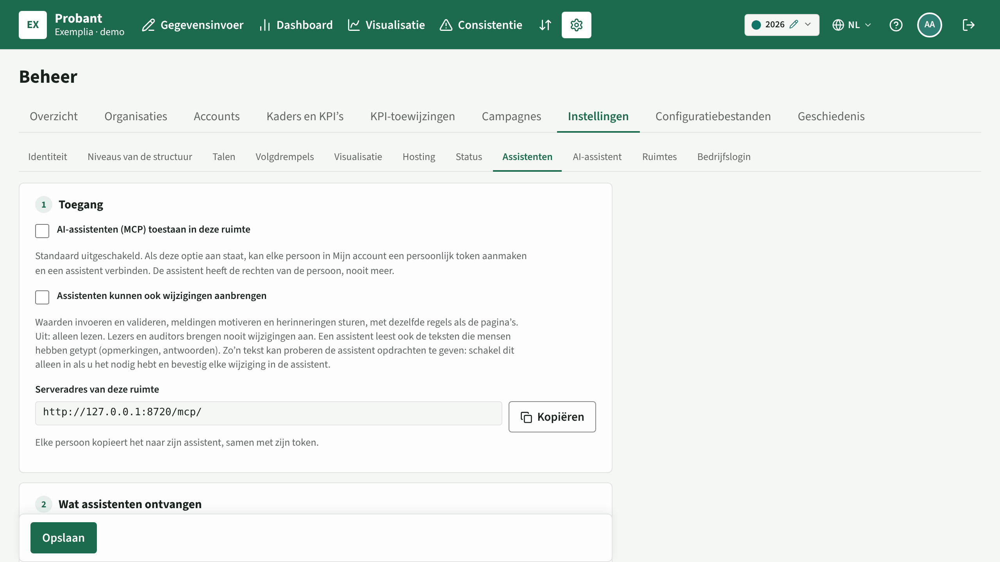

## De AI-assistent inschakelen {#ai}

De AI-assistent legt consistentiemeldingen uit, stelt KPI-koppelingen voor in de migratie-assistent en stelt vertalingen voor. Standaard staat hij uit. Er verlaat niets de tool zolang u hem niet inschakelt.

1. Ga naar **Beheer › Instellingen › AI-assistent**.
2. Vink **De AI-assistent inschakelen** aan.
3. Kies de **Aanbieder** en het **Model**.
4. Voer de **API-sleutel van uw aanbiedersaccount** in. De tool bewaart de sleutel alleen voor deze ruimte en toont hem nooit meer. Klik op **De sleutel verwijderen** om hem te wissen.
5. Vink onder **Toepassingen** de gewenste toepassingen aan. **Gevoelige KPI's mogen naar de AI-assistent worden verstuurd** staat standaard uit: niets van een KPI die als Beperkt of Vertrouwelijk is gemarkeerd, of van een KPI die ermee wordt berekend, wordt verstuurd, en de waarschuwingen ervan hebben geen **Uitleggen met AI**. Klik op **Opslaan**.

Elk antwoord is een voorstel met de markering “Voorgesteld door AI”. Er wordt niets opgeslagen totdat een persoon klikt en opslaat zoals gebruikelijk. De geschiedenis bewaart elke aanroep zonder de inhoud.

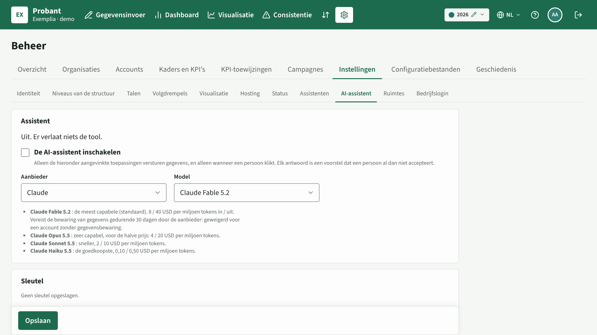

## De hosting en de back-ups controleren {#hosting}

Ga naar **Beheer › Instellingen › Hosting**. De pagina toont de versie, de automatische back-up, de controle van de gegevens en de e-mailinstellingen. Klik op **Een back-up maken en downloaden** om meteen een back-up te maken. Het IT-team kopieert de back-ups naar een andere plek. Of een ruimtebeheerder stelt de **Kopie buiten de server** in: de tool kopieert dan zelf elke back-up naar S3-compatibele opslag of een SFTP-server die het IT-team levert, en waarschuwt u als een kopie mislukt.

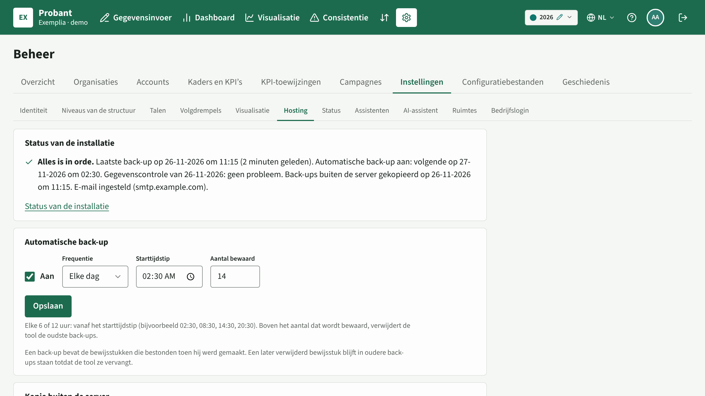

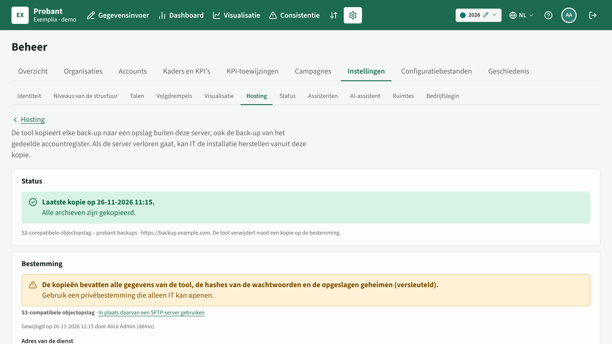

Om de e-mailserver in te stellen, gebruikt u het blok **E-mail** van dezelfde pagina. Voer de server, de poort, de beveiliging, de gebruikersnaam, het wachtwoord en het verzendadres in die het IT-team u geeft. Klik op **Opslaan** en daarna op **Een test-e-mail sturen**. Als de e-mail niet vertrekt, geeft een bericht de oorzaak in eenvoudige woorden. Deze instellingen gelden voor alle ruimtes: alleen een ruimtebeheerder kan ze wijzigen. Het wachtwoord wordt nooit meer getoond. Als het IT-team de e-mails in het instellingenbestand heeft ingesteld, toont het blok deze instellingen alleen-lezen.

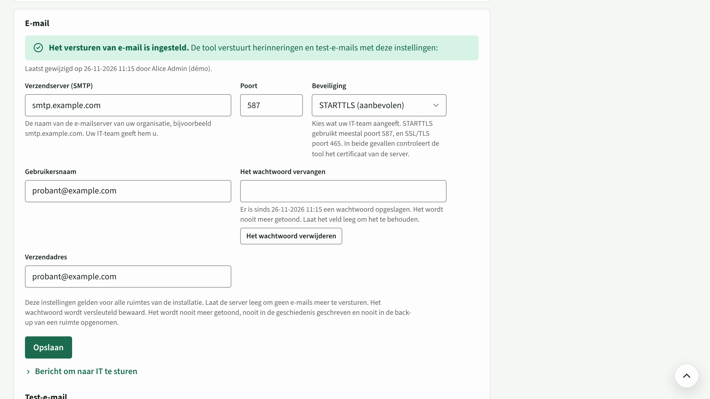

Om in één oogopslag te zien of alles in orde is, gaat u naar **Beheer › Instellingen › Status**. Elke regel (versie, database, bestanden, laatste back-up, schijfruimte, e-mail, achtergrondtaken, update van de database, HTTPS) toont **Goed**, **Te controleren** of **Storing**, en wat te doen. De beheerder van een andere ruimte dan de hoofdruimte ziet dezelfde regels, maar de regels database en update van de database controleren alleen de eigen ruimte en het gemeenschappelijke accountregister, niet de andere ruimtes. Het detail voor IT (namen van de andere ruimtes, mappen op de schijf) ziet hij niet: de ruimtebeheerder ziet het. In **Instellingen › Hosting** toont het blok **Voor IT** hem niet de gegevensmap, de toegestane adressen, de databaseserver, de gebruikersnaam voor e-mail of de map van de back-ups.

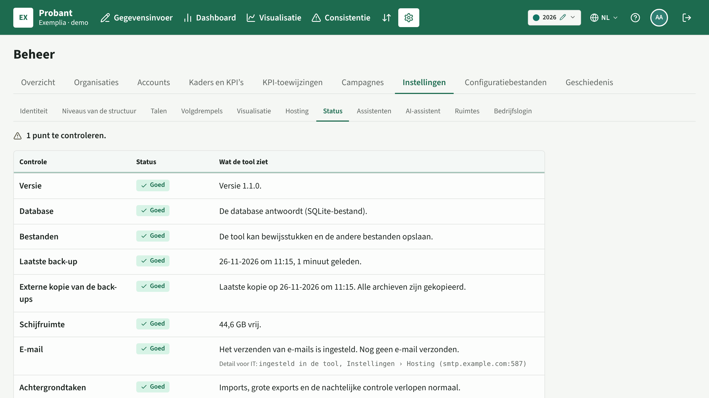

De tool kan u ook per e-mail waarschuwen. Onderaan **Instellingen › Status** zet een ruimtebeheerder de **Waarschuwingen per e-mail** aan en kiest de ontvangers: standaard de beheerders van de hoofdruimte en de ruimtebeheerders, plus andere adressen, bijvoorbeeld de mailbox van het IT-team. Als er een probleem verschijnt (mislukte of te late back-up, schijf bijna vol, gestopte achtergrondtaak, mislukte e-mails…), krijgen de ontvangers een e-mail met wat ze moeten doen. Daarna krijgen ze hoogstens één keer per dag een herinnering zolang het probleem duurt, en een e-mail als het is opgelost. Op een nieuwe installatie staan de waarschuwingen meteen aan; een installatie die al vóór de waarschuwingen bestond, houdt ze uit tot iemand ze aanzet. De pagina zegt welk geval geldt. Klik op **Testwaarschuwing sturen** om ze te controleren. Als de server uit staat, kan de tool niemand waarschuwen.

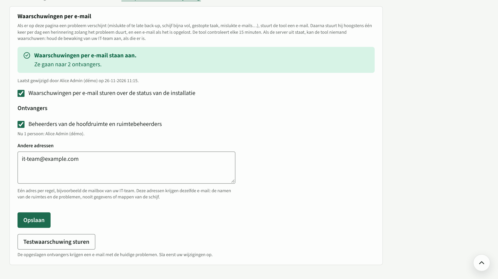

Het blok **Automatische updates** van **Instellingen › Hosting** toont de laatste controle van de server en het resultaat. Een ruimtebeheerder kiest wat er gebeurt als er een nieuwe versie verschijnt: **Automatisch installeren** ('s nachts, na een back-up; als de nieuwe versie niet werkt, gaat de server terug naar de vorige versie), **Alleen melden** (het IT-team installeert hem) of **Uit**, en hoeveel dagen er na de publicatie wordt gewacht (standaard 3). Een taak van de server doet het werk, nooit de tool zelf. Als het scherm zegt dat de taak niet is geïnstalleerd, vraag het IT-team dan om haar in te stellen.

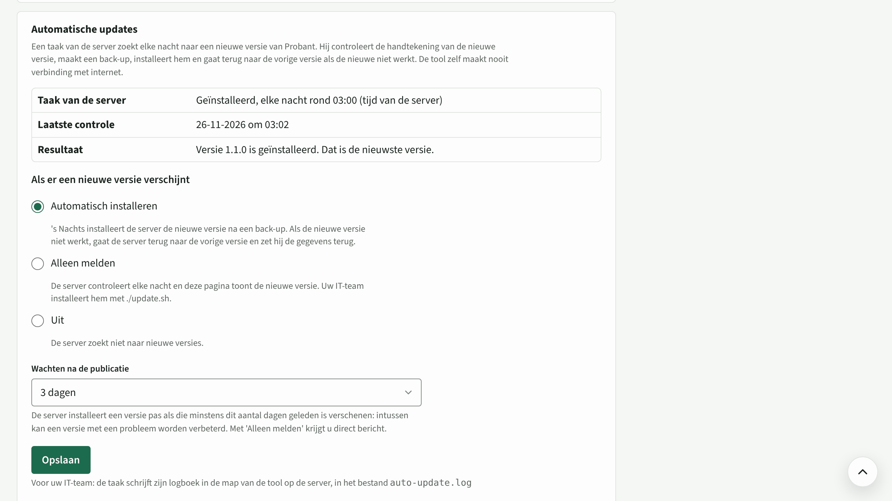

## De totalen van elk niveau bekijken {#consolidation}

**Consolidatie** toont de waarde van elke KPI op elk niveau van de boom, van de vestigingen tot de groep. Kies de KPI's die u wilt tonen, open een rij om de organisaties eronder te zien en exporteer de tabel naar Excel. Een vermelding geeft aan wanneer een totaal onvolledig is.

## De meldingen en consistentieregels behandelen {#consistency}

**Consistentie** toont de meldingen van de campagne: ongewone waarden, grote afwijkingen met N-1 en regels waaraan niet is voldaan. Klik op een melding om de bevinding en de toelichting van de bijdrager te lezen en accepteer, wijs af of negeer haar. Onder **Consistentieregels** stelt u de regels in. Een regel met de ernst **Blokkerend** voorkomt dat de bijdrager valideert zolang er niet aan is voldaan.

## Waarden uit een bestand importeren {#import-values}

Klik op **Importeren / Exporteren** en daarna op **Waarden importeren**. Kies het bestand, lees het voorbeeld en bevestig. De tool slaat niets op vóór uw bevestiging en past dezelfde regels toe als het invoerpaneel.

Getallen in Excel-cellen worden gelezen zoals ze zijn. Een getal dat als tekst is geschreven, wordt gelezen in de taal van het bestand. In een CSV-bestand geeft het kolomscheidingsteken die aan: “;” hoort bij de decimale komma, “,” bij de decimale punt. Anders geeft de kop van de kolom met waarden die aan: in het Engels is “1,234” 1234, in het Nederlands 1,234. Het voorbeeld toont hoe de getallen zijn gelezen en markeert een waarde zoals “1,234”. De assistent **Een vorig systeem migreren** leest ze in de taal van uw scherm.

Bevat het bestand cijfers voor berekende KPI's van een niet-afgesloten periode, dan telt het voorbeeld ze en vraagt het u te kiezen of u deze waarden overschrijft of deze rijen negeert. Overschreven cijfers vervangen het berekende resultaat, en totalen en formules die ze gebruiken, worden opnieuw berekend. **Te behandelen** toont ook cijfers die vóór deze regel ongewijzigd in berekende cellen zijn geïmporteerd: open **Overschreven waarden** en kies voor elk **Overschrijven** of **Verwijderen**.

## Naar een officieel formaat exporteren {#official-formats}

**Officiële formaten** exporteert de waarden naar de officiële werkmap van een norm, bijvoorbeeld de werkmap van de EFRAG voor de norm VS. De tool schrijft alleen de invoercellen. Open het geëxporteerde bestand in Excel en sla het op voordat u het converteert.

## Een KPI-lijst opslaan {#kpi-lists}

**KPI-lijsten** groepeert de KPI's die u vaak volgt onder één naam. Kies een lijst met één klik in een export of in een in te vullen bestand.

## De grafieken lezen en weergaven maken {#visualisation}

**Visualisatie** toont de grafieken van de weergaven. Open een weergave, wijzig bovenaan de filters en gebruik dan het menu ‘…’ van een grafiek om de gegevens te tonen of te exporteren. U kunt ook een weergave maken, bewerken en delen.

## De instellingen van de tool wijzigen {#settings}

**Instellingen** bundelt wat u in de tool kunt instellen: de identiteit, de niveaus van de organisatieboom, de drempels, de kleuren van de grafieken, de talen, de AI-assistent, de assistenten en de hosting. Niemand hoeft code te wijzigen.

## De ruimtes beheren {#spaces}

**Ruimtes** toont de ruimtes van deze installatie. Elke ruimte heeft eigen gegevens: referentiekaders, organisaties, campagnes, waarden, bewijsstukken en identiteit. De accounts worden gedeeld: een persoon meldt zich één keer aan.

## Inloggen met het bedrijfsaccount {#company-sign-in}

Een ruimtebeheerder kan iedereen laten inloggen met zijn bedrijfsaccount (OpenID Connect, bijvoorbeeld Microsoft Entra ID, Google, Okta of Keycloak). Het bedrijfsaccount bewijst alleen wie de persoon is: accounts, rollen en toewijzingen maakt u nog steeds in de tool aan. Iemand heeft een actief account met hetzelfde e-mailadres nodig.

1. Ga naar **Beheer › Instellingen › Bedrijfslogin**.
2. Kopieer de **Omleidings-URI** naar de applicatie bij uw provider. Voer het **Adres van de provider (issuer)**, de **Client-ID** en het **Clientgeheim** in.
3. Klik op **De provider controleren**. Selecteer **Inloggen met het bedrijfsaccount toestaan** en klik op **Opslaan**.

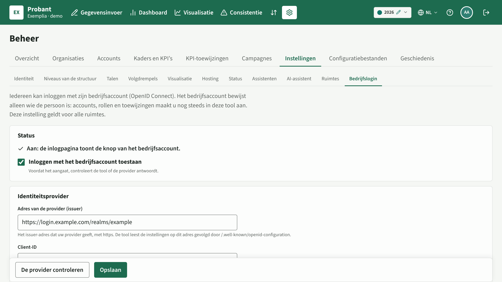

Staat het aan, dan houden alleen de ruimtebeheerders hun wachtwoord, als noodaccounts. **Uitloggen** sluit de sessie alleen in de tool, niet bij de provider. De **Inloggeschiedenis** toont de methode van elke login.

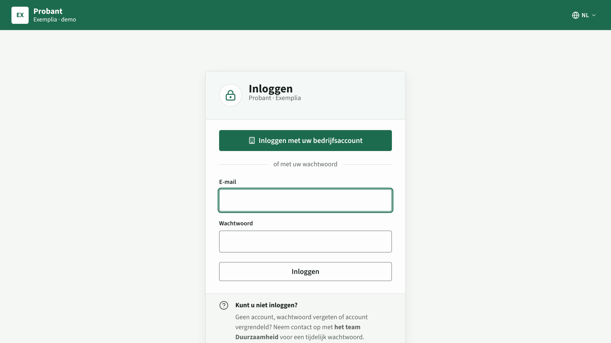

## Elke wijziging volgen {#history}

Klik in de bovenbalk op **Beheer** en dan op **Geschiedenis**. Kies bij **Logboek** **Gegevensinvoer** om de waarden, de validaties en de bewijsstukken te zien, of **Beheerwijzigingen** om de campagnes, het kader, de organisaties en de accounts te zien. De tool verwijdert nooit iets uit de geschiedenis.

## De rondleiding opnieuw bekijken {#tour}

Bij uw eerste aanmelding toont een korte rondleiding waar u kunt handelen. Ze blokkeert het scherm niet. Uw browser onthoudt dat u haar hebt gezien.

1. Klik in de bovenbalk op **Help**.
2. Klik op **Rondleiding opnieuw tonen**.
3. Klik op **Volgende** om verder te gaan en aan het einde op **Klaar**. Om te stoppen klikt u op **Rondleiding sluiten**, drukt u op Esc of klikt u op **Niet meer tonen**.

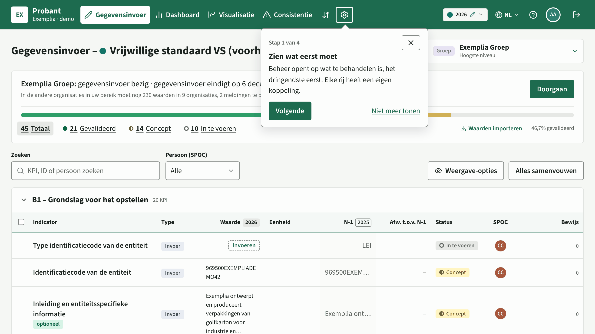

## Mijn taal of mijn wachtwoord wijzigen {#account}

Klik op uw naam en dan op **Mijn account**. Kies de **Taal** en wijzig uw wachtwoord onder **Mijn wachtwoord wijzigen**.

**Mijn laatste inlogpogingen**, in **Mijn account**, toont uw laatste inlogpogingen in deze ruimte. Herkent u er een niet, wijzig dan uw wachtwoord en waarschuw een beheerder.
