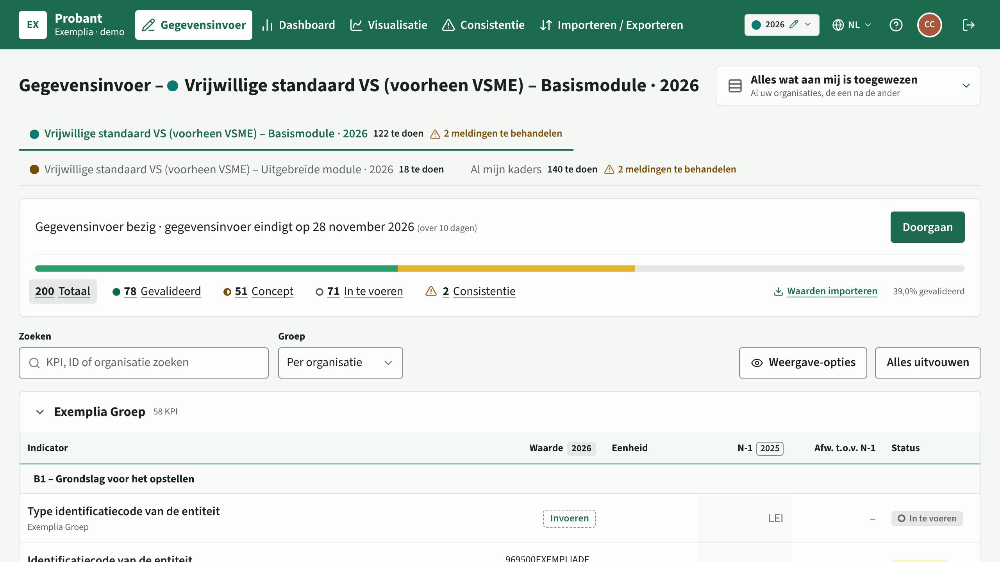
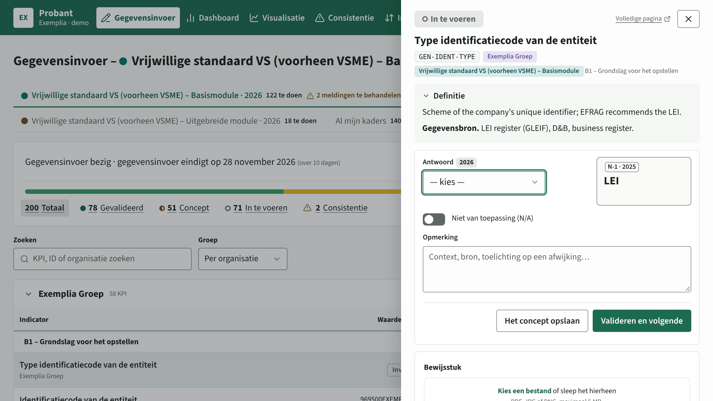
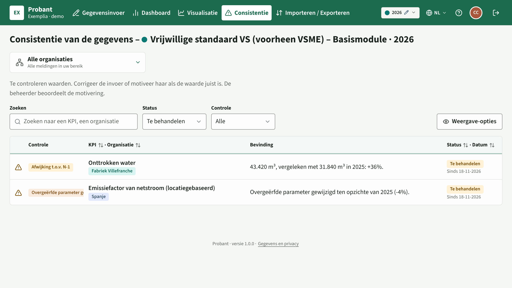
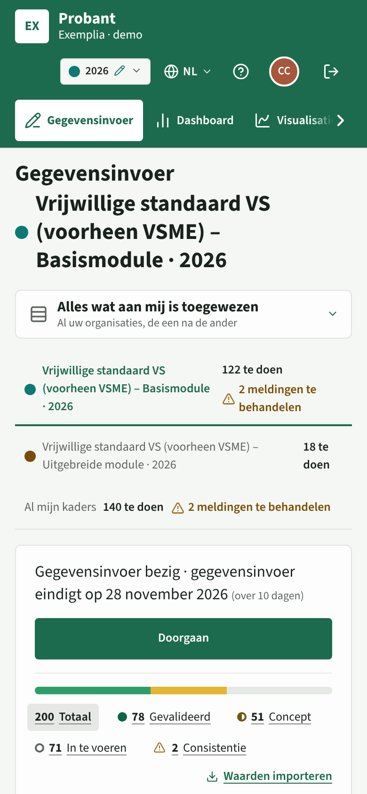

# Handleiding voor bijdragers

U voert de waarden in van de KPI’s die een beheerder aan u heeft toegewezen, en u valideert ze. Deze handleiding toont elke taak in enkele stappen. Engelse versie: [`docs/guides/contributor.md`](../../guides/contributor.md).

## Vinden wat u moet invoeren {#find}

1. Klik in de bovenbalk op **Gegevensinvoer**. De pagina opent bij **Alles wat aan mij is toegewezen**.
2. Kies het kader en de periode bij **Ik beantwoord…** (bovenbalk) of gebruik de tabbladen onder de titel.
3. Klik boven de tabel op **In te voeren** of **Concept** om alleen de rijen te houden waarvoor u iets moet doen.
4. Gebruik **Zoeken** om een KPI, een ID of een organisatie te vinden.

Klik op **Starten** (of **Doorgaan**) om de eerste waarde te openen die nog moet gebeuren. De samenvatting toont hoeveel waarden er nog zijn en wanneer de gegevensinvoer eindigt.

## Een waarde invoeren {#enter}

1. Klik op de rij van de KPI of druk erop op Enter. Het invoerpaneel wordt geopend.
2. Voer het getal, het antwoord of de tekst in bij **Waarde** (of bij **Antwoord**, voor een lijst of een tekst).
3. Klik op **Het concept opslaan** om het te bewaren en later terug te komen.

Het paneel toont de waarde van de vergelijkingsperiode (N-1) en de afwijking. Gaat de afwijking over de drempel van de campagne, dan is de **Opmerking** verplicht.

Kies **Volledige pagina** als u liever op de hele pagina werkt.

Als het paneel zegt dat een organisatie “opent op” een datum na de periode, kan voor deze periode nog niets worden ingevoerd. Vraag een beheerder de openingsdatum te wijzigen. Voor de rest verandert er niets voor u.

## Een waarde markeren als niet van toepassing {#na}

1. Open het invoerpaneel van de KPI.
2. Vink **Niet van toepassing (N/A)** aan.
3. Schrijf de reden in **Opmerking**. De opmerking is verplicht bij N/A.

## Een bewijsstuk toevoegen {#evidence}

1. Open het invoerpaneel van de KPI.
2. Klik onder **Bewijsstuk** op **Kies een bestand** of sleep het bestand naar het vak.
3. Gebruik een PDF-, JPG- of PNG-bestand. Het paneel toont de maximale grootte (standaard 5 MB).

Vereist de KPI een bewijsstuk, dan kunt u niet valideren zonder minstens één bestand. Dit geldt niet voor N/A.

## Mijn invoer valideren {#validate}

Valideren bevestigt dat uw invoer volledig is. Het betekent niet dat het cijfer is geauditeerd.

1. Open het invoerpaneel van de KPI.
2. Klik op **Valideren en volgende**. Het paneel opent de volgende waarde.
3. Aan het einde toont de samenvatting “Alles klaar”.

Ontbreekt er iets, dan zegt de tool wat u moet toevoegen: een waarde of N/A, een opmerking of een bewijsstuk.

## Een gevalideerde waarde wijzigen {#reopen}

U kunt een waarde bewerken die u hebt gevalideerd. De tool zet hem terug naar concept en u valideert hem opnieuw.

1. Open het invoerpaneel van de KPI.
2. Wijzig de waarde en klik op **De wijziging opslaan**. Of klik op **Terug naar concept** om nog niets te wijzigen.
3. Klik op **Valideren** als de waarde klopt.

**De waarde wissen** maakt de waarde leeg en zet de cel terug op **In te voeren**. De opmerking en de bewijsstukken blijven. De geschiedenis bewaart elke wijziging.

Is de campagne afgesloten, dan kan alleen een beheerder haar heropenen.

## Een KPI die door een afgesloten campagne is geblokkeerd {#shared-closed}

Sommige KPI’s horen bij twee kaders met dezelfde periode. De waarde wordt gedeeld. Is een van de twee campagnes afgesloten, dan kunt u de waarde in de andere niet wijzigen.

Het paneel toont dan een bericht dat het kader en de campagne noemt. Vraag een beheerder de afgesloten campagne te heropenen.

## Een melding “Te controleren” behandelen {#check}

De tool controleert uw waarden en markeert ongewone waarden met **Te controleren**. Een melding blokkeert de validatie niet, maar een regel met de ernst **Blokkerend** wel: u kunt pas valideren als de regel is gehaald.

1. Open het invoerpaneel. Het blok **Te controleren** geeft de reden.
2. Als de waarde fout is, corrigeert u hem en slaat u op.
3. Als de waarde klopt, klikt u op **Ik licht het toe in de opmerking**, schrijft u de toelichting en slaat u op.

De pagina **Consistentie** toont al uw meldingen. Klik op een melding om de fiche te openen. In het invoerpaneel geeft **Meldingsfiche** dezelfde details. Een beheerder beoordeelt uw toelichting.

Heeft uw beheerder de AI-assistent ingeschakeld, klik dan bij een melding op **Uitleggen met AI**. Het antwoord is alleen een voorstel. Klik op **Gebruiken als mijn toelichting** om het in de opmerking te kopiëren en sla op.

## Waarden uit een bestand importeren {#import}

1. Klik in de bovenbalk op **Importeren / Exporteren**. Het opent bij **Waarden importeren**.
2. Volg de stappen van de pagina. De tool toont een voorbeeld voordat hij iets opslaat.

Dezelfde regels gelden als in het invoerpaneel.

Getallen in Excel-cellen worden gelezen zoals ze zijn. Een getal dat als tekst is geschreven, wordt gelezen in de taal van het bestand. In een CSV-bestand geeft het kolomscheidingsteken die aan: “;” hoort bij de decimale komma, “,” bij de decimale punt. Anders geeft de kop van de kolom met waarden die aan: in het Engels is “1,234” 1234, in het Nederlands 1,234. Het voorbeeld toont hoe de getallen zijn gelezen en markeert een waarde zoals “1,234”.

## De grafieken lezen {#visualisation}

**Visualisatie** toont de voortgang en de cijfers van uw bereik in weergaven. Open een weergave, wijzig bovenaan de filters en gebruik dan het menu ‘…’ van een grafiek om de gegevens te tonen of te exporteren. Concepten kunnen in de cijfers meetellen zolang een campagne open is.

## De tool op een telefoon gebruiken {#phone}

De pagina’s werken op een telefoon. Het invoerpaneel beslaat het hele scherm. Gebruik de sluitknop om terug te keren naar de lijst.

## De rondleiding opnieuw bekijken {#tour}

Bij uw eerste aanmelding toont een korte rondleiding waar u kunt handelen. Ze blokkeert het scherm niet. Uw browser onthoudt dat u haar hebt gezien.

1. Klik in de bovenbalk op **Help**.
2. Klik op **Rondleiding opnieuw tonen**.
3. Klik op **Volgende** om verder te gaan en aan het einde op **Klaar**. Om te stoppen klikt u op **Rondleiding sluiten**, drukt u op Esc of klikt u op **Niet meer tonen**.

## De taal wijzigen {#language}

De tool is beschikbaar in het Frans, Engels, Spaans, Duits, Italiaans, Nederlands en Portugees.

1. Klik in de bovenbalk op de taal, of klik op uw naam en dan op **Mijn account**.
2. Kies onder **Taal** de taal en sla op.

De namen van KPI’s en thema’s verschijnen in uw taal als ze een vertaling hebben.

## Een AI-assistent koppelen {#assistant}

Heeft uw beheerder assistenten ingeschakeld, dan kunt u er een koppelen (bijvoorbeeld Claude). Hij leest en handelt met uw rechten, nooit meer.

1. Klik op uw naam en dan op **Mijn account**.
2. Voer onder **AI-assistenten (MCP)** een naam in bij **Naam van het token** en kies **Verloopt na**.
3. Klik op **Token aanmaken**.
4. Kopieer het token nu. U ziet het niet opnieuw.
5. Plak de kant-en-klare configuratie in uw assistent.

Om een assistent te stoppen, klikt u op zijn regel op **Intrekken**. De geschiedenis toont “(via MCP)” na elke wijziging die een assistent heeft gemaakt.

## Mijn wachtwoord wijzigen {#account}

1. Klik op uw naam en dan op **Mijn account**.
2. Voer onder **Mijn wachtwoord wijzigen** het huidige en het nieuwe wachtwoord in.
3. Klik op **Mijn wachtwoord opslaan**.

Als u uw wachtwoord bent vergeten, vraagt u een beheerder het opnieuw in te stellen.

**Mijn laatste inlogpogingen**, in **Mijn account**, toont uw laatste inlogpogingen in deze ruimte. Herkent u er een niet, wijzig dan uw wachtwoord en waarschuw een beheerder.
