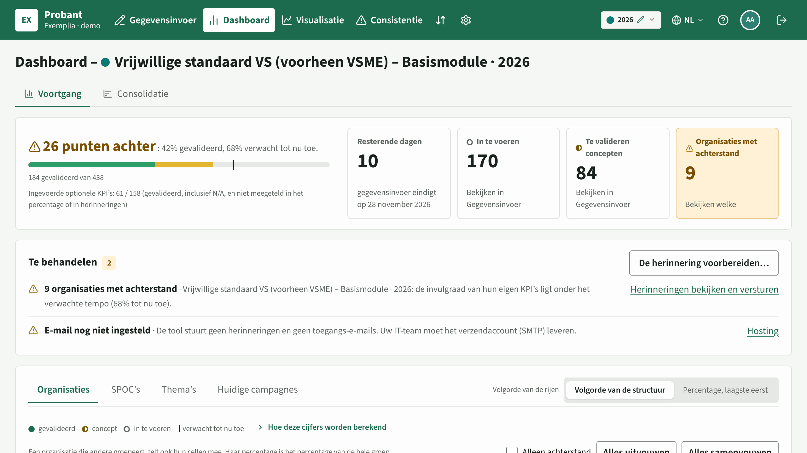
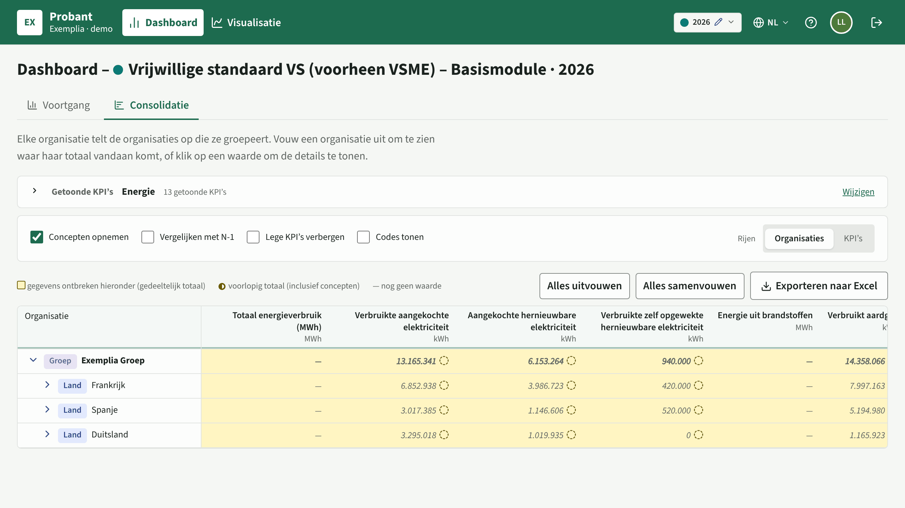
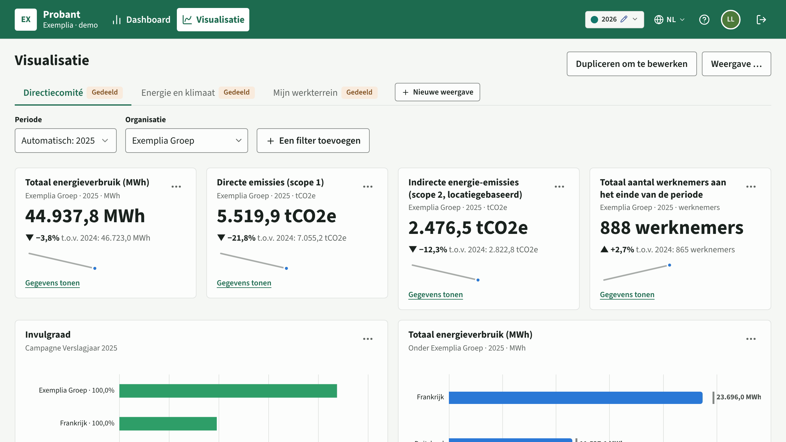
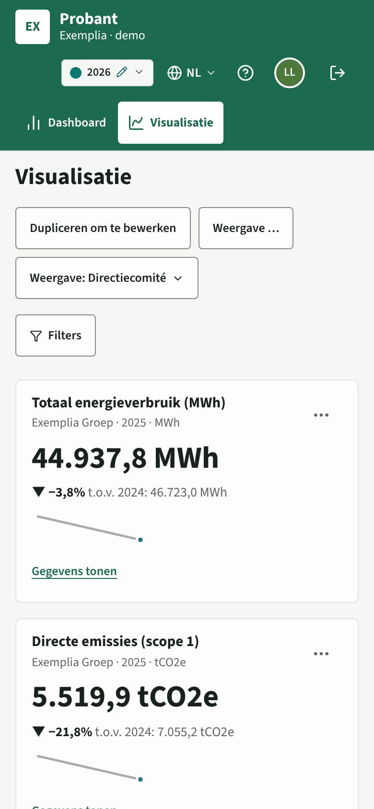

# Handleiding voor lezers

U leest de voortgang en de cijfers. U wijzigt nooit iets: de rol lezer is alleen-lezen. Engelse versie: [`docs/guides/reader.md`](../../guides/reader.md).

## De voortgang volgen {#dashboard}

1. Klik in de bovenbalk op **Dashboard**.
2. Lees het oordeel bovenaan. Het zegt of de campagne op schema ligt ten opzichte van het verwachte tempo.
3. Lees de tabel per organisatie. Een organisatie die andere organisaties groepeert, toont de invulgraad van de hele groep.

## De totalen van elk niveau zien {#consolidation}

1. Klik in het **Dashboard** op **Consolidatie**.
2. Kies de KPI’s die u wilt tonen. Open een rij om de organisaties eronder te zien.

De pagina toont de waarden van elk niveau van de structuur, van het laagste tot het hoogste. U ziet de organisaties van uw bereik.

## De grafieken lezen {#visualisation}

1. Klik in de bovenbalk op **Visualisatie**. De pagina opent bij een weergave.
2. Klik op een tabblad om een andere weergave te openen.
3. Gebruik de filters bovenaan: de periode, de vergelijking, de organisatie en het kader.
4. Klik op **Weergavefilters opnieuw instellen** om opnieuw te beginnen.
5. Open het menu “…” van een grafiek om de gegevens te tonen, de grafiek schermvullend te openen of als afbeelding of Excel-bestand te exporteren.

Concepten kunnen meetellen in de cijfers zolang een campagne open is. De pagina zegt het als ze meetellen.

## De tool op een telefoon gebruiken {#phone}

De pagina’s werken op een telefoon, in één kolom. Filters openen in een venster.

## De rondleiding opnieuw bekijken {#tour}

Bij uw eerste aanmelding toont een korte rondleiding waar u kunt handelen. Ze blokkeert het scherm niet. Uw browser onthoudt dat u haar hebt gezien.

1. Klik in de bovenbalk op **Help**.
2. Klik op **Rondleiding opnieuw tonen**.
3. Klik op **Volgende** om verder te gaan en aan het einde op **Klaar**. Om te stoppen klikt u op **Rondleiding sluiten**, drukt u op Esc of klikt u op **Niet meer tonen**.

## De taal wijzigen {#language}

De tool is beschikbaar in het Frans, Engels, Spaans, Duits, Italiaans, Nederlands en Portugees.

1. Klik in de bovenbalk op de taal, of klik op uw naam en dan op **Mijn account**.
2. Kies onder **Taal** de taal en sla op.

## Mijn wachtwoord wijzigen {#account}

1. Klik op uw naam en dan op **Mijn account**.
2. Voer onder **Mijn wachtwoord wijzigen** het huidige en het nieuwe wachtwoord in.
3. Klik op **Mijn wachtwoord opslaan**.

Als u uw wachtwoord bent vergeten, vraagt u een beheerder het opnieuw in te stellen.

**Mijn laatste inlogpogingen**, in **Mijn account**, toont uw laatste inlogpogingen in deze ruimte. Herkent u er een niet, wijzig dan uw wachtwoord en waarschuw een beheerder.

## Een assistent raadplegen {#assistant}

Heeft een beheerder assistenten ingeschakeld, dan kunt u onder **Mijn account** bij **AI-assistenten (MCP)** een AI-assistent koppelen. Voor uw rol kan hij alleen lezen. Hij voert nooit iets in en wijzigt nooit iets. Hij leest de campagnes, KPI's, organisaties en de invulgraad; de waarden van uw bereik leest hij alleen als uw beheerder dat toestaat (**Instellingen › Assistenten**). Ook dan leest hij alleen de gevalideerde waarden, zoals de Visualisatie ze u toont. Heeft uw beheerder **Gevoelige KPI's worden aan assistenten gegeven** uitgeschakeld, dan leest hij nooit een KPI die als Beperkt of Vertrouwelijk is gemarkeerd, noch een KPI die daaruit is berekend.
