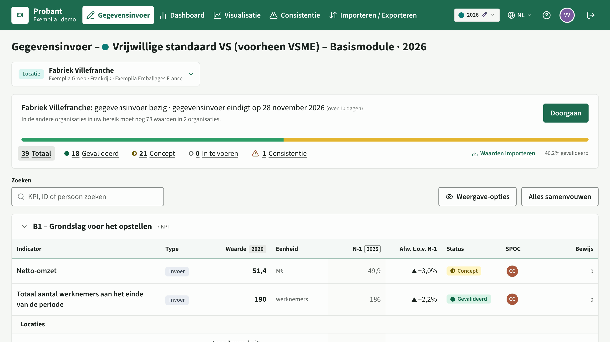
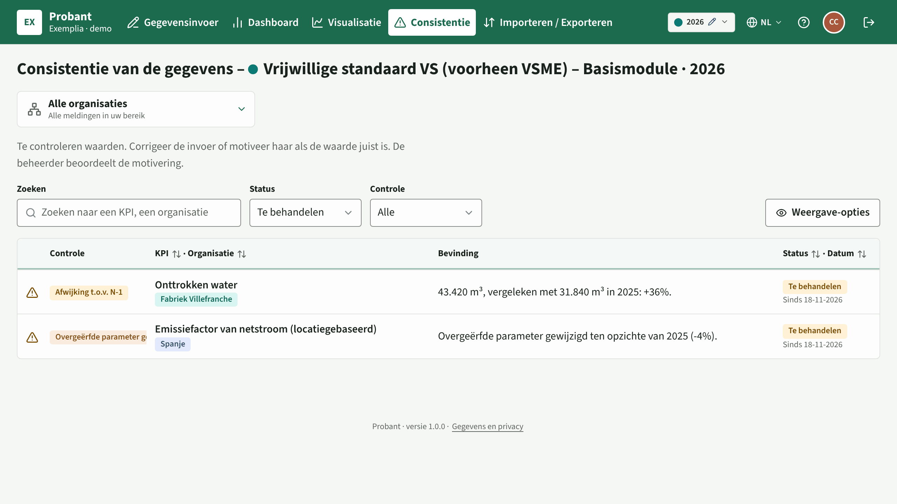
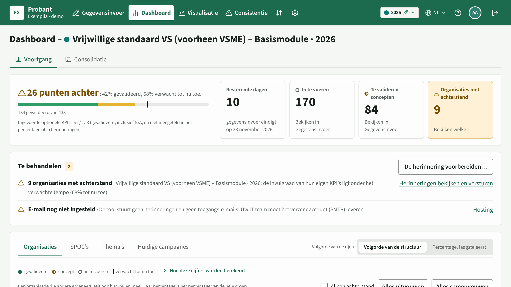
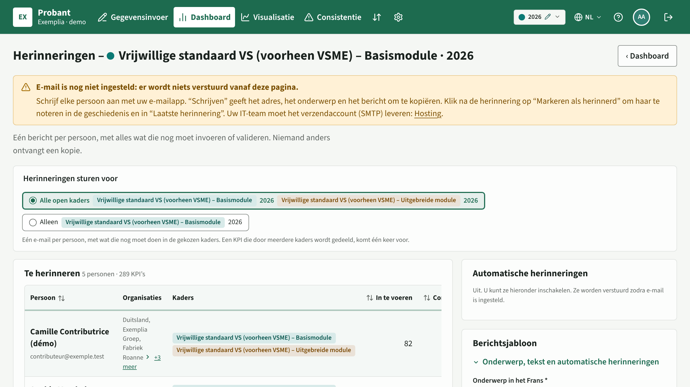

# Handleiding voor validators

U volgt en valideert de invoer van de KPI’s en organisaties die een beheerder aan u heeft toegewezen (KPI-toewijzingen, keuze Validators), en van de organisaties daaronder. Zonder toewijzing valideert een beheerder in uw plaats. In dit bereik kunt u ook herinneringen sturen. Engelse versie: [`docs/guides/validator.md`](../../guides/validator.md).

## Mijn bereik zien en wat er nog te doen is {#scope}

1. Klik in de bovenbalk op **Gegevensinvoer**. De pagina opent bij **Alles wat aan mij is toegewezen**.
2. Klik rechtsboven op de pagina op de naam van de organisatie (**Alles wat aan mij is toegewezen**) en kies in de lijst een organisatie uit uw bereik.
3. Klik boven de tabel op **In te voeren**, **Concept** of **Gevalideerd** om de rijen te filteren.
4. Kies een organisatie, open **Weergave-opties** en vink **Berekende en geconsolideerde KPI’s tonen** aan om de totalen te zien. Ze zijn alleen-lezen.

## Invoer controleren en valideren {#review}

1. Open de rij van een waarde in concept. Het invoerpaneel wordt geopend.
2. Lees de waarde, de opmerking, de afwijking ten opzichte van N-1 en de bewijsstukken.
3. Als de invoer volledig is, klikt u op **Valideren**.
4. Als dat niet zo is, vraagt u de bijdrager de invoer aan te vullen.

Valideren bevestigt dat de invoer volledig is. Het controleert het cijfer niet inhoudelijk. De validatie vraagt een waarde of N/A, een opmerking (bij N/A of bij een grote afwijking) en een bewijsstuk als de KPI dat vereist.

Als het paneel zegt dat een organisatie “opent op” een datum na de periode, kan voor deze periode nog niets worden ingevoerd of gevalideerd. Vraag een beheerder de openingsdatum te wijzigen. Voor de rest verandert er niets voor u.

## Een invoer terugzetten naar concept {#reopen}

1. Open het invoerpaneel van de gevalideerde waarde.
2. Klik op **Terug naar concept**. De waarde blijft gelijk.
3. Daarna kan de bijdrager de waarde wijzigen en opnieuw valideren.

**De waarde wissen** maakt in plaats daarvan de cel leeg. De geschiedenis bewaart beide acties. Na de einddatum van de gegevensinvoer kunnen bijdragers een waarde niet meer wijzigen, maar u kunt hem nog wel terugzetten naar concept.

## Consistentiemeldingen behandelen {#alerts}

1. Klik in de bovenbalk op **Consistentie**. De pagina toont de meldingen van uw bereik.
2. Klik op een melding om de fiche te openen.
3. Lees de bevinding en de toelichting van de bijdrager.

Een melding blokkeert een validatie niet, maar een regel met de ernst **Blokkerend** wel: de bijdrager kan pas valideren als de regel is gehaald. De beheerder beslist over de toelichting.

## Een overschreven waarde goedkeuren of afwijzen {#forced}

Een persoon kan vragen een berekend resultaat met een motivering door een andere waarde te vervangen.

1. Klik op de pagina **Gegevensinvoer** op **Overschreven waarden bekijken** of open de berekende KPI.
2. Lees de motivering.
3. Klik op **De waarde goedkeuren en overschrijven** om het verzoek te accepteren.
4. Om het af te wijzen, voert u de reden in en klikt u op **Afwijzen**.

## De voortgang volgen {#dashboard}

1. Klik in de bovenbalk op **Dashboard**.
2. Lees het oordeel bovenaan en daarna de tabel per organisatie. Die toont de organisaties die achterlopen.
3. Klik op **Consolidatie** om de totalen van uw bereik te zien.

## Herinneringen sturen {#reminders}

1. Klik in het **Dashboard** op **Herinneren…** (of op **De herinnering voorbereiden…** als de installatie geen e-mails verstuurt). De pagina **Herinneringen** wordt geopend.
2. Kies de kaders. De tool selecteert de personen die nog iets moeten invoeren of valideren.
3. Lees het voorbeeld van het bericht. Stuur desgewenst een test naar uzelf.
4. Klik op **De herinnering sturen**. De bevestiging noemt de personen.

Als de installatie geen e-mail kan versturen, toont de pagina een oranje kader. Klik op **Schrijven** om het adres, het onderwerp en het bericht te krijgen. Verstuur ze met uw e-mailprogramma. Klik daarna op **Markeren als herinnerd**.

## Een KPI die door een afgesloten campagne is geblokkeerd {#shared-closed}

Een KPI die bij twee kaders met dezelfde periode hoort, heeft één gedeelde waarde. Is één campagne afgesloten, dan kan de waarde in de andere niet wijzigen. Het paneel zegt welke campagne is afgesloten. Vraag een beheerder haar te heropenen.

## Waarden uit een bestand importeren {#import}

Klik op **Importeren / Exporteren**. Het menu opent voor een bijdrager bij **Waarden importeren**. Voor een validator opent het bij **Mijn exports**, en **Waarden importeren** is één klik verder. De tool toont een voorbeeld voordat hij iets opslaat.

Cijfers voor berekende KPI's van een niet-afgesloten periode: het voorbeeld vraagt u te kiezen of u deze waarden overschrijft of deze rijen negeert. U kunt alleen de organisaties overschrijven die u valideert, zolang de invoer open is. Voor de andere wordt de rij geweigerd.

## Een grote export ophalen {#large-exports}

Boven een bepaalde grootte bereidt de tool een export of een in te vullen bestand voor op de server. Open **Importeren / Exporteren** en kies **Mijn exports**. Het bestand staat onder “Grote bestanden”. De tool bewaart het 7 dagen.

## De rondleiding opnieuw bekijken {#tour}

Bij uw eerste aanmelding toont een korte rondleiding waar u kunt handelen. Ze blokkeert het scherm niet. Uw browser onthoudt dat u haar hebt gezien.

1. Klik in de bovenbalk op **Help**.
2. Klik op **Rondleiding opnieuw tonen**.
3. Klik op **Volgende** om verder te gaan en aan het einde op **Klaar**. Om te stoppen klikt u op **Rondleiding sluiten**, drukt u op Esc of klikt u op **Niet meer tonen**.

## De taal wijzigen {#language}

1. Klik in de bovenbalk op de taal, of klik op uw naam en dan op **Mijn account**.
2. Kies onder **Taal** een van de zeven talen en sla op.

**Mijn laatste inlogpogingen**, in **Mijn account**, toont uw laatste inlogpogingen in deze ruimte. Herkent u er een niet, wijzig dan uw wachtwoord en waarschuw een beheerder.

## Een AI-assistent koppelen {#assistant}

Als een beheerder assistenten heeft ingeschakeld, maakt u onder **Mijn account** bij **AI-assistenten (MCP)** een token aan: voer de **Naam van het token** in, kies **Verloopt na**, klik op **Token aanmaken** en kopieer het token meteen. De assistent heeft uw rechten, nooit meer. Klik op **Intrekken** om hem te stoppen.
