# Guia do administrador

Configure a ferramenta, conduza as campanhas e acompanhe o preenchimento. Tudo o que pode ser configurado está em **Administração**. A equipa de informática fornece o alojamento, o nome de domínio e a conta de email. Versão em inglês: [`docs/guides/administrator.md`](../../guides/administrator.md).

## Ver o que fazer primeiro {#overview}

1. Clique em **Administração** na barra superior. A página **Visão geral** abre-se.
2. Leia a lista **Por tratar**, com o mais urgente primeiro. Cada linha tem a sua ligação.
3. Clique em **Para que serve cada secção** se precisar de um lembrete dos separadores.

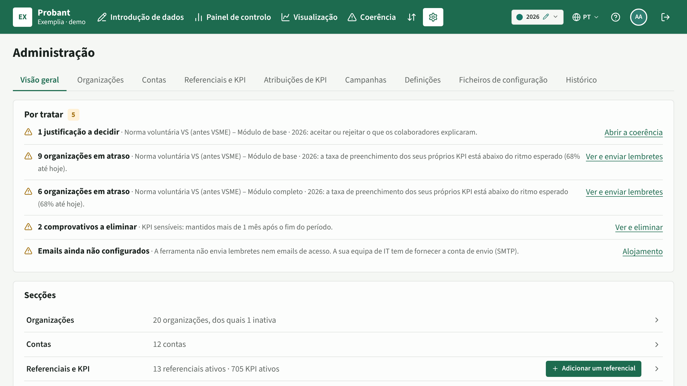

## Configurar uma nova instalação {#setup}

O primeiro arranque abre um assistente com 8 passos. Começa pela sua própria conta de administrador.

1. Introduza a conta, a organização e as línguas.
2. Escolha um referencial da biblioteca ou componha o seu.
3. Adicione a equipa e crie a primeira campanha.

Se sair do assistente, clique em **Administração › Definições › Retomar a configuração inicial** para continuar.

## Adicionar um referencial {#framework}

1. Clique em **Administração** na barra superior. Na **Visão geral**, clique em **Adicionar um referencial** na linha **Referenciais e KPI**.
2. Escolha **Instalar a partir da biblioteca**, **Compor a partir de KPI existentes** ou **Importar um ficheiro**.
3. Abra o separador **Conteúdo** do referencial para organizar os temas e os KPI.

A ficha do KPI define o tipo de resposta, a unidade, a fórmula e a exigência de comprovativo. Escolha «Restrito» ou «Confidencial» em **Confidencialidade** para um KPI sensível.

Assim que um KPI tem um valor guardado ou importado, a sua unidade já não pode mudar, tal como o seu formato. A ferramenta di-lo ao guardar. Mantenha a unidade, ou crie um novo KPI na unidade pretendida. Para passar os valores antigos, exporte-os, converta-os no ficheiro e depois importe-os no novo KPI.

Um exercício fechado guarda a sua lista de KPI. Para adicionar um KPI também aos exercícios passados, defina o período **Pedido desde** (ver a secção seguinte).

## Escolher desde quando um KPI é pedido {#requested-since}

Cada KPI de um referencial tem um período **Pedido desde**: o primeiro exercício, ou o primeiro período, em que o referencial o pede. Quando cria um KPI, a ferramenta pergunta «Adicioná-lo também aos exercícios anteriores?». Por predefinição, o KPI é pedido a partir do período em curso, e nenhum exercício passado muda.

1. Aceda a **Administração › Referenciais e KPI**, abra o referencial e depois o separador **Conteúdo**.
2. Leia o período no fim de cada linha. «Desde o início» quer dizer que o KPI já existia antes desta definição.
3. Assinale um ou mais KPI, ou clique no período de uma linha. Na barra de ações, escolha o período em **Pedido desde**.
4. Clique em **Aplicar**. A ferramenta mostra os exercícios que mudam e quantas células acrescenta. Confirme para guardar.

Um exercício fechado não muda enquanto estiver fechado: nenhuma célula, nenhum total novo, a mesma taxa de preenchimento. O KPI aparece quando reabre o exercício, nos dois modos, e fica no fecho seguinte. Um exercício já reaberto recebe as células de imediato.

Não pode adiar o período se um exercício que perde o KPI estiver fechado, ou tiver para ele um valor, um N/A, um comentário ou um comprovativo. Se as células estiverem vazias, a ferramenta pede-lhe que confirme. O histórico regista cada alteração. Quando um KPI calculado é pedido antes de uma das suas fontes, a ferramenta avisa: a fonte tem células desde o mesmo período.

## Escolher a moeda dos montantes {#currency}

Os modelos da biblioteca escrevem os seus montantes em euros. Se as suas demonstrações financeiras usam outra moeda, defina-a antes de instalar um modelo:

1. Vá a **Administração › Referenciais e KPI › Unidades e formatos**.
2. Em **Moeda de referência**, escolha a moeda e clique em **Guardar**.

Quando instala ou atualiza um modelo da biblioteca, os seus montantes passam a usar esta moeda: «€» passa a «$», «M€» passa a «M$» e «€/h» passa a «$/h». Os ecrãs da instalação indicam a moeda. Um KPI que já existe no espaço mantém a sua unidade, tenha valores ou não; só os KPI novos passam a usar a moeda.

A ferramenta não converte nenhum valor nem usa taxas de câmbio. Se mudar a moeda mais tarde, os KPI que já existem mantêm a sua unidade, e a página conta os KPI cuja unidade está noutra moeda. O livro oficial do EFRAG usa a moeda de referência como moeda do relatório. Deixa vazio um montante cuja unidade está noutra moeda, e o relatório da exportação indica-o.

Cada espaço tem a sua própria moeda de referência. Um espaço novo começa com o euro.

## Adicionar as organizações {#organisations}

1. Aceda a **Administração › Organizações**.
2. Clique em **Nova organização**, escolha a organização superior e clique em **Criar a organização**.
3. Para um local que abre durante o ano, indique a data em **Aberta desde**. O local conta nos totais, e são-lhe pedidos valores, apenas para os períodos que terminam nesta data ou depois. Se deixar o campo vazio, o local conta como aberto desde sempre. Ao colar várias organizações, escreva a data entre parênteses retos: «Lyon [2026-03-01]».

Os níveis da árvore (por exemplo Grupo, País, Filial, Local) definem-se em **Administração › Definições › Níveis da árvore**.

Neste ecrã e em **Unidades e formatos**, os nomes dos níveis e das unidades aparecem na sua língua. Os campos em que escreve mantêm a língua de referência da instalação, e a etiqueta nomeia-a (por exemplo «Nome (língua de referência: Français)»). A tradução para a sua língua é mostrada junto ao campo. Para a alterar, use **Definições › Línguas**.

Uma organização nunca abre antes da organização de que depende: conta a data mais tardia entre a sua e as das organizações acima. Quando uma mudança de data ou de organização superior tirasse valores dos totais, a ficha conta-os, incluindo os das organizações abaixo, e pede uma confirmação. Um valor para uma organização ainda não aberta no período é recusado no ecrã, numa importação e por um assistente. A mensagem liga à ficha que tem a data.

## Criar as contas {#accounts}

1. Aceda a **Administração › Contas**.
2. Clique em **Nova conta**, ou em **Várias contas** para criar muitas de uma vez.
3. Introduza o email e o nome, e escolha a **Função**: administrador, validador, colaborador, leitor ou auditor.
4. Clique em **Criar a conta**. Envie a palavra-passe provisória à pessoa.

Para dar uma nova palavra-passe provisória, abra a conta e clique em **Repor a palavra-passe**. A pessoa escolhe a sua própria palavra-passe no primeiro início de sessão.

Um leitor ou um auditor não introduz nem valida nada. Quando mudar a função de uma conta para uma destas duas, a ferramenta indica quantas atribuições vai retirar e pede uma confirmação antes de guardar. Retira-as, com uma linha no Histórico. Voltar à função anterior não as devolve. Para as dar antes a outra pessoa, use primeiro **Substituir uma pessoa…**. Para as voltar a dar mais tarde, use **Atribuições de KPI** (opção **Validadores** para as atribuições de validador).

**Por tratar** lista as contas que passaram a só de leitura antes desta regra e ainda têm atribuições. Clique em **Rever** e depois em **Retirar** numa linha. Uma conta desativada guarda as suas atribuições até usar **Substituir uma pessoa…**.

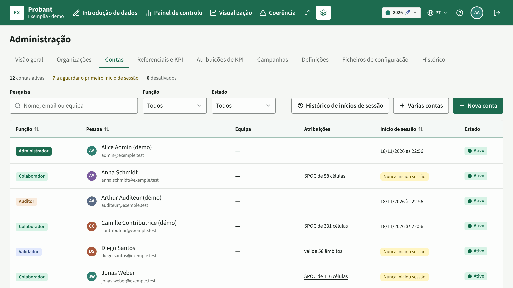

Para ver quem iniciou sessão e quando, clique em **Histórico de inícios de sessão** em **Administração › Contas**. Cada linha indica a data, a conta e o resultado: **Bem-sucedido**, **Falhado** ou **Bloqueado: demasiadas tentativas**. Um nome de utilizador que não corresponde a nenhuma conta do espaço só aparece com uma referência, nunca com o texto escrito. Filtre por resultado ou por período, ou pesquise um nome. Defina durante quanto tempo a ferramenta guarda o histórico em **Administração › Definições › Alojamento** (180 dias por predefinição).

## Atribuir os KPI {#assign}

Cada célula da grelha é um KPI de uma organização. O SPOC (ponto de contacto) é a pessoa que o introduz.

1. Aceda a **Administração › Atribuições de KPI**.
2. Clique numa célula e escolha uma ou mais pessoas. Também pode selecionar uma linha ou uma coluna e clicar em **Atribuir**.
3. Clique em **Substituir uma pessoa…** quando alguém sai.
4. Assinale **Apenas as linhas a completar** para ver o que falta.

Para escolher os validadores, selecione **Validadores** na lista **Função**. Uma atribuição de validador vale para um KPI numa organização e em todas as organizações abaixo dela: a grelha tem então um separador por nível de organização, com os KPI introduzidos nesse nível ou abaixo. Uma célula marcada «via …» já está coberta pelo validador de uma organização acima. Só são propostos os validadores e os administradores ativos. Uma célula sem validador é validada pelos administradores. Cada atribuição dada ou retirada escreve uma linha no Histórico.

Para um grupo grande, a grelha mostra um grupo de organizações de cada vez. Escolha o grupo na lista **Organizações** acima da grelha. Os filtros e a gravação em lote aplicam-se ao grupo mostrado. **Todas (lento para um grupo grande)** mostra tudo, mas a ferramenta não memoriza esta escolha.

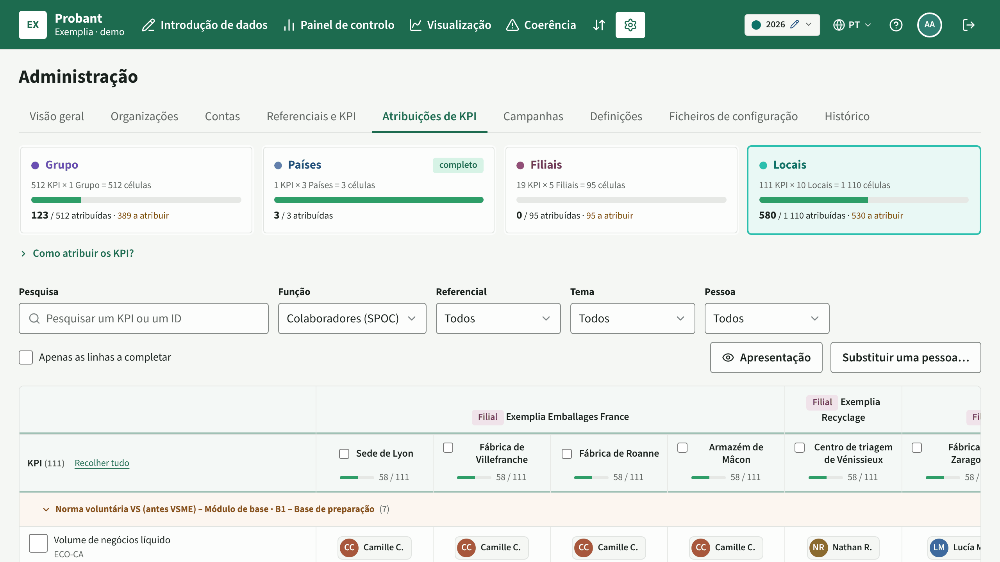

## Abrir, rever, encerrar e reabrir uma campanha {#campaign}

1. Aceda a **Administração › Campanhas** e clique em **Nova campanha** na linha do referencial.
2. Escolha o período, defina as datas e o **Limiar de desvio**, e clique em **Criar a campanha**.
3. Clique em **Gerir** numa campanha. Utilize **Abrir a introdução de dados**, **Iniciar a revisão** ou **Encerrar definitivamente**.
4. Para alterar uma campanha encerrada, clique em **Reabrir aos colaboradores** ou em **Reabrir para corrigir (revisão)**. O histórico regista a reabertura.
5. Quando reabre um ano encerrado, escolha primeiro:
   - **Manter os números da época** (selecionado por predefinição): nada é recalculado. Só são recalculados a organização cujo valor corrige e os totais acima dela. Exemplo: uma organização que entretanto passou para outro país continua nos totais do seu antigo país.
   - **Recalcular com a organização de hoje**: todos os totais do ano são recalculados com a árvore e as fórmulas de hoje. Exemplo: a organização deslocada passa os seus valores para os totais do seu novo país.

   Um ano reaberto mantendo os números da época mantém a árvore de organizações do seu encerramento: uma correção é recalculada com os pais da época, e uma organização criada entretanto não tem célula nesse ano. A sua escolha vale até ao próximo encerramento.

   Quando um ano tem duas campanhas (dois referenciais) e uma delas está encerrada, os KPI pedidos pela campanha encerrada mantêm os seus números até a outra campanha ser também encerrada: uma alteração das organizações ou **Refazer os cálculos** já não os altera, e mantêm a árvore de organizações do dia do encerramento. Um KPI comum às duas campanhas também mantém os seus números. Só uma correção importada na campanha encerrada recalcula a organização corrigida e os seus totais. Com **Recalcular com a organização de hoje**, os KPI de outra campanha do ano ainda encerrada mantêm os seus números.

Uma campanha encerrada fica congelada para todos, incluindo os administradores. Os seus valores passam a ser o N-1 da campanha seguinte. **Refazer os cálculos** raramente é necessário.

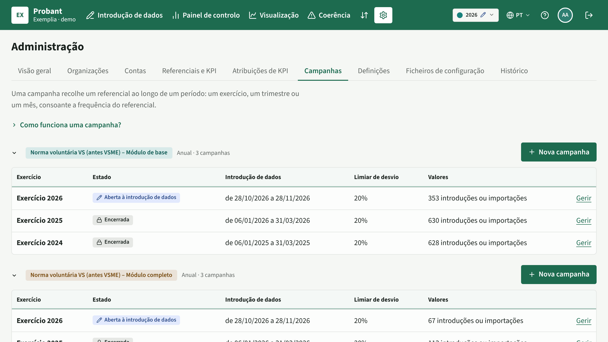

## Introduzir e verificar valores {#entry}

**Introdução de dados** lista as células da campanha aberta, por organização e por KPI. Vê-las todas e pode introduzir ou corrigir um valor em qualquer célula. Use os filtros para encontrar um KPI, uma organização ou um estado e clique numa célula para abrir o seu painel.

## Reabrir uma introdução validada {#reopen}

1. Aceda a **Introdução de dados** e abra a linha do valor.
2. Clique em **Voltar a rascunho**. O valor não muda.
3. O colaborador altera-o e valida-o de novo.

**Apagar o valor** esvazia a célula em vez disso. Ambas as ações ficam no histórico.

## Um KPI bloqueado por uma campanha encerrada {#shared-closed}

Um KPI pode pertencer a dois referenciais com o mesmo período. O seu valor é partilhado. Se uma campanha estiver encerrada, ninguém pode alterar o valor na outra, nem sequer o administrador. O painel indica a campanha encerrada.

1. Reabra a campanha encerrada: clique em **Gerir** e depois em **Reabrir para corrigir (revisão)**.
2. Altere o valor no painel de introdução.
3. Encerre de novo a campanha.

## Enviar lembretes {#reminders}

1. No **Painel de controlo**, clique em **Enviar lembrete…** (ou em **Preparar o lembrete…** se a instalação não enviar emails). A página **Lembretes** abre-se.
2. Escolha os referenciais. A ferramenta seleciona as pessoas que ainda têm algo por fazer.
3. Leia a pré-visualização e clique em **Enviar o lembrete**.

Em **Modelo da mensagem** altera-se o texto. Em **Lembretes automáticos** definem-se os dias antes do fim da introdução de dados. Sem conta de email (SMTP), **Escrever** fornece o texto a enviar por si. Depois clique em **Marcar como lembrado**.

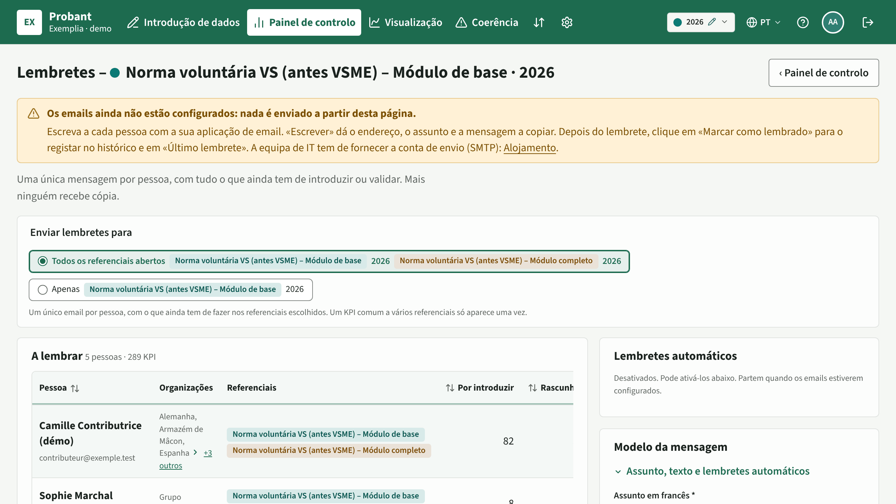

## Obter o dossier de auditoria {#audit-file}

Um administrador ou um auditor pode transferir um ficheiro Excel com o que uma auditoria precisa: para cada KPI e organização, o valor, o estado, quem o introduziu e validou, os comprovativos, os alertas de coerência e as suas justificações, e o histórico das alterações. A ferramenta só lê os dados. Criar o ficheiro não altera nada.

1. Clique em **Importar / Exportar** e depois em **Nova exportação**.
2. Em **Disposição**, escolha **Dossier de auditoria**. Escolha o exercício e, se só precisar de algumas, as organizações.
3. Clique em **Transferir**.

O ficheiro tem quatro separadores: **Para ler**, **Auditoria** (uma linha por KPI e organização), **Histórico** (cada alteração destes valores, da mais antiga à mais recente) e **Comprovativos** (os nomes dos ficheiros, os tamanhos e quem os adicionou). O separador **Para ler** indica a data, a versão da ferramenta e os filtros. Um ficheiro grande é preparado no servidor, como qualquer exportação grande.

Os validadores e os colaboradores não veem o dossier de auditoria: é para administradores e auditores. Um auditor limitado a algumas organizações só obtém essas.

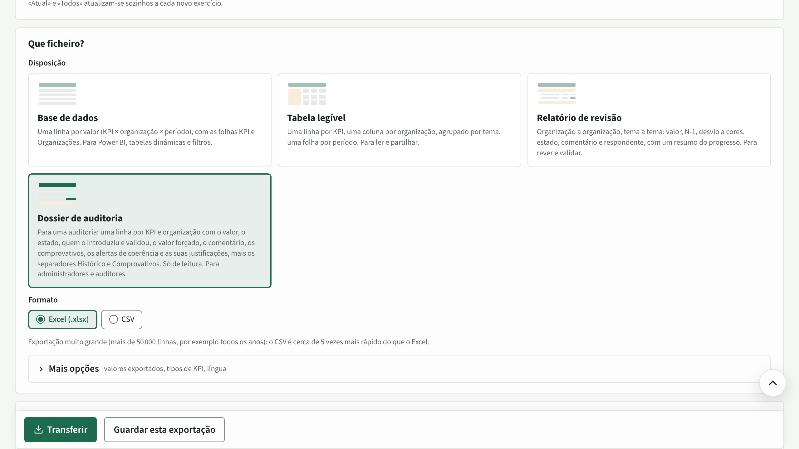

## Imprimir o certificado de encerramento {#closing-certificate}

Um administrador pode imprimir uma página que resume uma campanha encerrada. A ferramenta só lê os dados. Abrir a página não altera nada.

1. Clique em **Administração**, depois em **Campanhas** e numa campanha encerrada.
2. Clique em **Certificado de encerramento**.
3. Clique em **Imprimir**. Na janela de impressão, escolha Guardar como PDF para manter um ficheiro.

A página mostra o âmbito, a taxa de preenchimento, o número de valores, os comprovativos e os alertas de coerência. Indica quem encerrou a campanha e quando, se o histórico o guardar. A impressão digital é um código calculado a partir de todos os números da campanha. Se um número mudar, a impressão digital muda. Para verificar mais tarde, volte a abrir o certificado e compare as duas impressões digitais.

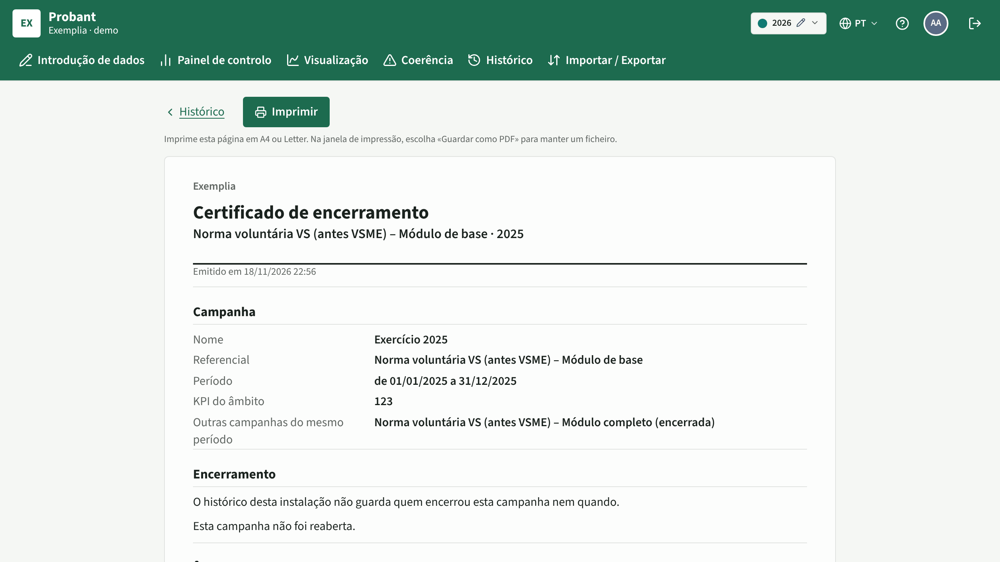

## Obter uma exportação grande {#large-exports}

Acima de um limite de tamanho, a ferramenta prepara no servidor uma exportação ou um ficheiro a preencher. Abra **Importar / Exportar** e escolha **As minhas exportações**. O ficheiro está em «Ficheiros grandes». A ferramenta guarda-o durante 7 dias.

Um administrador define o número de dias em **Administração › Definições › Alojamento**, no bloco «Exportações grandes».

## Eliminar os comprovativos dos KPI sensíveis {#evidence-delete}

A ferramenta guarda os ficheiros de comprovativos. Nunca os elimina sozinha.

1. Aceda a **Administração › Definições › Alojamento**. Em **Comprovativos dos KPI sensíveis**, introduza o número em **Meses antes de propor a eliminação**.
2. Clique em **Administração › Histórico** e depois em **Comprovativos a eliminar**.
3. A página lista os ficheiros cujas campanhas estão todas encerradas e cujo período terminou há mais meses do que esse número.
4. Selecione os ficheiros e clique em **Eliminar a seleção**. Ou clique em **Eliminar** numa linha.

Atenção: a eliminação é definitiva. O ficheiro não vai para a reciclagem. O histórico regista cada eliminação sem o conteúdo do ficheiro. O valor da resposta não muda.

As cópias de segurança feitas antes guardam o ficheiro até a ferramenta as substituir. Um restauro devolve o ficheiro a **Comprovativos a eliminar**: elimine-o de novo. As cópias das cópias de segurança que a equipa de informática guarda fora da ferramenta também guardam o ficheiro: peça à equipa de informática que as elimine. Defina o número de cópias a guardar em **Administração › Definições › Alojamento**, em **Cópia de segurança automática**, para que as cópias antigas desapareçam depressa.

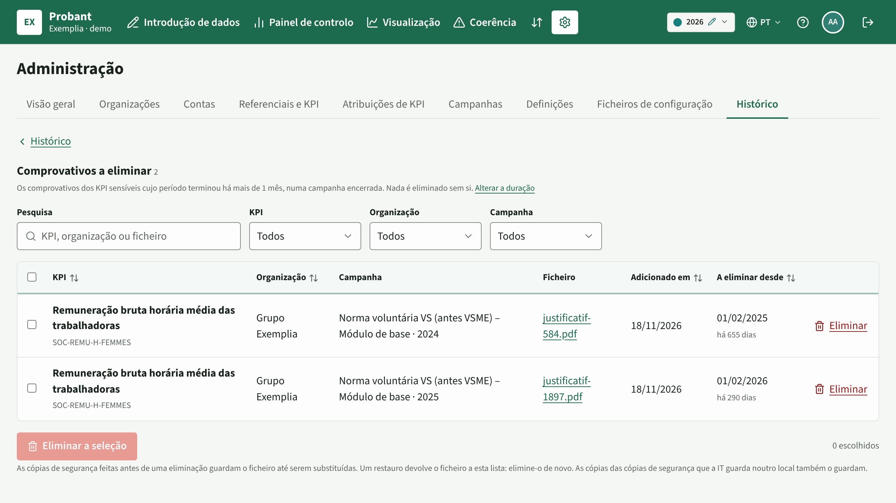

## Adicionar ou traduzir uma língua {#languages}

Os menus e os botões existem em francês, inglês, espanhol, alemão, italiano, neerlandês e português. Cada pessoa escolhe a sua língua em **A minha conta**. Os nomes dos KPI, dos temas e das unidades definem-se em **Administração › Definições › Línguas**.

1. Clique em **Adicionar uma língua**, ou abra uma língua e clique em **Traduzir**.
2. Para traduzir em lote, utilize **Exportar** e **Importar**, ou **Traduzir todas as línguas de uma vez**.

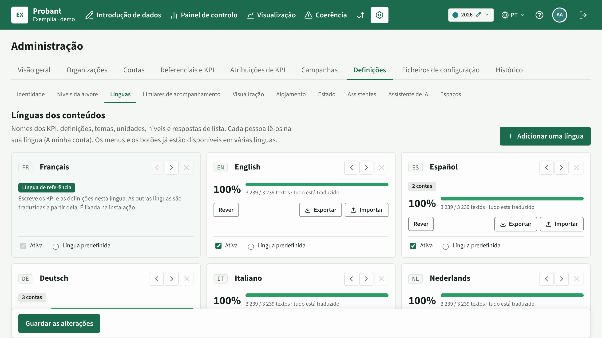

## Ligar um assistente (MCP) {#assistants}

Um assistente de IA, por exemplo o Claude, pode ler e alterar dados com os direitos da pessoa que o liga, nunca mais. Está desativado por predefinição.

1. Aceda a **Administração › Definições › Assistentes**.
2. Assinale **Permitir assistentes de IA (MCP) neste espaço**.
3. Assinale **Os assistentes também podem fazer alterações** apenas se as pessoas precisarem. Os leitores e os auditores nunca alteram nada.
   Em **O que os assistentes recebem**, escolha **Um leitor pode ler os valores através de um assistente** (desativado por predefinição) e **Os KPI sensíveis são dados aos assistentes** (ativado por predefinição; se desativado, os KPI marcados como Restrito ou Confidencial, e os KPI calculados a partir deles, ficam ocultos a todas as ferramentas). Um leitor nunca recebe um rascunho, apenas valores validados.
4. Clique em **Guardar**. Dê o **Endereço do servidor deste espaço** às pessoas.

Cada pessoa cria um token em **A minha conta**. Em **Tokens ativos**, clique em **Revogar** para cortar um assistente de imediato. O histórico regista cada chamada e mostra «(via MCP)» depois de cada alteração.

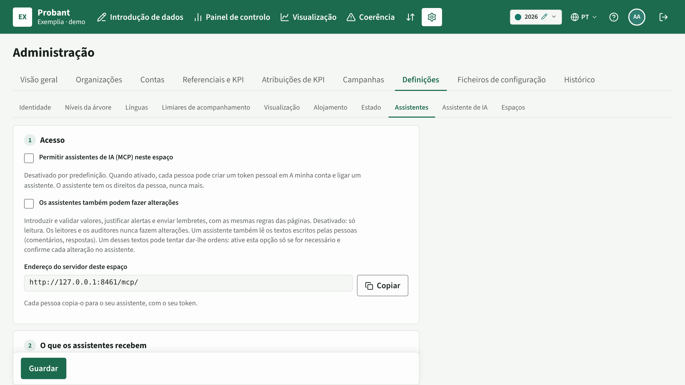

## Ativar o assistente de IA {#ai}

O assistente de IA explica os alertas de coerência, propõe correspondências de KPI no assistente de migração e propõe traduções. Está desativado por predefinição. Nada sai da ferramenta enquanto não o ativar.

1. Aceda a **Administração › Definições › Assistente de IA**.
2. Assinale **Ativar o assistente de IA**.
3. Escolha o **Fornecedor** e o **Modelo**.
4. Introduza a **Chave de API da sua conta junto do fornecedor**. A ferramenta guarda-a apenas para este espaço e não a volta a mostrar. Clique em **Retirar a chave** para a eliminar.
5. Em **Utilizações**, assinale as utilizações pretendidas. **Os KPI sensíveis podem ser enviados ao assistente de IA** está desligado por predefinição: nada de um KPI marcado como Restrito ou Confidencial, nem de um KPI calculado a partir dele, é enviado, e os seus alertas não têm **Explicar com IA**. Clique em **Guardar**.

Cada resposta é uma proposta marcada «Proposto pela IA». Nada é guardado enquanto uma pessoa não clicar e guardar como de costume. O histórico regista cada chamada sem o seu conteúdo.

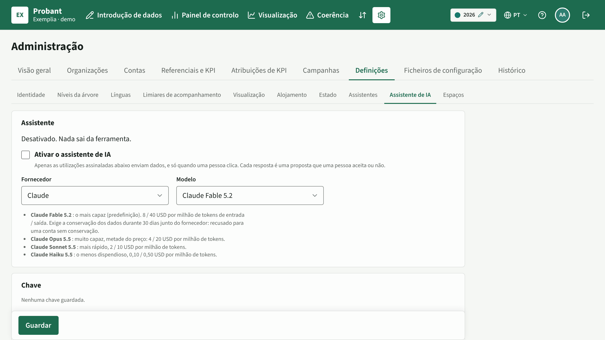

## Verificar o alojamento e as cópias de segurança {#hosting}

Aceda a **Administração › Definições › Alojamento**. A página mostra a versão, a cópia de segurança automática, o controlo dos dados e a configuração do email. Clique em **Criar e transferir uma cópia de segurança** para fazer uma de imediato. A equipa de informática copia as cópias de segurança para outro local.

Para ver num relance se está tudo bem, aceda a **Administração › Definições › Estado**. Cada linha (versão, base de dados, ficheiros, última cópia de segurança, espaço em disco, email, tarefas em segundo plano, atualização da base, HTTPS) mostra **Bom**, **A verificar** ou **Avaria**, e o que fazer. O administrador de um espaço que não é o espaço principal vê as mesmas linhas, mas as linhas base de dados e atualização da base só verificam o seu espaço e o registo comum das contas, não os outros espaços. Não vê o detalhe para a IT (nomes dos outros espaços, pastas do disco): o gestor de espaços vê-o. Em **Definições › Alojamento**, o bloco **Para a IT** não lhe mostra a pasta dos dados, os endereços autorizados, o servidor da base, o nome de utilizador do email nem a pasta das cópias de segurança.

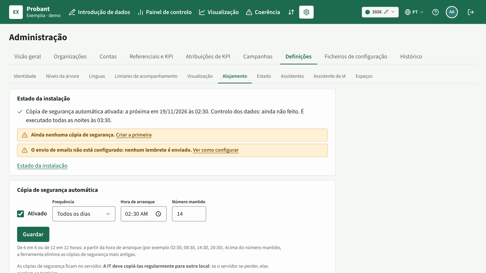

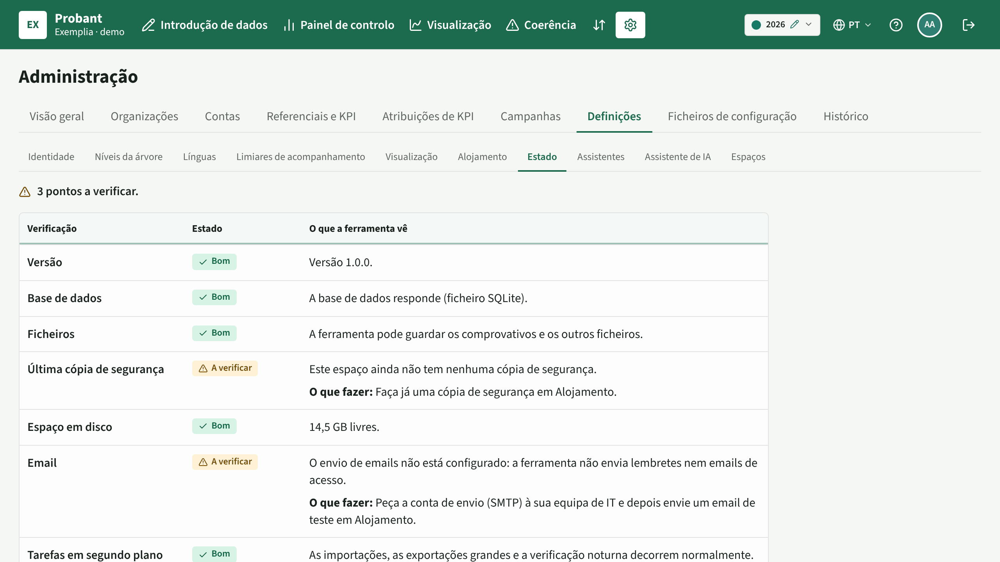

## Ver os totais de cada nível {#consolidation}

**Consolidação** mostra o valor de cada KPI em cada nível da árvore, dos locais até ao grupo. Escolha os KPI a mostrar, abra uma linha para ver as organizações abaixo dela e exporte a tabela para Excel. Uma menção indica quando um total está incompleto.

## Tratar os alertas e as regras de coerência {#consistency}

**Coerência** lista os alertas da campanha: valores invulgares, grandes diferenças em relação a N-1 e regras não cumpridas. Clique num alerta para ler a constatação e a explicação do colaborador e depois aceite-o, rejeite-o ou ignore-o. Em **Regras de coerência** definem-se as regras. Uma regra **Bloqueante** impede o colaborador de validar enquanto não for cumprida.

## Importar valores de um ficheiro {#import-values}

Clique em **Importar / Exportar** e depois em **Importar valores**. Escolha o ficheiro, leia a pré-visualização e confirme. A ferramenta não guarda nada antes da sua confirmação e aplica as mesmas regras que o painel de introdução.

Os números das células do Excel são lidos tal como estão. Um número escrito como texto é lido na língua do ficheiro. Num ficheiro CSV, indica-a o separador de colunas: «;» vai com a vírgula decimal, «,» com o ponto. Caso contrário, indica-a o cabeçalho da coluna de valores: em inglês, «1,234» vale 1234; em português, 1,234. A pré-visualização indica como leu os números e assinala um valor como «1,234». O assistente **Migrar um sistema anterior** lê-os na língua do seu ecrã.

Se o ficheiro tiver números para KPI calculados de um período não encerrado, a pré-visualização conta-os e pede-lhe para escolher entre forçar estes valores ou ignorar estas linhas. Os números forçados passam a ser valores forçados: substituem o resultado do cálculo, e os totais e as fórmulas que os usam são recalculados. **Por tratar** também indica os números importados tal como estão em células calculadas antes desta regra: abra **Valores forçados** e escolha **Forçar** ou **Retirar** para cada um.

## Exportar para um formato oficial {#official-formats}

**Formatos oficiais** exporta os valores para o livro oficial de uma norma, por exemplo o livro da EFRAG para a norma VS. A ferramenta só escreve as células de introdução. Abra o ficheiro exportado no Excel e guarde-o antes de o converter.

## Guardar uma lista de KPI {#kpi-lists}

**Listas de KPI** agrupa sob um nome os KPI que acompanha com frequência. Escolha uma lista com um clique numa exportação ou num ficheiro a preencher.

## Ler os gráficos e criar vistas {#visualisation}

**Visualização** mostra os gráficos das vistas. Abra uma vista, altere os filtros no topo e use o menu «…» de um gráfico para mostrar os dados ou exportá-lo. Também pode criar uma vista, editá-la e partilhá-la.

## Alterar as definições da ferramenta {#settings}

**Definições** reúne o que pode ajustar na ferramenta: a identidade, os níveis da árvore de organizações, os limiares, as cores dos gráficos, os idiomas, o assistente de IA, os assistentes e o alojamento. Ninguém precisa de alterar código.

## Gerir os espaços {#spaces}

**Espaços** lista os espaços desta instalação. Cada espaço tem os seus próprios dados: quadros de referência, organizações, campanhas, valores, comprovativos e identidade. As contas são comuns: uma pessoa inicia sessão uma só vez.

## Acompanhar cada alteração {#history}

Clique em **Administração** na barra superior e depois em **Histórico**. Em **Registo**, escolha **Introdução de dados** para ver os valores, as validações e os comprovativos, ou **Alterações de administração** para ver as campanhas, o referencial, as organizações e as contas. A ferramenta nunca elimina nada do histórico.

## Ver a visita guiada novamente {#tour}

No seu primeiro início de sessão, uma visita breve mostra onde agir. Não bloqueia o ecrã. O navegador recorda que a viu.

1. Clique em **Ajuda** na barra superior.
2. Clique em **Mostrar a visita novamente**.
3. Clique em **Seguinte** para continuar e em **Concluir** no fim. Para parar, clique em **Fechar a visita**, prima Esc ou clique em **Não mostrar novamente**.

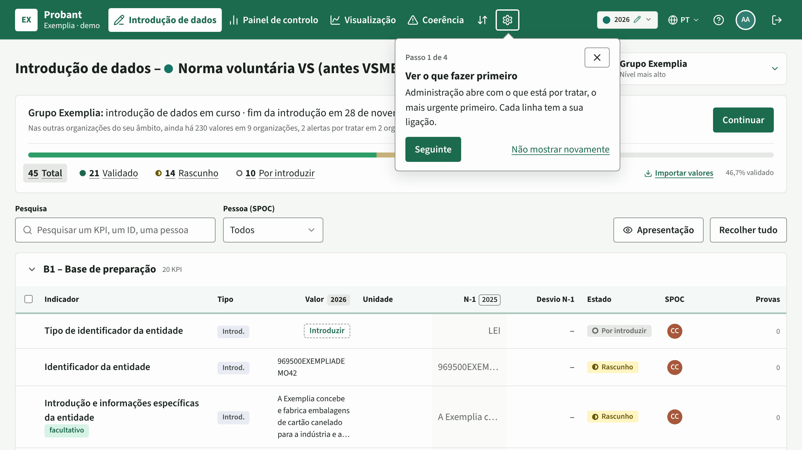

## Alterar a minha língua ou a minha palavra-passe {#account}

Clique no seu nome e depois em **A minha conta**. Escolha a **Língua** e altere a palavra-passe em **Alterar a minha palavra-passe**.

**Os meus últimos inícios de sessão**, em **A minha conta**, lista os seus últimos inícios de sessão neste espaço. Se não reconhecer um, altere a sua palavra-passe e avise um administrador.
