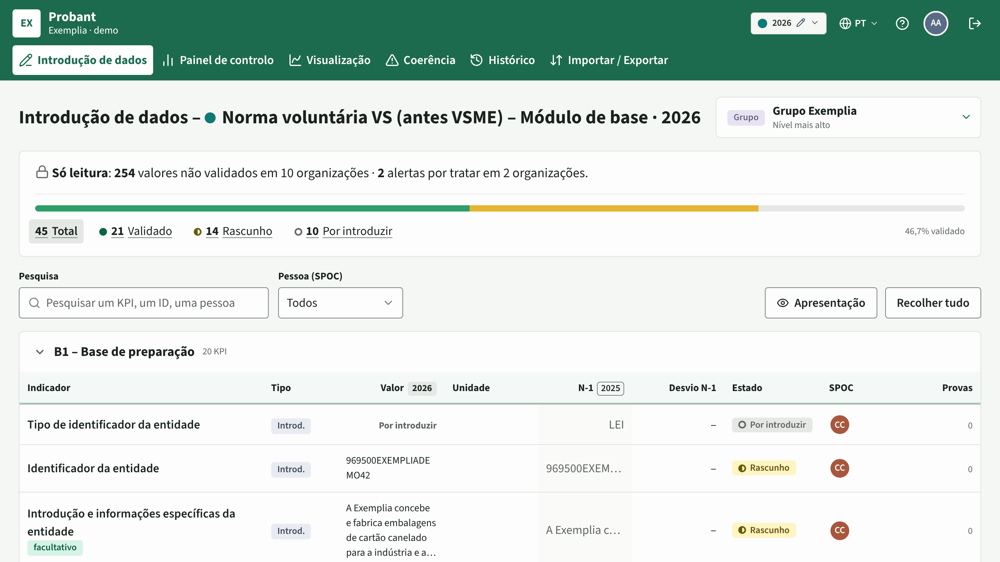
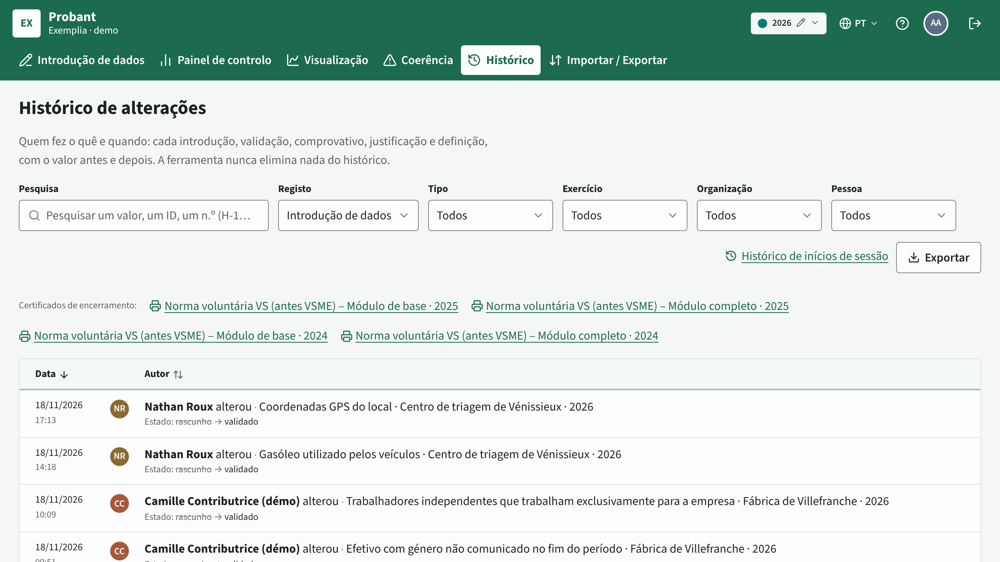
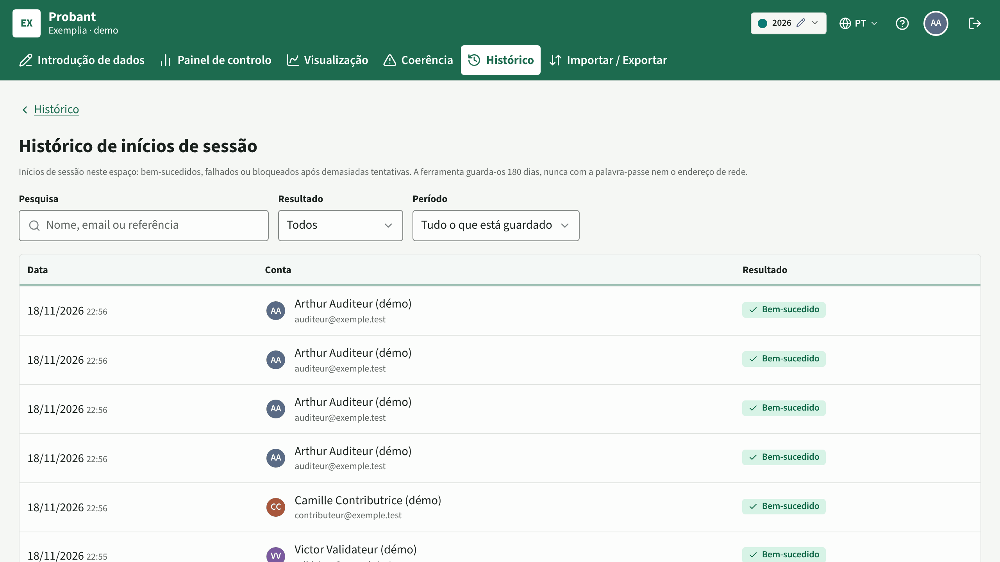
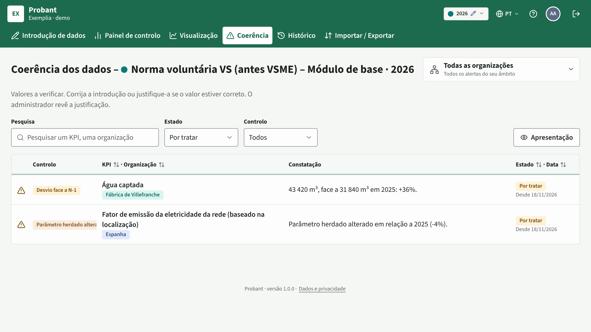
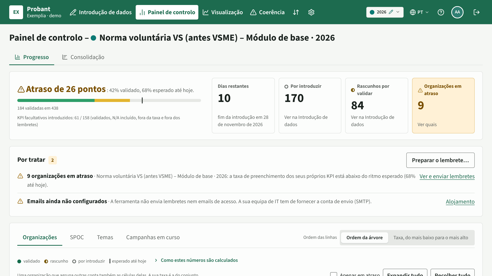
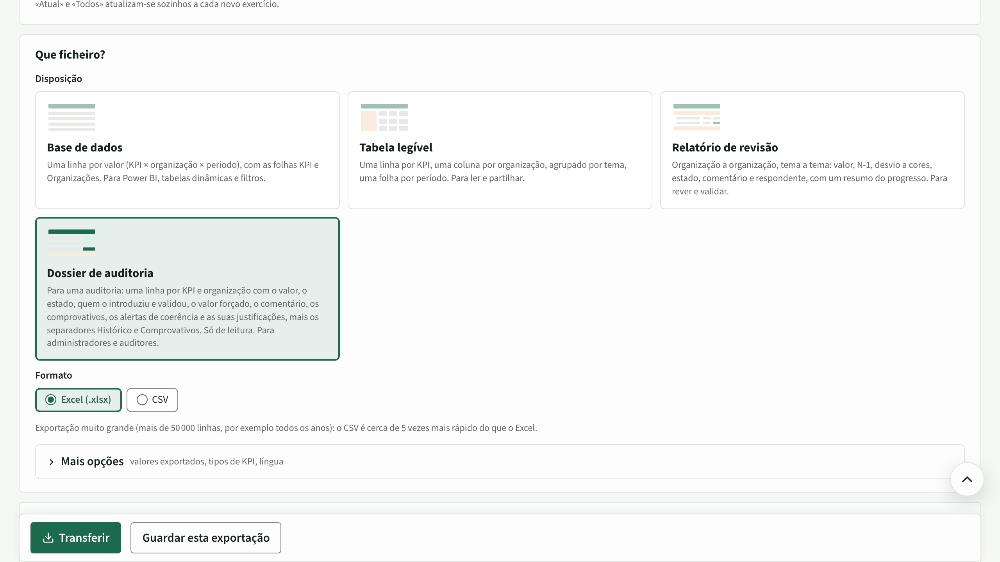
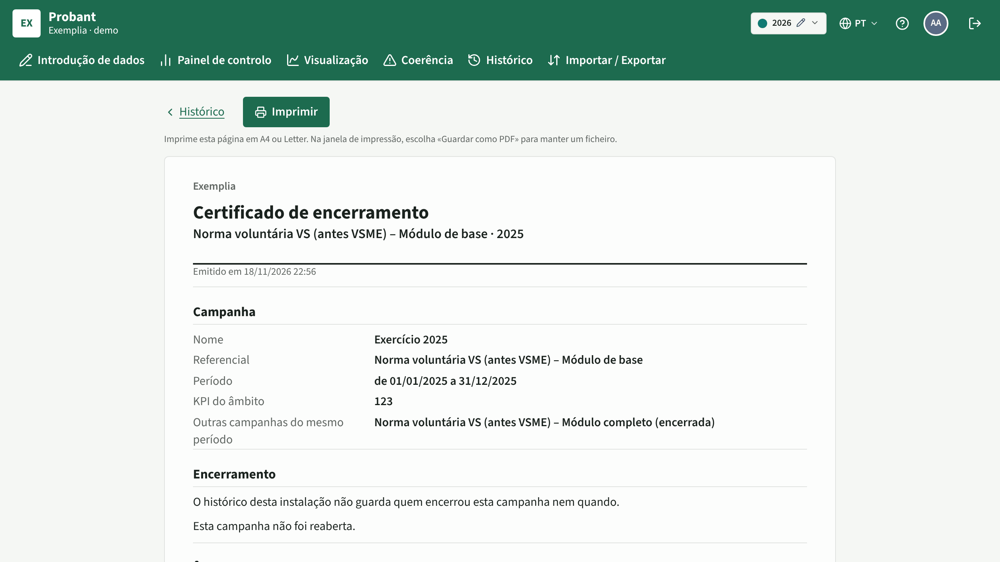

# Guia do auditor

Pode ver todos os valores, os seus comprovativos e o seu histórico. Nunca altera nada: a função de auditor é só de leitura. Versão em inglês: [`docs/guides/auditor.md`](../../guides/auditor.md).

## Consultar os valores de uma organização {#read-only}

1. Clique em **Introdução de dados** na barra superior. A página abre na organização mais alta do seu âmbito.
2. Clique no nome da organização no canto superior direito da página e escolha a organização na lista.
3. Utilize **Pesquisar** e os filtros acima da tabela para encontrar um KPI.
4. Clique numa linha para abrir o painel. Mostra o valor, o comentário, os comprovativos e o histórico por exercício.

Abra **Apresentação** e assinale **Mostrar os KPI calculados e consolidados** para ver os totais e as componentes de cada cálculo.

## Abrir os comprovativos {#evidence}

1. Abra o painel de um valor.
2. Em **Comprovativos**, clique no nome de um ficheiro para o abrir.

A coluna **Provas** da tabela mostra o número de ficheiros de cada KPI.

## Acompanhar cada alteração {#history}

1. Clique em **Histórico** na barra superior.
2. Escolha **Introdução de dados** para ver os valores, as validações e os comprovativos. Escolha **Alterações de administração** para ver as campanhas, o referencial, as organizações e as contas.
3. Filtre por exercício, organização ou pessoa.
4. Clique em **Exportar** para obter o registo como ficheiro.

O histórico mostra quem fez o quê e quando, com o valor antes e depois. A ferramenta nunca elimina nada dele. Uma alteração feita por um assistente de IA mostra «(via MCP)».

Três linhas de **Alterações de administração** precisam de uma explicação:

- «retirou as atribuições (função só de leitura)»: uma conta passou a leitor ou auditor e perdeu as suas atribuições. A linha lista-as por função, com «Ver o texto completo» quando a lista é longa.
- «adicionou um KPI ao âmbito de um período reaberto»: um exercício encerrado guarda a sua lista de KPI, e um administrador acrescentou este KPI de propósito enquanto a campanha estava reaberta.
- «escolheu como reabrir uma campanha»: o administrador manteve os números da época ou recalculou com a organização de hoje.

## Ver quem iniciou sessão {#sign-ins}

1. Clique em **Histórico** na barra superior.
2. Clique em **Histórico de inícios de sessão** no fim da barra de filtros.
3. Filtre por nome ou e-mail, por resultado ou por período.

Cada linha mostra a data, a conta e o resultado: **Bem-sucedido**, **Falhado** ou **Bloqueado: demasiadas tentativas**. Para um nome de utilizador desconhecido, a ferramenta mostra apenas uma referência, nunca o texto escrito. A página é só de leitura. O administrador define durante quanto tempo a ferramenta guarda estas linhas. Se o seu acesso estiver limitado a algumas organizações, esta página não está disponível para si.

## Ler os alertas de coerência {#consistency}

1. Clique em **Coerência** na barra superior.
2. Filtre os alertas por estado, controlo, KPI ou organização.
3. Clique num alerta para ler a constatação e a explicação do colaborador.

Um alerta não bloqueia uma validação, mas uma regra **Bloqueante** bloqueia: o colaborador não pode validar enquanto a regra não for cumprida. O administrador decide sobre cada explicação.

## Acompanhar o progresso e os gráficos {#dashboard}

Clique em **Painel de controlo** para ver o preenchimento por organização e em **Consolidação** para ver os totais de cada nível. Clique em **Visualização** para ver os gráficos. Os rascunhos podem contar nos valores enquanto uma campanha estiver aberta. A página indica-o quando acontece.

## Obter o dossier de auditoria {#audit-file}

Um administrador ou um auditor pode transferir um ficheiro Excel com o que uma auditoria precisa: para cada KPI e organização, o valor, o estado, quem o introduziu e validou, os comprovativos, os alertas de coerência e as suas justificações, e o histórico das alterações. A ferramenta só lê os dados. Criar o ficheiro não altera nada.

1. Clique em **Importar / Exportar** e depois em **Nova exportação**.
2. Em **Disposição**, escolha **Dossier de auditoria**. Escolha o exercício e, se só precisar de algumas, as organizações.
3. Clique em **Transferir**.

O ficheiro tem quatro separadores: **Para ler**, **Auditoria** (uma linha por KPI e organização), **Histórico** (cada alteração destes valores, da mais antiga à mais recente) e **Comprovativos** (os nomes dos ficheiros, os tamanhos e quem os adicionou). O separador **Para ler** indica a data, a versão da ferramenta e os filtros. Um ficheiro grande é preparado no servidor, como qualquer exportação grande.

Vê os mesmos dados que nas páginas da ferramenta. Se um administrador o limitou a algumas organizações, o ficheiro só contém essas.

## Imprimir o certificado de encerramento {#closing-certificate}

Pode imprimir uma página que resume uma campanha encerrada. A ferramenta só lê os dados.

1. Clique em **Histórico**. Por cima da lista, em **Certificados de encerramento:**, clique numa campanha.
2. Clique em **Imprimir**. Na janela de impressão, escolha Guardar como PDF para manter um ficheiro.

A página mostra o âmbito, a taxa de preenchimento, o número de valores, os comprovativos e os alertas de coerência. Indica quem encerrou a campanha e quando, se o histórico o guardar. A impressão digital é um código calculado a partir de todos os números da campanha. Se um número mudar, a impressão digital muda. Se estiver limitado a algumas organizações, recebe um certificado parcial: isso é indicado no topo de cada página, e cada número e a impressão digital abrangem apenas as suas organizações.

## Obter uma exportação grande {#large-exports}

Acima de um limite de tamanho, a ferramenta prepara no servidor uma exportação ou um ficheiro a preencher. Abra **Importar / Exportar** e escolha **As minhas exportações**. O ficheiro está em «Ficheiros grandes». A ferramenta guarda-o durante 7 dias.

## Utilizar a ferramenta num telemóvel {#phone}

As páginas funcionam num telemóvel, numa só coluna.

## Ver a visita guiada novamente {#tour}

No seu primeiro início de sessão, uma visita breve mostra onde agir. Não bloqueia o ecrã. O navegador recorda que a viu.

1. Clique em **Ajuda** na barra superior.
2. Clique em **Mostrar a visita novamente**.
3. Clique em **Seguinte** para continuar e em **Concluir** no fim. Para parar, clique em **Fechar a visita**, prima Esc ou clique em **Não mostrar novamente**.

## Alterar a língua {#language}

1. Clique na língua na barra superior, ou clique no seu nome e depois em **A minha conta**.
2. Em **Língua**, escolha uma das sete línguas e guarde.

**Os meus últimos inícios de sessão**, em **A minha conta**, lista os seus últimos inícios de sessão neste espaço. Se não reconhecer um, altere a sua palavra-passe e avise um administrador.

## Consultar um assistente {#assistant}

Se um administrador ativou os assistentes, pode ligar um assistente de IA em **A minha conta**, em **Assistentes de IA (MCP)**. Para a sua função, só pode ler. O histórico regista cada chamada.
