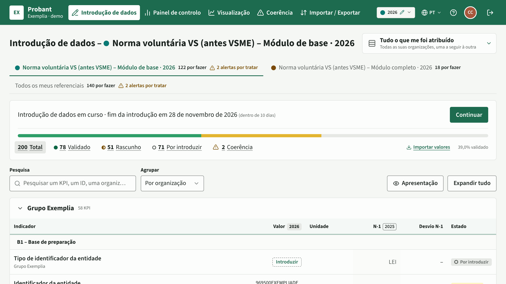
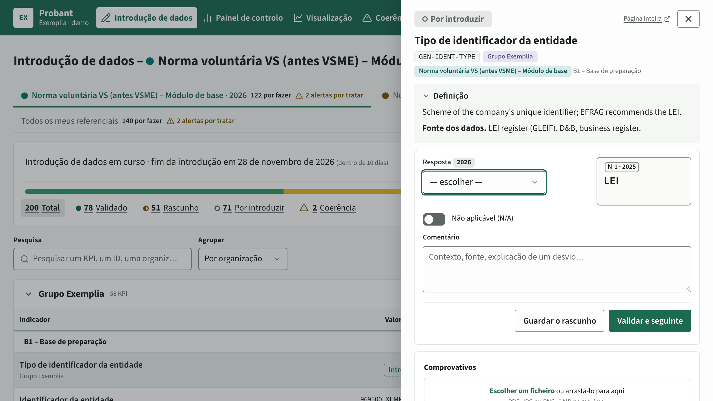
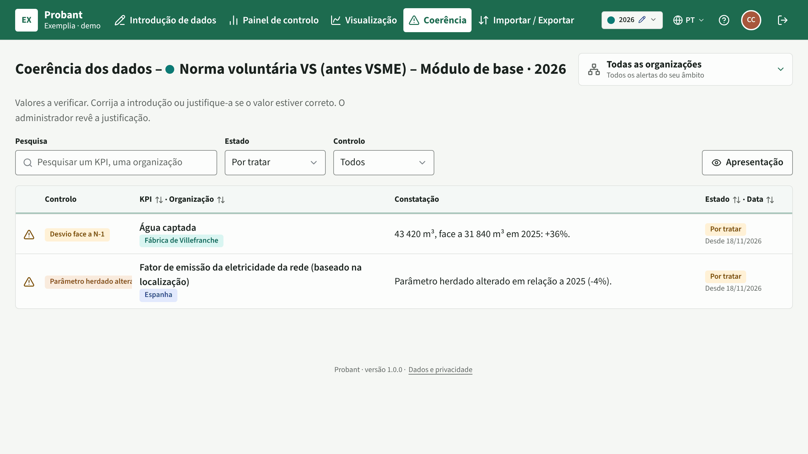
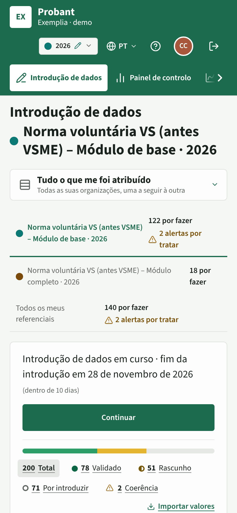

# Guia do colaborador

Introduza os valores dos KPI que um administrador lhe atribuiu e valide-os. Este guia mostra cada tarefa em poucos passos. Versão em inglês: [`docs/guides/contributor.md`](../../guides/contributor.md).

## Encontrar o que introduzir {#find}

1. Clique em **Introdução de dados** na barra superior. A página abre em **Tudo o que me foi atribuído**.
2. Escolha o referencial e o período em **Estou a responder a…** (barra superior), ou utilize os separadores sob o título.
3. Clique em **Por introduzir** ou **Rascunho** acima da tabela para manter apenas as linhas que lhe dizem respeito.
4. Utilize **Pesquisar** para encontrar um KPI, um ID ou uma organização.

Clique em **Começar** (ou **Continuar**) para abrir o primeiro valor que ainda falta fazer. O resumo mostra quantos valores faltam e quando termina a introdução de dados.

## Introduzir um valor {#enter}

1. Clique na linha do KPI, ou prima Enter nela. O painel de introdução abre-se.
2. Introduza o número, a resposta ou o texto em **Valor** (ou em **Resposta**, para uma lista ou um texto).
3. Clique em **Guardar o rascunho** para o manter e voltar mais tarde.

O painel mostra o valor do período de comparação (N-1) e o desvio. Se o desvio ultrapassar o limiar da campanha, o **Comentário** é obrigatório.

Escolha **Página inteira** se preferir trabalhar na página toda.

Se o painel disser que uma organização «abre a» uma data posterior ao período, ainda não se pode introduzir nada para este período. Peça a um administrador que altere a data de abertura. Mais nada muda para si.

## Marcar um valor como não aplicável {#na}

1. Abra o painel de introdução do KPI.
2. Assinale **Não aplicável (N/A)**.
3. Escreva o motivo em **Comentário**. O comentário é obrigatório para N/A.

## Adicionar um comprovativo {#evidence}

1. Abra o painel de introdução do KPI.
2. Em **Comprovativos**, clique em **Escolher um ficheiro** ou arraste o ficheiro para a zona.
3. Utilize um ficheiro PDF, JPG ou PNG. O painel mostra o limite de tamanho (5 MB por predefinição).

Se o KPI exigir um comprovativo, não pode validar sem pelo menos um ficheiro. Isto não se aplica a N/A.

## Validar a minha introdução {#validate}

Validar confirma que a sua introdução está completa. Não significa que o valor foi auditado.

1. Abra o painel de introdução do KPI.
2. Clique em **Validar e seguinte**. O painel abre o valor seguinte.
3. No fim, o resumo mostra «Tudo feito».

Se faltar algo, a ferramenta diz o que acrescentar: um valor ou N/A, um comentário ou um comprovativo.

## Alterar um valor validado {#reopen}

Pode editar um valor que validou. A ferramenta volta a pô-lo em rascunho e valida-o de novo.

1. Abra o painel de introdução do KPI.
2. Altere o valor e clique em **Guardar a alteração**. Ou clique em **Voltar a rascunho** para ainda não alterar nada.
3. Clique em **Validar** quando o valor estiver correto.

**Apagar o valor** esvazia o valor e devolve a célula a **Por introduzir**. O comentário e os comprovativos mantêm-se. O histórico regista cada alteração.

Se a campanha estiver encerrada, só um administrador a pode reabrir.

## Um KPI bloqueado por uma campanha encerrada {#shared-closed}

Alguns KPI pertencem a dois referenciais com o mesmo período. O valor é partilhado. Se uma das duas campanhas estiver encerrada, não pode alterar o valor na outra.

O painel mostra então uma mensagem que indica o referencial e a campanha. Peça a um administrador que reabra a campanha encerrada.

## Tratar um alerta «Por verificar» {#check}

A ferramenta verifica os seus valores e marca os invulgares com **Por verificar**. Um alerta não bloqueia a validação, mas uma regra **Bloqueante** bloqueia: não pode validar enquanto a regra não for cumprida.

1. Abra o painel de introdução. O bloco **Por verificar** dá o motivo.
2. Se o valor estiver errado, corrija-o e guarde.
3. Se o valor estiver certo, clique em **Explico no comentário**, escreva a explicação e guarde.

A página **Coerência** lista todos os seus alertas. Clique num alerta para abrir a sua ficha. No painel de introdução, **Ficha do alerta** dá os mesmos detalhes. Um administrador revê a sua explicação.

Se o administrador ativou o assistente de IA, clique em **Explicar com IA** num alerta. A resposta é apenas uma proposta. Clique em **Utilizar como explicação** para a copiar para o comentário e guarde.

## Importar valores de um ficheiro {#import}

1. Clique em **Importar / Exportar** na barra superior. Abre em **Importar valores**.
2. Siga os passos da página. A ferramenta mostra uma pré-visualização antes de guardar o que quer que seja.

Aplicam-se as mesmas regras do painel de introdução.

Os números das células do Excel são lidos tal como estão. Um número escrito como texto é lido na língua do ficheiro. Num ficheiro CSV, indica-a o separador de colunas: «;» vai com a vírgula decimal, «,» com o ponto. Caso contrário, indica-a o cabeçalho da coluna de valores: em inglês, «1,234» vale 1234; em português, 1,234. A pré-visualização indica como leu os números e assinala um valor como «1,234».

## Ler os gráficos {#visualisation}

**Visualização** mostra o progresso e os números do seu âmbito em vistas. Abra uma vista, altere os filtros no topo e use o menu «…» de um gráfico para mostrar os dados ou exportá-lo. Os rascunhos podem contar nos números enquanto uma campanha estiver aberta.

## Utilizar a ferramenta num telemóvel {#phone}

As páginas funcionam num telemóvel. O painel de introdução ocupa o ecrã todo. Utilize o botão de fechar para voltar à lista.

## Ver a visita guiada novamente {#tour}

No seu primeiro início de sessão, uma visita breve mostra onde agir. Não bloqueia o ecrã. O navegador recorda que a viu.

1. Clique em **Ajuda** na barra superior.
2. Clique em **Mostrar a visita novamente**.
3. Clique em **Seguinte** para continuar e em **Concluir** no fim. Para parar, clique em **Fechar a visita**, prima Esc ou clique em **Não mostrar novamente**.

## Alterar a língua {#language}

A ferramenta está disponível em francês, inglês, espanhol, alemão, italiano, neerlandês e português.

1. Clique na língua na barra superior, ou clique no seu nome e depois em **A minha conta**.
2. Em **Língua**, escolha a língua e guarde.

Os nomes dos KPI e dos temas aparecem na sua língua quando têm tradução.

## Ligar um assistente de IA {#assistant}

Se o administrador ativou os assistentes, pode ligar um (por exemplo o Claude). Lê e age com os seus direitos, nunca mais.

1. Clique no seu nome e depois em **A minha conta**.
2. Em **Assistentes de IA (MCP)**, introduza um nome em **Nome do token** e escolha **Expira após**.
3. Clique em **Criar um token**.
4. Copie o token agora. Não o voltará a ver.
5. Cole a configuração já preparada no seu assistente.

Para parar um assistente, clique em **Revogar** na sua linha. O histórico mostra «(via MCP)» depois de cada alteração feita por um assistente.

## Alterar a minha palavra-passe {#account}

1. Clique no seu nome e depois em **A minha conta**.
2. Em **Alterar a minha palavra-passe**, introduza a palavra-passe atual e a nova.
3. Clique em **Guardar a minha palavra-passe**.

Se se esqueceu da palavra-passe, peça a um administrador que a reponha.

**Os meus últimos inícios de sessão**, em **A minha conta**, lista os seus últimos inícios de sessão neste espaço. Se não reconhecer um, altere a sua palavra-passe e avise um administrador.
