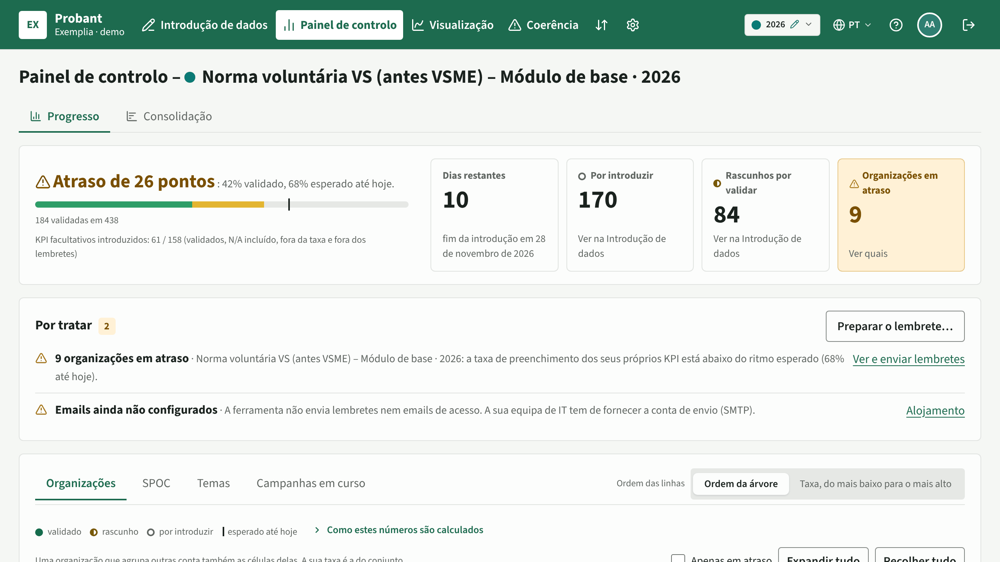
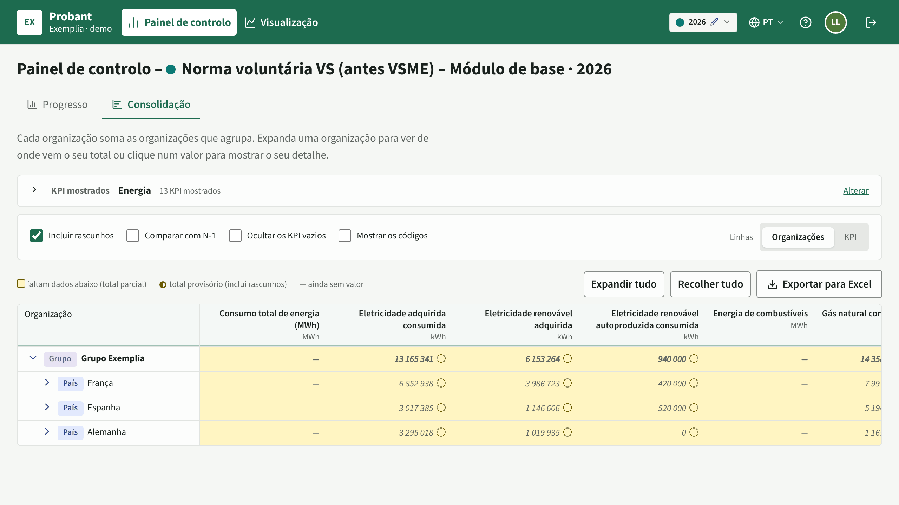
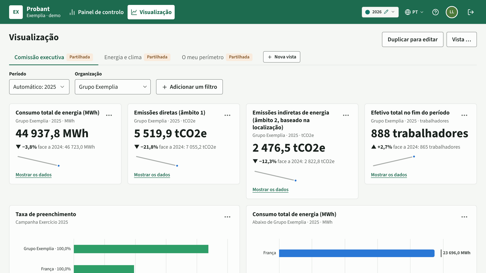
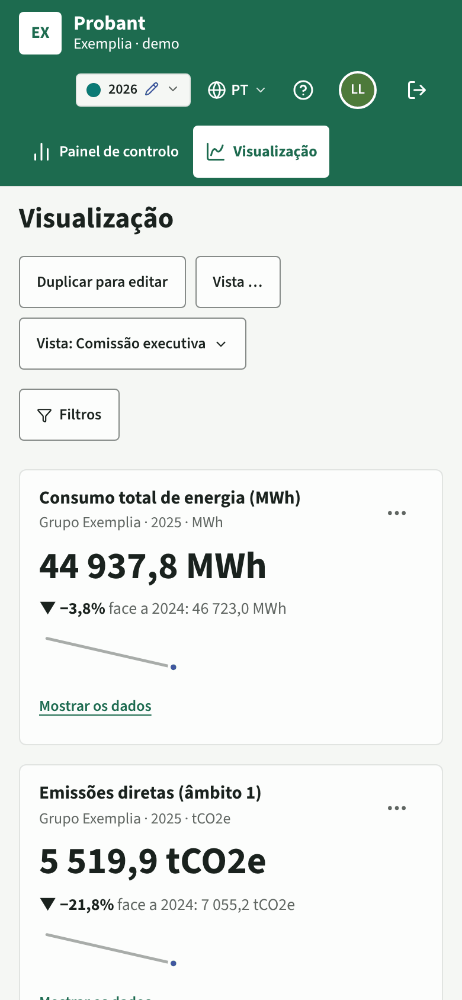

# Guia do leitor

Consulte o progresso e os valores. Nunca altera nada: a função de leitor é só de leitura. Versão em inglês: [`docs/guides/reader.md`](../../guides/reader.md).

## Acompanhar o progresso {#dashboard}

1. Clique em **Painel de controlo** na barra superior.
2. Leia o veredicto no topo. Diz se a campanha está de acordo com o ritmo esperado.
3. Leia a tabela por organização. Uma organização que agrupa outras mostra a taxa do grupo todo.

## Ver os totais de cada nível {#consolidation}

1. No **Painel de controlo**, clique em **Consolidação**.
2. Escolha os KPI a mostrar. Abra uma linha para ver as organizações que estão abaixo dela.

A página mostra os valores de cada nível da árvore, do mais baixo ao mais alto. Vê as organizações do seu âmbito.

## Ler os gráficos {#visualisation}

1. Clique em **Visualização** na barra superior. A página abre numa vista.
2. Clique num separador para abrir outra vista.
3. Utilize os filtros no topo: o período, a comparação, a organização e o referencial.
4. Clique em **Repor os filtros da vista** para recomeçar.
5. Abra o menu «…» de um gráfico para mostrar os seus dados, abri-lo em ecrã inteiro ou exportá-lo como imagem ou como ficheiro Excel.

Os rascunhos podem contar nos valores enquanto uma campanha estiver aberta. A página indica-o quando acontece.

## Utilizar a ferramenta num telemóvel {#phone}

As páginas funcionam num telemóvel, numa só coluna. Os filtros abrem numa janela.

## Ver a visita guiada novamente {#tour}

No seu primeiro início de sessão, uma visita breve mostra onde agir. Não bloqueia o ecrã. O navegador recorda que a viu.

1. Clique em **Ajuda** na barra superior.
2. Clique em **Mostrar a visita novamente**.
3. Clique em **Seguinte** para continuar e em **Concluir** no fim. Para parar, clique em **Fechar a visita**, prima Esc ou clique em **Não mostrar novamente**.

## Alterar a língua {#language}

A ferramenta está disponível em francês, inglês, espanhol, alemão, italiano, neerlandês e português.

1. Clique na língua na barra superior, ou clique no seu nome e depois em **A minha conta**.
2. Em **Língua**, escolha a língua e guarde.

## Alterar a minha palavra-passe {#account}

1. Clique no seu nome e depois em **A minha conta**.
2. Em **Alterar a minha palavra-passe**, introduza a palavra-passe atual e a nova.
3. Clique em **Guardar a minha palavra-passe**.

Se se esqueceu da palavra-passe, peça a um administrador que a reponha.

**Os meus últimos inícios de sessão**, em **A minha conta**, lista os seus últimos inícios de sessão neste espaço. Se não reconhecer um, altere a sua palavra-passe e avise um administrador.

## Consultar um assistente {#assistant}

Se um administrador ativou os assistentes, pode ligar um assistente de IA em **A minha conta**, em **Assistentes de IA (MCP)**. Para a sua função, só pode ler. Nunca introduz nem altera nada. Lê as campanhas, os KPI, as organizações e a taxa de preenchimento; lê também os valores do seu âmbito apenas se o administrador o permitir (**Definições › Assistentes**). Mesmo assim, só lê os valores validados, como a Visualização lhos mostra. Se o seu administrador desativou **Os KPI sensíveis são dados aos assistentes**, nunca lê um KPI marcado como Restrito ou Confidencial, nem um KPI calculado a partir de um deles.
