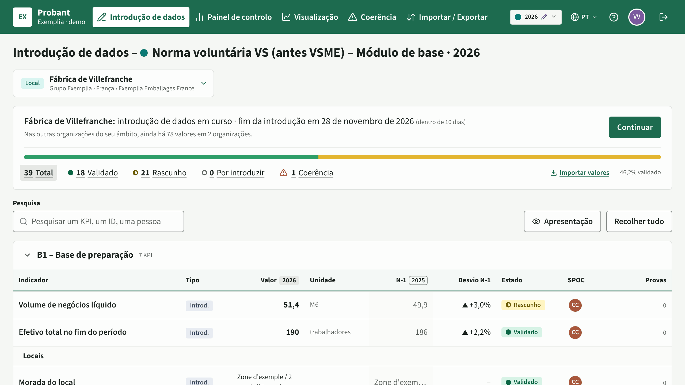
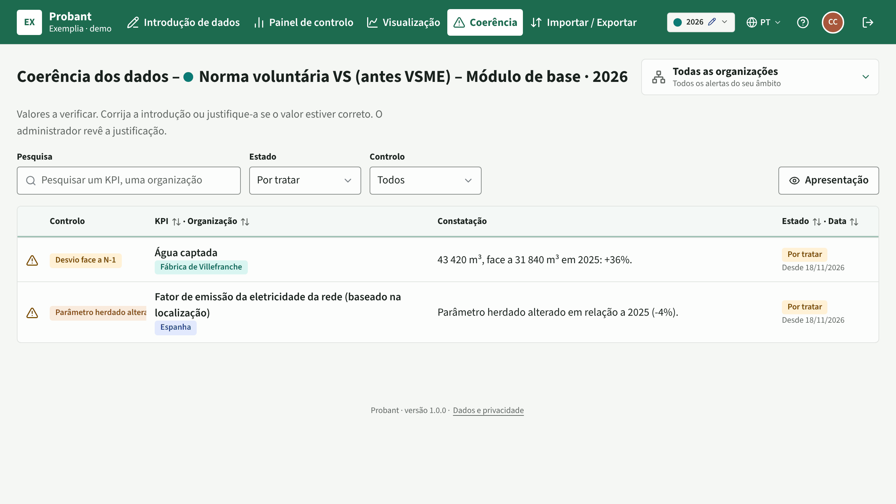
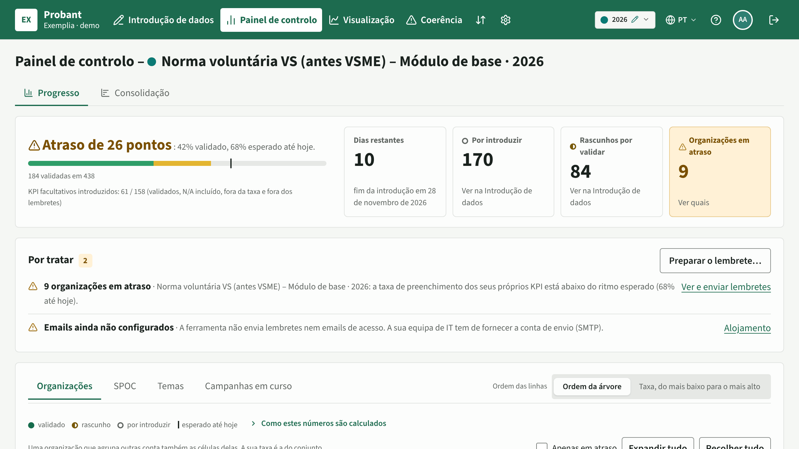
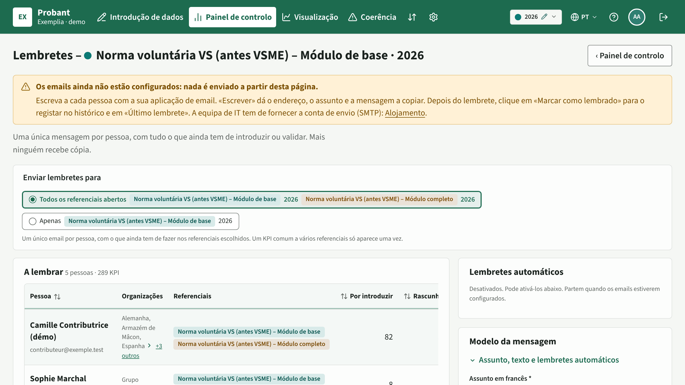

# Guia do validador

Acompanhe e valide as introduções dos KPI e das organizações que um administrador lhe atribuiu (Atribuições de KPI, opção Validadores) e das organizações que estão abaixo delas. Sem atribuição, um administrador valida no seu lugar. Neste âmbito, também pode enviar lembretes. Versão em inglês: [`docs/guides/validator.md`](../../guides/validator.md).

## Ver o meu âmbito e o que falta {#scope}

1. Clique em **Introdução de dados** na barra superior. A página abre em **Tudo o que me foi atribuído**.
2. Clique no nome da organização no canto superior direito da página (**Tudo o que me foi atribuído**) e escolha na lista uma organização do seu âmbito.
3. Clique em **Por introduzir**, **Rascunho** ou **Validado** acima da tabela para filtrar as linhas.
4. Escolha uma organização, abra **Apresentação** e assinale **Mostrar os KPI calculados e consolidados** para ver os totais. São só de leitura.

## Verificar e validar introduções {#review}

1. Abra a linha de um valor em rascunho. O painel de introdução abre-se.
2. Leia o valor, o comentário, o desvio face a N-1 e os comprovativos.
3. Se a introdução estiver completa, clique em **Validar**.
4. Se não estiver, peça ao colaborador que a complete.

Validar confirma que a introdução está completa. Não audita o valor. A validação exige um valor ou N/A, um comentário (para N/A ou para um desvio grande) e um comprovativo se o KPI o exigir.

Se o painel disser que uma organização «abre a» uma data posterior ao período, ainda não se pode introduzir nem validar nada para este período. Peça a um administrador que altere a data de abertura. Mais nada muda para si.

## Voltar a pôr uma introdução em rascunho {#reopen}

1. Abra o painel de introdução do valor validado.
2. Clique em **Voltar a rascunho**. O valor não muda.
3. O colaborador pode então alterá-lo e validá-lo de novo.

**Apagar o valor** esvazia a célula em vez disso. O histórico regista ambas as ações. Depois da data de fim da introdução de dados, os colaboradores já não podem alterar um valor, mas o validador ainda pode voltar a pô-lo em rascunho.

## Tratar os alertas de coerência {#alerts}

1. Clique em **Coerência** na barra superior. A página lista os alertas do seu âmbito.
2. Clique num alerta para abrir a sua ficha.
3. Leia a constatação e a explicação do colaborador.

Um alerta não bloqueia uma validação, mas uma regra **Bloqueante** bloqueia: o colaborador não pode validar enquanto a regra não for cumprida. O administrador decide sobre a explicação.

## Aprovar ou rejeitar um valor forçado {#forced}

Uma pessoa pode pedir que um resultado calculado seja substituído por outro valor, com uma justificação.

1. Clique em **Ver os valores forçados** na página **Introdução de dados**, ou abra o KPI calculado.
2. Leia a justificação.
3. Clique em **Aprovar e forçar o valor** para aceitar o pedido.
4. Para o recusar, introduza o motivo e clique em **Rejeitar**.

## Acompanhar o progresso {#dashboard}

1. Clique em **Painel de controlo** na barra superior.
2. Leia o veredicto no topo e depois a tabela por organização. Mostra as organizações em atraso.
3. Clique em **Consolidação** para ver os totais do seu âmbito.

## Enviar lembretes {#reminders}

1. No **Painel de controlo**, clique em **Enviar lembrete…** (ou em **Preparar o lembrete…** se a instalação não enviar emails). A página **Lembretes** abre-se.
2. Escolha os referenciais. A ferramenta seleciona as pessoas que ainda têm algo para introduzir ou validar.
3. Leia a pré-visualização da mensagem. Se quiser, envie um teste a si próprio.
4. Clique em **Enviar o lembrete**. A confirmação indica as pessoas.

Se a instalação não puder enviar emails, a página mostra uma caixa cor de laranja. Clique em **Escrever** para obter o endereço, o assunto e a mensagem. Envie-os com a sua aplicação de email. Depois clique em **Marcar como lembrado**.

## Um KPI bloqueado por uma campanha encerrada {#shared-closed}

Um KPI que pertence a dois referenciais com o mesmo período tem um único valor partilhado. Se uma campanha estiver encerrada, o valor não pode mudar na outra. O painel indica qual campanha está encerrada. Peça a um administrador que a reabra.

## Importar valores de um ficheiro {#import}

Clique em **Importar / Exportar**. O menu abre em **Importar valores** para um colaborador. Para um validador, abre em **As minhas exportações**, e **Importar valores** fica a um clique. A ferramenta mostra uma pré-visualização antes de guardar o que quer que seja.

Números para KPI calculados de um período não encerrado: a pré-visualização pede-lhe para escolher entre forçar estes valores ou ignorar estas linhas. Só pode forçar as organizações que valida, enquanto a introdução está aberta. Para as outras, a linha é rejeitada.

## Obter uma exportação grande {#large-exports}

Acima de um limite de tamanho, a ferramenta prepara no servidor uma exportação ou um ficheiro a preencher. Abra **Importar / Exportar** e escolha **As minhas exportações**. O ficheiro está em «Ficheiros grandes». A ferramenta guarda-o durante 7 dias.

## Ver a visita guiada novamente {#tour}

No seu primeiro início de sessão, uma visita breve mostra onde agir. Não bloqueia o ecrã. O navegador recorda que a viu.

1. Clique em **Ajuda** na barra superior.
2. Clique em **Mostrar a visita novamente**.
3. Clique em **Seguinte** para continuar e em **Concluir** no fim. Para parar, clique em **Fechar a visita**, prima Esc ou clique em **Não mostrar novamente**.

## Alterar a língua {#language}

1. Clique na língua na barra superior, ou clique no seu nome e depois em **A minha conta**.
2. Em **Língua**, escolha uma das sete línguas e guarde.

**Os meus últimos inícios de sessão**, em **A minha conta**, lista os seus últimos inícios de sessão neste espaço. Se não reconhecer um, altere a sua palavra-passe e avise um administrador.

## Ligar um assistente de IA {#assistant}

Se um administrador ativou os assistentes, crie um token em **A minha conta**, em **Assistentes de IA (MCP)**: introduza o **Nome do token**, escolha **Expira após**, clique em **Criar um token** e copie o token de imediato. O assistente tem os seus direitos, nunca mais. Clique em **Revogar** para o parar.
